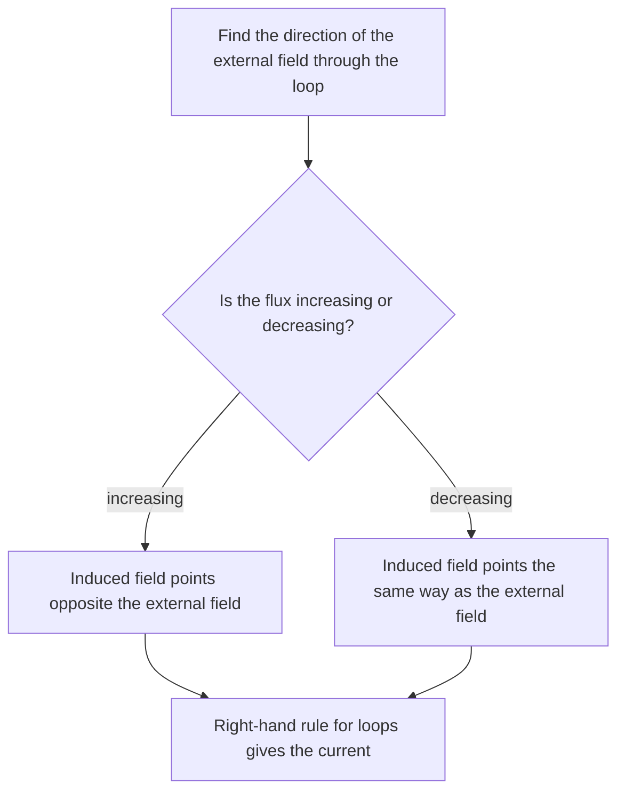

## Magnetism makes electricity

If currents make magnetic fields, can magnetic fields make currents? Michael Faraday showed in 1831 that they can, but only when something *changes*. A magnet sitting inside a coil does nothing; a magnet moving in or out drives a current. This discovery, electromagnetic induction, is how nearly all the world's electricity is generated, and it's behind transformers, induction stoves, wireless chargers and electric guitar pickups.

## Magnetic flux

Induction depends on **magnetic flux**, the amount of magnetic field passing through a loop. For a flat loop of area $A$ in a uniform field,

$$\Phi_B = BA\cos\theta,$$

where $\theta$ is the angle between $\vec B$ and the loop's normal. The unit is the **weber** (Wb), $1\text{ Wb} = 1\text{ T·m}^2$. Flux is largest when the field passes straight through the loop and zero when the field lies in the loop's plane.

## Faraday's law

**Faraday's law** says a changing magnetic flux through a circuit induces an emf:

$$\mathcal{E} = -N\frac{\Delta\Phi_B}{\Delta t}$$

for a coil of $N$ turns. The flux can change in three ways, and all of them work:

- the field strength changes (a magnet moves closer, an electromagnet switches on);
- the area changes (a loop expands, a sliding rod sweeps out area);
- the orientation changes (a coil rotates in a field: a generator).

The size of the emf depends on how *fast* the flux changes. The minus sign is Lenz's law.

## Lenz's law

**Lenz's law**: the induced current flows in the direction that *opposes the change* in flux that produced it. If the flux through a loop is increasing, the induced current makes its own field pointing the opposite way; if decreasing, the induced field points the same way, trying to prop the flux up.

To find the direction: (1) find the direction of the original field through the loop; (2) decide whether the flux is increasing or decreasing; (3) the induced field opposes the change; (4) use the right-hand rule for loops to find the current that makes that induced field.



Lenz's law is energy conservation in disguise. If induced currents *aided* the change, pushing a magnet slightly toward a coil would make it pull itself in faster and faster, creating energy from nothing. Instead, you always have to do work against the induced effects, and that work becomes the electrical energy.

### Example 1

A 200-turn coil of area 0.010 m² sits with its plane perpendicular to a magnetic field. The field increases steadily from 0.10 T to 0.50 T in 0.20 s. Find the induced emf and, if the coil's resistance is 4.0 Ω, the current.

$\Delta\Phi_B = (0.50 - 0.10)(0.010) = 4.0\times10^{-3}$ Wb per turn.

$|\mathcal{E}| = N\dfrac{\Delta\Phi_B}{\Delta t} = 200\dfrac{4.0\times10^{-3}}{0.20} = 4.0$ V. Current: $4.0/4.0 = 1.0$ A, circulating so that its field opposes the increasing external field.

## Motional emf

A conducting rod of length $L$ sliding at speed $v$ along two rails in a perpendicular field $B$ sweeps out area at the rate $Lv$, so the flux through the circuit changes at rate $BLv$:

$$\mathcal{E} = BLv.$$


In the picture the field points into the page and the enclosed area grows, so the flux into the page increases. The induced current therefore circulates counterclockwise, making a field out of the page inside the loop: up through the rod.

Microscopically, the charges in the moving rod feel a magnetic force $qvB$ along it, which pushes them to one end. With a resistor $R$ closing the circuit, current $I = BLv/R$ flows, and the field then exerts a force $ILB$ on the rod that opposes its motion (Lenz again). Keeping the rod moving at constant speed requires a pushing force, and the power you supply, $Fv = \dfrac{B^2L^2v^2}{R}$, exactly equals the electrical power $I^2R$ dissipated.

### Example 2

A 0.50 m rod slides at 4.0 m/s along rails in a 0.80 T field; the rails are connected by a 2.0 Ω resistor. Find the emf, the current, and the force needed to keep it moving.

$\mathcal{E} = 0.80(0.50)(4.0) = 1.6$ V. $I = 1.6/2.0 = 0.80$ A. $F = ILB = 0.80(0.50)(0.80) = 0.32$ N. Power check: $Fv = 1.28$ W $= I^2R = 0.64(2.0)$ ✓.

## Generators

A coil of $N$ turns and area $A$ rotating at angular speed $\omega$ in a uniform field has flux $\Phi_B = BA\cos(\omega t)$, which changes continuously. The induced emf is

$$\mathcal{E} = NBA\omega\sin(\omega t),$$

an alternating voltage with peak value $NBA\omega$. This is an AC **generator**. Turbines spun by steam, water or wind turn the coils in every power plant. (A motor is the same device run backward: current in, rotation out.)

*Where the peak value comes from.* Think of a rectangular coil of length $\ell$ and width $w$ spinning about an axis through its center, parallel to its long sides and perpendicular to the field. Each long side moves in a circle of radius $w/2$ at speed $v = \omega w/2$. When the coil's plane lies along the field, the long sides cut straight across the field lines, and each acts as a moving rod with motional emf $B\ell v$ (the formula $\mathcal{E} = BLv$ from the previous section). The two sides add, giving $2B\ell(\omega w/2) = B(\ell w)\omega = BA\omega$ per turn, or $NBA\omega$ for $N$ turns. A quarter turn later the sides move parallel to the field, cut no field lines, and the emf is zero. In between, only the part of the velocity across the field counts, which is where the $\sin(\omega t)$ comes from.

## Eddy currents and transformers

Changing flux through a solid piece of metal induces swirling **eddy currents** inside it. They heat the metal (induction stoves heat the pan directly) and, by Lenz's law, they resist motion, which is how magnetic brakes on trains and roller coasters work. Transformer and motor cores are made of thin insulated layers to block eddy currents and their energy loss.

A **transformer** has two coils wound on a shared iron core. An alternating current in the primary coil ($N_p$ turns) creates a changing flux that passes through the secondary ($N_s$ turns), inducing a voltage


The core carries the changing flux from one coil to the other, so every turn of either coil links the same flux. Each turn therefore has the same emf, and the voltage of each coil is proportional to its number of turns:

$$\frac{V_s}{V_p} = \frac{N_s}{N_p}.$$

An ideal transformer conserves power, $V_pI_p = V_sI_s$, so stepping voltage up steps current down. That's why grids transmit power at hundreds of kilovolts and step it down near homes. Transformers need AC; a steady DC current makes no changing flux.

## Reading a flux graph

Faraday's law says the emf depends on the *rate* at which flux changes: $\Delta\Phi_B/\Delta t$ is the slope of a graph of flux against time. So:

- where the flux graph is steep, the emf is large;
- where the flux graph is flat (even if the flux is large), the emf is zero;
- where the slope changes sign, the emf (and induced current) reverses direction.

A rotating coil shows all three. Its flux follows a cosine curve. The flux is largest when the coil faces the field, but there the graph is momentarily flat, so the emf is zero. The flux passes through zero when the coil is edge-on to the field, and there the graph is steepest, so the emf is largest. The emf graph is therefore shifted a quarter cycle from the flux graph: a sine where the flux is a cosine.

```plot
{"x": [0, 8], "y": [-1, 5], "xLabel": "time (s)", "yLabel": "flux per turn (mWb)", "segments": [{"from": [0, 0], "to": [2, 4]}, {"from": [2, 4], "to": [5, 4]}, {"from": [5, 4], "to": [6, 0]}, {"from": [6, 0], "to": [8, 0]}], "points": [{"at": [2, 4]}, {"at": [5, 4]}, {"at": [6, 0]}], "caption": "Flux through a coil: rising for 2 s, steady for 3 s, then falling to zero in 1 s"}
```

### Example 3

The graph shows the flux through each turn of a 50-turn coil. Find the size of the emf during each stage and compare the directions.

*0 to 2 s:* slope $= \dfrac{4.0\times10^{-3}\text{ Wb}}{2.0\text{ s}} = 2.0\times10^{-3}$ Wb/s, so $|\mathcal{E}| = 50(2.0\times10^{-3}) = 0.10$ V.

*2 to 5 s:* the flux is large but constant, so the slope is zero and $\mathcal{E} = 0$.

*5 to 6 s:* slope $= \dfrac{-4.0\times10^{-3}\text{ Wb}}{1.0\text{ s}}$, so $|\mathcal{E}| = 50(4.0\times10^{-3}) = 0.20$ V, twice as large because the same change happens in half the time. The flux is now decreasing instead of increasing, so by Lenz's law the induced current flows the opposite way to the first stage.

*After 6 s:* no flux, no change, no emf.

## Common mistakes

- Thinking a strong but steady field induces an emf (only changes count).
- Getting Lenz's law backwards: the induced field opposes the *change*, not the field itself.
- Forgetting the factor $N$ for a coil, or the $\cos\theta$ in the flux.
- Expecting transformers to work on DC.

## Key points

- $\Phi_B = BA\cos\theta$ (webers).
- Faraday: $\mathcal{E} = -N\,\Delta\Phi_B/\Delta t$; the emf is $N$ times the slope of the flux–time graph.
- Lenz: induced current opposes the change in flux (energy conservation).
- Motional emf $\mathcal{E} = BLv$; generator peak emf $NBA\omega$.
- Transformer: $V_s/V_p = N_s/N_p$, with $V_pI_p = V_sI_s$.
