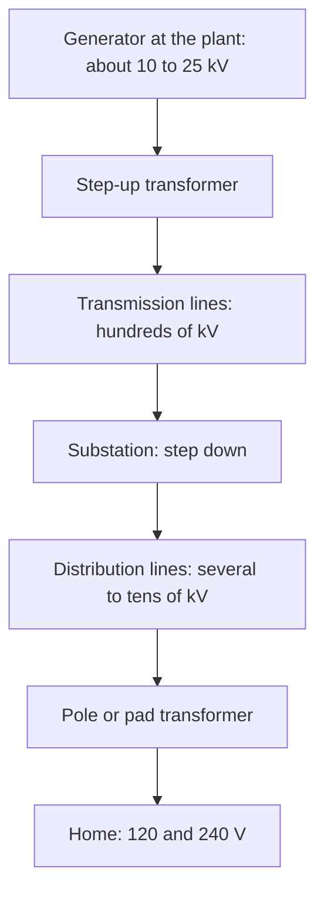

## Why AC needs more than Ohm's law

The inductance lesson found the impedance of a series RLC circuit, $Z = \sqrt{R^2 + (X_L - X_C)^2}$, and the rms current $V_{\text{rms}}/Z$. But it left two puzzles. Why do the resistance and the reactances combine like the sides of a right triangle instead of simply adding? And how much power does the circuit actually use? Both answers come from one idea: in an AC circuit, the current and the voltage don't always rise and fall together. This lesson builds that idea, then uses it to explain how the electric grid moves power across a continent, and why it runs on alternating current at high voltage.

## Phase: when current and voltage get out of step

Drive a sinusoidal current $I = I_0\sin(\omega t)$ through each kind of element on its own and compare the voltage across it.

- *Resistor.* $V = IR$ at every instant, so the voltage peaks when the current peaks. They are in phase.
- *Inductor.* The voltage across an inductor is $L\,\Delta I/\Delta t$, proportional to how fast the current is *changing*. A sine wave changes fastest as it crosses zero and not at all at its peaks. So the inductor's voltage is largest when the current is zero and zero when the current is largest: the voltage peaks a quarter cycle ($90^\circ$) *before* the current. The current lags the voltage by $90^\circ$.
- *Capacitor.* Now turn it around: the capacitor's charge follows its voltage, $Q = CV$, and the current is how fast the charge changes. The current is largest as the voltage crosses zero, a quarter cycle *before* the voltage peaks. The current leads the voltage by $90^\circ$.

```plot
{"x": [0, 14.5], "y": [-1.8, 1.3], "xLabel": "ωt (rad)", "yLabel": "value / peak", "functions": [{"f": "sin(x)", "dashed": true, "to": 12.57}, {"f": "sin(x - pi/2)", "to": 12.57}], "labels": [{"at": [2.8, -1.55], "text": "voltage: dashed"}, {"at": [9.6, -1.55], "text": "current: solid, a quarter cycle later"}], "caption": "Inductor: the current (solid) lags the voltage (dashed) by a quarter cycle"}
```

A memory aid used by many students: "ELI the ICE man". In an inductor (L), the emf E comes before the current I; in a capacitor (C), I comes before E.

## Phasors: adding voltages that are out of step

In a series circuit the same current flows through every element, but the three voltages peak at different times, so you can't simply add their peak (or rms) values. The standard tool is the **phasor**: an arrow whose length is a voltage's peak (or rms) value and whose direction is its phase. Picture all the arrows rotating together at angular speed $\omega$; the actual value of each voltage at any instant is its arrow's vertical projection, a sine wave. Because the arrows keep fixed angles to each other, you can add them once, as vectors, and the sum stays valid at every instant.

Draw the current's phasor along the $x$ axis. Then:

- $V_R = IR$ points along the current;
- $V_L = IX_L$ points $90^\circ$ ahead (up);
- $V_C = IX_C$ points $90^\circ$ behind (down).


$V_L$ and $V_C$ point in opposite directions, so they partly cancel, leaving $V_L - V_C$ at right angles to $V_R$. By Pythagoras, the source voltage is

$$V = \sqrt{V_R^2 + (V_L - V_C)^2} = I\sqrt{R^2 + (X_L - X_C)^2} = IZ.$$

That is where the impedance formula comes from. The angle between the source voltage and the current is the **phase angle** $\varphi$:

$$\tan\varphi = \frac{X_L - X_C}{R}.$$

If $X_L > X_C$ the circuit is inductive ($\varphi > 0$, current lags); if $X_C > X_L$ it is capacitive ($\varphi < 0$, current leads); at resonance $\varphi = 0$.

## Power: only the resistor uses energy

An ideal inductor or capacitor stores energy for a quarter cycle and hands it back the next quarter cycle, so on average it uses none. All the average power goes into the resistance:

$$P_{\text{avg}} = I_{\text{rms}}^2R = I_{\text{rms}}V_{\text{rms}}\cos\varphi,$$

since $\cos\varphi = R/Z$ (from the phasor triangle) and $I_{\text{rms}}Z = V_{\text{rms}}$. The factor $\cos\varphi$ is the **power factor**. It runs from 1 (pure resistance, or resonance) down to 0 (pure inductance or capacitance, where the current flows but delivers no average power).

### Example 1

Use the series circuit from the inductance lesson: $R = 30\ \Omega$, $X_L = 37.7\ \Omega$, $X_C = 53.1\ \Omega$, $Z = 33.7\ \Omega$, driven at 120 V rms, so $I_{\text{rms}} = 3.56$ A. Find the voltage across each element, the phase angle, the power factor and the average power.

Voltages (rms): $V_R = (3.56)(30) = 107$ V, $V_L = (3.56)(37.7) = 134$ V, $V_C = (3.56)(53.1) = 189$ V.

Two of these are *larger than the 120 V source*. That's not an error: $V_L$ and $V_C$ are half a cycle out of step and largely cancel. Check with phasors: $\sqrt{107^2 + (134 - 189)^2} = \sqrt{11\,449 + 3025} = 120$ V ✓.

Phase angle: $\tan\varphi = \dfrac{37.7 - 53.1}{30} = -0.513$, so $\varphi = -27^\circ$. Negative: the circuit is capacitive and the current leads the voltage.

Power factor: $\cos\varphi = R/Z = 30/33.7 = 0.89$.

Power: $P = I_{\text{rms}}V_{\text{rms}}\cos\varphi = (3.56)(120)(0.89) = 380$ W. Check: $I_{\text{rms}}^2R = (3.56)^2(30) = 380$ W ✓. The product $I_{\text{rms}}V_{\text{rms}} = 427$ "volt-amperes" overstates the real power by 12%.

## Moving power across a continent

A power line has resistance, so it wastes power $I^2R_{\text{line}}$ as heat: the **line loss**. To deliver power $P$ at voltage $V$ (power factor 1), the line must carry current $I = P/V$, so

$$P_{\text{loss}} = \left(\frac PV\right)^2R_{\text{line}}.$$

Doubling the transmission voltage halves the current and cuts the loss to a quarter. That's the whole reason for high-voltage lines, and the reason the grid uses AC: transformers, which only work with changing currents, step the voltage up efficiently at the power plant and back down near users.



### Example 2

A plant sends 10 MW through lines with a total resistance of 5.0 Ω. Compare the losses at 20 kV and at 200 kV.

At 20 kV: $I = \dfrac{10\times10^6}{20\times10^3} = 500$ A, so $P_{\text{loss}} = (500)^2(5.0) = 1.25\times10^6$ W, an eighth (12.5%) of the power.

At 200 kV: $I = 50$ A, so $P_{\text{loss}} = (50)^2(5.0) = 1.25\times10^4$ W, just 0.125%.

Ten times the voltage, one hundredth of the loss. (Don't compute the loss as $V^2/R_{\text{line}}$ with the transmission voltage: that $V$ is across the customer's load, not across the wire. The voltage drop along the wire is only $IR_{\text{line}}$, 250 V in the second case.)

### Example 3: why utilities care about power factor

A factory motor draws 6.0 kW of real power from a 240 V (rms) supply at a power factor of 0.75. The supply wiring has 0.20 Ω of resistance. Compare the wiring loss with what it would be at power factor 1.

At 0.75: $I = \dfrac{P}{V\cos\varphi} = \dfrac{6000}{(240)(0.75)} = 33.3$ A, so the loss is $(33.3)^2(0.20) = 222$ W.

At 1.0: $I = 6000/240 = 25.0$ A, loss $= (25.0)^2(0.20) = 125$ W.

The same useful power needs a third more current at the lower power factor, and the wiring loss grows by $1/0.75^2 = 1.78$ times. Motors are inductive, so industrial plants often add capacitors, whose leading current offsets the motor's lagging current, to bring the power factor close to 1. Many utilities charge large customers for a low power factor.

## A little history, and three-phase power

In the 1880s Thomas Edison's company built DC systems, starting with New York's Pearl Street Station in 1882. DC couldn't be transformed with the technology of the time, so it had to be generated near its customers. George Westinghouse backed AC, licensing Nikola Tesla's polyphase motor patents in 1888, and AC won the bitter "war of the currents" in the 1890s; the Niagara Falls power plant, which began sending AC to Buffalo in 1896, was a landmark. Today, modern electronics can convert AC to DC and back at very high voltages, so **HVDC** (high-voltage direct current) lines are used for some very long links and undersea cables, where they lose less than AC lines would. Most of the grid is still AC.

Power plants actually generate **three-phase power**: three AC voltages on separate wires, each a third of a cycle ($120^\circ$) behind the last. *Simplified:* for a balanced load the three currents add to zero at every instant, so no heavy return wire is needed, and the total power delivered stays constant instead of pulsing, which makes large motors run smoothly. Houses usually get a single phase.

## Common mistakes

- Adding $V_R$, $V_L$ and $V_C$ as plain numbers (they add as phasors).
- Using $P = I_{\text{rms}}V_{\text{rms}}$ without the power factor when the load has reactance.
- Thinking inductors and capacitors use average power (ideal ones store and return it).
- Computing line loss as $V^2/R$ with the transmission voltage instead of $I^2R$ with the line current.
- Getting the phase backwards: current lags in an inductor and leads in a capacitor.

## Key points

- Current is in phase with voltage in a resistor, lags by $90^\circ$ in an inductor, leads by $90^\circ$ in a capacitor.
- Phasors: $V = \sqrt{V_R^2 + (V_L - V_C)^2} = IZ$, $\tan\varphi = (X_L - X_C)/R$.
- $P_{\text{avg}} = I_{\text{rms}}V_{\text{rms}}\cos\varphi = I_{\text{rms}}^2R$; power factor $\cos\varphi = R/Z$.
- Line loss $(P/V)^2R_{\text{line}}$: high voltage, made possible by transformers, keeps losses small.
