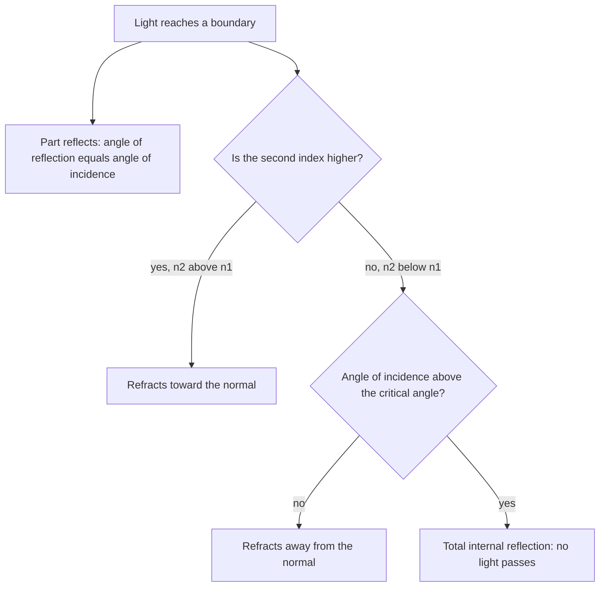

## Light is an electromagnetic wave

The last module showed that a changing magnetic field creates an electric field (Faraday). James Clerk Maxwell added the reverse: a changing electric field creates a magnetic field. Put together, the two can sustain each other and travel through empty space as a wave. Maxwell calculated the speed of that wave from $\varepsilon_0$ and $\mu_0$ and got the measured speed of light. Light, he concluded, is an electromagnetic wave. This lesson describes those waves and then treats light as rays to understand reflection and refraction.

## Properties of electromagnetic waves

An **electromagnetic wave** consists of oscillating electric and magnetic fields, perpendicular to each other and to the direction of travel (a transverse wave). It needs no medium. In vacuum all EM waves travel at

$$c = \frac{1}{\sqrt{\mu_0\varepsilon_0}} = 3.00\times10^8\text{ m/s},$$

and as with any wave $c = f\lambda$. The field magnitudes are linked by $E = cB$.

The picture shows one moment of such a wave. The electric field oscillates in one plane and the magnetic field in the plane at right angles to it, in step with each other, and both are perpendicular to the direction the wave travels.


EM waves carry energy. Their *intensity* (average power per area) is $I = \tfrac12c\varepsilon_0E_0^2$, where $E_0$ is the peak field. Sunlight at Earth's distance delivers about 1360 W/m². They also carry momentum, exerting a small radiation pressure, $I/c$ for absorbed light, which solar sails use.

*The electromagnetic spectrum.* All EM waves are the same phenomenon, differing only in frequency and wavelength:

| Region | Typical wavelength | Uses / sources |
|---|---|---|
| Radio | > 1 m | broadcasting, MRI |
| Microwave | 1 mm – 1 m | ovens, radar, Wi-Fi |
| Infrared | 700 nm – 1 mm | heat lamps, remote controls |
| Visible | 400 – 700 nm | sight (violet 400, red 700) |
| Ultraviolet | 10 – 400 nm | sunburn, sterilization |
| X-rays | 0.01 – 10 nm | medical imaging |
| Gamma rays | < 0.01 nm | nuclear decay |

## Polarization

In ordinary light from the Sun or a bulb, the electric field points in random directions perpendicular to the beam. A **polarizer** passes only the component of $\vec E$ along its transmission axis. Unpolarized light passing through one polarizer loses half its intensity and emerges **polarized** along the axis. Polarized light of intensity $I_0$ hitting a second polarizer at angle $\theta$ to its polarization emerges with

$$I = I_0\cos^2\theta,$$

**Malus's law**. Crossed polarizers ($\theta = 90^\circ$) block everything. Light reflected from water or roads is partly polarized horizontally, which is why polarized sunglasses (with vertical axes) cut glare.

## Rays and reflection

When the wavelength is tiny compared with the objects light meets, we can treat light as **rays**: straight lines along which energy travels. That's the domain of geometric optics.

At a smooth surface, light obeys the **law of reflection**: the angle of reflection equals the angle of incidence, $\theta_r = \theta_i$, both measured from the *normal* (the line perpendicular to the surface). Rough surfaces reflect diffusely, scattering light in many directions, which is how we see most objects.

## Refraction and Snell's law

Light travels slower in materials than in vacuum. The **index of refraction** of a material is

$$n = \frac cv,$$

always at least 1: air 1.000 (1.0003), water 1.33, glass about 1.5, diamond 2.42. When light crosses a boundary at an angle, the change of speed bends it. This is **refraction**, governed by **Snell's law**:

$$n_1\sin\theta_1 = n_2\sin\theta_2,$$

with both angles measured from the normal. Going into a slower medium (larger $n$), light bends *toward* the normal; into a faster one, *away* from it. The frequency stays the same across the boundary, so the wavelength shrinks in the denser medium: $\lambda_n = \lambda/n$.

*Why it bends:* think of a marching band crossing from pavement onto mud at an angle. The side that hits the mud first slows first, swinging the whole line around, toward the perpendicular.

```shape
{"segments": [{"from": [-3, 0], "to": [3, 0]}, {"from": [0, -2.6], "to": [0, 2.6], "dashed": true}, {"from": [-1.5, 2.6], "to": [0, 0], "arrow": true, "label": "incident"}, {"from": [0, 0], "to": [1.06, -2.6], "arrow": true, "label": "refracted"}, {"from": [0, 0], "to": [1.5, 2.6], "dashed": true, "label": "reflected"}], "labels": [{"at": [-2.6, 0.3], "text": "air, n = 1.00"}, {"at": [-2.6, -0.4], "text": "water, n = 1.33"}, {"at": [0.15, 2.4], "text": "normal"}], "caption": "Light entering water bends toward the normal: 30° in air becomes 22° in water"}
```

### Example 1

Light in air strikes water at $30^\circ$ from the normal. Find the angle of refraction, and the light's speed and wavelength in water if its vacuum wavelength is 600 nm.

$1.00\sin 30^\circ = 1.33\sin\theta_2$, so $\sin\theta_2 = 0.376$ and $\theta_2 = 22.1^\circ$.

$v = c/n = 3.00\times10^8/1.33 = 2.26\times10^8$ m/s. $\lambda_{\text{water}} = 600/1.33 = 451$ nm.

*Dispersion.* The index of refraction depends slightly on wavelength: violet light bends more than red in glass. A prism therefore spreads white light into a spectrum, and raindrops do the same to make rainbows.

## Total internal reflection

When light goes from a higher to a lower index (glass to air, say), it bends away from the normal. At a large enough angle of incidence, the refracted ray would have to bend past $90^\circ$, which is impossible, so all the light reflects back. This **total internal reflection** begins at the **critical angle** $\theta_c$, where $\theta_2 = 90^\circ$:

$$\sin\theta_c = \frac{n_2}{n_1} \qquad (n_1 > n_2).$$

Optical fibers trap light by total internal reflection along kilometers of glass, carrying the internet's data. Diamonds sparkle because their high index gives a small critical angle (24.4°), so light bounces around inside many times before escaping.

### Example 2

Find the critical angle for light going from glass ($n = 1.52$) into air, and into water ($n = 1.33$).

Into air: $\sin\theta_c = 1/1.52 = 0.658$, so $\theta_c = 41.1^\circ$.

Into water: $\sin\theta_c = 1.33/1.52 = 0.875$, so $\theta_c = 61.0^\circ$. The smaller the index difference, the larger the critical angle.

This chart pulls together everything that can happen to light at a boundary.



## Why Snell's law has sines in it

The marching-band picture can be made exact. Picture straight wavefronts (crests) of light, one wavelength apart, arriving at the boundary at angle $\theta_1$. Consider a stretch of boundary of length $x$ that exactly one wavelength of the incoming wave spans. Since the wavefronts tilt at $\theta_1$ to the boundary, simple trigonometry gives $\lambda_1 = x\sin\theta_1$. On the other side the same crests must meet the same stretch of boundary (they can't appear or vanish at the surface), but they are now $\lambda_2$ apart and tilted at $\theta_2$, so $\lambda_2 = x\sin\theta_2$. Dividing,

$$\frac{\sin\theta_1}{\sin\theta_2} = \frac{\lambda_1}{\lambda_2} = \frac{v_1}{v_2} = \frac{n_2}{n_1},$$

using $\lambda = v/f$ with the same frequency on both sides and $v = c/n$. Cross-multiplying gives Snell's law. The bending is a direct consequence of the wave slowing down.

### Example 3: three polarizers

Unpolarized light of intensity 400 W/m² passes through three polarizers. The second is at $30^\circ$ to the first, and the third at $90^\circ$ to the first (so $60^\circ$ to the second). What comes out?

After the first: half of unpolarized light, $200$ W/m², polarized along the first axis.

After the second: $200\cos^2 30^\circ = 200(0.75) = 150$ W/m², now polarized along the second axis.

After the third: $150\cos^2 60^\circ = 150(0.25) = 37.5$ W/m².

Without the middle polarizer, the first and third are crossed and block everything. Adding a polarizer *between* them lets light through, because each polarizer re-polarizes the light along its own axis. The angle that matters at each step is the one between neighboring polarizers.

## Common mistakes

- Measuring angles from the surface instead of the normal.
- Thinking the frequency changes on refraction (speed and wavelength change).
- Looking for total internal reflection when going into a denser medium (it only happens going to lower $n$).
- Forgetting the factor $\tfrac12$ for unpolarized light through the first polarizer.

## Key points

- EM waves: transverse, $c = 3.00\times10^8$ m/s $= 1/\sqrt{\mu_0\varepsilon_0}$, $c = f\lambda$, $E = cB$.
- Malus: $I = I_0\cos^2\theta$; unpolarized light halves through a polarizer.
- Reflection: $\theta_r = \theta_i$. Refraction: $n = c/v$, $n_1\sin\theta_1 = n_2\sin\theta_2$.
- Critical angle $\sin\theta_c = n_2/n_1$ for $n_1 > n_2$.
