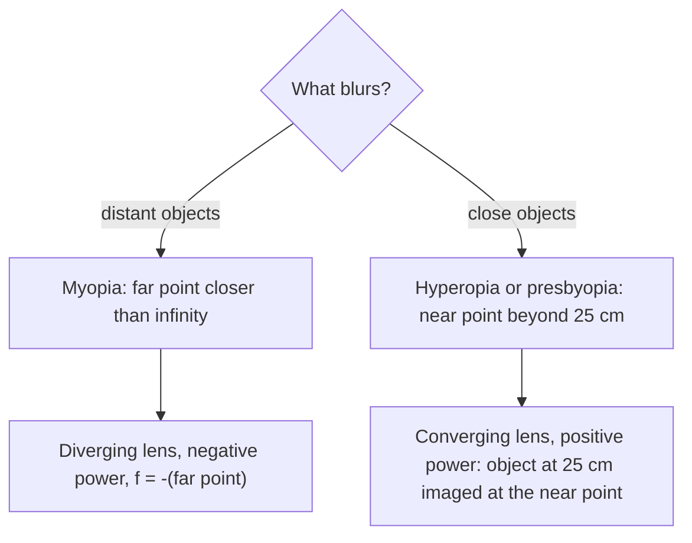

## Putting lenses to work

The previous lesson built one tool, the thin-lens equation $\dfrac1{d_o} + \dfrac1{d_i} = \dfrac1f$ with $m = -d_i/d_o$, and showed that in a two-lens system the image from the first lens is the object for the second. This lesson applies that tool to the most important optical systems: your eye, eyeglasses, the magnifying glass, the microscope and the telescope. One new idea runs through all of them. What makes something look big is not the size of its image but the *angle* it fills in your view.

## The eye

Light enters the eye through the curved, transparent **cornea**, passes through the pupil and an adjustable lens, and forms a real, inverted image on the **retina**, the light-sensitive layer at the back. The cornea does most of the bending; the lens fine-tunes it. The brain flips the image, so you never notice it is upside down.


The iris, the colored ring around the pupil, adjusts the size of the opening to control how much light gets in; the optic nerve carries the retina's signals to the brain.

A camera focuses by moving its lens closer to or farther from the sensor. The eye can't do that: the lens-to-retina distance is fixed at about 2.0 cm. Instead, muscles change the lens's shape, and so its focal length. This is **accommodation**. Relaxed, the eye focuses on distant objects; tensed, it bulges the lens to focus on close ones.

Two distances describe an eye's range:

- The **far point** is the farthest distance at which the eye can focus. For a normal eye it is effectively infinity.
- The **near point** is the closest. It grows with age (about 10 cm in childhood, 25 cm for a young adult, a meter or more by age 60). By convention, a normal near point is 25 cm, and the formulas below use that value.

### Example 1: how much does the eye adjust?

Treat the eye as a single lens 2.0 cm from the retina. Find its power when viewing a very distant object and an object at 25 cm.

Distant object: $1/d_o \approx 0$, so $P = \dfrac1f = \dfrac1{d_i} = \dfrac{1}{0.020\text{ m}} = 50$ D.

Object at 25 cm: $P = \dfrac{1}{0.25} + \dfrac{1}{0.020} = 4.0 + 50 = 54$ D.

So a young eye's accommodation adds about 4 diopters. Notice that powers in diopters need distances in meters.

## Correcting vision

Lens power $P = 1/f$ (in diopters, with $f$ in meters) was introduced in the previous lesson. Eyeglasses work by forming an image that the eye *can* focus on. The simplest approach treats the corrective lens as sitting right at the eye (exact for contact lenses, close enough for glasses).

**Myopia** (nearsightedness): the eye focuses too strongly, so its far point is closer than infinity and distant things blur. A diverging lens fixes it by taking a distant object and making a virtual image at the eye's far point. An object at infinity forms its image at the focal point, so the lens needs $f = -(\text{far point})$.

**Hyperopia** (farsightedness): the eye focuses too weakly, so its near point is farther than 25 cm and close-up reading blurs. A converging lens takes an object at 25 cm and makes a virtual image at the eye's near point, where the eye can focus.

**Presbyopia** is the loss of accommodation with age: the lens stiffens and the near point recedes, even in eyes that see distant things clearly. Reading glasses (converging) or bifocals (two powers in one lens) help.

The choice of lens comes down to one question:



### Example 2: prescriptions

(a) A nearsighted person's far point is 50 cm. What lens power do they need?

The lens must image infinity at 50 cm on the same side, so $d_i = -50$ cm and $f = -50$ cm $= -0.50$ m. $P = 1/(-0.50) = -2.0$ D.

(b) A farsighted person's near point is 100 cm. What lens lets them read at 25 cm?

Object at $d_o = 25$ cm; the image must be virtual at the near point, $d_i = -100$ cm:

$$\frac1f = \frac1{25} - \frac1{100} = \frac{3}{100}, \qquad f = 33.3\text{ cm} = 0.333\text{ m}, \qquad P = +3.0\text{ D}.$$

Glasses actually sit about 2 cm in front of the eye. Measuring distances from the glasses instead (far point $50 - 2 = 48$ cm from the lens) changes (a) to $-2.1$ D, which is why optometrists record that distance.

## Angular size and angular magnification

A coin held at arm's length can hide the Moon. What sets how big something *looks* is the angle it subtends at your eye. For an object of height $h$ at distance $d$, with small angles in radians,

$$\theta \approx \frac{h}{d}.$$

Bringing an object closer makes it look bigger, but only down to the near point; any closer and it blurs. So the best unaided view of a small object is at 25 cm, where $\theta_0 = h/(25\text{ cm})$. An instrument's **angular magnification** compares the angle it delivers with that best unaided angle:

$$M = \frac{\theta}{\theta_0}.$$

## The simple magnifier

A **magnifier** is a single converging lens held close to the eye, with the object just inside its focal length. The lens makes an enlarged, upright, virtual image farther away, which the eye can focus on. In effect, the lens lets you hold the object much closer than your near point.

```shape
{"segments": [{"from": [-7, 0], "to": [5, 0], "dashed": true}, {"from": [0, -2], "to": [0, 3.4]}, {"from": [-2, 0], "to": [-2, 1], "arrow": true}, {"from": [-6, 0], "to": [-6, 3], "arrow": true, "dashed": true}, {"from": [-2, 1], "to": [0, 1]}, {"from": [0, 1], "to": [4.5, -0.5], "arrow": true}, {"from": [-2, 1], "to": [3, -1.5], "arrow": true}, {"from": [0, 1], "to": [-6, 3], "dashed": true}, {"from": [-2, 1], "to": [-6, 3], "dashed": true}], "points": [{"at": [-3, 0], "label": "F"}, {"at": [3, 0], "label": "F"}], "labels": [{"at": [0, 3.8], "text": "lens"}, {"at": [-2, -0.5], "text": "object"}, {"at": [-6, 3.5], "text": "virtual image"}], "caption": "A magnifier: object inside F, rays traced back (dashed) meet at an upright, enlarged virtual image"}
```

Two settings are common:

- *Object at the focal point.* The image is at infinity, so the relaxed eye views it comfortably. The rays from the top of the object leave at angle $\theta = h/f$, so
$$M = \frac{h/f}{h/25\text{ cm}} = \frac{25\text{ cm}}{f}.$$
- *Image at the near point* (25 cm). Then $d_i = -25$ cm, the lens equation gives $d_o = \dfrac{25f}{25 + f}$, and $\theta = h/d_o$, so
$$M = 1 + \frac{25\text{ cm}}{f}.$$

The near-point setting gives one more unit of magnification at the cost of a tense eye. Either way, a shorter focal length means more magnification. Lens flaws limit simple magnifiers to about 10×.

### Example 3: a hand lens

A magnifier has $f = 5.0$ cm. Find its angular magnification with the image at infinity and at the near point, and where to hold the object in the second case.

At infinity: $M = 25/5.0 = 5.0$. At the near point: $M = 1 + 25/5.0 = 6.0$, with the object at $d_o = \dfrac{25(5.0)}{25 + 5.0} = 4.2$ cm, just inside the 5.0 cm focal length.

## The compound microscope

A **compound microscope** uses two converging lenses. The **objective**, with a very short focal length, sits close to the specimen, which is placed just outside its focal point. It forms a real, inverted, greatly enlarged image inside the tube. The **eyepiece** then acts as a magnifier for that image. If the intermediate image is at the eyepiece's focal point, the final image is at infinity, and

$$M = m_{\text{obj}}\,M_{\text{eye}} = \left(-\frac{d_i}{d_o}\right)\left(\frac{25\text{ cm}}{f_e}\right).$$

Because the specimen sits just outside $f_o$, $d_i$ is roughly the distance from the objective to the intermediate image, and the objective's magnification is roughly that distance divided by $f_o$.

### Example 4: a microscope

A microscope has an objective with $f_o = 0.50$ cm and an eyepiece with $f_e = 2.5$ cm. The specimen is 0.52 cm from the objective. Find the overall magnification and the distance between the lenses (final image at infinity).

Objective: $\dfrac1{d_i} = \dfrac1{0.50} - \dfrac1{0.52} = 0.0769$, so $d_i = 13.0$ cm and $m_{\text{obj}} = -13.0/0.52 = -25$.

Eyepiece: $M_{\text{eye}} = 25/2.5 = 10$. Overall $M = (-25)(10) = -250$: the specimen looks 250 times larger, inverted.

The intermediate image must sit at the eyepiece's focal point, so the lenses are $13.0 + 2.5 = 15.5$ cm apart.

## Telescopes

A distant object can't be brought closer, so a telescope works on angles alone. In a **refracting telescope**, a long-focal-length objective lens forms a real image of the distant object at its focal point. The eyepiece, placed one eyepiece focal length beyond that image, magnifies it, and rays leave in parallel bundles for a relaxed eye.

```shape
{"segments": [{"from": [-3, 0], "to": [13.5, 0], "dashed": true}, {"from": [0, -3.8], "to": [0, 3.2]}, {"from": [10, -3.8], "to": [10, 3.2]}, {"from": [-3, 0.9], "to": [0, 0]}, {"from": [-3, 2.9], "to": [0, 2]}, {"from": [0, 0], "to": [10, -3]}, {"from": [0, 2], "to": [10, -3.5]}, {"from": [10, -3], "to": [13, 0.6], "arrow": true}, {"from": [10, -3.5], "to": [13, 0.1], "arrow": true}], "points": [{"at": [8, -2.4], "label": "image"}], "labels": [{"at": [0, 3.6], "text": "objective"}, {"at": [10, 3.6], "text": "eyepiece"}, {"at": [4, 0.45], "text": "fₒ"}, {"at": [9, 0.45], "text": "fₑ"}], "caption": "Refracting telescope: the objective forms an image at its focal point, which is also the eyepiece's focal point; the rays leave at a larger angle"}
```

If the intermediate image has height $h'$, it subtends $\theta_0 = h'/f_o$ at the objective (the same angle the distant object subtends) and $\theta = h'/f_e$ at the eyepiece. So

$$M = -\frac{f_o}{f_e},$$

with the minus sign meaning the view is inverted. The tube length is about $f_o + f_e$. A long objective focal length and a short eyepiece focal length give high magnification.

Large telescopes use a concave mirror as the objective: a **reflecting telescope**. Mirrors have no color fringes (a lens bends each color slightly differently), and a mirror can be supported from behind, so it can be made far larger than any lens. Size matters for two reasons other than magnification. A wider objective collects more light (in proportion to its area), so fainter objects become visible. And it blurs less: the next lesson shows that diffraction limits the finest detail any instrument can resolve to an angle proportional to $\lambda/D$.

### Example 5: a refractor

A telescope has an objective with $f_o = 90$ cm and an eyepiece with $f_e = 2.5$ cm. Find its angular magnification and length. The Moon subtends about 0.0091 rad; how large does it appear?

$M = -90/2.5 = -36$; length $90 + 2.5 = 92.5$ cm. The Moon appears to span $36(0.0091) = 0.33$ rad, about 19°, and upside down.

## Common mistakes

- Using centimeters in $P = 1/f$; diopters need meters.
- Giving a nearsighted person a converging lens (they need diverging, negative power) or a farsighted person a diverging one.
- In hyperopia problems, entering the near-point image distance as positive. The image is virtual, on the object's side, so $d_i$ is negative.
- Adding the two magnifications of a microscope instead of multiplying them.
- Thinking a telescope's main job is magnification. Light gathering and resolution depend on the objective's diameter and usually matter more.

## Key points

- The eye focuses by accommodation; normal near point 25 cm, far point infinity.
- Myopia: diverging lens with $f = -(\text{far point})$. Hyperopia: converging lens that images an object at 25 cm at the near point.
- Angular magnification $M = \theta/\theta_0$ with $\theta_0 = h/(25\text{ cm})$.
- Magnifier: $M = 25\text{ cm}/f$ (image at infinity) or $1 + 25\text{ cm}/f$ (image at the near point).
- Microscope: $M = m_{\text{obj}}M_{\text{eye}} = -\dfrac{d_i}{d_o}\cdot\dfrac{25\text{ cm}}{f_e}$. Telescope: $M = -f_o/f_e$, length $\approx f_o + f_e$.
