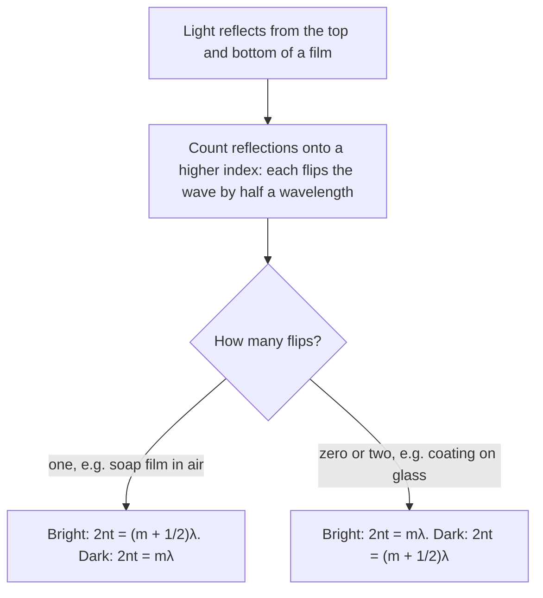

## When rays aren't enough

Geometric optics treats light as rays, which works when openings and objects are much larger than the wavelength. When light passes through openings comparable to its wavelength, or when light waves from two sources overlap, the wave nature shows up as bright and dark fringes. These effects proved that light is a wave (Thomas Young, 1801), and today they measure wavelengths, analyze starlight, color soap bubbles and limit how sharp any telescope or microscope can be.

## Coherence and interference

The superposition principle from the waves lesson applies to light: where two light waves overlap, their fields add. To see a stable pattern, the sources must be **coherent**, keeping a fixed phase relationship (same frequency, steady phase difference). Two separate bulbs aren't coherent; light from one source split into two paths is.

As with sound, two coherent waves interfere constructively where their path difference is a whole number of wavelengths and destructively where it's a half-integer number.

## Young's double-slit experiment


Light of wavelength $\lambda$ falls on two narrow slits a distance $d$ apart. Each slit acts as a source, and on a distant screen the waves arrive with path difference $d\sin\theta$ at angle $\theta$. Bright fringes (maxima) occur where

$$d\sin\theta = m\lambda, \qquad m = 0, \pm1, \pm2, \ldots$$

and dark fringes where $d\sin\theta = (m + \tfrac12)\lambda$. The integer $m$ is the *order* of the fringe.

For a screen at distance $L$ and small angles ($\sin\theta \approx \tan\theta = y/L$), the bright fringes sit at $y_m = \dfrac{m\lambda L}{d}$, equally spaced by

$$\Delta y = \frac{\lambda L}{d}.$$

Smaller slit spacing or longer wavelength spreads the fringes out.

```plot
{"x": [-3, 3], "y": [0, 1.1], "xLabel": "position on screen (fringe spacings)", "yLabel": "relative intensity", "functions": [{"f": "cos(pi*x)^2"}], "caption": "Ideal double-slit pattern: equally spaced bright fringes of equal brightness"}
```

### Example 1

Red laser light ($\lambda = 650$ nm) shines on slits 0.20 mm apart. The screen is 2.0 m away. Find the fringe spacing and the angle of the third-order bright fringe.

$\Delta y = \dfrac{(650\times10^{-9})(2.0)}{0.20\times10^{-3}} = 6.5\times10^{-3}$ m $= 6.5$ mm.

$\sin\theta_3 = \dfrac{3(650\times10^{-9})}{0.20\times10^{-3}} = 9.75\times10^{-3}$, so $\theta_3 = 0.56^\circ$. Small angles, as assumed.

## Diffraction gratings

A **diffraction grating** has thousands of equally spaced slits. The maxima satisfy the same condition, $d\sin\theta = m\lambda$, but with many slits they become extremely sharp and bright, while everything in between is dark. Since the angle depends on wavelength, a grating separates light into its colors much more precisely than a prism. Spectrometers use gratings to identify elements by their spectral lines, and the rainbow shimmer on a CD is grating diffraction from its tracks.

A grating is usually specified by lines per millimeter: 600 lines/mm means $d = 1/600$ mm $= 1.67$ μm.

### Example 2

A grating with 500 lines/mm is lit with 589 nm sodium light. Find the angles of the first- and second-order maxima, and the highest order visible.

$d = 1/(500\text{ mm}^{-1}) = 2.0$ μm.

First order: $\sin\theta_1 = 589\times10^{-9}/2.0\times10^{-6} = 0.2945$, $\theta_1 = 17.1^\circ$.

Second order: $\sin\theta_2 = 0.589$, $\theta_2 = 36.1^\circ$.

Highest order: $\sin\theta \le 1$ requires $m \le d/\lambda = 3.4$, so $m = 3$ is the highest ($\theta_3 = 62.1^\circ$).

## Single-slit diffraction

Even one slit of width $a$ spreads light into a pattern: a bright central band with weaker bands on each side. Pairing up waves from the top and bottom halves of the slit shows that the dark fringes are at

$$a\sin\theta = m\lambda, \qquad m = \pm1, \pm2, \ldots$$

(Note this is the condition for *dark* fringes, unlike the double-slit formula.) The central maximum, twice as wide as the others, spans from $-\theta_1$ to $\theta_1$. Narrower slits make wider patterns: squeezing light through a tiny opening spreads it out.

*Resolution.* Every lens or mirror is an aperture, so even a perfect telescope blurs a point of light into a small diffraction disk. Two point sources can just be resolved when their angular separation is at least

$$\theta_{\min} = 1.22\frac{\lambda}{D}$$

for a circular aperture of diameter $D$ (the **Rayleigh criterion**). That's why big telescopes (previous lesson) see finer detail, and why microscopes using shorter wavelengths (or electrons) resolve smaller things.

## Thin films

Light reflecting from the top and bottom surfaces of a thin film (soap bubble, oil slick, lens coating) interferes. Two facts determine the result:

- The wave reflecting off the bottom travels an extra $2t$ in the film, where the wavelength is $\lambda/n$.
- A reflection off a medium with a *higher* index flips the wave (a half-wavelength phase shift); reflection off a lower index doesn't.

For a soap film in air (one flip, at the top surface), constructive reflection occurs when $2nt = (m + \tfrac12)\lambda$. Since the condition depends on wavelength, different thicknesses reflect different colors: the swirling colors of a bubble map its thickness. Anti-reflection coatings on glasses use a film whose reflections cancel.

Which condition applies depends only on the number of flips, as this chart (and Example 5 below) shows:



### Example 3

A soap film ($n = 1.33$) in air looks green ($\lambda = 532$ nm) in reflection. What is its minimum thickness?

One phase flip, so constructive reflection needs $2nt = \tfrac12\lambda$ for the thinnest film: $t = \dfrac{532}{4(1.33)} = 100$ nm.

### Example 4: single-slit pattern width

Light of 600 nm passes through a slit 0.050 mm wide onto a screen 1.5 m away. How wide is the central bright band? What if the slit is made half as wide?

First dark fringe: $\sin\theta_1 = \dfrac{\lambda}{a} = \dfrac{600\times10^{-9}}{0.050\times10^{-3}} = 0.012$, a small angle, so $y_1 = L\tan\theta_1 \approx L\sin\theta_1 = 1.5(0.012) = 0.018$ m $= 1.8$ cm.

The central band runs from $-y_1$ to $+y_1$: $3.6$ cm wide.

Halving $a$ doubles $\sin\theta_1$ (still small), so the band doubles to $7.2$ cm. Proportional reasoning gets this without recalculating: the width is proportional to $\lambda L/a$.

### Example 5: anti-reflection coating

Camera lenses ($n = 1.52$) are coated with magnesium fluoride ($n = 1.38$). What is the thinnest coating that cancels reflected 550 nm light (the middle of the visible spectrum)?

Now *both* reflections flip phase: at the top surface (air to 1.38) and at the bottom (1.38 to 1.52), each going to a higher index. The flips cancel each other, so only the extra path matters. For destructive interference the extra path must be half a wavelength in the film: $2t = \dfrac12\cdot\dfrac{\lambda}{n}$, i.e. $2nt = \tfrac12\lambda$.

$t = \dfrac{550}{4(1.38)} = 99.6$ nm, about 100 nm. The rule changes with the number of flips, so always count them before choosing the condition.

## How bright are the fringes?

Between the bright and dark fringes the brightness changes smoothly. For two slits, the waves arriving at a point add with a phase difference set by the path difference, and the result is an intensity that rises and falls like $\cos^2$ across the screen, as in the figure above: full brightness where the path difference is $0, \lambda, 2\lambda, \ldots$, zero where it's $\tfrac12\lambda, \tfrac32\lambda, \ldots$. In a real experiment the slits have some width too, so the double-slit fringes are dimmed toward the sides by the broad single-slit pattern of each slit.

With many slits (a grating), the waves from all the slits line up only at the exact angles $d\sin\theta = m\lambda$; slightly off those angles, the slits' contributions fall out of step with one another and cancel. The more slits, the smaller the error that's enough to cancel, so the bright lines get narrower and brighter as the number of slits grows. That sharpness is what lets a spectrometer separate two colors only a fraction of a nanometer apart.

## Common mistakes

- Using the double-slit (bright) formula for single-slit dark fringes, or vice versa.
- Using the small-angle formula $y = m\lambda L/d$ when the angle is large (gratings often have large angles).
- Forgetting to convert lines/mm into slit spacing $d$.
- Ignoring the phase flip on reflection in thin films.

## Key points

- Coherent sources: path difference $m\lambda$ bright, $(m + \tfrac12)\lambda$ dark.
- Double slit / grating: $d\sin\theta = m\lambda$; fringe spacing $\lambda L/d$ for small angles.
- Single slit dark fringes: $a\sin\theta = m\lambda$ ($m \ne 0$).
- Rayleigh limit: $\theta_{\min} = 1.22\lambda/D$.
- Thin film in air (one flip): bright reflection when $2nt = (m + \tfrac12)\lambda$. Coating on glass (two flips): dark reflection when $2nt = (m + \tfrac12)\lambda$.
