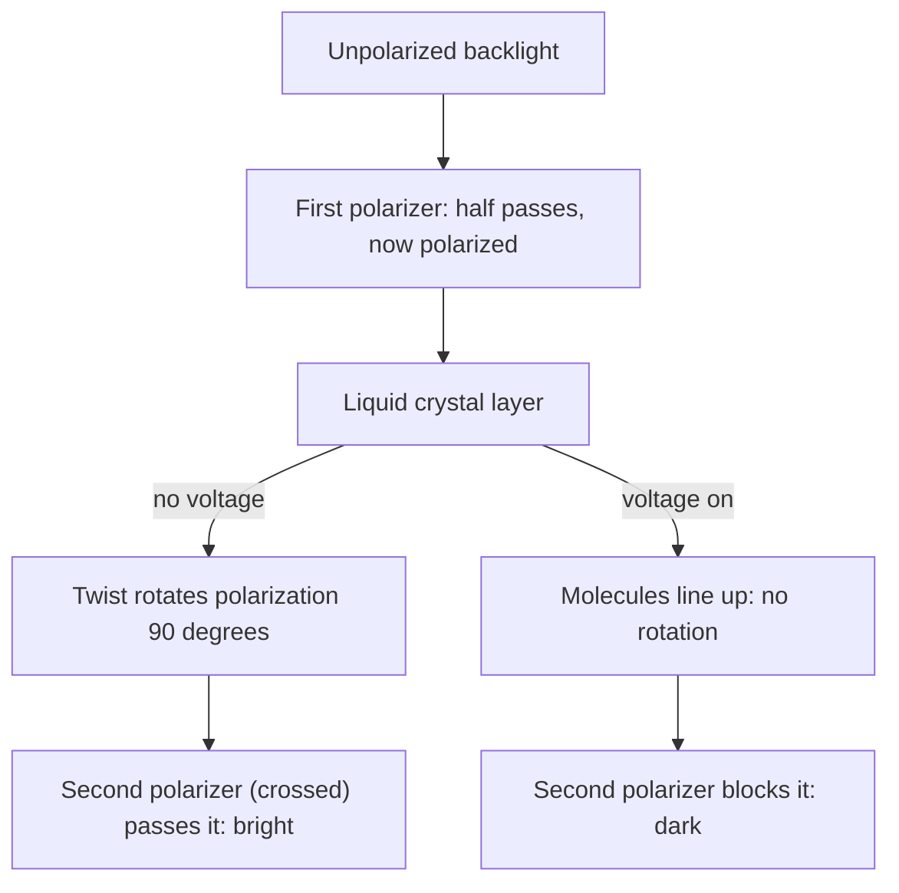

## Beyond the polarizing filter

The light lesson made polarized light with a polarizer and measured it with Malus's law, $I = I_0\cos^2\theta$. It also said in one sentence that light reflected from water or a road is "partly polarized horizontally", which is why polarized sunglasses cut glare. This lesson explains that sentence and its relatives. Nature polarizes light in three more ways besides absorbing filters: by reflection, by scattering, and by splitting it in certain crystals. Each one comes from the same picture, electrons in matter shaken by the light's electric field, and each one is used in technology you own, from camera filters to the screen you may be reading this on.

Two facts about radiating charges carry the whole lesson. When light passes through matter, its electric field makes the electrons oscillate along the field direction, and each oscillating electron re-radiates light polarized along its own line of motion. And an oscillating charge radiates most strongly perpendicular to its motion and *not at all along the line it oscillates on*. (This is the radiation pattern of a small antenna; it is stated here, not derived.)

## Polarization by reflection: Brewster's angle

When light strikes a surface, the plane that contains the incoming ray and the normal is the **plane of incidence**. Any polarization can be split into two parts: the electric field *perpendicular* to the plane of incidence (called s-polarization, from the German *senkrecht*, perpendicular), which for light hitting a horizontal lake is horizontal, and the field *in* the plane of incidence (p-polarization).

The two parts reflect differently. Follow the p part into the glass: the refracted wave shakes electrons along its field, which lies in the plane of incidence and perpendicular to the refracted ray. Those electrons produce the reflected light. If the reflected ray happens to point exactly along their line of oscillation, they can't send any p light that way. That happens when the reflected and refracted rays are at $90^\circ$ to each other. Then the reflected light is purely s-polarized.

The angle of incidence where this happens is **Brewster's angle** $\theta_B$, found by David Brewster in 1815. The reflected ray leaves at $\theta_B$ from the normal and the refracted ray at $\theta_2$, and they are perpendicular, so $\theta_B + 90^\circ + \theta_2 = 180^\circ$, giving $\theta_2 = 90^\circ - \theta_B$. Snell's law then reads

$$n_1\sin\theta_B = n_2\sin(90^\circ - \theta_B) = n_2\cos\theta_B,$$

so

$$\tan\theta_B = \frac{n_2}{n_1}.$$

At other angles the reflected light is only *partly* polarized (more s than p), which is the glare the light lesson mentioned. Near Brewster's angle the glare is almost entirely horizontally polarized, and vertical-axis sunglasses remove nearly all of it.

### Example 1: Brewster's angle for water and glass

Find Brewster's angle for light in air reflecting from water ($n = 1.33$) and from glass ($n = 1.52$), and for light inside the glass reflecting from the glass–air surface.

Water: $\tan\theta_B = 1.33$, $\theta_B = 53.1^\circ$. Check: the refracted angle is $\sin^{-1}(\sin 53.1^\circ/1.33) = 36.9^\circ$, and $53.1^\circ + 36.9^\circ = 90^\circ$, as it should.

Glass from air: $\tan\theta_B = 1.52$, $\theta_B = 56.7^\circ$.

Inside the glass: $\tan\theta_B = 1.00/1.52$, $\theta_B = 33.3^\circ$. This is the complement of $56.7^\circ$ (a ray at Brewster's angle going in meets the far side of a parallel slab at Brewster's angle going out), and it is less than the critical angle, $41.1^\circ$. Brewster's angle always comes before total internal reflection, because $\tan\theta_B = n_2/n_1$ while $\sin\theta_c = n_2/n_1$, and $\tan\theta > \sin\theta$.

### Example 2: how much light, and how polarized?

Unpolarized light of intensity 1000 W/m² hits glass ($n = 1.52$) at Brewster's angle. Fresnel's equations for reflection (not derived here) give a reflectance of 15.7% for the s part at this angle and 0 for the p part. Find the reflected and transmitted intensities.

Unpolarized light is half s and half p: 500 W/m² each.

Reflected: $0.157 \times 500 = 78$ W/m², all s-polarized.

Transmitted: p, all 500 W/m²; s, $500 - 78 = 422$ W/m². The transmitted beam is only slightly polarized. One surface makes a perfectly polarized but weak reflected beam; a stack of a dozen glass plates at Brewster's angle strips most of the s light from the transmitted beam and makes a crude polarizer, a trick used before polarizing filters existed. Gas lasers use the same effect: windows tilted at Brewster's angle let p light through without any reflection loss, so the laser's output comes out p-polarized.

## Polarization by scattering, and the blue sky

Air molecules are far smaller than a wavelength of light. Sunlight shakes their electrons, and they re-radiate in all directions: **Rayleigh scattering**. Two results follow.

*Color.* A small oscillator radiates more strongly the faster it is driven: the scattered intensity grows as $1/\lambda^4$ (stated, not derived). Short wavelengths scatter far more than long ones, so the sky is blue and the setting Sun, seen through a long path of air that has scattered its blue away, is red. (Violet scatters even more than blue, but sunlight contains less violet and our eyes are less sensitive to it, so the sky looks blue rather than violet. Cloud droplets are bigger than the wavelength and scatter all colors about equally, so clouds are white; Rayleigh's $1/\lambda^4$ law applies only to scatterers much smaller than $\lambda$.)

*Polarization.* Look at the sky $90^\circ$ away from the Sun. Sunlight's field is perpendicular to its direction of travel, so it shakes each molecule's electrons in the plane perpendicular to the sunbeam. Of that motion, the part pointing toward you radiates nothing toward you (radiation is zero along the line of oscillation), so only the part perpendicular to both the sunbeam and your line of sight reaches you. The scattered light is strongly polarized. In practice it reaches about 70 to 80% polarized on a clear day, not 100%, because light is scattered more than once and molecules are not perfect dipoles. That is why a photographer's polarizing filter darkens a blue sky most at right angles to the Sun.

### Example 3: how much bluer?

By what factor is violet light (400 nm) scattered more than red light (700 nm)? Blue (450 nm) more than red?

The ratio is $(\lambda_{\text{red}}/\lambda)^4$: $(700/400)^4 = 1.75^4 = 9.4$ for violet and $(700/450)^4 = 5.9$ for blue. Doubling the wavelength cuts the scattering by $2^4 = 16$.

## Birefringence: one crystal, two indices

In glass, light travels at the same speed whatever its polarization. In crystals whose atoms are arranged differently along different directions, such as calcite, quartz and ice, the electrons are easier to shake along some directions than others, so the speed depends on the polarization. Such a material has two indices of refraction and is called **birefringent** (doubly refracting). The two indices are named the ordinary and extraordinary indices, $n_o$ and $n_e$; for calcite at 589 nm, $n_o = 1.658$ and $n_e = 1.486$, a large difference. A ray entering calcite splits into two rays polarized at right angles, so a calcite crystal laid on printed text shows every letter twice. Rotating a polarizer over the crystal makes first one image and then the other vanish.

### Wave plates

Cut a thin slice of a birefringent crystal so that light crosses it with its two polarizations traveling at different speeds. The slice has a "slow axis" (larger index) and a "fast axis" (smaller index) at right angles. Light polarized along either axis passes through unchanged, but the two components of any other polarization come out shifted relative to each other. In thickness $t$, the optical path of the two components differs by $t\,|n_e - n_o|$.

- A **quarter-wave plate** makes that difference $\lambda/4$: $t = \dfrac{\lambda}{4|n_e - n_o|}$. Linearly polarized light entering at $45^\circ$ to the axes has equal components, now a quarter cycle out of step. The tip of the field vector then traces a circle as the wave passes: **circular polarization**.
- A **half-wave plate** makes the difference $\lambda/2$. It flips the component along one axis relative to the other, which reflects the polarization direction across the fast axis: light at angle $\alpha$ to the fast axis leaves at $-\alpha$, rotated by $2\alpha$.

### Example 4: a quartz quarter-wave plate

Quartz has $n_o = 1.544$ and $n_e = 1.553$ at 589 nm. How thick is a quarter-wave plate for that wavelength?

$|n_e - n_o| = 0.009$, so $t = \dfrac{589\text{ nm}}{4(0.009)} = 1.6\times10^4$ nm $= 16$ μm.

That is thinner than a sheet of paper and hard to make, so real plates are often made thicker by a whole number of wavelengths of path difference ("multi-order" plates), which acts the same at the design wavelength. Calcite, with a difference of 0.172, would need under 1 μm. A plate is a quarter-wave plate only at one wavelength; at another, the same thickness gives a different shift.

## Putting it together: liquid crystal displays

A common type of liquid crystal display (the twisted nematic type) places a thin layer of liquid crystal, a birefringent fluid of rod-shaped molecules, between two crossed polarizers. With no voltage, the molecules form a gentle quarter-turn twist across the layer and guide the light's polarization around by $90^\circ$, so the light passes the second polarizer: the pixel is bright. A voltage lines the molecules up with the field, the twist disappears, the polarization is no longer rotated, and the crossed polarizer blocks the light: the pixel is dark. Intermediate voltages give shades of gray, and color filters over the pixels give color.

### Example 5: a gray pixel (simplified model)

Backlight of intensity $I_0$ reaches a pixel. Model a partly switched pixel as turning the polarization by an angle $\phi$ instead of $90^\circ$. (This is a simplification: a real, partly untwisted layer also makes the light somewhat elliptically polarized.) What fraction of $I_0$ gets through when $\phi = 90^\circ$, $45^\circ$ and $0^\circ$?

After the first polarizer: $I_0/2$. The light is now at angle $\phi$ to the first axis, so at $90^\circ - \phi$ to the second, and Malus's law gives $I = \tfrac12I_0\cos^2(90^\circ - \phi) = \tfrac12I_0\sin^2\phi$.

$\phi = 90^\circ$: $0.50I_0$ (bright). $\phi = 45^\circ$: $\tfrac12(0.5)I_0 = 0.25I_0$ (mid-gray). $\phi = 0^\circ$: $0$ (dark). An ideal display can never pass more than half the backlight, which is one reason LCDs need bright backlights.

Other uses of the same ideas: many 3D cinemas send the left-eye and right-eye images with opposite circular polarizations, and the glasses' filters (a wave plate plus a polarizer for each eye) separate them; engineers put clear plastic models of parts between crossed polarizers, where stress makes the plastic birefringent and shows up as colored fringes (photoelasticity).

## Common mistakes

- Using $\sin\theta_B = n_2/n_1$ (that's the critical angle) instead of $\tan\theta_B = n_2/n_1$.
- Thinking reflected light at Brewster's angle is polarized *in* the plane of incidence. It is polarized perpendicular to it (parallel to the surface): the p part is what vanishes.
- Expecting the whole reflected beam to be strong at Brewster's angle. It is fully polarized but weak (under 8% of unpolarized light from glass).
- Applying $1/\lambda^4$ to clouds, fog or dust, whose particles are not small compared with the wavelength.
- Treating a wave plate as a polarizer. It absorbs nothing; it changes the *kind* of polarization by delaying one component.

## Key points

- Oscillating electrons re-radiate along their motion's polarization and do not radiate along their line of oscillation.
- Brewster's angle: $\tan\theta_B = n_2/n_1$; the reflected light is completely s-polarized (perpendicular to the plane of incidence) and the reflected and refracted rays are perpendicular.
- Rayleigh scattering by small particles goes as $1/\lambda^4$ (blue sky, red sunsets); skylight $90^\circ$ from the Sun is strongly polarized.
- Birefringent crystals have two indices; a slice of thickness $t$ delays one polarization by $t|n_e - n_o|$.
- Quarter-wave plate: $t = \lambda/(4|n_e - n_o|)$, turns linear light at $45^\circ$ into circular. Half-wave plate: rotates linear polarization by $2\alpha$.
- An LCD pixel is a switchable polarization rotator between crossed polarizers.
