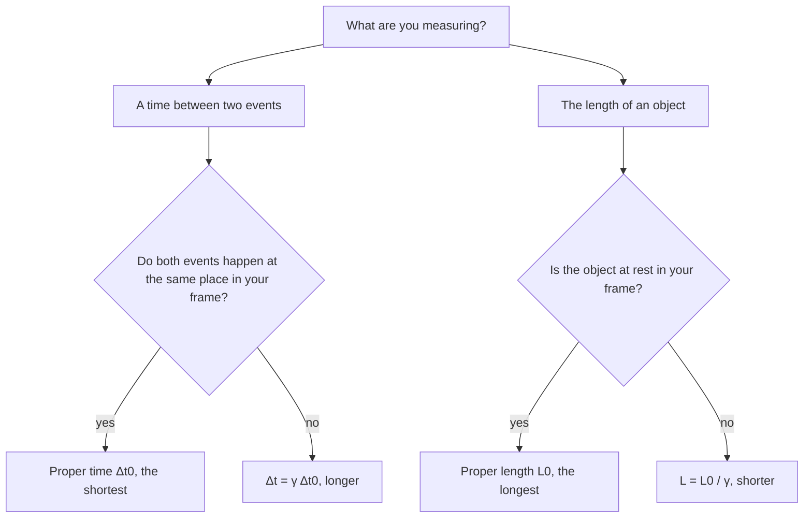

## A crack in classical physics

Maxwell's equations predict that light travels at $c$. But relative to what? By the relative-velocity rule from kinematics, someone chasing a light beam should see it go slower. Experiments (most famously Michelson and Morley's, 1887) found no such effect: everyone measures the same speed of light. In 1905 Albert Einstein took this at face value and followed the consequences. Space and time themselves turn out to depend on the observer's motion. The effects are tiny at everyday speeds, which is why Newton's mechanics works so well, but they're essential for particle accelerators, GPS satellites and nuclear energy.

## Einstein's postulates

Special relativity rests on two *postulates*:

1. *The principle of relativity*: the laws of physics are the same in every inertial reference frame. No experiment can tell whether you are "really" moving at constant velocity.
2. *The constancy of the speed of light*: light in vacuum travels at $c = 3.00\times10^8$ m/s in every inertial frame, regardless of the motion of the source or the observer.

The second postulate is the strange one. It means velocities don't simply add, and that forces us to give up absolute time.

## Relativity of simultaneity

Two events that are simultaneous in one frame are generally not simultaneous in another moving relative to it. Picture a flash of light at the center of a moving train car. Riders see it hit the front and back walls at the same time. An observer on the platform sees the back wall moving toward the light and the front wall moving away; since light has the same speed for her, it hits the back wall first. Both are right. There is no universal "now."

## Time dilation

Consider a "light clock": a pulse bouncing between two mirrors a distance $D$ apart, ticking once per round trip. In its own rest frame a tick takes $\Delta t_0 = 2D/c$. Seen from a frame where the clock moves sideways at speed $v$, the light follows a longer zigzag path, at the same speed $c$, so each tick takes longer. The picture shows both views of one tick.


In the moving view, half a tick is a right triangle: the light travels the hypotenuse $c\,\Delta t/2$ while the clock moves $v\,\Delta t/2$ sideways, and the vertical side is still $D = c\,\Delta t_0/2$. The Pythagorean theorem on that path gives

$$\Delta t = \gamma\,\Delta t_0, \qquad \gamma = \frac{1}{\sqrt{1 - v^2/c^2}}.$$

The factor $\gamma$ (the **Lorentz factor**) is always at least 1. $\Delta t_0$ is the **proper time**, measured by a clock at rest relative to the events (both ticks happen at the clock). Every other observer measures a longer interval: moving clocks run slow. This is **time dilation**.

| $v/c$ | 0.10 | 0.50 | 0.80 | 0.90 | 0.99 | 0.999 |
|---|---|---|---|---|---|---|
| $\gamma$ | 1.005 | 1.155 | 1.667 | 2.294 | 7.09 | 22.4 |

The graph shows the same numbers: $\gamma$ stays very close to 1 for most of the range and then shoots upward as $v$ approaches $c$.

```plot
{"x": [0, 1], "y": [0, 8], "xLabel": "v/c", "yLabel": "γ", "functions": [{"f": "1/sqrt(1 - x^2)", "from": 0, "to": 0.992}], "points": [{"at": [0.6, 1.25], "label": "0.6c: γ = 1.25"}, {"at": [0.9, 2.294], "label": "0.9c: γ = 2.29"}], "caption": "The Lorentz factor γ against speed: almost 1 at everyday speeds, unbounded as v approaches c"}
```

### Example 1

Muons created in the upper atmosphere have a half-life of 1.52 μs in their own rest frame. They travel at $0.995c$. How long is their half-life as measured from the ground, and how far do they travel in that time?

$\gamma = 1/\sqrt{1 - 0.995^2} = 1/\sqrt{0.009975} = 10.0$.

Ground half-life: $\Delta t = 10.0(1.52)$ μs $= 15.2$ μs. Distance: $(0.995)(3.00\times10^8)(15.2\times10^{-6}) = 4.54$ km. Without time dilation they'd go only 454 m per half-life and few would reach the ground; in fact many do, a direct confirmation.

## Length contraction

An object's length is longest in its own rest frame (its **proper length** $L_0$). Observers who see it moving along its length measure it shorter:

$$L = \frac{L_0}{\gamma} = L_0\sqrt{1 - v^2/c^2}.$$

Only lengths along the direction of motion contract; perpendicular dimensions don't change. **Length contraction** and time dilation are two views of the same thing: in the muon's frame, its half-life is the normal 1.52 μs, but the atmosphere rushing toward it is contracted to a tenth of its height.

### Example 2

A spaceship 120 m long (proper length) passes Earth at $0.60c$. How long is it according to Earth observers?

$\gamma = 1/\sqrt{1 - 0.36} = 1.25$. $L = 120/1.25 = 96$ m.

The hardest part of most problems is deciding which measurement is the proper one. This chart sorts it out.



## Relativistic velocity addition

If a ship moves at $v$ relative to Earth and fires a probe forward at $u'$ relative to the ship, the probe's speed relative to Earth is not $u' + v$ but

$$u = \frac{u' + v}{1 + u'v/c^2}.$$

At low speeds the denominator is about 1 and the old rule returns. If $u' = c$, then $u = c$ exactly: nothing can be boosted past light speed. Two ships each approaching Earth at $0.80c$ from opposite sides see each other approaching at $\dfrac{1.60c}{1.64} = 0.976c$, not $1.6c$.

## Relativistic momentum and energy

To keep momentum conserved in all frames, momentum must be redefined as

$$p = \gamma mv,$$

which grows without bound as $v \to c$: an infinite force-times-time would be needed to reach $c$. The total energy of a particle of mass $m$ is

$$E = \gamma mc^2,$$

which includes the **rest energy** $E_0 = mc^2$, present even when the particle is at rest. Kinetic energy is the rest of it:

$$K = (\gamma - 1)mc^2.$$

At low speed this reduces to $\tfrac12mv^2$ (expand $\gamma \approx 1 + \tfrac12v^2/c^2$). Energy and momentum are related by

$$E^2 = (pc)^2 + (mc^2)^2,$$

so a massless particle (a photon) has $E = pc$.

**Mass–energy equivalence**, $E_0 = mc^2$, means mass is a form of energy. Nuclear reactions convert a small fraction of rest mass into large amounts of kinetic energy: one gram of mass is $9\times10^{13}$ J, roughly the energy of a 20-kiloton explosion.

### Example 3

An electron ($mc^2 = 0.511$ MeV) moves at $0.90c$. Find its total energy, kinetic energy and momentum.

$\gamma = 2.294$. $E = 2.294(0.511) = 1.172$ MeV. $K = 1.172 - 0.511 = 0.661$ MeV.

$pc = \gamma mc^2(v/c) = 1.172(0.90) = 1.055$ MeV, so $p = 1.055$ MeV/$c$. Check: $\sqrt{1.055^2 + 0.511^2} = 1.172$ ✓. (The classical $\tfrac12mv^2 = 0.207$ MeV would badly underestimate $K$.)

### Example 4

How fast must a particle move for its kinetic energy to equal its rest energy? How does that compare with what $\tfrac12mv^2$ would predict?

$K = (\gamma - 1)mc^2 = mc^2$ requires $\gamma = 2$. Then $1 - v^2/c^2 = \dfrac{1}{\gamma^2} = \dfrac14$, so $v^2/c^2 = \dfrac34$ and $v = \sqrt{0.75}\,c = 0.866c$.

Newtonian physics would set $\tfrac12mv^2 = mc^2$, giving $v = \sqrt2\,c = 1.41c$: faster than light, which is impossible. At high speeds the classical formula fails badly; each extra joule buys less and less speed as $v$ approaches $c$.

## When does relativity matter?

A useful way to judge: compute $\gamma - 1$, the fractional size of the effects. For small $v/c$, $\gamma \approx 1 + \tfrac12(v/c)^2$ (try $v/c = 0.1$: the exact $\gamma$ is 1.00504, the approximation 1.00500).

| Situation | $v/c$ | $\gamma - 1$ |
|---|---|---|
| Car on a highway | $10^{-7}$ | $5\times10^{-15}$ |
| GPS satellite | $1.3\times10^{-5}$ | $8\times10^{-11}$ |
| Electron in an old TV tube | 0.2 | 0.02 |
| LHC proton | 0.999999991 | about 7000 |

Even the GPS effect matters: $8\times10^{-11}$ of a day is about 7 μs, and light travels about 2 km in that time, so uncorrected clocks would put your position off by kilometers within a day. (Gravity also changes clock rates, by an even larger amount in the other direction; GPS corrects for both.)

## Common mistakes

- Swapping which observer measures proper time or proper length (proper means "at rest relative to the thing measured").
- Dividing by $\gamma$ for time dilation or multiplying for length contraction (moving clocks run slow: $\Delta t = \gamma\Delta t_0$; moving lengths shrink: $L = L_0/\gamma$).
- Adding velocities classically near $c$.
- Using $\tfrac12mv^2$ for kinetic energy at relativistic speeds.

## Key points

- Postulates: physics is the same in all inertial frames; $c$ is the same for all observers.
- $\gamma = 1/\sqrt{1 - v^2/c^2}$; $\Delta t = \gamma\Delta t_0$; $L = L_0/\gamma$.
- $u = (u' + v)/(1 + u'v/c^2)$; nothing exceeds $c$.
- $p = \gamma mv$; $E = \gamma mc^2$; $K = (\gamma - 1)mc^2$; $E_0 = mc^2$; $E^2 = (pc)^2 + (mc^2)^2$.
