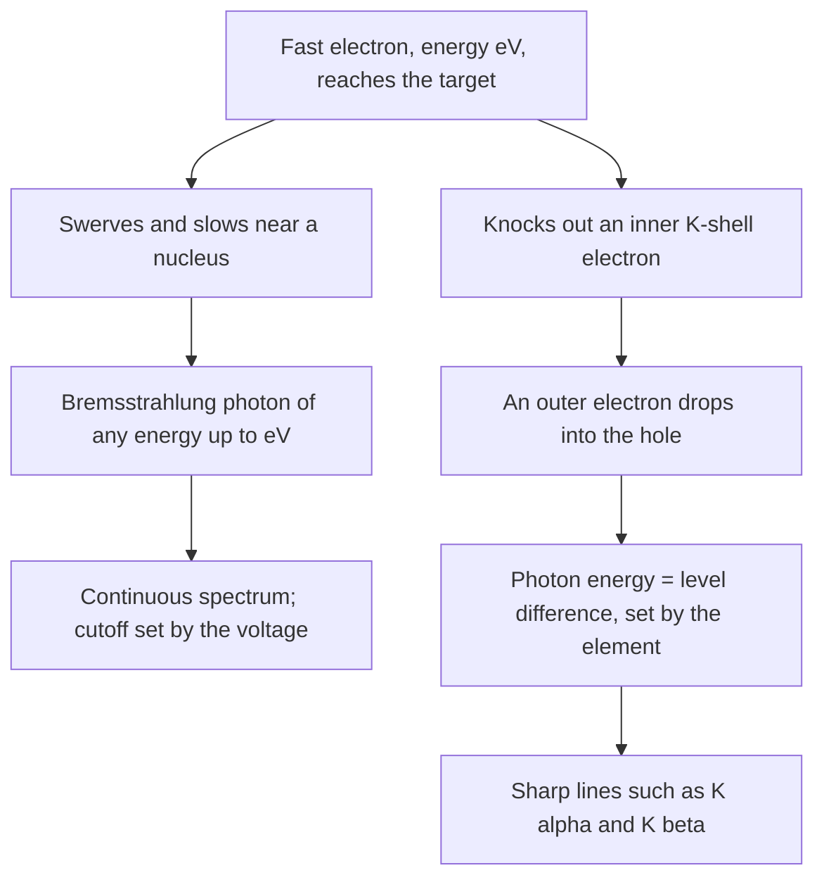

## Beyond the Bohr model

The previous lesson's Bohr model explained hydrogen with a single number $n$. It can't explain why lithium, sodium and potassium behave alike, why the periodic table has rows of 2, 8, 8, 18, …, or why each element gives off its own sharp X-ray lines. Quantum mechanics does, with two ingredients: each electron is described by four quantum numbers, and no two electrons in an atom may share all four. This lesson develops both, and then uses atomic energy levels to explain X-ray tubes and lasers.

## Four quantum numbers

In quantum mechanics an electron in an atom is a standing wave spread around the nucleus, called an **orbital**, rather than a ball on a track. Fitting a standing wave around a nucleus in three dimensions takes three whole numbers, just as a string needed one. A fourth describes the electron itself.

- The **principal quantum number** $n = 1, 2, 3, \ldots$ sets the orbital's size and, mostly, its energy. All states with the same $n$ form a **shell**.
- The **orbital quantum number** $l = 0, 1, \ldots, n - 1$ sets the orbital's shape and the electron's orbital angular momentum, $L = \sqrt{l(l+1)}\,\dfrac{h}{2\pi}$. States with the same $n$ and $l$ form a **subshell**, named by a letter: $l = 0, 1, 2, 3$ are s, p, d, f. So "3p" means $n = 3$, $l = 1$.
- The **magnetic quantum number** $m_l = -l, \ldots, -1, 0, 1, \ldots, l$ sets the orbital's orientation. The component of its angular momentum along a chosen axis is $m_l\dfrac{h}{2\pi}$. There are $2l + 1$ values.
- The **spin quantum number** $m_s = +\tfrac12$ or $-\tfrac12$ ("spin up" or "spin down"). Every electron has a built-in angular momentum and magnetism, called **spin**, as if it were a tiny spinning magnet, and it has only these two settings.

Counting gives the sizes of subshells and shells:

| Subshell | $l$ | $m_l$ values | Electrons ($2(2l+1)$) |
|---|---|---|---|
| s | 0 | 1 | 2 |
| p | 1 | 3 | 6 |
| d | 2 | 5 | 10 |
| f | 3 | 7 | 14 |

Adding the subshells of shell $n$ gives $2n^2$ states: 2, 8, 18, 32 for $n = 1, 2, 3, 4$.

### Example 1: counting the third shell

List the subshells of $n = 3$ and count its states.

$l$ can be 0, 1 or 2: the 3s, 3p and 3d subshells. They have $1 + 3 + 5 = 9$ orbitals (values of $m_l$). Each orbital holds two spin settings, so the shell holds $2(9) = 18$ electrons, matching $2n^2 = 2(3^2) = 18$.

## The Pauli exclusion principle and the periodic table

Wolfgang Pauli's rule is short and has enormous consequences. The **Pauli exclusion principle**: no two electrons in an atom can have the same set of four quantum numbers. So each orbital holds at most two electrons, one spin up and one spin down.

Without it, every electron would drop into the lowest state, 1s, and all atoms would behave much alike. With it, electrons fill states from the lowest energy upward, one per state. In atoms with many electrons, energy depends on $l$ as well as $n$: an electron in an s orbital spends some time close to the nucleus, where the inner electrons screen less of its charge, so it is more tightly bound than a p electron of the same shell. The filling order is

$$1s,\ 2s,\ 2p,\ 3s,\ 3p,\ 4s,\ 3d,\ 4p,\ 5s,\ 4d,\ 5p,\ 6s,\ \ldots$$

The list of occupied subshells, with the number of electrons in each as a superscript, is the atom's **electron configuration**.

### Example 2: sodium and chlorine

Write the ground-state configurations of sodium ($Z = 11$) and chlorine ($Z = 17$).

Sodium: fill 1s (2), 2s (2) and 2p (6), which uses 10 electrons; the 11th goes into 3s: $1s^2\,2s^2\,2p^6\,3s^1$.

Chlorine: the same first 10, then 3s (2) and five more in 3p: $1s^2\,2s^2\,2p^6\,3s^2\,3p^5$.

Chemistry is mostly about the outermost electrons. Sodium has one electron outside filled subshells, which it gives up easily, just like lithium ($1s^2\,2s^1$) and potassium (one 4s electron). Chlorine is one electron short of filling 3p, so it grabs an electron readily, like fluorine. Neon ($1s^2\,2s^2\,2p^6$) and argon have only completely filled subshells, so they hardly react. Each row of the periodic table corresponds to filling a new outer shell. The third row has only 8 elements, not 18, because 3d fills after 4s, in the fourth row.

## X-rays

An **X-ray tube** accelerates electrons through a high voltage $V$, often tens of kilovolts, and slams them into a metal target. Each electron arrives with kinetic energy $eV$, and the X-ray spectrum has two parts.


```plot
{"x": [0, 150], "y": [0, 3.5], "xLabel": "wavelength (pm)", "yLabel": "intensity", "functions": [{"f": "(x/41.3 - 1)/x^2*6822.76", "from": 41.3, "to": 150}], "segments": [{"from": [71, 0.973], "to": [71, 3], "label": "Kα"}, {"from": [63, 0.903], "to": [63, 1.6], "label": "Kβ"}], "points": [{"at": [41.3, 0], "label": "λmin"}], "caption": "X-ray spectrum of a molybdenum target at 30 kV: a continuous spectrum with a sharp short-wavelength cutoff, plus the target's characteristic lines"}
```

*The continuous spectrum.* As an electron swerves and slows near the target's nuclei, it radiates X-ray photons of every energy up to its full kinetic energy. This radiation is called **bremsstrahlung** (German for "braking radiation"). The most energetic photon possible gets the electron's entire energy, $hf_{\max} = eV$, so the spectrum stops sharply at the **cutoff wavelength**

$$\lambda_{\min} = \frac{hc}{eV}.$$

With $hc = 1240$ eV·nm and $V$ in volts, $\lambda_{\min} = 1240/V$ nm. The cutoff depends only on the voltage, not on the target. That was itself strong evidence for photons: a wave picture has no reason for a sharp edge.

*Characteristic lines.* If an incoming electron knocks out one of the target atom's innermost (n = 1, "K-shell") electrons, an electron from a higher shell drops into the hole and emits a photon whose energy is the difference between the levels. These **characteristic X-rays** come at wavelengths fixed by the target element: the drop from n = 2 gives the Kα line and the drop from n = 3 the Kβ line. Raising the voltage moves the cutoff but not these lines.

The chart puts the two processes side by side.



A Bohr-style estimate gives the Kα energy. The electron dropping from n = 2 sees the nuclear charge $Z$ screened by the one remaining 1s electron, so roughly a charge $Z - 1$. Hydrogen's levels scale with the square of the charge, so

$$E_{K\alpha} \approx 13.6\text{ eV}\,(Z - 1)^2\left(1 - \frac14\right) = 10.2\text{ eV}\,(Z - 1)^2.$$

Henry Moseley found this $(Z - 1)^2$ pattern in 1913. It let him order the elements by atomic number rather than mass and predict missing elements.

### Example 3: a dental X-ray tube

A tube runs at 30 kV. What are the most energetic photon and the shortest wavelength it produces?

$hf_{\max} = eV = 30$ keV. $\lambda_{\min} = \dfrac{1240\text{ eV·nm}}{30\,000\text{ eV}} = 0.0413$ nm $= 41.3$ pm. Doubling the voltage would halve the cutoff wavelength.

### Example 4: copper's Kα line

Estimate the Kα energy and wavelength for copper ($Z = 29$).

$E \approx 10.2(29 - 1)^2 = 10.2(784) = 8.0\times10^{3}$ eV $= 8.0$ keV. Then $\lambda = 1240/8000 = 0.155$ nm. The measured value is 0.154 nm, so the simple estimate is within 1%. This wavelength is close to the spacing of atoms in crystals, which is why copper Kα X-rays are the standard tool for X-ray crystallography.

X-rays pass through soft tissue but are absorbed strongly by dense material containing heavier atoms, such as calcium in bone. That contrast makes medical imaging possible. X-ray photons also carry enough energy to ionize atoms, so doses are kept low.

## Lasers

An atom in an excited state can drop to a lower one in two ways. In **spontaneous emission** it emits a photon on its own, in a random direction at a random moment. That is how ordinary lamps glow. In **stimulated emission**, discovered theoretically by Einstein in 1917, a passing photon whose energy exactly matches the drop triggers the emission. The new photon is a copy of the first: same energy, direction, phase and polarization. One photon becomes two, two become four, and the light is amplified. The word **laser** stands for this: light amplification by stimulated emission of radiation.

There is a catch. The same passing photon could instead be absorbed by an atom in the *lower* state, and normally lower states are far more crowded than upper ones, so absorption wins. A laser needs a **population inversion**, more atoms in the upper state than the lower one. It gets there by pumping energy in (with a flash lamp, an electric discharge, or a current) into a level that quickly decays to a **metastable state**, an excited state that lasts around a millisecond instead of the usual 10 nanoseconds or so. Atoms pile up there.

```shape
{"segments": [{"from": [0, 0], "to": [4, 0]}, {"from": [0, 3], "to": [4, 3]}, {"from": [0, 4], "to": [4, 4]}, {"from": [0.8, 0], "to": [0.8, 4], "arrow": true, "label": "pump"}, {"from": [1.9, 4], "to": [1.9, 3], "arrow": true}, {"from": [3, 3], "to": [3, 0], "arrow": true, "label": "laser photon"}], "labels": [{"at": [5.3, 0], "text": "ground state"}, {"at": [5.3, 3], "text": "metastable"}, {"at": [5.3, 4], "text": "short-lived"}], "caption": "Three-level laser: atoms are pumped up, drop quickly to a long-lived level, and pile up there until stimulated emission releases them together"}
```

Mirrors at both ends of the laser make the light pass back and forth through the material many times, amplifying it on every pass; one mirror lets a small fraction escape as the beam. The result is light that is monochromatic (one sharp wavelength), coherent (in step), tightly directional and intense. Barcode scanners, fiber-optic links, eye surgery and the interference experiments of the wave-optics lesson all rely on these properties.

### Example 5: the red helium–neon laser

In a helium–neon laser, the lasing neon atoms drop from a level 20.66 eV above their ground state to one at 18.70 eV. Find the wavelength.

The photon carries the difference, $20.66 - 18.70 = 1.96$ eV, so $\lambda = 1240/1.96 = 633$ nm, the familiar red beam. Using either level on its own (1240/20.66 = 60 nm) would put the light in the far ultraviolet. Only the *difference* matters.

## Common mistakes

- Letting $l$ run up to $n$; it stops at $n - 1$ (so there is no 1p or 2d).
- Forgetting the factor 2 for spin when counting electrons in a subshell or shell.
- Filling 3d before 4s.
- Thinking the X-ray cutoff depends on the target metal. It depends only on the voltage; the characteristic lines depend on the metal.
- Using $Z^2$ instead of $(Z - 1)^2$ in the Kα estimate.
- Thinking a laser's light comes from ordinary spontaneous emission; stimulated emission and a population inversion are what make it a laser.

## Key points

- Quantum numbers: $n \ge 1$; $l = 0$ to $n - 1$ (s, p, d, f); $m_l = -l$ to $l$; $m_s = \pm\tfrac12$.
- Pauli: no two electrons in an atom share all four numbers. A subshell holds $2(2l + 1)$ electrons, a shell $2n^2$.
- The periodic table reflects shells filling in the order 1s, 2s, 2p, 3s, 3p, 4s, 3d, …; outer electrons set the chemistry.
- X-ray tube: continuous spectrum with cutoff $\lambda_{\min} = hc/(eV)$, plus characteristic lines; $E_{K\alpha} \approx 10.2\text{ eV}\,(Z - 1)^2$.
- Lasers use stimulated emission from a population inversion (metastable level), giving monochromatic, coherent, directional light.
