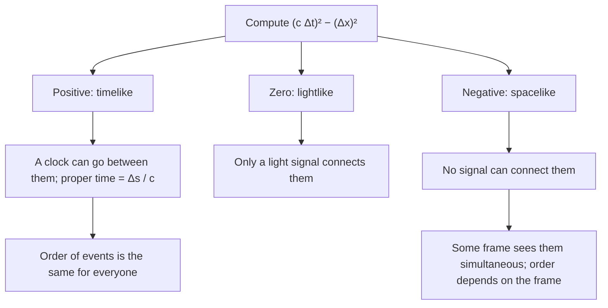

## Relativity as geometry

The special relativity lesson treated time dilation, length contraction and the relativity of simultaneity as three separate surprises. In 1908 Hermann Minkowski, Einstein's former mathematics teacher, showed that they are one idea: space and time together form a four-dimensional **spacetime**, and different observers simply slice it differently. This honors lesson develops that picture with diagrams and one quantity all observers agree on, and uses it to settle the most famous puzzle in relativity, the twin paradox. Everything stays in one space dimension, and the math is algebra.

## Spacetime diagrams

A **spacetime diagram** plots position $x$ across and time up. A point on it is an **event**: something that happens at one place at one instant, such as a firecracker exploding or a clock ticking. The path of an object through spacetime is its **worldline**. An object at rest has a vertical worldline (its $x$ never changes); a moving object's worldline tilts, and a faster object tilts more.

Choosing units well makes the diagram clean. Measure time in years and distance in light-years (the distance light goes in a year), so $c = 1$ ly/yr. Then a light pulse moves one unit across for every unit up, and its worldline is a 45° line. Because nothing travels faster than light, the worldline of any object is always steeper than 45°.

The two 45° lines through an event form its **light cone** (in one space dimension it is a pair of lines; with two space dimensions it really is a cone). Events inside the upper half can be reached from the event by something moving slower than light, so they are its possible future; events inside the lower half are its possible past. Events outside the cone are too far away for even light to connect them: nothing that happens at the event can affect them, and they can't affect it.

## The spacetime interval

Two observers in relative motion disagree about the time between two events ($\Delta t$) and about the distance between them ($\Delta x$). But they agree on one combination, the **spacetime interval**:

$$(\Delta s)^2 = (c\,\Delta t)^2 - (\Delta x)^2.$$

The light clock shows why. In the clock's own frame two ticks happen at the same place, so $\Delta x = 0$ and $(\Delta s)^2 = (c\,\Delta t_0)^2$. In a frame where the clock moves at $v$, the ticks are $\Delta t$ apart in time and $\Delta x = v\,\Delta t$ apart in space, and

$$(c\,\Delta t)^2 - (v\,\Delta t)^2 = (c\,\Delta t)^2\left(1 - \frac{v^2}{c^2}\right) = \left(\frac{c\,\Delta t}{\gamma}\right)^2 = (c\,\Delta t_0)^2,$$

using $\Delta t = \gamma\,\Delta t_0$. Both observers get the same number. The minus sign is the whole difference between spacetime and ordinary space, where distance comes from $\Delta x^2 + \Delta y^2$ with a plus.

The sign of $(\Delta s)^2$ sorts every pair of events into one of three kinds:

- **Timelike** ($(\Delta s)^2 > 0$): the events are farther apart in time than light could need. A clock can travel from one to the other, and the time it reads, $\Delta s/c$, is the proper time between them. One event can cause the other, and every observer agrees on which came first.
- **Lightlike** ($(\Delta s)^2 = 0$): only a light signal connects them.
- **Spacelike** ($(\Delta s)^2 < 0$): they are too far apart in space for even light to connect them. There is a frame in which they are simultaneous, and in that frame their distance apart is $\sqrt{(\Delta x)^2 - (c\,\Delta t)^2}$. Different observers can disagree about which happened first, which is harmless, because neither can cause the other.

### Example 1: classifying events

Event A is at $t = 0$, $x = 0$. Event B is at $t = 2.0$ yr, $x = 1.5$ ly. Event C is at $t = 1.0$ yr, $x = 3.0$ ly. Classify each pair with A.

*A and B.* $(\Delta s)^2 = (2.0)^2 - (1.5)^2 = 4.00 - 2.25 = 1.75$ yr² (with $c = 1$ ly/yr). Positive, so timelike. A traveler who goes from A to B at constant speed moves $1.5/2.0 = 0.75c$ and ages $\Delta s/c = \sqrt{1.75} = 1.32$ yr, not 2.0 yr. Check with time dilation: $\gamma = 1/\sqrt{1 - 0.75^2} = 1.512$, and $2.0/1.512 = 1.32$ yr. ✓

*A and C.* $(\Delta s)^2 = (1.0)^2 - (3.0)^2 = -8.0$. Negative, so spacelike: light leaving A has gone only 1 ly by the time C happens, 3 ly away. In a frame where they are simultaneous, they are $\sqrt{8.0} = 2.83$ ly apart. That frame moves at $v = c^2\Delta t/\Delta x = c/3$ relative to ours (from setting $\Delta t' = 0$ in the transformation below).

## The Lorentz transformation

To translate the coordinates of an event from frame S to a frame S′ moving at velocity $v$ along $+x$ (with their origins matching), relativity replaces the everyday rule $x' = x - vt$ with the **Lorentz transformation**:

$$x' = \gamma\,(x - vt), \qquad t' = \gamma\left(t - \frac{v x}{c^2}\right).$$

For differences between two events, the same formulas hold with $\Delta$s. At low speed $\gamma \approx 1$ and $vx/c^2$ is tiny, so the everyday rules come back. The extra term $-vx/c^2$ in the time formula is the relativity of simultaneity in one line: two events with $\Delta t = 0$ but $\Delta x \ne 0$ get $\Delta t' = -\gamma v\,\Delta x/c^2$, which is not zero. In S′, the event farther along the direction of motion happens *first*.

### Example 2: simultaneous for one observer, not the other

Two lamps 600 m apart along a track flash at the same instant in the track's frame S. A rocket passes along the track at $0.60c$ in the direction from the first lamp toward the second. In the rocket's frame, how far apart in time and space are the flashes?

$\gamma = 1/\sqrt{1 - 0.36} = 1.25$. With $\Delta t = 0$ and $\Delta x = 600$ m:

$$\Delta t' = \gamma\left(0 - \frac{v\,\Delta x}{c^2}\right) = -1.25\,\frac{(0.60)(600\text{ m})}{3.00\times10^8\text{ m/s}} = -1.5\times10^{-6}\text{ s}.$$

The second lamp (ahead, in the direction of motion) flashes 1.5 μs *before* the first in the rocket's frame. The distance is $\Delta x' = \gamma(\Delta x - v\,\Delta t) = 1.25(600) = 750$ m.

Check with the interval: in S, $(\Delta s)^2 = 0 - 600^2 = -360\,000$ m². In S′, $c\,\Delta t' = 450$ m, so $(\Delta s)^2 = 450^2 - 750^2 = 202\,500 - 562\,500 = -360\,000$ m². ✓ (Why 750 m and not a contracted length? The flashes are not simultaneous in S′, so 750 m is not the length of anything in that frame; the track itself, measured by simultaneous marks in S′, is $600/1.25 = 480$ m long.)

## The twin paradox

Twin Alex stays on Earth. Twin Blair flies to a star 4.0 ly away at $0.80c$, turns around at once and flies back at $0.80c$. Earth's clocks say the trip takes $2 \times (4.0/0.80) = 10.0$ yr. With $\gamma = 1/\sqrt{1 - 0.64} = 5/3$, Blair's clock reads $10.0/(5/3) = 6.0$ yr. Blair comes home 4 years younger than Alex.

The **twin paradox** is the objection: from Blair's point of view, Earth moved away and came back, so shouldn't Alex be the younger one? The diagram shows why the two twins are not interchangeable.

Alex's worldline is straight: Alex stays in one inertial frame. Blair's is bent at the turnaround, where Blair must accelerate. So the situation is not symmetric, and only Alex can use the simple time dilation formula for the whole trip. Measure each worldline with the interval. Alex: $(\Delta s)^2 = 10^2 - 0^2$, so 10 yr. Blair's outbound leg: $(\Delta s)^2 = 5^2 - 4^2 = 9$, so 3 yr; the return leg is another 3 yr; total 6 yr. The rule in spacetime is the reverse of ordinary geometry: *between two events, the straight (inertial) worldline has the longest proper time*, and any bent path ages less. The traveler who changes frames is the younger one. The acceleration doesn't age anyone directly; its role is to make the path bent.

### Example 3: where the missing years go

During the outbound leg, Blair can correctly say that Earth's clocks run slow by $\gamma$. Blair's 3.0 yr outbound correspond to only $3.0/(5/3) = 1.8$ yr on Earth, in Blair's outbound frame. The same holds on the way home: another 1.8 yr. That adds to 3.6 yr, not 10 yr. Where are the other 6.4 yr?

They are in the turnaround. In Blair's outbound frame, the Earth event simultaneous with the turnaround ($t = 5$ yr, $x = 4$ ly) has the same $t'$, which means the same value of $t - vx/c^2$: $t - 0.80x = 5 - 3.2 = 1.8$, so Earth time 1.8 yr. In the return frame (velocity $-0.80c$), the condition is $t + 0.80x = 5 + 3.2 = 8.2$, so Earth time 8.2 yr. When Blair switches frames, the Earth event Blair calls "now" jumps from 1.8 yr to 8.2 yr. Then $1.8 + (8.2 - 1.8) + 1.8 = 10.0$ yr. ✓ Nothing visible happens to Alex at that moment; what changes is Blair's line of simultaneity.

## Watching the trip: the relativistic Doppler effect

What would the twins actually *see* if each sent a light signal every birthday? A source moving away stretches the time between arriving signals for two reasons: its clock runs slow (a factor $\gamma$) and each signal starts farther away (a factor $1 + v/c$). The product, $\gamma(1 + \beta)$ with $\beta = v/c$, simplifies to the **relativistic Doppler effect**:

$$f_{\text{received}} = f_{\text{sent}}\sqrt{\frac{1 - \beta}{1 + \beta}} \ \text{(receding)}, \qquad f_{\text{received}} = f_{\text{sent}}\sqrt{\frac{1 + \beta}{1 - \beta}} \ \text{(approaching)}.$$

Unlike the Doppler formula for sound, this depends only on the relative speed of source and receiver, not on who is "really" moving, because there is no medium to move relative to.

### Example 4: counting birthday signals

At $\beta = 0.80$: $\sqrt{0.2/1.8} = 1/3$ and $\sqrt{1.8/0.2} = 3$.

*What Blair receives.* Outbound (3 yr of Blair's time), Earth's yearly signals arrive at one-third the rate: 1 signal. Homeward (3 yr), they arrive three times as fast: 9 signals. Total 10: Blair sees Alex age 10 years. ✓

*What Alex receives.* Blair turns around at Earth time 5 yr, but the light showing it arrives only at $5 + 4 = 9$ yr (the dashed signal in the diagram). So for 9 years Alex sees Blair receding and gets signals at one-third the rate: 3 signals. In the last year Alex sees Blair approaching: 3 more. Total 6: Alex sees Blair age 6 years. ✓

The asymmetry is plain here too: Blair sees the switch from slow to fast signals halfway through the trip, while Alex sees it only in the last year.

## Common mistakes

- Using $(\Delta x)^2 + (c\,\Delta t)^2$: the interval has a minus sign, and with this sign convention, timelike intervals are positive.
- Treating the twins symmetrically. Only the twin with a straight worldline is inertial for the whole trip; the traveler's frame changes at the turnaround.
- Thinking that acceleration itself ages the traveler less. A longer cruise with the same brief turnaround gives a bigger age gap.
- Assuming events simultaneous in one frame are simultaneous in all. That holds only for events with no separation along the direction of motion (in this lesson's one dimension, events at the same place); events separated along the direction of motion get different times in other frames.
- Using the sound Doppler formula for light. Light's formula has a square root and depends only on the relative speed.

## Key points

- Spacetime diagrams: events are points, worldlines are paths, light moves at 45° when $c = 1$ ly/yr; the light cone separates possible past and future from "elsewhere".
- Interval $(\Delta s)^2 = (c\,\Delta t)^2 - (\Delta x)^2$ is the same in every inertial frame. Timelike: proper time $\Delta s/c$, fixed order. Spacelike: order can differ between frames; no causal link.
- Lorentz transformation: $x' = \gamma(x - vt)$, $t' = \gamma(t - vx/c^2)$; simultaneous events separated by $\Delta x$ differ by $\Delta t' = -\gamma v\,\Delta x/c^2$.
- Twin paradox: the inertial (straight) worldline has the longest proper time; the traveler ages $\sqrt{(c\,\Delta t)^2 - (\Delta x)^2}/c$ per straight leg.
- Relativistic Doppler: $f_{\text{received}} = f_{\text{sent}}\sqrt{(1 - \beta)/(1 + \beta)}$ when receding, inverted when approaching.
