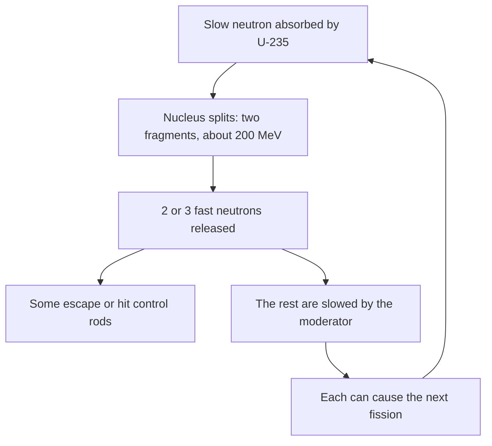

## Bookkeeping with mass

The nuclear physics lesson found the binding energy of a nucleus from its mass defect, and said that fission and fusion release energy by moving toward the peak of the binding-energy curve. This honors lesson makes that quantitative for any reaction. One number from a table of masses, the Q-value, tells whether a reaction can happen on its own and how much energy it releases. We apply it to beta decay, to reactions that need an energy input, to fission and fusion, and finally to what absorbed radiation does to the body.

## The Q-value

For any nuclear reaction or decay, the **Q-value** is the rest energy that disappears:

$$Q = \left(\sum m_{\text{before}} - \sum m_{\text{after}}\right)c^2, \qquad 1\text{ u} \leftrightarrow 931.5\text{ MeV}.$$

If $Q > 0$, mass turns into kinetic energy of the products (and any gamma rays): the reaction releases energy, and a decay with $Q > 0$ can happen spontaneously. If $Q < 0$, kinetic energy has to be supplied and turned into mass, so the reaction happens only when something hits the target hard enough.

Mass tables list *atomic* masses, which include the electrons. That's convenient: when $Z$ balances on both sides, the electron masses balance too and cancel. (We'll see the one case where they don't.) As in the earlier lesson, use hydrogen-1 (1.007825 u) for a proton and 1.008665 u for a neutron.

### Example 1: alpha decay of uranium-238

$^{238}_{92}\text{U} \to {}^{234}_{90}\text{Th} + {}^{4}_{2}\text{He}$. Atomic masses: U-238 238.050787 u, Th-234 234.043600 u, He-4 4.002603 u. Find $Q$ and the alpha particle's kinetic energy.

$\Delta m = 238.050787 - 234.043600 - 4.002603 = 0.004584$ u, so $Q = 0.004584(931.5) = 4.27$ MeV. Positive, so U-238 can decay this way on its own.

How is 4.27 MeV shared? The uranium starts at rest, so the thorium and the alpha fly apart with equal and opposite momenta $p$. Kinetic energy is $K = p^2/(2m)$, so with the same $p$ the lighter particle gets more energy, in inverse proportion to mass: $K_\alpha/K_{\text{Th}} = 234/4$. The alpha's share is

$$K_\alpha = Q\,\frac{A - 4}{A} = 4.27 \times \frac{234}{238} = 4.20 \text{ MeV},$$

and the recoiling thorium gets the other 0.07 MeV. Most alphas measured from U-238 do have 4.20 MeV (a smaller group has a little less, because the thorium is sometimes left in an excited state). Alpha energies come in sharp lines, unlike the beta energies below.

## Beta decay and the neutrino

For beta-minus decay, the parent atom has $Z$ electrons and the daughter atom $Z + 1$; the emitted electron makes up the difference, so with atomic masses, $Q = [M(\text{parent}) - M(\text{daughter})]c^2$. For carbon-14 → nitrogen-14, $Q = (14.003242 - 14.003074)(931.5) = 0.156$ MeV.

Here early experimenters hit a puzzle. A two-body decay, like alpha decay, should give the electron one fixed energy. Instead beta electrons come out with every energy from nearly zero up to $Q$. Either energy wasn't conserved, or a third, unseen particle was carrying off the rest. In 1930 Wolfgang Pauli proposed the second option: a neutral, extremely light particle now called the **neutrino**. It interacts so weakly that it passes through the Earth almost unhindered, and it wasn't detected until 1956, by Clyde Cowan and Frederick Reines at a nuclear reactor. In beta-minus decay the third particle is an antineutrino; in beta-plus, a neutrino.

Beta-plus decay emits a **positron**, the electron's antiparticle: same mass, positive charge. Now the electrons don't cancel. The parent atom carries $Z$ electrons but the daughter atom only $Z - 1$, so the difference in atomic masses includes one spare electron mass that is not available as energy; and the positron's mass must be created as well. Two electron masses must be subtracted:

$$Q_{\beta^+} = [M(\text{parent}) - M(\text{daughter}) - 2m_e]c^2, \qquad 2m_ec^2 = 1.022\text{ MeV}.$$

A positron doesn't last long. When it meets an electron, the two **annihilate**: their mass turns entirely into energy, usually two gamma photons of 0.511 MeV each, flying off in opposite directions (so their momenta cancel). The reverse also happens. In **pair production** a gamma photon passing near a nucleus turns into an electron and a positron; it needs at least 1.022 MeV, the rest energy of the pair. (The nucleus is needed to absorb some momentum; a lone photon can't do it.)

### Example 2: the PET tracer fluorine-18

$^{18}_{9}\text{F} \to {}^{18}_{8}\text{O} + e^+ + \nu$. Atomic masses: F-18 18.000938 u, O-18 17.999160 u. Find $Q$.

Mass difference: $0.001778$ u $\times 931.5 = 1.656$ MeV. Subtract $1.022$ MeV: $Q = 0.634$ MeV, shared among the positron, the neutrino and (a little) the recoil. In a PET (positron emission tomography) scan, the patient receives a sugar labeled with F-18. Each positron annihilates within a millimeter or two, and the scanner detects the two 0.511 MeV photons arriving at opposite detectors at the same instant; the source lies on the line between them. Millions of such lines map where the sugar is being used.

## Reactions that need energy: threshold

The first artificial nuclear reaction, by Ernest Rutherford in 1919, was alpha particles striking nitrogen:

$$^{4}_{2}\text{He} + {}^{14}_{7}\text{N} \to {}^{17}_{8}\text{O} + {}^{1}_{1}\text{H}.$$

With masses 4.002603, 14.003074, 16.999132 and 1.007825 u, $Q = (18.005677 - 18.006957)(931.5) = -1.19$ MeV. Energy must be supplied. But an alpha with exactly 1.19 MeV is not enough. The alpha brings in momentum, momentum is conserved, so the products must still be moving afterward and some of the incoming kinetic energy is stuck in that motion. The minimum projectile energy, the **threshold energy**, is (for speeds well below $c$)

$$K_{\text{th}} = -Q\left(1 + \frac{m_{\text{projectile}}}{m_{\text{target}}}\right).$$

### Example 3: Rutherford's reaction

$K_{\text{th}} = 1.19\left(1 + \dfrac{4}{14}\right) = 1.19(1.286) = 1.53$ MeV. The alphas Rutherford used, from natural radioactive sources, had several MeV, comfortably above this. A heavier projectile on a light target wastes more: firing nitrogen at a stationary helium nucleus would need $1.19(1 + 14/4) = 5.4$ MeV for the same reaction.

## Fission and the chain reaction

A slow neutron absorbed by uranium-235 makes it split. One of many possible outcomes is

$$^{1}_{0}\text{n} + {}^{235}_{92}\text{U} \to {}^{141}_{56}\text{Ba} + {}^{92}_{36}\text{Kr} + 3\,{}^{1}_{0}\text{n}.$$

### Example 4: energy from fission

Masses: U-235 235.043928 u, Ba-141 140.914403 u, Kr-92 91.926173 u, neutron 1.008665 u. Find $Q$ and estimate the energy per kilogram of uranium-235.

Before: $235.043928 + 1.008665 = 236.052593$ u. After: $140.914403 + 91.926173 + 3(1.008665) = 235.866571$ u. $\Delta m = 0.186022$ u, so $Q = 173$ MeV, almost all of it kinetic energy of the two fragments. Both fragments are neutron-rich and beta-decay several times afterward, adding more; the total per fission is about 200 MeV.

Per kilogram: one U-235 atom has mass $235(1.66\times10^{-27}) = 3.90\times10^{-25}$ kg, so 1 kg holds $2.56\times10^{24}$ atoms. At 200 MeV $= 3.20\times10^{-11}$ J each, that's $8.2\times10^{13}$ J. Burning a kilogram of gasoline releases about $4.6\times10^{7}$ J, nearly two million times less.

Each fission frees 2 or 3 neutrons, which can cause more fissions: a **chain reaction**. What matters is the **multiplication factor** $k$, the average number of neutrons from one fission that go on to cause another. If $k < 1$ the reaction dies out; if $k = 1$ it runs steadily (a reactor at constant power is "critical", which is normal, not alarming); if $k > 1$ it grows. Neutrons are born fast, but U-235 captures slow ones far more readily, so most reactors surround the fuel with a **moderator** (water or graphite) whose light nuclei slow the neutrons by collisions. **Control rods** of neutron-absorbing material (boron or cadmium) slide in or out to hold $k$ at 1.

## Fusion and the Coulomb barrier

Light nuclei release energy by fusing. The reaction planned for fusion power plants is deuterium–tritium:

$$^{2}_{1}\text{H} + {}^{3}_{1}\text{H} \to {}^{4}_{2}\text{He} + {}^{1}_{0}\text{n}.$$

### Example 5: sharing the energy of D–T fusion

Masses: H-2 2.014102 u, H-3 3.016049 u, He-4 4.002603 u, neutron 1.008665 u. Find $Q$ and each product's kinetic energy, assuming the fuel nuclei start with negligible energy.

$\Delta m = 5.030151 - 5.011268 = 0.018883$ u, so $Q = 17.6$ MeV. The products have equal and opposite momenta, so, as in Example 1, energy divides in inverse proportion to mass. The neutron gets $17.6 \times \dfrac{4.0}{5.0} = 14.1$ MeV and the helium nucleus $3.5$ MeV. Per kilogram of fuel this is about $3.4\times10^{14}$ J, roughly four times fission's.

Why is fusion so hard to achieve? Both nuclei are positive. To touch, about 3 fm apart, they must overcome an electric repulsion with potential energy $kq_1q_2/r \approx (1.44\text{ MeV·fm})/(3\text{ fm}) \approx 0.5$ MeV, the **Coulomb barrier**. The typical thermal energy $k_BT$ at the Sun's core temperature of about 15 million K is only about 1.3 keV. Fusion happens anyway for two reasons: a few nuclei in the gas move much faster than average, and quantum tunneling lets nuclei pass through the barrier without having enough energy to go over it. (This is a simplified picture; the Sun mainly fuses ordinary hydrogen by a slower chain of reactions, not D–T.)

## Radiation dose

Radiation from these reactions harms living tissue mainly by ionizing atoms and breaking molecules such as DNA. Two quantities describe a dose.

The **absorbed dose** is the energy deposited per kilogram of tissue, measured in **grays**: $1\text{ Gy} = 1$ J/kg. But equal energy does more biological damage when it's deposited densely, as alpha particles do along their short tracks. The **equivalent dose** multiplies by a **radiation weighting factor** $w_R$ and is measured in **sieverts** (Sv):

$$H = w_R\,D.$$

Current international recommendations (ICRP, 2007) use $w_R = 1$ for gamma rays, X-rays and electrons, 2 for protons, 20 for alpha particles, and between about 2.5 and 20 for neutrons, depending on their energy.

For scale: the average person in the United States receives about 6 mSv per year, roughly half from natural sources (radon gas, cosmic rays, the ground, the body's own potassium-40) and half mostly from medical imaging. A chest X-ray gives roughly 0.1 mSv or less. A whole-body dose of several sieverts received at once causes severe radiation sickness and is often fatal without treatment. For low doses, radiation protection rules assume the **linear no-threshold model**: cancer risk is proportional to dose, with no completely safe level. That is a cautious assumption for setting limits, not a settled fact; whether risk really falls in proportion at doses of a few mSv is still debated, because the effect is too small to measure directly against the natural cancer rate.

### Example 6: same energy, different damage

(a) A 70 kg worker absorbs 0.14 J from gamma rays spread over the whole body. (b) An alpha emitter lodged in a 0.30 kg organ deposits $6.0\times10^{-4}$ J there. Find each absorbed and equivalent dose.

(a) $D = 0.14/70 = 2.0\times10^{-3}$ Gy $= 2.0$ mGy. With $w_R = 1$: $H = 2.0$ mSv.

(b) $D = 6.0\times10^{-4}/0.30 = 2.0$ mGy, the same absorbed dose. With $w_R = 20$: $H = 40$ mSv, twenty times the biological effect. (Strictly this is a dose to one organ; turning it into a whole-body "effective dose" uses further tissue weighting factors, beyond this lesson.) Alpha emitters are nearly harmless outside the body, since skin stops them, but dangerous when inhaled or swallowed.

## Common mistakes

- Forgetting the $2m_ec^2 = 1.022$ MeV term for beta-plus decay when using atomic masses (it cancels for alpha and beta-minus).
- Giving all of $Q$ to the alpha particle; momentum conservation gives it the fraction $(A - 4)/A$.
- Thinking $|Q|$ is enough to drive an endothermic reaction; the threshold is larger by the factor $1 + m_{\text{projectile}}/m_{\text{target}}$.
- Thinking "critical" means dangerous. A critical reactor ($k = 1$) is running steadily.
- Mixing up grays and sieverts: grays measure energy per kilogram; sieverts include the weighting for the type of radiation.

## Key points

- $Q = (\sum m_{\text{before}} - \sum m_{\text{after}})c^2$ with atomic masses; $Q > 0$ releases energy. For $\beta^+$, subtract $2m_ec^2 = 1.022$ MeV.
- In a two-body breakup from rest, energy divides in inverse proportion to mass: $K_\alpha = Q(A - 4)/A$.
- The continuous beta spectrum revealed the neutrino. Positron + electron → two 0.511 MeV photons; pair production needs at least 1.022 MeV.
- Threshold for $Q < 0$: $K_{\text{th}} = -Q(1 + m_{\text{projectile}}/m_{\text{target}})$.
- Fission ≈ 200 MeV per U-235 ($8\times10^{13}$ J/kg); chain reaction steady at $k = 1$. D–T fusion 17.6 MeV, 14.1 MeV to the neutron; the Coulomb barrier makes fusion need extreme temperatures.
- Dose: gray = J/kg absorbed; sievert = $w_R \times$ gray ($w_R = 20$ for alphas).
