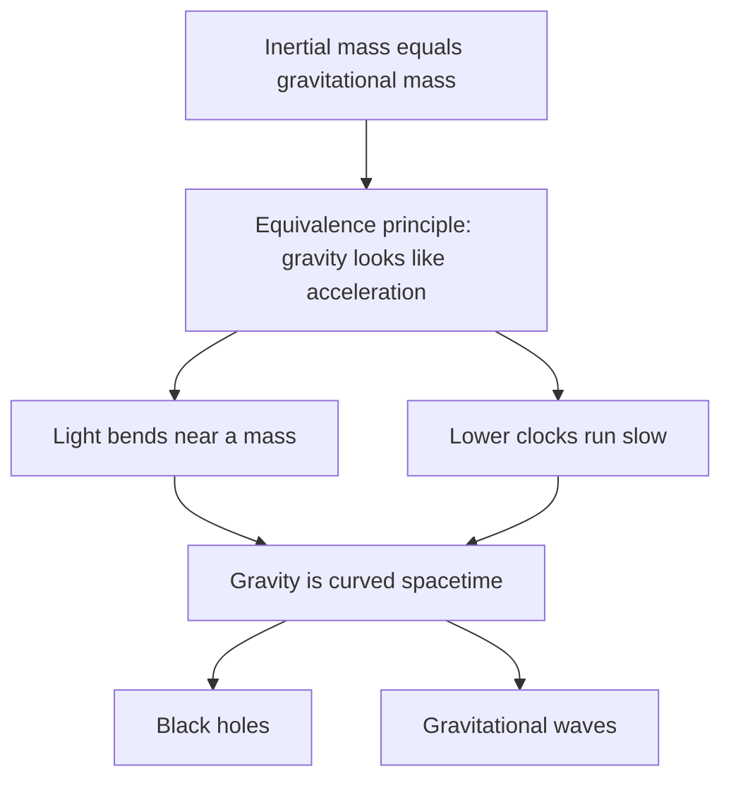

## Two theories that disagree

The gravitation lesson gave you Newton's law, $F = GMm/r^2$, and the relativity lesson gave you Einstein's 1905 rule that nothing, not even information, travels faster than light. These two don't fit together. In Newton's law the force depends on where the Sun is *right now*, so if the Sun moved, Earth would feel the change instantly, across 150 million km. Special relativity forbids that.

Einstein spent ten years on the problem, and his answer, **general relativity** (1915), is a new theory of gravity: gravity is not a force transmitted across space but the curvature of spacetime itself. This lesson builds the idea from one simple observation, then follows it to four predictions you can calculate with algebra: clocks that run at different rates at different heights, light that bends, black holes, and ripples in spacetime that were finally detected in 2015. Throughout, we use the approximate "weak-field" formulas, which are accurate whenever the effects are small; the full theory needs mathematics well beyond this course.

## The equivalence principle

Newton's second law uses an object's *inertial* mass (how hard it is to accelerate), and his law of gravity uses its *gravitational* mass (how strongly gravity pulls it). Nothing in Newton's theory says these must be equal, yet experiments find them equal to about one part in $10^{15}$ (the MICROSCOPE satellite, 2022). That is why all objects fall with the same acceleration.

Einstein took this as a clue. Picture yourself in a windowless elevator. If it sits on Earth, a dropped ball falls at 9.8 m/s². If it is far out in space with a rocket accelerating it upward at 9.8 m/s², the floor rushes up to meet the released ball in exactly the same way. Einstein's **equivalence principle** says no experiment done inside a small enough box can tell the two situations apart: locally, being in a gravitational field is equivalent to being in an accelerating frame. (If you studied the honors lesson on accelerating frames, you met the "fictitious" force $-m\vec a$ felt in an accelerating frame; the equivalence principle says gravity is the same kind of thing.)

The principle has consequences for light. Shine a beam sideways across the accelerating elevator. While the light crosses, the floor speeds up, so inside the elevator the beam's path curves downward. By equivalence, *light must bend in a gravitational field too*, even though a photon has no mass.



## Clocks run slow low down

Put a light source on the floor of the accelerating elevator (height $h$ below the ceiling) and a detector on the ceiling. The light takes a time of about $h/c$ to rise, and during that time the detector has picked up speed $gh/c$ away from it. By the Doppler effect, the detector sees the light shifted to a lower frequency, by the fraction

$$\frac{\Delta f}{f} \approx \frac{gh}{c^2}.$$

By equivalence, the same must happen in a building on Earth: light climbing out of gravity loses frequency, a **gravitational redshift**. Now think of the light's wave crests as the ticks of a clock on the floor. If the ceiling receives fewer crests per second than the floor sends, and none are lost on the way, then the floor clock really is ticking slower as seen from the ceiling. This is **gravitational time dilation**: a clock lower in a gravitational field runs slower than a higher one, by the fraction

$$\frac{\Delta t_{\text{high}} - \Delta t_{\text{low}}}{\Delta t} \approx \frac{gh}{c^2} \qquad\text{(near Earth's surface, height difference } h\text{)}.$$

More generally, $gh$ is the change in gravitational potential energy per kilogram, so for larger distances you replace it with $GM\left(\dfrac{1}{r_{\text{low}}} - \dfrac{1}{r_{\text{high}}}\right)$, the same expression you used for orbits.

In 1959 Robert Pound and Glen Rebka sent gamma rays up a 22.5 m tower at Harvard and measured the predicted shift, $gh/c^2 = 2.5\times10^{-15}$. Today's optical atomic clocks are so precise that they detect the difference when one is raised by just 30 centimeters (first done in 2010).

### Example 1: a mountain clock

A clock sits for one year (3.156 × 10⁷ s) on top of Mount Everest, 8849 m above a second clock at sea level. How much more time does the mountain clock record?

$$\frac{gh}{c^2} = \frac{(9.8)(8849)}{(3.00\times10^8)^2} = 9.6\times10^{-13}.$$

Over a year: $9.6\times10^{-13}\times3.156\times10^7\text{ s} = 3.0\times10^{-5}$ s, about 30 μs. The mountain clock gains about 30 μs per year. Tiny, but easily measurable.

## GPS: both relativities at once

The relativity lesson showed that a GPS satellite's clock runs slow because of its speed. Gravity pushes the other way, because the satellite is far above the ground clocks. A GPS satellite orbits at $r = 2.656\times10^7$ m (about 4.2 Earth radii) with speed $v = \sqrt{GM_E/r} = 3.87$ km/s.

### Example 2: the GPS clock correction

Use $GM_E = 3.986\times10^{14}$ m³/s², $R_E = 6.371\times10^6$ m and one day = 86 400 s. Ignore Earth's rotation (it changes the answer by about 0.1 μs per day).

*Gravity (satellite clock runs fast):*

$$\frac{GM_E}{c^2}\left(\frac{1}{R_E} - \frac1r\right) = \frac{3.986\times10^{14}}{(2.998\times10^8)^2}\left(\frac{1}{6.371\times10^6} - \frac{1}{2.656\times10^7}\right) = 5.29\times10^{-10},$$

which is $5.29\times10^{-10}\times86\,400\text{ s} = 45.7$ μs gained per day.

*Speed (satellite clock runs slow):* for $v \ll c$, $\gamma - 1 \approx \tfrac12 v^2/c^2 = \tfrac12(3874)^2/(2.998\times10^8)^2 = 8.35\times10^{-11}$, or 7.2 μs lost per day.

*Net:* $45.7 - 7.2 = 38.5$ μs gained per day. Light travels about 11.5 km in that time, so without the correction GPS positions would drift by kilometers per day. The satellite clocks are deliberately built to tick slightly slow before launch so they keep time with the ground once in orbit.

The plot shows how the two effects trade off with orbit radius, for a circular orbit. In units of Earth radii $x = r/R_E$, the gravity gain is $60.1(1 - 1/x)$ μs per day and the speed loss is $30.1/x$ μs per day. They cancel at $x = 1.5$, about 3200 km up: an orbiting clock below that runs slow overall, one above it runs fast.

```plot
{"x": [1, 7], "y": [-40, 60], "xLabel": "orbit radius (Earth radii)", "yLabel": "clock gain (μs per day)", "functions": [{"f": "60.1*(1 - 1/x)", "label": "gravity", "dashed": true}, {"f": "-30.1/x", "label": "speed", "dashed": true}, {"f": "60.1 - 90.2/x", "label": "net"}], "points": [{"at": [4.17, 38.5], "label": "GPS"}, {"at": [1.5, 0], "label": "break-even"}], "caption": "Daily gain of an orbiting clock compared with a ground clock (circular orbits, Earth's rotation ignored)"}
```

## Curved spacetime and bending light

In general relativity, mass and energy curve spacetime, and objects with no forces on them follow the straightest possible paths through that curved spacetime. The physicist John Wheeler summed it up: spacetime tells matter how to move; matter tells spacetime how to curve. Earth orbits the Sun not because a force pulls it sideways but because, in the Sun's curved spacetime, the orbit *is* the straightest path. For weak fields and slow speeds the theory reproduces Newton's law, which is why Newton works so well in the solar system.

Two classic tests:

- **Light bending.** Starlight grazing the Sun should be deflected by 1.75 arcseconds, twice what a naive Newtonian calculation (treating light as fast particles) gives. Expeditions led by Arthur Eddington measured it during the 1919 solar eclipse; their accuracy was limited, but modern radio measurements agree with Einstein to better than 0.1%. Galaxies and clusters bend light from objects behind them, an effect called **gravitational lensing** that astronomers now use to map mass they cannot see.
- **Mercury's orbit.** Mercury's elliptical orbit slowly rotates. After the pull of the other planets is subtracted, 43 arcseconds per century were left unexplained by Newton. General relativity gives exactly that.

## Black holes

If enough mass is packed into a small enough region, spacetime curves so steeply that nothing, not even light, can climb out. That region is a **black hole**, and its boundary, the point of no return, is the **event horizon**. For a non-rotating black hole of mass $M$, the horizon is a sphere with the **Schwarzschild radius**

$$r_s = \frac{2GM}{c^2}.$$

You can get the same formula by setting Newton's escape speed $\sqrt{2GM/r}$ equal to $c$, an argument John Michell made in 1783. That agreement is partly luck: the Newtonian picture (light rising, slowing and falling back) is not what happens. The exact result comes from Karl Schwarzschild's 1916 solution of Einstein's equations.

### Example 3: how small is a black hole?

For the Sun ($M = 1.989\times10^{30}$ kg):

$$r_s = \frac{2(6.674\times10^{-11})(1.989\times10^{30})}{(2.998\times10^8)^2} = 2.95\times10^3\text{ m} \approx 3\text{ km}.$$

Because $r_s$ is proportional to $M$, any black hole has $r_s \approx 2.95$ km per solar mass. A 10-solar-mass black hole left by a collapsed star has a horizon radius of about 30 km. The black hole at the center of our galaxy, Sagittarius A*, has about $4.3\times10^6$ solar masses, so $r_s \approx 1.3\times10^{10}$ m, a bit less than a tenth of Earth's distance from the Sun. Earth would have to be squeezed into a sphere of radius 9 mm.

Black holes were long only theory, but the evidence is now strong: stars orbiting Sagittarius A* (the orbital-mechanics method from the gravitation honors lesson), X-rays from gas heated as it spirals in, and images of the glowing gas around the black holes in the galaxy M87 (2019) and our own galaxy (2022) made by the Event Horizon Telescope, a network of radio dishes spread across Earth.

## Gravitational waves

When masses accelerate, the curvature they cause changes, and the changes spread outward at the speed of light as **gravitational waves**: ripples that stretch and squeeze space itself, along directions perpendicular to the wave's travel. Einstein predicted them in 1916 but doubted they could ever be detected, because the stretching is so small. A passing wave changes a length $L$ by $\Delta L$, and the fractional change $h = \Delta L/L$ (the wave's strain) from even violent events far away is around $10^{-21}$.

The detectors that succeeded, the two LIGO observatories in Washington and Louisiana, are giant Michelson interferometers (the interferometers honors lesson of the optics module describes how one works), built on the interference ideas of the wave-optics lesson:


A beam splitter divides a laser beam between two perpendicular 4 km arms; mirrors at the far ends send the beams back, and the recombined light reaches a photodetector. The arm lengths are set so the two returning beams cancel (destructive interference) and the detector is nearly dark. A gravitational wave stretches one arm while squeezing the other, so the beams no longer cancel exactly and light reaches the detector. (Real LIGO bounces the light back and forth in each arm many times to multiply the effect; the picture leaves that out.)

### Example 4: the first detection

On 14 September 2015 both LIGO detectors recorded a signal with peak strain of about $h = 1.0\times10^{-21}$. How much did a 4.0 km arm change in length?

$$\Delta L = hL = (1.0\times10^{-21})(4000\text{ m}) = 4.0\times10^{-18}\text{ m},$$

about 1/400 of a proton's diameter. The signal reached the Louisiana detector about 7 ms before the one in Washington, consistent with a wave traveling at the speed of light (the sites are about 3000 km apart, a light travel time of up to 10 ms). The waveform matched two black holes, of about 36 and 29 solar masses, spiraling together 1.3 billion light-years away into one of about 62 solar masses. The missing 3 solar masses left as gravitational-wave energy:

$$E = mc^2 = 3(1.989\times10^{30})(2.998\times10^8)^2 = 5\times10^{47}\text{ J},$$

most of it in a fraction of a second. Rainer Weiss, Kip Thorne and Barry Barish shared the 2017 Nobel Prize in Physics for the detection. Since then, detectors have recorded many more mergers, including two neutron stars in 2017 that telescopes also saw as a flash of light, which showed that gravitational waves travel at the speed of light to within about one part in $10^{15}$.

## Common mistakes

- Thinking the clock *higher* up runs slow. In gravity, the lower clock runs slow; in GPS the gravity effect makes the satellite clock run fast and the speed effect makes it run slow.
- Using $gh/c^2$ for large height changes like satellite orbits; $g$ is not constant there, so use $GM(1/r_{\text{low}} - 1/r_{\text{high}})/c^2$.
- Thinking light bends because photons have mass. Photons are massless; light follows the curvature of spacetime.
- Treating a black hole as a cosmic vacuum cleaner. Far from it, its gravity is the same as any object of the same mass: if the Sun were replaced by a 1-solar-mass black hole, Earth's orbit wouldn't change.
- Confusing the strain $h$ (a pure number) with the length change $\Delta L = hL$.

## Key points

- Equivalence principle: in a small region, gravity can't be told apart from acceleration; so light bends and lower clocks run slow.
- Near Earth, a clock higher by $h$ runs fast by the fraction $gh/c^2$; for large distances use $GM(1/r_1 - 1/r_2)/c^2$.
- GPS satellite clocks gain about 45.7 μs/day from gravity and lose about 7.2 μs/day from speed: net about +38 μs/day.
- General relativity: mass and energy curve spacetime; free objects follow the straightest paths in it. Tested by light bending (1.75″ at the Sun), Mercury's orbit and many other effects.
- Schwarzschild radius $r_s = 2GM/c^2$, about 3 km per solar mass.
- Gravitational waves travel at $c$; strain $h = \Delta L/L$ is about $10^{-21}$; first detected by LIGO in 2015.
