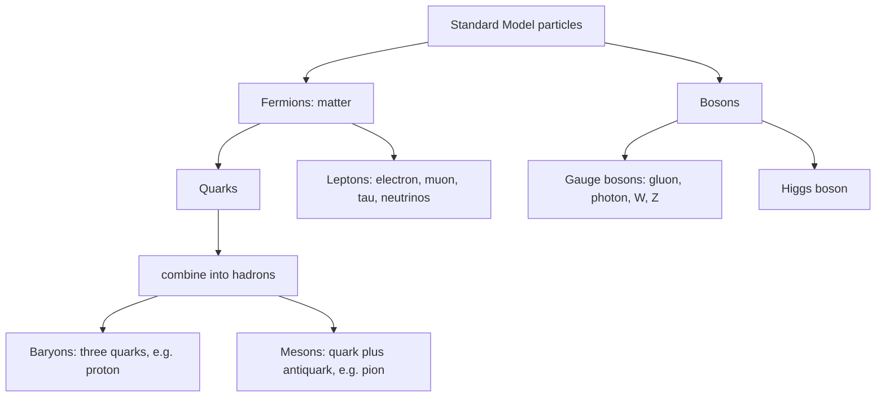

## What is everything made of?

The nuclear physics lesson built nuclei out of protons and neutrons and explained beta decay, in which a neutron turns into a proton while an electron and an antineutrino fly out. It left questions open. Are protons and neutrons themselves made of something smaller? What is an antineutrino? What holds the pieces together, and why does beta decay happen at all?

The answers make up the **Standard Model** of particle physics, built in the 1960s and 1970s and tested in detail since. It lists the smallest known building blocks of matter, the forces between them, and the rules for which reactions can happen. This lesson uses rest energy $E_0 = mc^2$, photons, and the circular path of a charge in a magnetic field.

## Antimatter

In 1928 Paul Dirac combined quantum mechanics with special relativity and found that his equation for the electron also described a partner with the same mass and the opposite charge. In 1932 Carl Anderson saw one: a cloud-chamber track that curved the "wrong" way in a magnetic field. This **positron** ($e^+$) was the first **antiparticle** found. Every particle has an antiparticle with the same mass and opposite charge (and the opposite of the other conserved numbers you'll meet below); a few neutral particles, such as the photon, are their own antiparticles. Antiparticles are written with a bar: $\bar\nu$ is an antineutrino, $\bar p$ an antiproton.

The nuclear-reactions honors lesson met the two processes that link matter, antimatter and energy. A particle and its antiparticle can **annihilate**, turning all their energy into other particles: an electron and a positron at rest give two 0.511 MeV photons flying apart (two, so that their momenta cancel). In reverse, **pair production** turns energy into a particle–antiparticle pair; a photon needs at least $2m_ec^2 = 1.022$ MeV, and a nucleus nearby to take up momentum, to make an electron and a positron. Heavier antiparticles need correspondingly more energy.

### Example 1: making antiprotons

The antiproton was first made in 1955 at the Bevatron in Berkeley by colliding fast protons with protons. The reaction can't be $p + p \to p + \bar p$: the charge would drop from $+2$ to $0$. The simplest reaction that works keeps both original protons and adds a proton–antiproton pair:

$$p + p \to p + p + p + \bar p.$$

Charge: $+2 \to +1 + 1 + 1 - 1 = +2$. ✓ (It also conserves baryon number, a rule coming later in the lesson.)

Now suppose two protons collide head-on with equal speeds, as in a modern collider. The total momentum is zero, so in principle all the energy can go into rest energy, with the four product particles left at rest. The new pair needs $2m_pc^2 = 2(938.3) = 1876.6$ MeV of extra rest energy, so each incoming proton needs kinetic energy of at least

$$K = \frac{1876.6\text{ MeV}}{2} = 938.3\text{ MeV} = m_pc^2.$$

If instead a proton hits a proton at rest, the products must keep moving to carry the momentum, which wastes energy. A relativistic calculation shows the beam then needs $K = 6m_pc^2 = 5.6$ GeV, six times the head-on figure. The Bevatron was built to reach about 6 GeV for exactly this reason, and it is why today's highest-energy machines collide two beams.

## Inside the proton: quarks

By the early 1960s accelerators had produced hundreds of short-lived particles that feel the strong force, collectively called **hadrons**. In 1964 Murray Gell-Mann and George Zweig independently proposed that hadrons are built from a few smaller particles, which Gell-Mann named **quarks**. From 1968, electrons fired at protons at SLAC bounced off small, point-like pieces inside, much as Rutherford had found the nucleus inside the atom.

Quarks have fractional charges: the up quark (u) has charge $+\tfrac23e$ and the down quark (d) has charge $-\tfrac13e$. Hadrons come in two families:

- **Baryons** are made of three quarks. The proton is uud: charge $\tfrac23 + \tfrac23 - \tfrac13 = +1$. The neutron is udd: charge $\tfrac23 - \tfrac13 - \tfrac13 = 0$.
- **Mesons** are made of a quark and an antiquark. The positive pion, $\pi^+$, is u$\bar{\text{d}}$: charge $\tfrac23 + \tfrac13 = +1$ (the antidown has charge $+\tfrac13$).

No one has ever isolated a single quark. The force between quarks does not weaken as they separate; pulling them apart takes so much energy that new quark–antiquark pairs are created, and they come out as hadrons. This is called **confinement**.

There are six kinds ("flavors") of quark, in three **generations** of increasing mass: up and down; charm and strange; top and bottom. The heaviest, the top quark, found at Fermilab in 1995, is nearly as heavy as a whole gold atom. Ordinary matter uses only the first generation.

## Leptons

The other matter particles, the **leptons**, don't feel the strong force at all. There are three charged ones, the electron, the muon (about 207 times the electron's mass) and the tau, and three neutral **neutrinos**, one paired with each. Neutrinos interact so weakly that hundreds of trillions from the Sun pass through your body every second without effect. They were thought massless until experiments around 1998–2001 showed that they change type in flight, which requires small masses.

Quarks and leptons are **fermions**: they obey the Pauli exclusion principle you met in the atomic-physics lesson, which is why matter takes up space. The particles in the right-hand column are **bosons**, which don't obey it.

## Four interactions and their carriers

In the Standard Model, a force between two particles comes from exchanging a third particle, a **gauge boson**. The photon carries the electromagnetic force; **gluons** carry the strong force between quarks; the **W and Z bosons** carry the weak force. Gravity is not part of the Standard Model; a carrier called the graviton has been proposed, but there is no tested quantum theory of gravity yet.

| Interaction | Acts on | Carrier | Range | Rough relative strength |
|---|---|---|---|---|
| Strong | quarks, gluons | gluons | about $10^{-15}$ m between hadrons | 1 |
| Electromagnetic | charged particles | photon | unlimited | $10^{-2}$ |
| Weak | quarks, leptons | W⁺, W⁻, Z⁰ | about $10^{-18}$ m | $10^{-6}$ |
| Gravity | everything with energy | (graviton, hypothetical) | unlimited | $10^{-38}$ |

The strengths are rough comparisons for two protons about $10^{-15}$ m apart; books quote different values, especially for the weak force, because the comparison depends on energy and distance. The strong force between nucleons from the nuclear lesson is a leftover of the gluon force between their quarks. The weak force is the one that changes one kind of quark or lepton into another: in beta decay, a d quark in a neutron becomes a u quark by emitting a W⁻, which then decays into an electron and an antineutrino.

### Range from the carrier's mass

Why is the weak force so short-ranged? In 1935 Hideki Yukawa argued that a force carried by a particle of mass $m$ has a limited range. A rough version uses the uncertainty principle: creating the carrier "borrows" energy $mc^2$, which is allowed only for a time of about $\hbar/(mc^2)$, and in that time the carrier can travel at most about $c$ times as far. So

$$R \approx \frac{\hbar c}{mc^2}, \qquad \hbar c = 197\text{ MeV·fm}.$$

This is an estimate, not an exact law, but it captures the pattern: heavy carriers give short ranges, a massless one unlimited range. From the short range of the nuclear force, Yukawa predicted a carrier about 200 times the electron's mass. The pion, found in 1947 with a rest energy of 140 MeV (which gives $R \approx 197/140 = 1.4$ fm), fits the idea.

### Example 2: the range of the weak force

The W boson's rest energy is 80.4 GeV $= 80\,400$ MeV. Estimate the range of the weak force.

$$R \approx \frac{197\text{ MeV·fm}}{80\,400\text{ MeV}} = 2.5\times10^{-3}\text{ fm} = 2.5\times10^{-18}\text{ m},$$

a few thousandths of a proton's size. That is why the weak force is so feeble at ordinary distances: its carrier can barely reach.

## The Higgs boson

The W and Z are heavy while the photon is massless, which the theory could only explain with one more ingredient, proposed in 1964 by Peter Higgs, François Englert and Robert Brout, and others: a field filling all of space. Particles that interact with it gain mass; the photon doesn't interact with it and stays massless. The field's own particle, the **Higgs boson**, was discovered at CERN's Large Hadron Collider (LHC) in 2012, with a rest energy of about 125 GeV, and Higgs and Englert shared the 2013 Nobel Prize.

One common misunderstanding: the Higgs field gives quarks their masses, but the up and down quarks are very light (a few MeV each), so the three quarks in a proton add up to only about 9 MeV of its 938 MeV. Almost all of the proton's mass, and so of yours, is the energy of the strong interaction inside it, through $E = mc^2$.

## Conservation laws: which reactions can happen

A particle reaction or decay can only happen if it conserves energy, momentum and charge, and also two counts that the Standard Model keeps:

- **Baryon number** $B$: $+\tfrac13$ for each quark, so $+1$ for each baryon, $-1$ for each antibaryon, and $0$ for mesons, leptons and photons.
- **Lepton number** $L$: $+1$ for each lepton (electron, muon, tau, neutrinos), $-1$ for each antilepton, $0$ for everything else. (In fact electron-type, muon-type and tau-type lepton numbers are each conserved in reactions; only neutrino oscillations mix them.)

A decay also needs energy: the particle at rest must have more rest energy than all its products combined.

### Example 3: allowed or forbidden?

Rest energies: proton 938.27 MeV, neutron 939.57 MeV, electron and positron 0.511 MeV.

(a) $n \to p + e^- + \bar\nu_e$. Charge: $0 \to +1 - 1 + 0$. ✓ $B$: $1 \to 1 + 0 + 0$. ✓ $L$: $0 \to 0 + 1 - 1$. ✓ Energy: $939.57 > 938.27 + 0.511$. ✓ **Allowed**: this is beta decay; a free neutron has a half-life of about 10 minutes.

(b) $p \to e^+ + \gamma$. Charge ✓, energy ✓, but $B$: $1 \to 0$. ✗ (Lepton number fails too: $L$: $0 \to -1$, since the positron is an antilepton.) **Forbidden.** Experiments watching huge tanks of water have never seen a proton decay and show its lifetime is longer than $10^{34}$ years, so baryon number conservation holds extremely well.

(c) $p \to n + e^+ + \nu_e$ for a free proton. Charge, $B$ and $L$ all balance, but the products need $939.57 + 0.511 = 940.08$ MeV, more than the proton's 938.27 MeV. ✗ **Forbidden for a free proton.** Inside some nuclei it does happen (beta-plus decay), because the change in nuclear binding energy supplies the difference.

## Accelerators: momentum from a magnetic field

To make heavy particles like the Higgs, physicists collide others at enormous energies, in rings where magnets bend the beam. The magnetism lesson's result $r = mv/(qB)$ is really $r = p/(qB)$, and it stays true at relativistic speeds if $p$ is the relativistic momentum $\gamma mv$. For a particle of charge $e$ it's convenient to write

$$p\ (\text{in GeV}/c) = 0.300\,B\ (\text{in T})\ r\ (\text{in m}).$$

### Example 4: bending LHC protons

The LHC was designed for 7.0 TeV protons, bent by magnets of 8.33 T. At this energy $pc \approx E$, so $p = 7000$ GeV/$c$. The bending radius is

$$r = \frac{p}{0.300B} = \frac{7000}{0.300(8.33)} = 2.80\times10^3\text{ m}.$$

The 2.8 km radius applies inside the bending magnets; with straight sections, the ring is 26.7 km around. Each proton's Lorentz factor is $E/(mc^2) = 7000/0.938 \approx 7500$, so its speed is within about 1 part in $10^8$ of $c$.

## Common mistakes

- Saying protons and neutrons are fundamental. They are baryons made of quarks; electrons, as far as anyone can tell, are fundamental.
- Adding quark charges as whole numbers. Up is $+\tfrac23$, down is $-\tfrac13$; antiquarks have the opposite signs.
- Checking only charge. A reaction must also conserve baryon number, lepton number and energy.
- Thinking the Higgs field gives the proton its mass. It gives the quarks their small masses; most of the proton's mass is strong-interaction energy.

## Key points

- Every particle has an antiparticle with equal mass and opposite charge; making a pair takes at least $2mc^2$, most efficiently in head-on collisions.
- Matter is made of fermions: quarks (u $+\tfrac23$, d $-\tfrac13$, and four heavier flavors) and leptons (e, μ, τ and three neutrinos), in three generations.
- Baryons are three quarks (p = uud, n = udd); mesons are quark–antiquark pairs; quarks are confined.
- Forces are carried by gauge bosons: gluons (strong), photon (electromagnetic), W and Z (weak); gravity is not in the Standard Model. Range $R \approx \hbar c/(mc^2)$.
- The Higgs field gives the W, Z, quarks and charged leptons mass (where neutrino masses come from is still open); the Higgs boson (125 GeV) was found in 2012.
- Reactions conserve energy, momentum, charge, baryon number and lepton number.
- In a magnetic field, $p = qBr$; $p$ (GeV/$c$) $= 0.300\,B$ (T) $r$ (m).
