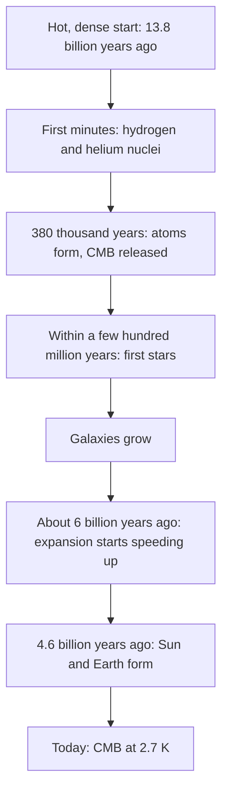

## Physics on the largest scale

**Cosmology** is the study of the universe as a whole: its size, its history and what it is made of. It may seem out of reach, since we can't visit galaxies or run experiments on them, but nearly everything we know comes from tools you already have. The Doppler effect from the sound lesson tells us how fast galaxies move. Wien's law from the quantum lesson reads a temperature from a spectrum. Orbits from the gravitation lesson weigh galaxies. Put together, these tools lead to a startling picture: the universe is expanding, it had a hot beginning about 13.8 billion years ago, and about 95% of it is made of something we have never seen directly.

## Measuring cosmic distances

Everything in cosmology starts with distances, and they are hard: a faint nearby star and a bright distant one can look the same.

**Parallax.** As Earth goes around the Sun, a nearby star seems to shift back and forth against much more distant stars, just as your thumb seems to jump when you look at it with one eye and then the other.


The **parallax angle** $p$ is half the star's total back-and-forth shift, the angle the Earth–Sun distance (1 AU) makes as seen from the star. Since $p$ is tiny, $d = (1\text{ AU})/p$ with $p$ in radians. Astronomers define the **parsec** (pc) as the distance at which $p$ is one arcsecond ($1'' = 1/3600$ of a degree). Then

$$d\ (\text{in pc}) = \frac{1}{p\ (\text{in arcseconds})}, \qquad 1\text{ pc} = 3.086\times10^{16}\text{ m} = 3.26\text{ light-years}.$$

A **light-year** (ly) is the distance light travels in a year, $9.46\times10^{15}$ m. The European Space Agency's Gaia satellite has measured parallaxes for over a billion stars, but only out to several thousand light-years with good accuracy, a tiny part of our galaxy.

### Example 1: the nearest star

Proxima Centauri has a parallax of 0.768″. Its distance is $d = 1/0.768 = 1.30$ pc, or $1.30 \times 3.26 = 4.24$ light-years. Its light left over four years ago.

**Standard candles.** Farther out, astronomers use objects whose true power output (luminosity $L$) is known. Light spreads over a sphere, so the brightness we measure, the intensity, is $I = L/(4\pi d^2)$; knowing $L$ and measuring $I$ gives $d$. In 1912 Henrietta Leavitt found that pulsating stars called Cepheid variables have a luminosity tied to their pulsation period, which made them the first **standard candles** for other galaxies. Today exploding stars called type Ia supernovae serve as standard candles out to billions of light-years.

## Redshift and Hubble's law

The light from a galaxy contains the same spectral lines as atoms on Earth, but shifted. The **redshift** $z$ is the fractional shift in wavelength:

$$z = \frac{\lambda_{\text{observed}} - \lambda_{\text{emitted}}}{\lambda_{\text{emitted}}}.$$

For $z$ much less than 1, the Doppler effect for light gives the galaxy's speed away from us: $v \approx cz$. In the 1910s Vesto Slipher found that almost all galaxies are redshifted. Georges Lemaître in 1927 and Edwin Hubble in 1929, combining redshifts with distances, found that the farther a galaxy is, the faster it recedes. This is **Hubble's law**:

$$v = H_0d,$$

where the **Hubble constant** $H_0$ is about 70 km/s per megaparsec (Mpc, a million parsecs). This value is a live research question: measurements from the early universe give about 67 km/s/Mpc, while measurements using Cepheids and supernovae give about 73. The gap, called the Hubble tension, is larger than either side's stated uncertainty and is not yet explained.

```plot
{"x": [0, 120], "y": [0, 9000], "xLabel": "distance (Mpc)", "yLabel": "recession speed (km/s)", "functions": [{"f": "70*x", "label": "v = 70 d"}], "points": [{"at": [15, 1200]}, {"at": [28, 1850]}, {"at": [43, 3020]}, {"at": [55, 3700]}, {"at": [70, 5100]}, {"at": [88, 6000]}, {"at": [105, 7500]}], "caption": "A Hubble diagram (illustrative data): recession speed grows in proportion to distance, and the slope is H₀"}
```

Hubble's law does not mean we are at the center. If space itself is stretching uniformly, every galaxy sees every other galaxy moving away at a speed proportional to distance, like raisins in rising bread dough: from any raisin, a raisin twice as far away moves off twice as fast. Strictly, a galaxy's large redshift comes from light's wavelength being stretched along with space while the light travels, not from motion through space, so $v \approx cz$ is only a good approximation for small $z$.

### Example 2: a galaxy's distance from its redshift

In a galaxy's spectrum, hydrogen's red line, emitted at 656.3 nm, is observed at 662.9 nm. Find the galaxy's speed and distance, using $H_0 = 70$ km/s/Mpc.

$$z = \frac{662.9 - 656.3}{656.3} = 0.0101, \qquad v \approx cz = (3.00\times10^5\text{ km/s})(0.0101) = 3.02\times10^3\text{ km/s}.$$

$$d = \frac{v}{H_0} = \frac{3020\text{ km/s}}{70\text{ km/s/Mpc}} = 43\text{ Mpc},$$

about 140 million light-years.

## How old is the universe?

Run the expansion backward. If every galaxy has always moved at its present speed, all were together a time $d/v = 1/H_0$ ago, called the **Hubble time**.

### Example 3: the Hubble time

Convert $H_0 = 70$ km/s/Mpc to SI units: 1 Mpc $= 3.086\times10^{19}$ km, so

$$\frac{1}{H_0} = \frac{3.086\times10^{19}\text{ km}}{70\text{ km/s}} = 4.41\times10^{17}\text{ s} = \frac{4.41\times10^{17}}{3.156\times10^7\text{ s/yr}} = 1.40\times10^{10}\text{ yr}.$$

About 14 billion years. The best value for the age of the universe, 13.8 billion years, comes from a full model fitted to the cosmic background radiation below. The two are close partly by coincidence: the expansion slowed for billions of years and has since been speeding up.

## The hot beginning

The **Big Bang** theory says the universe was once extremely hot and dense, and has been expanding and cooling ever since. (It was not an explosion at a point in space; space itself has been expanding everywhere.) Three main lines of evidence support it:

1. **Expansion**, Hubble's law.
2. **Cosmic microwave background** (CMB). About 380 000 years after the start, the universe cooled to about 3000 K, cool enough for electrons and nuclei to form neutral atoms, and it became transparent. The light released then has been stretched by the expansion by a factor of about 1100 and now arrives from every direction as blackbody radiation at 2.725 K. Arno Penzias and Robert Wilson discovered it by accident in 1965, and NASA's COBE satellite measured its spectrum in 1990 as the most perfect blackbody ever seen.
3. **Light elements.** In the first few minutes the universe was a fusion reactor that turned about a quarter of the hydrogen's mass into helium, just as observed in the oldest gas.



## Dark matter

A star orbiting a galaxy's center obeys the same rule as a planet orbiting the Sun: gravity supplies the centripetal force, $GM(r)m/r^2 = mv^2/r$, where $M(r)$ is the mass inside the orbit. So

$$v = \sqrt{\frac{GM(r)}{r}}, \qquad M(r) = \frac{v^2r}{G}.$$

Most of a galaxy's stars are near its center. If that were all its mass, stars far out should orbit more slowly, with $v \propto 1/\sqrt r$, like the outer planets. Instead, in the 1970s Vera Rubin and Kent Ford, followed by radio astronomers, found that orbital speeds stay roughly constant far beyond the visible edge. A flat **rotation curve** means $M(r) = v^2r/G$ keeps growing in proportion to $r$: there is mass out there we cannot see.

```plot
{"x": [0, 30], "y": [0, 300], "xLabel": "distance from galaxy center (kpc)", "yLabel": "orbital speed (km/s)", "functions": [{"f": "230*(1 - exp(-x/2.5))", "label": "observed (roughly flat)"}, {"f": "221*sqrt(8/x)", "label": "expected from visible mass", "dashed": true, "from": 8}], "caption": "A schematic rotation curve: speeds stay high far from the center instead of falling off"}
```

### Example 4: weighing the Milky Way

The Sun orbits the center of the Milky Way at about 230 km/s, at a distance of about 8.2 kpc $= 2.53\times10^{20}$ m. Find the mass inside the Sun's orbit.

$$M = \frac{v^2r}{G} = \frac{(2.30\times10^5)^2(2.53\times10^{20})}{6.67\times10^{-11}} = 2.0\times10^{41}\text{ kg},$$

about $1.0\times10^{11}$ solar masses. (This treats the mass as if it were all at the center, which is only roughly right for a flattened galaxy.) Since the curve stays flat far beyond the Sun, the total mass is several times larger, far more than the stars and gas we see.

The name **dark matter** is for whatever this is: matter that has gravity but emits no light. Other evidence agrees: Fritz Zwicky found in 1933 that galaxies in clusters move too fast for the visible mass to hold them; clusters bend background light (gravitational lensing) more than their visible mass can; and the pattern of hot and cold spots in the CMB needs it. What dark matter is remains unknown. Searches for new particles have not found it yet, and a minority of researchers instead propose modifying the law of gravity.

## Dark energy and the cosmic budget

In 1998 two teams measuring type Ia supernovae found that distant ones were dimmer, so farther away, than a slowing expansion allowed: the expansion is accelerating. Whatever drives it is called **dark energy**; its nature is the biggest open question in cosmology. Saul Perlmutter, Brian Schmidt and Adam Riess shared the 2011 Nobel Prize for the discovery.

A Newtonian argument shows how much matter would be "just enough" to stop the expansion. A galaxy at distance $r$ moving at $v = Hr$ just escapes the mass $M = \tfrac43\pi r^3\rho$ inside its distance if $\tfrac12v^2 = GM/r$. Solving gives the **critical density**

$$\rho_c = \frac{3H^2}{8\pi G}.$$

(General relativity gives the same formula.) With $H_0 = 70$ km/s/Mpc $= 2.27\times10^{-18}$ s⁻¹, $\rho_c = 9.2\times10^{-27}$ kg/m³, the mass of five or six hydrogen atoms per cubic meter. Measurements show the total density is very close to $\rho_c$, made up of roughly 5% ordinary matter, 27% dark matter and 68% dark energy (2018 values from the Planck satellite).

## Common mistakes

- Picturing the Big Bang as an explosion from a center into empty space. Space itself expands everywhere; there is no center.
- Using $v = cz$ for large redshifts; it only works for $z$ much less than 1.
- Forgetting unit conversions in $1/H_0$: km and Mpc must cancel.
- Taking 1/(parallax) in degrees or radians. $d = 1/p$ gives parsecs only when $p$ is in arcseconds.
- Calling dark matter and dark energy the same thing. Dark matter pulls (gravity, clumps around galaxies); dark energy drives the speed-up of the expansion.

## Key points

- Parallax: $d$ (pc) $= 1/p$ (arcsec); 1 pc $= 3.26$ ly $= 3.086\times10^{16}$ m. Standard candles use $I = L/(4\pi d^2)$.
- Redshift $z = \Delta\lambda/\lambda$; $v \approx cz$ for small $z$; Hubble's law $v = H_0d$, $H_0 \approx 70$ km/s/Mpc (67 to 73 depending on method).
- Hubble time $1/H_0 \approx 14$ billion years; the measured age is 13.8 billion years.
- Big Bang evidence: expansion, the 2.725 K cosmic microwave background, and light-element abundances.
- Flat rotation curves ($M = v^2r/G$ growing with $r$), cluster motions and lensing point to dark matter; accelerating expansion points to dark energy.
- Critical density $\rho_c = 3H^2/(8\pi G)$; the universe is about 5% ordinary matter, 27% dark matter, 68% dark energy.
