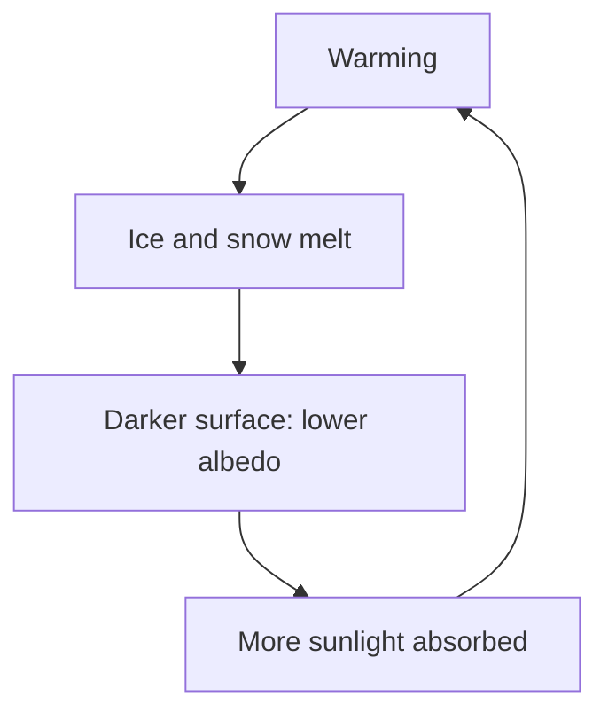

## A planet as a thermodynamic system

The heat lesson introduced the Stefan–Boltzmann law: a surface at absolute temperature $T$ radiates power $P = e\sigma AT^4$. The quantum lesson added Wien's law: the hotter the object, the shorter the wavelength where its radiation peaks. Together with conservation of energy, these two laws explain why Earth has the temperature it has, why it is warmer than a bare rock at the same distance from the Sun, and why adding carbon dioxide to the air warms it further.

This is physics at the frontier in a different sense: not new particles or distant galaxies, but a system complicated enough that research continues, and important enough that the 2021 Nobel Prize in Physics went partly to Syukuro Manabe and Klaus Hasselmann for modeling Earth's climate. The simple models in this lesson are the ones those researchers started from. They capture the mechanism and the rough numbers; real climate models add the atmosphere's motion, water and clouds.

## Sunlight arriving

The Sun radiates a total power (its luminosity) of $L = 3.83\times10^{26}$ W. At distance $d$ that power is spread over a sphere of area $4\pi d^2$, so the intensity of sunlight is

$$S = \frac{L}{4\pi d^2}.$$

At Earth's distance this is the **solar constant**, the power per square meter on a surface facing the Sun above the atmosphere.

### Example 1: the solar constant

With $d = 1.496\times10^{11}$ m:

$$S = \frac{3.83\times10^{26}}{4\pi(1.496\times10^{11})^2} = 1.36\times10^3\text{ W/m}^2.$$

Satellites measure 1361 W/m², varying by only about 0.1% over the Sun's 11-year cycle. Mars, 1.52 times as far from the Sun, gets $1361/1.52^2 = 589$ W/m², by the inverse-square law.

## The energy balance of a bare planet

A planet's temperature settles where the power it absorbs from sunlight equals the power it radiates away. If it absorbed more, it would warm up and radiate more ($P \propto T^4$) until the two matched.


*Absorbed.* Sunlight arrives as a parallel beam, so the planet intercepts it over its cross-section, a disk of area $\pi R^2$. A fraction of it, the **albedo** $\alpha$, is reflected straight back to space by clouds, ice and bright ground; for Earth, $\alpha \approx 0.30$. Absorbed power: $S(1 - \alpha)\pi R^2$.

*Emitted.* The planet radiates infrared from its whole surface, area $4\pi R^2$, and most surfaces and clouds are nearly perfect emitters ($e \approx 1$) in the infrared. Emitted power: $4\pi R^2\sigma T^4$.

Setting them equal, $R$ cancels:

$$T_e = \left(\frac{S(1 - \alpha)}{4\sigma}\right)^{1/4}.$$

$T_e$ is the planet's **effective temperature**, the temperature a blackbody would need to radiate away what the planet absorbs. The 4 comes from the ratio of the sphere's area to its cross-section: averaged over day and night and over the globe, each square meter receives a quarter of $S$.

### Example 2: Earth without a greenhouse effect

$$T_e = \left(\frac{1361(1 - 0.30)}{4(5.67\times10^{-8})}\right)^{1/4} = \left(4.20\times10^9\right)^{1/4} = 255\text{ K},$$

about $-18$ °C. But Earth's average surface temperature is about 288 K (15 °C). The 33 K difference is the **greenhouse effect**, and without it most of Earth would be frozen.

## Sunlight in, infrared out

Why does the atmosphere warm the surface? Because sunlight and Earth's own radiation are very different kinds of light. By Wien's law, $\lambda_{\max} = (2.898\times10^{-3}\text{ m·K})/T$:

- the Sun's surface, at 5772 K, peaks at 502 nm, visible light;
- Earth's surface, at 288 K, peaks at 10 μm, in the infrared.

The main gases of air, nitrogen and oxygen, hardly absorb either. But **greenhouse gases**, such as water vapor, carbon dioxide (CO₂) and methane, let most sunlight through while absorbing infrared at particular wavelengths, because their molecules can bend and stretch at infrared frequencies (CO₂ absorbs strongly near 15 μm, close to Earth's peak). Eunice Foote (1856) and John Tyndall (1859) showed in the laboratory that CO₂ and water vapor absorb heat radiation, and Svante Arrhenius made the first calculation of CO₂'s effect on Earth's temperature in 1896.

A gas that absorbs infrared also emits it, in all directions, including back down. So the surface receives sunlight *plus* infrared from the atmosphere, and must warm up until it radiates enough to balance both.

## A one-layer model

Model the atmosphere as a single layer that is transparent to sunlight and absorbs a fraction $\varepsilon$ of the infrared from the surface (and, being a good absorber at those wavelengths, emits with emissivity $\varepsilon$ too). Per square meter of surface, the absorbed sunlight is $\sigma T_e^4$ (from Example 2's balance). Two balances, each power in = power out:

*The layer* absorbs $\varepsilon\sigma T_s^4$ from the surface and emits $\varepsilon\sigma T_a^4$ both up and down: $\varepsilon\sigma T_s^4 = 2\varepsilon\sigma T_a^4$, so $\sigma T_a^4 = \tfrac12\sigma T_s^4$.

*The surface* absorbs sunlight and the layer's downward infrared, and emits $\sigma T_s^4$: $\sigma T_e^4 + \varepsilon\sigma T_a^4 = \sigma T_s^4$.

Substitute the first into the second: $\sigma T_e^4 = \sigma T_s^4(1 - \varepsilon/2)$, so

$$T_s = T_e\left(\frac{2}{2 - \varepsilon}\right)^{1/4}.$$

With no absorption ($\varepsilon = 0$) the surface is at $T_e$. With a layer absorbing all the infrared ($\varepsilon = 1$), $T_s = 2^{1/4}(255) = 303$ K, too warm. Real values lie in between.

```plot
{"x": [0, 1], "y": [250, 310], "xLabel": "infrared absorbed by the layer, ε", "yLabel": "surface temperature (K)", "functions": [{"f": "254.6*(2/(2 - x))^0.25", "label": "one-layer model"}], "points": [{"at": [0.78, 288], "label": "Earth today, 288 K"}], "caption": "One-layer model: the more infrared the atmosphere absorbs, the warmer the surface"}
```

### Example 3: how absorbing is Earth's atmosphere?

What value of $\varepsilon$ gives Earth's observed 288 K? Solve for $\varepsilon$:

$$\left(\frac{T_e}{T_s}\right)^4 = \frac{2 - \varepsilon}{2} \quad\Rightarrow\quad \varepsilon = 2 - 2\left(\frac{255}{288}\right)^4 = 2 - 2(0.611) = 0.78.$$

So in this model the atmosphere absorbs about 78% of the surface's infrared. Notice what the model predicts: add more greenhouse gas, $\varepsilon$ rises, and the surface warms, even though the sunlight hasn't changed. Viewed from space, the planet must still radiate $\sigma T_e^4$ per square meter on average to balance the sunlight; the extra gas just makes the surface warmer underneath. (The model is a teaching tool. In the real atmosphere, convection carries much of the surface's heat upward, absorption varies strongly with wavelength, and clouds both reflect sunlight and trap infrared.)

## Forcing, feedbacks and sensitivity

Climate scientists describe a change in terms of **radiative forcing** $\Delta F$: the change in the net energy flow into the climate system, in W/m², before temperatures respond. For CO₂, detailed radiation calculations fit

$$\Delta F \approx 5.35\ln\frac{C}{C_0}\text{ W/m}^2,$$

where $C_0$ and $C$ are the old and new concentrations. The logarithm appears because the center of CO₂'s absorption band is already nearly saturated; extra CO₂ acts mainly at the band's edges, so each doubling adds about the same forcing, $5.35\ln 2 = 3.7$ W/m².

How much warming does a forcing cause? With no other changes, a warmer planet radiates more, by about $\Delta(\sigma T^4) \approx 4\sigma T_e^3\,\Delta T$. So the bare response is

$$\Delta T_0 \approx \frac{\Delta F}{4\sigma T_e^3} = \frac{\Delta F}{3.7\text{ W/(m}^2\text{·K)}}.$$

### Example 4: CO₂ so far, and a doubling

Before industrialization, CO₂ was about 280 parts per million (ppm); by the early 2020s it had passed 420 ppm. The forcing from that rise is $5.35\ln(420/280) = 5.35(0.405) = 2.2$ W/m². For a doubling, $\Delta F = 3.7$ W/m² and $\Delta T_0 = 3.7/3.7 = 1.0$ K. (More careful calculations give about 1.2 K for this no-feedback response.)

But the climate does not stay otherwise unchanged. Warming triggers **feedbacks**, changes that alter the energy balance further:

- **Water vapor** (amplifying): warmer air holds about 7% more water vapor per kelvin, and water vapor is a greenhouse gas.
- **Ice and snow** (amplifying): melting ice exposes darker ground and ocean, lowering the albedo.
- **Clouds** (uncertain): clouds reflect sunlight and trap infrared, and how they change is the largest source of uncertainty; most evidence suggests a small amplifying effect overall.



The total warming after the climate settles, for a doubling of CO₂, is called the **climate sensitivity**. The 2021 report of the Intergovernmental Panel on Climate Change (IPCC) gives a best estimate of 3 °C, likely between 2.5 and 4 °C, combining physics, observations and Earth's past climates. That the greenhouse effect is real and that added CO₂ warms the planet is basic, well-tested physics; the exact sensitivity is where the remaining scientific uncertainty lies. By 2011–2020, the global surface had warmed by about 1.1 °C compared with 1850–1900.

## Common mistakes

- Using the planet's full surface area $4\pi R^2$ for absorbed sunlight. Sunlight is intercepted by the cross-section $\pi R^2$; the factor 4 enters only when you average.
- Forgetting the albedo, or using it for emission. Albedo reflects sunlight; infrared emission uses emissivity.
- Using Celsius in $T^4$. Always use kelvins.
- Thinking greenhouse gases "trap" sunlight. They are nearly transparent to sunlight; they absorb and re-emit the infrared the surface gives off.
- Adding forcings from successive CO₂ increases linearly. The forcing grows with the logarithm of the concentration: each doubling adds about 3.7 W/m².

## Key points

- Solar constant $S = L/(4\pi d^2) = 1361$ W/m² at Earth.
- Energy balance: $S(1 - \alpha)\pi R^2 = 4\pi R^2\sigma T_e^4$, so $T_e = [S(1 - \alpha)/(4\sigma)]^{1/4}$; Earth: 255 K, compared with a 288 K surface.
- Sunlight peaks in the visible, Earth's emission near 10 μm; greenhouse gases absorb and re-emit the infrared.
- One-layer model: $T_s = T_e[2/(2 - \varepsilon)]^{1/4}$; $\varepsilon \approx 0.78$ matches Earth.
- CO₂ forcing $\Delta F \approx 5.35\ln(C/C_0)$ W/m²; 3.7 W/m² per doubling; no-feedback warming about 1 K per doubling.
- Feedbacks (water vapor, ice–albedo, clouds) bring the climate sensitivity to about 3 °C per doubling (likely 2.5 to 4 °C).
