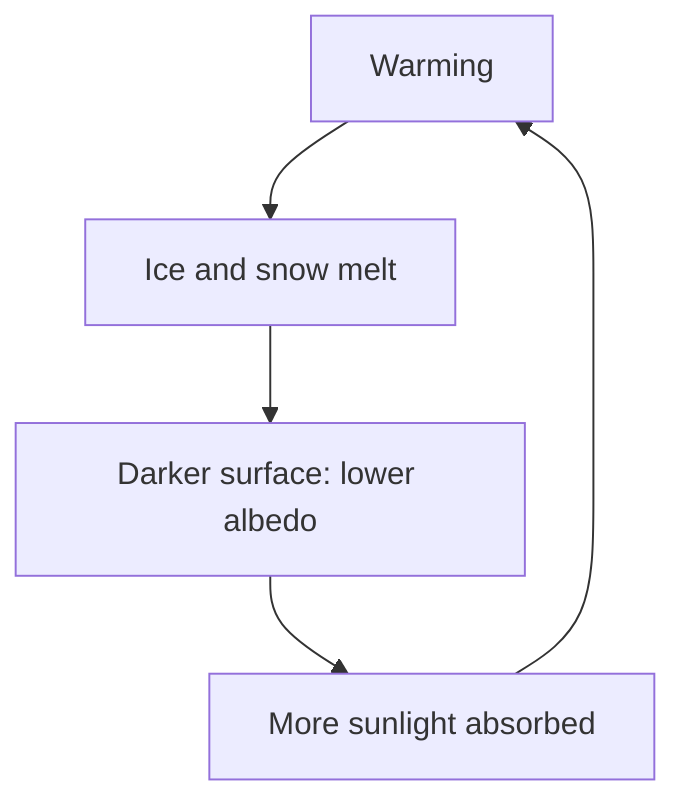

## From a planet's temperature to climate change

The heat lesson introduced the Stefan–Boltzmann law, $P = e\sigma AT^4$, and the quantum lesson Wien's law, which says hotter objects radiate at shorter wavelengths. The honors lesson on insulation and radiation used them to find a planet's temperature and to explain the greenhouse effect with a simple model. This lesson asks the questions that follow. How strongly does the atmosphere hold in heat? Why does adding carbon dioxide warm the surface, even though CO₂ already absorbs much of the infrared it can? And how much warming does a given change cause, once the rest of the climate responds?

These are research questions; the 2021 Nobel Prize in Physics went in part to Syukuro Manabe and Klaus Hasselmann for modeling Earth's climate. The models here are the simple ones that research builds on. They capture the mechanisms and the rough numbers, and we label their simplifications as we go.

## Recap: the energy balance


Sunlight arrives with intensity $S = 1361$ W/m² (the **solar constant**), and a fraction $\alpha \approx 0.30$, the **albedo**, is reflected. The planet intercepts sunlight over its cross-section $\pi R^2$ but radiates infrared from its whole surface $4\pi R^2$. Balancing the two gives the **equilibrium temperature**

$$T_e = \left(\frac{S(1 - \alpha)}{4\sigma}\right)^{1/4} = 255\text{ K for Earth},$$

while Earth's average surface is about 288 K. The 33 K difference is the **greenhouse effect**. Sunlight, peaking near 0.5 μm, passes through the air; the surface's infrared, peaking near 10 μm, is absorbed by **greenhouse gases** such as water vapor and CO₂, whose molecules bend and stretch at infrared frequencies (CO₂ absorbs strongly near 15 μm). Eunice Foote (1856) and John Tyndall (1859) first showed in the laboratory that these gases absorb heat radiation.

## A partly absorbing layer

The simplest greenhouse model treats the atmosphere as one layer that absorbs *all* the surface's infrared, and it gives $T_s = 2^{1/4}T_e = 303$ K, too warm. A better version lets the layer absorb only a fraction $\varepsilon$ of the surface's infrared. A good absorber at a wavelength is an equally good emitter there, so the layer also emits with emissivity $\varepsilon$, from both its top and its bottom. Per square meter, the absorbed sunlight is $\sigma T_e^4$. Two balances:

*The layer* absorbs $\varepsilon\sigma T_s^4$ and emits $\varepsilon\sigma T_a^4$ up and the same down: $\varepsilon\sigma T_s^4 = 2\varepsilon\sigma T_a^4$, so $\sigma T_a^4 = \tfrac12\sigma T_s^4$.

*The surface* absorbs sunlight plus the layer's downward infrared and emits $\sigma T_s^4$: $\sigma T_e^4 + \varepsilon\sigma T_a^4 = \sigma T_s^4$.

Substituting the first into the second gives $\sigma T_e^4 = \sigma T_s^4(1 - \varepsilon/2)$, so

$$T_s = T_e\left(\frac{2}{2 - \varepsilon}\right)^{1/4}.$$

For $\varepsilon = 0$ this gives $T_e$; for $\varepsilon = 1$, the all-absorbing 303 K. As a check, the energy leaving the top, $(1 - \varepsilon)\sigma T_s^4 + \varepsilon\sigma T_a^4 = \sigma T_s^4(1 - \varepsilon/2) = \sigma T_e^4$, still equals the absorbed sunlight, as it must.

```plot
{"x": [0, 1], "y": [250, 310], "xLabel": "fraction of infrared absorbed, ε", "yLabel": "surface temperature (K)", "functions": [{"f": "254.6*(2/(2 - x))^0.25", "label": "one-layer model"}], "points": [{"at": [0.78, 288], "label": "Earth, 288 K"}], "caption": "One-layer model: the more infrared the layer absorbs, the warmer the surface"}
```

### Example 1: how absorbing is the atmosphere?

What $\varepsilon$ gives Earth's 288 K? Rearranging, $(T_e/T_s)^4 = (2 - \varepsilon)/2$, so, with the unrounded $T_e = 254.6$ K,

$$\varepsilon = 2 - 2\left(\frac{254.6}{288}\right)^4 = 2 - 2(0.611) = 0.78.$$

In this model the atmosphere absorbs about 78% of the surface's infrared, and raising $\varepsilon$ raises $T_s$ with no change in sunlight. (A teaching model: the real atmosphere absorbs very differently at different wavelengths, clouds both reflect sunlight and trap infrared, and convection carries much of the surface's heat upward.)

## Where Earth radiates from: the emission height

The layer model hides something important about the real atmosphere: it gets colder with height. In the lowest 10 km or so, convection keeps the temperature falling by about 6.5 K per kilometer on average, a rate called the **lapse rate**. Infrared emitted near the ground is mostly absorbed overhead; the radiation that escapes to space comes mainly from higher up, where there is less gas above to absorb it. Averaged over wavelengths, Earth radiates to space as if from an **emission height** of about 5 km. And the temperature there is

$$288\text{ K} - (6.5\text{ K/km})(5\text{ km}) = 255.5\text{ K} \approx T_e.$$

That is no coincidence. The planet must radiate $\sigma T_e^4$ to space, so the layer it radiates from has to sit at about $T_e$; the surface is warmer because it lies several kilometers below, down the lapse rate.

Now add CO₂. The air becomes more opaque in the infrared, so the escaping radiation comes from higher, colder air, and the planet radiates less than it absorbs. It warms until the new, higher emission level is back at $T_e$, and the whole temperature profile, surface included, has shifted up. This also answers a common objection, that CO₂'s absorption is already "saturated": at wavelengths near the band's center, adding CO₂ doesn't change how much is absorbed near the ground, but it still raises the height from which radiation escapes, and the band's edges are far from saturated.

### Example 2: surface warming from a higher emission level

Suppose added CO₂ raises the average emission height by 180 m, with the lapse rate unchanged. The new emission level must warm to $T_e$, so the surface warms by

$$\Delta T_s = (6.5\text{ K/km})(0.18\text{ km}) = 1.2\text{ K}.$$

(This is roughly what detailed calculations give for doubling CO₂ before any feedbacks. The picture is simplified: the real emission height differs with wavelength, and the lapse rate itself changes as the climate warms.)

## Forcing and the planet's first response

Climate scientists measure a change by its **radiative forcing** $\Delta F$: the change in the net energy flowing into the climate system, in W/m², before temperatures respond. Detailed radiation calculations for CO₂ fit

$$\Delta F \approx 5.35\ln\frac{C}{C_0}\text{ W/m}^2,$$

where $C_0$ and $C$ are the old and new concentrations. The logarithm comes from the saturation just described: each doubling adds about the same forcing, $5.35\ln 2 = 3.7$ W/m².

A warmer planet radiates more. Since $\Delta(\sigma T^4) \approx 4\sigma T^3\Delta T$, at $T_e = 255$ K each kelvin of warming sends out about $4\sigma T_e^3 = 3.7$ W/m² more. So, with nothing else changing,

$$\Delta T_0 \approx \frac{\Delta F}{3.7\text{ W/(m}^2\text{·K)}}.$$

### Example 3: CO₂ so far, and a doubling

Before industrialization, CO₂ was about 280 ppm; by the early 2020s it had reached about 420 ppm. The forcing is $5.35\ln(420/280) = 5.35(0.405) = 2.2$ W/m². For a doubling, $\Delta F = 3.7$ W/m² and $\Delta T_0 \approx 3.7/3.7 = 1.0$ K. More careful calculations, which account for the real atmosphere's temperature profile, give about 1.2 K, consistent with Example 2.

## Feedbacks

A warmer climate changes in ways that alter the energy balance again. These **feedbacks** decide most of the final answer:

- **Water vapor** (amplifying): warmer air holds about 7% more water vapor per kelvin, and water vapor is a greenhouse gas.
- **Ice and snow** (amplifying): melting exposes darker ground and ocean, lowering the albedo.
- **Clouds** (uncertain): clouds reflect sunlight and trap infrared, and how they change is the largest uncertainty; most evidence points to a small amplifying effect.
- **Lapse-rate changes** (reducing): in the tropics the upper air warms more than the surface, so it radiates more effectively, which partly offsets the water-vapor feedback.



A simple way to combine them: suppose the net feedbacks turn each kelvin of warming into an extra $f$ kelvin. The first response $\Delta T_0$ triggers $f\Delta T_0$ more, which triggers $f^2\Delta T_0$, and so on. For $0 \le f < 1$ this geometric series adds up to

$$\Delta T = \Delta T_0(1 + f + f^2 + \cdots) = \frac{\Delta T_0}{1 - f}.$$

### Example 4: feedbacks and the uncertainty they cause

The best estimate for the warming from doubling CO₂, once the climate settles, is 3 °C. With $\Delta T_0 = 1.2$ K, what feedback factor does that imply?

$$3.0 = \frac{1.2}{1 - f} \quad\Rightarrow\quad 1 - f = 0.40, \quad f = 0.60.$$

Now see how sensitive the answer is to $f$. With $f = 0.50$, $\Delta T = 1.2/0.50 = 2.4$ K; with $f = 0.70$, $\Delta T = 1.2/0.30 = 4.0$ K. A modest uncertainty in the feedbacks, mostly from clouds, becomes a wide range in the result, and the range is lopsided: the closer $f$ gets to 1, the faster $\Delta T$ grows.

## Climate sensitivity

The eventual warming for a doubling of CO₂ is the **climate sensitivity**. Svante Arrhenius made the first estimate in 1896, by hand: about 5 to 6 °C. In 1967 Manabe and Richard Wetherald, with a model that included both convection and the water-vapor feedback, found about 2.3 °C. The 2021 report of the Intergovernmental Panel on Climate Change (IPCC) gives a best estimate of 3 °C, likely between 2.5 and 4 °C, combining physics, observations and Earth's past climates. That added CO₂ warms the planet is well-tested physics; the exact sensitivity is where the remaining uncertainty lies. By 2011–2020 the global surface had warmed by about 1.1 °C compared with 1850–1900.

## Common mistakes

- Thinking greenhouse gases "trap sunlight." They are nearly transparent to sunlight; they absorb and re-emit the surface's infrared.
- Concluding that a saturated absorption band means more CO₂ does nothing. It still raises the emission height, and the band's edges still absorb more.
- Adding forcings from successive CO₂ increases linearly. Forcing grows with the logarithm: each doubling adds about 3.7 W/m².
- Using $\Delta T_0(1 + f)$ for the effect of feedbacks. Each round of feedback triggers another, so the total is $\Delta T_0/(1 - f)$.
- Using Celsius in $T^4$ or $4\sigma T^3$. Always use kelvins.

## Key points

- Equilibrium temperature $T_e = [S(1 - \alpha)/(4\sigma)]^{1/4} = 255$ K for Earth; the surface is 288 K.
- One-layer model with partial absorption: $T_s = T_e[2/(2 - \varepsilon)]^{1/4}$; $\varepsilon \approx 0.78$ matches Earth.
- Earth radiates to space from about 5 km up, where it is near $T_e$; the surface is warmer by the lapse rate (about 6.5 K/km) times that height. More CO₂ raises the emission height.
- CO₂ forcing $\Delta F \approx 5.35\ln(C/C_0)$ W/m², 3.7 W/m² per doubling; the no-feedback response is about $\Delta F/(3.7\text{ W/(m}^2\text{·K)})$, roughly 1 to 1.2 K per doubling.
- Feedbacks: $\Delta T = \Delta T_0/(1 - f)$; water vapor and ice amplify, clouds are the main uncertainty.
- Climate sensitivity: about 3 °C per doubling, likely 2.5 to 4 °C (IPCC, 2021).
