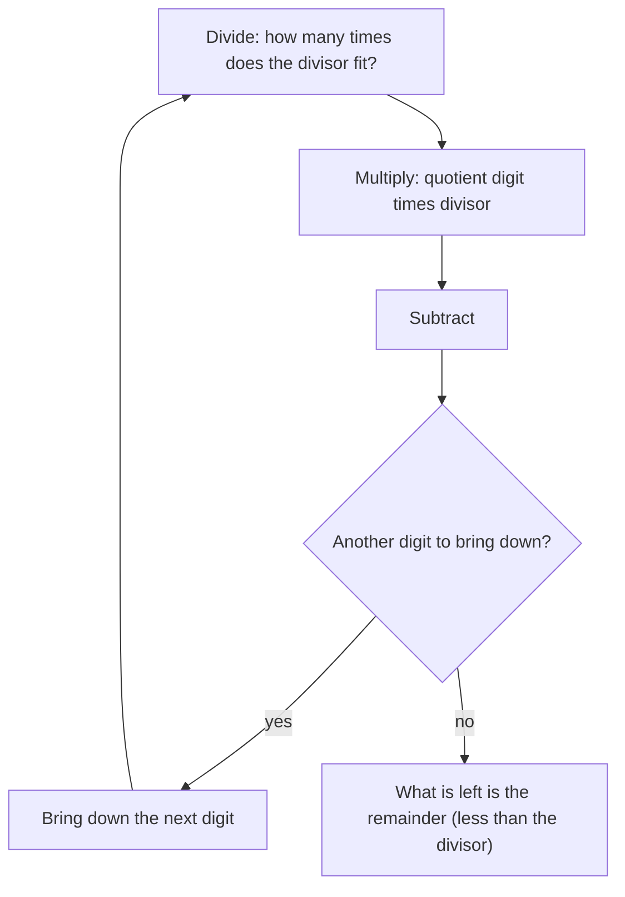

## The four operations

In the last lesson you saw that a number is a sum of place values. This lesson is about the four operations (adding, subtracting, multiplying and dividing), the words used to name their results, the properties that let you rearrange a calculation, and how to decide which operation a word problem is asking for.

| Operation | Example | Name of the result | Names of the parts |
|---|---|---|---|
| Addition | $8 + 5 = 13$ | **sum** | addends |
| Subtraction | $13 - 5 = 8$ | **difference** | minuend − subtrahend |
| Multiplication | $6 \times 4 = 24$ | **product** | **factors** |
| Division | $24 \div 4 = 6$ | **quotient** | **dividend** ÷ **divisor** |

Multiplication can be written several ways: $6 \times 4$, $6 \cdot 4$, $(6)(4)$, and later, with letters, $6x$. Division can be written $24 \div 4$, $24/4$ or $\dfrac{24}{4}$.

## What the operations mean

**Addition** combines amounts. **Subtraction** takes away, or finds how far apart two amounts are ("how many more?"). Subtraction undoes addition: since $8 + 5 = 13$, we know $13 - 5 = 8$. This is how you check a subtraction.

**Multiplication** is repeated addition of equal groups: $6 \times 4$ means six groups of four, $4 + 4 + 4 + 4 + 4 + 4 = 24$. You can also picture it as a rectangle of 6 rows and 4 columns, which is why area is length times width.

**Division** splits an amount into equal groups. $24 \div 4$ asks "how many 4s fit into 24?" or "if 24 is shared among 4, how much does each get?" Division undoes multiplication: $24 \div 4 = 6$ because $6 \times 4 = 24$.

## Properties that let you rearrange

These properties are true for every number, which is why you can rely on them.

- **Commutative property**: order doesn't matter for addition or multiplication. $a + b = b + a$ and $a \times b = b \times a$. (It fails for subtraction and division: $10 - 3 \ne 3 - 10$.)
- **Associative property**: grouping doesn't matter for addition or multiplication. $(a + b) + c = a + (b + c)$ and $(a \times b) \times c = a \times (b \times c)$. This lets you pick convenient pairs: $25 \times 7 \times 4 = (25 \times 4) \times 7 = 100 \times 7 = 700$.
- **Identity properties**: adding 0 changes nothing ($a + 0 = a$), and multiplying by 1 changes nothing ($a \times 1 = a$).
- **Zero property of multiplication**: anything times 0 is 0.
- Division by zero is **undefined**. If $12 \div 0$ were some number $q$, then $q \times 0$ would have to equal 12, but anything times 0 is 0. No number works, so we say it has no value. On the other hand $0 \div 12 = 0$, because $0 \times 12 = 0$.

## Multiplying larger numbers

Multi-digit multiplication uses place value and the distributive idea: to find $47 \times 36$, split 36 into $30 + 6$.

$$47 \times 36 = 47 \times 30 + 47 \times 6 = 1{,}410 + 282 = 1{,}692$$

The usual written method does exactly this: one row for the ones digit (282), one row for the tens digit (1,410, which is why that row is shifted one place left), then add.

An **area model** shows why. Think of $47 \times 36$ as the area of a rectangle 47 units wide and 36 tall, and cut each side at its place values: $47 = 40 + 7$ and $36 = 30 + 6$. The four smaller rectangles are the four partial products, and together they make the whole.

The two rows of the written method are the same four pieces grouped differently: the bottom row of the picture, $240 + 42 = 282$, is $47 \times 6$, and the top row, $1{,}200 + 210 = 1{,}410$, is $47 \times 30$.

## Long division and remainders

Long division handles one place at a time, from the left. The cycle is *divide, multiply, subtract, bring down*.

### Example 1

Divide $7{,}385 \div 6$.

- 6 into 7 goes 1 time. $1 \times 6 = 6$; $7 - 6 = 1$. Bring down 3: 13.
- 6 into 13 goes 2 times. $2 \times 6 = 12$; $13 - 12 = 1$. Bring down 8: 18.
- 6 into 18 goes 3 times. $3 \times 6 = 18$; $18 - 18 = 0$. Bring down 5: 5.
- 6 into 5 goes 0 times. $0 \times 6 = 0$; $5 - 0 = 5$. Nothing left to bring down.

Written out in the usual layout, the work looks like this:

The quotient is 1,230 and the **remainder** is 5, written 1,230 R 5. Check: quotient × divisor + remainder should give the dividend. $1{,}230 \times 6 + 5 = 7{,}380 + 5 = 7{,}385$. ✓ The remainder must always be smaller than the divisor; if it isn't, the quotient digit was too small.

The check rule is worth remembering as a formula:

$$\text{dividend} = \text{quotient} \times \text{divisor} + \text{remainder}$$

## Word problems: choosing the operation

Word problems are where most of the real thinking happens. Don't hunt for keywords alone; picture the situation. Still, some phrases are reliable clues:

| Operation | Typical phrases |
|---|---|
| Add | total, sum, combined, altogether, increased by, more than |
| Subtract | difference, how many more, how much less, left, decreased by, fewer than |
| Multiply | product, times, each (when finding a total), of, per (when finding a total), twice |
| Divide | quotient, per (when finding one unit), shared equally, split, each (when finding one share), average |

A reliable process:

1. Read the whole problem and decide what it asks for, including units.
2. Pick out the numbers you need (some problems include extras).
3. Decide the operation(s) by picturing what is happening.
4. Calculate, then check that the answer is reasonable with an estimate.
5. Answer in a sentence with units.

### Example 2

A theater has 28 rows of 35 seats. For a show, 712 tickets are sold. How many seats are empty?

Total seats: equal rows, so multiply: $28 \times 35 = 980$. Empty seats: total minus sold, so subtract: $980 - 712 = 268$. Estimate check: about $30 \times 35 = 1{,}050$ seats and about 700 sold, leaving roughly 350; 268 is in a believable range since we rounded 28 up. Answer: 268 seats are empty.

### Example 3

A van holds 12 people. How many vans are needed to take 150 people on a trip?

Divide: $150 \div 12 = 12$ R 6. Twelve vans carry 144 people, and the 6 left over still need a ride, so 13 vans are needed. Remainders must be interpreted: here we round *up*. If the question were "how many vans can be completely filled?" the answer would be 12, rounding down. Always ask what the remainder means in the story.

## Common mistakes

- *Subtracting in the wrong order.* "7 less than 20" is $20 - 7$, not $7 - 20$.
- *Dividing by zero* or thinking $0 \div 5$ is undefined. $0 \div 5 = 0$; $5 \div 0$ is undefined.
- *Ignoring the remainder's meaning.* You can't rent 12.5 vans; decide whether to round up or down.
- *Forgetting the zero in the quotient* during long division. In Example 1, skipping the step where 6 goes into 5 zero times gives 123 instead of 1,230.
- *Lining up digits wrong* in multi-digit multiplication, which shifts a partial product to the wrong place.

## Key points

- Sum, difference, product and quotient name the results of the four operations.
- Addition and multiplication are commutative and associative; subtraction and division are not.
- Division by zero is undefined; zero divided by a nonzero number is 0.
- Check division with dividend = quotient × divisor + remainder.
- In word problems, picture the situation, estimate, and interpret remainders sensibly.
