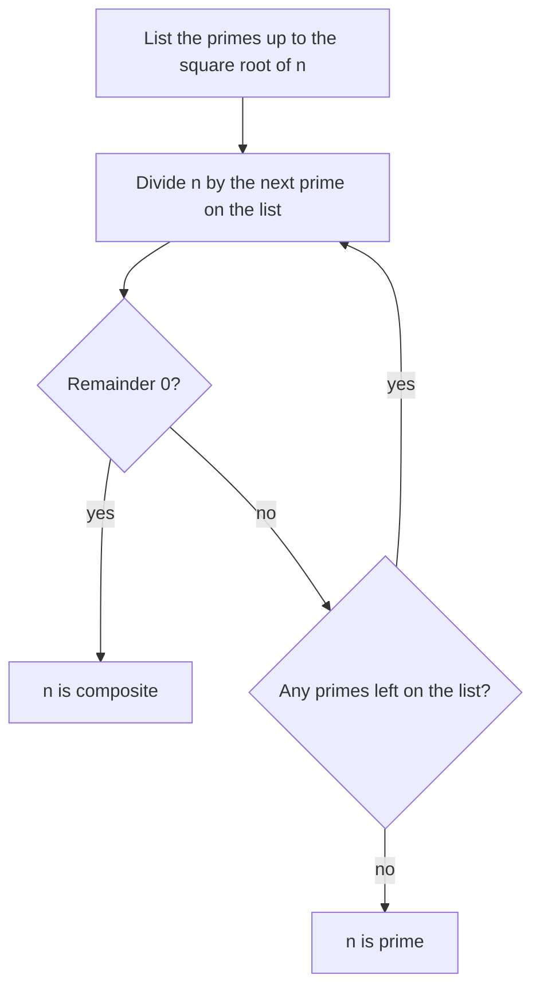

## Building blocks of multiplication

So far we've multiplied numbers together. This lesson runs the other way: given a number, which numbers multiply to make it? That question leads to factors, multiples and primes, the ideas behind simplifying fractions, finding common denominators and, much later, factoring in algebra.

## Factors and multiples

If $a \times b = n$ for whole numbers $a$ and $b$, then $a$ and $b$ are **factors** of $n$ (also called **divisors**), and $n$ is a **multiple** of both $a$ and $b$. For example, $4 \times 6 = 24$, so 4 and 6 are factors of 24, and 24 is a multiple of 4 and of 6. We also say 24 is **divisible** by 4: dividing leaves remainder 0.

Factors and multiples are two views of the same fact:

- The factors of 12 are 1, 2, 3, 4, 6 and 12. There are only finitely many, and none is bigger than 12.
- The multiples of 12 are 12, 24, 36, 48, and so on forever. You get them by multiplying 12 by 1, 2, 3, …

### Finding all factors with factor pairs

To list every factor of a number, find its **factor pairs**: pairs of numbers whose product is the number. Test 1, 2, 3, … in order, and stop as soon as the factors would start repeating.

A factor pair is a way to arrange that many objects in a rectangle with no gaps: 12 dots fit in 1 row of 12, 2 rows of 6 or 3 rows of 4 (and turning those rectangles sideways gives 12 rows of 1, 6 rows of 2 and 4 rows of 3).

### Example 1

List all factors of 60.

| Test | Divides 60? | Pair |
|---|---|---|
| 1 | yes | 1 × 60 |
| 2 | yes | 2 × 30 |
| 3 | yes | 3 × 20 |
| 4 | yes | 4 × 15 |
| 5 | yes | 5 × 12 |
| 6 | yes | 6 × 10 |
| 7 | no | |
| 8 | no | |

Next we'd test 9, but $8 \times 8 = 64$ is already more than 60, so any factor bigger than 8 must be paired with one smaller than 8, which we've already found. Stop. The factors are 1, 2, 3, 4, 5, 6, 10, 12, 15, 20, 30 and 60 (twelve of them).

Why stop there? If $a \times b = 60$ and both $a$ and $b$ were bigger than 8, the product would be more than 64. So in every pair at least one number is at most $\sqrt{60} \approx 7.7$. Testing up to that point catches every pair.

## Divisibility rules

These shortcuts tell you whether a number is divisible by a small number without dividing.

| Divisible by | Rule | Example |
|---|---|---|
| 2 | last digit is even (0, 2, 4, 6, 8) | 3,586 |
| 3 | sum of the digits is divisible by 3 | 471: 4 + 7 + 1 = 12 ✓ |
| 4 | last two digits form a number divisible by 4 | 7,316: 16 ✓ |
| 5 | last digit is 0 or 5 | 8,345 ✓ |
| 6 | divisible by both 2 and 3 | 522: even, 5 + 2 + 2 = 9 ✓ |
| 9 | sum of the digits is divisible by 9 | 6,381: 18 ✓ |
| 10 | last digit is 0 | 4,730 ✓ |

Why does the rule for 3 work? Take 471 = 4 × 100 + 7 × 10 + 1. Since 100 = 99 + 1 and 10 = 9 + 1, we can write 471 = (4 × 99 + 7 × 9) + (4 + 7 + 1). The first group is a multiple of 9, hence of 3. So 471 is divisible by 3 exactly when the digit sum 4 + 7 + 1 is. The same argument gives the rule for 9.

The rule for 2 works because 10 is even, so every place except the ones place contributes an even amount; only the last digit can make the number odd.

## Prime and composite numbers

A **prime number** is a whole number greater than 1 whose only factors are 1 and itself. A **composite number** is a whole number greater than 1 that has at least one other factor. The number 1 is neither prime nor composite (it has only one factor), and 0 is neither as well.

The primes less than 50 are:

$$2, 3, 5, 7, 11, 13, 17, 19, 23, 29, 31, 37, 41, 43, 47$$

Notice that 2 is the only even prime: every other even number has 2 as a factor. Primes go on forever (a fact proved more than 2,000 years ago), and they become rarer but never stop.

### Testing whether a number is prime

To decide whether $n$ is prime, try dividing it by the primes 2, 3, 5, 7, 11, … up to $\sqrt{n}$. If none divides it, $n$ is prime. The same factor-pair reasoning as before explains why you can stop at the square root.

### Example 2

Is 91 prime? Is 97 prime?

$\sqrt{91}$ is a little more than 9 (since $9^2 = 81$ and $10^2 = 100$), so test 2, 3, 5 and 7.

- 91 is odd, so not divisible by 2. Digit sum 10, not divisible by 3. Doesn't end in 0 or 5.
- $91 \div 7 = 13$. So $91 = 7 \times 13$ is composite.

For 97: also test 2, 3, 5, 7. Odd; digit sum 16 (not a multiple of 3); doesn't end in 0 or 5; $97 \div 7 = 13$ R 6. No prime up to $\sqrt{97}$ divides it, so 97 is prime.

A visual way to find all primes up to some limit is the *sieve*: write out the numbers, then cross out every multiple of 2 after 2, every multiple of 3 after 3, every multiple of 5 after 5, and so on. Whatever survives is prime. (It is called the sieve of Eratosthenes, after the Greek scholar who is credited with it.) For the numbers up to 50 you only need to cross out multiples of 2, 3, 5 and 7, because $7^2 = 49$ and the next prime, 11, has $11^2 = 121 > 50$.

## Even and odd

A whole number is **even** if it is divisible by 2 and **odd** if it isn't. Some facts that are useful for checking work: even + even = even, odd + odd = even, even + odd = odd, and a product is odd only if every factor is odd.

### Example 3

Chairs for a meeting must be set out in rows with the same number in each row, and there are 36 chairs. How many different row arrangements are possible if each row must have at least 2 chairs and there must be at least 2 rows?

Each arrangement is a factor pair of 36 (rows × chairs per row). The factors of 36 are 1, 2, 3, 4, 6, 9, 12, 18, 36. Excluding 1 and 36 (one row, or one chair per row) leaves 2, 3, 4, 6, 9, 12, 18 as possible row counts: 7 arrangements (2 rows of 18, 3 of 12, 4 of 9, 6 of 6, 9 of 4, 12 of 3, 18 of 2).

## Common mistakes

- *Calling 1 a prime.* It has only one factor; primes need exactly two.
- *Assuming every odd number is prime.* 9, 15, 21, 27, 33, 39, 49, 51, 57 and 91 are all odd and composite.
- *Confusing factors and multiples.* Factors of 12 are no bigger than 12; multiples of 12 are at least 12.
- *Missing a factor pair.* Test in order and don't skip numbers; stop only at the square root.
- *Misusing the digit-sum test.* It works for 3 and 9, not for 4, 7 or other numbers.

## Key points

- $a$ is a factor of $n$ when $n \div a$ leaves no remainder; then $n$ is a multiple of $a$.
- Find all factors with factor pairs, testing up to the square root.
- Divisibility rules: 2 (last digit even), 3 and 9 (digit sum), 5 (ends in 0 or 5), 10 (ends in 0).
- A prime has exactly two factors, 1 and itself; 1 is neither prime nor composite; 2 is the only even prime.
- Test for primes by dividing by primes up to $\sqrt{n}$.
