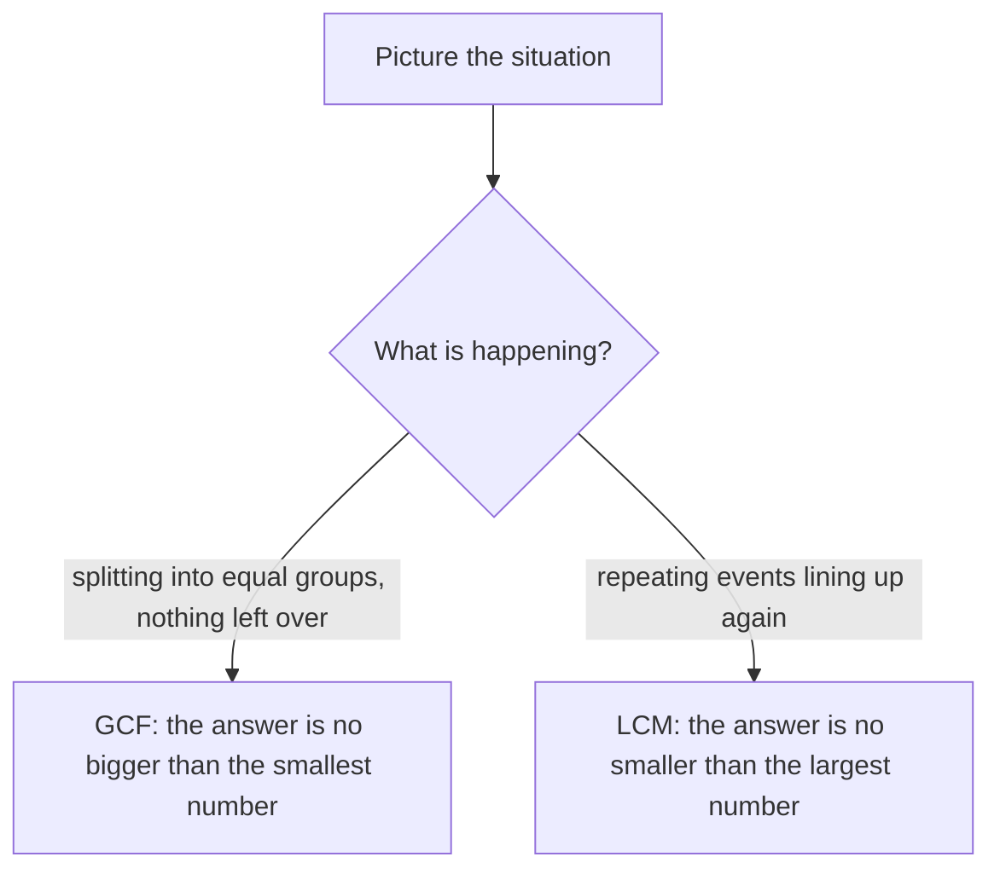

## Breaking numbers into primes

In the last lesson you met prime numbers. Their importance comes from one fact: every whole number greater than 1 can be written as a product of primes, and in only one way (apart from the order of the factors). This is called the **Fundamental Theorem of Arithmetic**. Primes are the atoms that all other whole numbers are built from. Writing a number as a product of primes is its **prime factorization**, and it is the key to two tools you'll use constantly with fractions: the greatest common factor and the least common multiple.

## Finding a prime factorization

### Factor trees

Split the number into any two factors, then keep splitting each factor that isn't prime. The primes at the ends of the branches are the prime factorization.

```shape
{"segments": [{"from": [0, 0], "to": [-1, -1]}, {"from": [0, 0], "to": [1, -1]}, {"from": [1, -1.3], "to": [0.2, -2.3]}, {"from": [1, -1.3], "to": [1.8, -2.3]}, {"from": [1.8, -2.6], "to": [1.1, -3.6]}, {"from": [1.8, -2.6], "to": [2.5, -3.6]}], "labels": [{"at": [0, 0.25], "text": "84"}, {"at": [-1, -1.2], "text": "2"}, {"at": [1, -1.15], "text": "42"}, {"at": [0.2, -2.5], "text": "2"}, {"at": [1.8, -2.45], "text": "21"}, {"at": [1.1, -3.8], "text": "3"}, {"at": [2.5, -3.8], "text": "7"}], "caption": "A factor tree for 84: the branch ends 2, 2, 3, 7 are prime"}
```

So $84 = 2 \times 2 \times 3 \times 7 = 2^2 \times 3 \times 7$. Writing repeated primes with exponents keeps the factorization compact.

You could start the tree differently, say $84 = 4 \times 21$ or $84 = 12 \times 7$, and you will always end with the same primes. That's the Fundamental Theorem at work.

### Repeated division

A tidier method: divide by the smallest prime that works, over and over.

### Example 1

Find the prime factorization of 360.

- $360 \div 2 = 180$
- $180 \div 2 = 90$
- $90 \div 2 = 45$ (45 is odd, so 2 is done)
- $45 \div 3 = 15$
- $15 \div 3 = 5$
- 5 is prime.

The divisors used were 2, 2, 2, 3, 3 and the final 5, so $360 = 2^3 \times 3^2 \times 5$. Check: $8 \times 9 \times 5 = 360$. ✓

## Greatest common factor (GCF)

The **greatest common factor** (**GCF**) of two or more numbers is the largest number that is a factor of all of them. It's also called the greatest common divisor (GCD). You need it to simplify fractions: dividing the top and bottom of $\tfrac{18}{24}$ by their GCF, 6, gives $\tfrac34$ in one step.

*Method 1: list factors.* Factors of 18: 1, 2, 3, 6, 9, 18. Factors of 24: 1, 2, 3, 4, 6, 8, 12, 24. Common factors: 1, 2, 3, 6. The greatest is 6. This is fine for small numbers.

*Method 2: prime factorizations.* Write each number as a product of primes and take each prime they *share*, using the *smaller* power.

$$18 = 2 \times 3^2, \qquad 24 = 2^3 \times 3$$

Shared primes: 2 (smaller power $2^1$) and 3 (smaller power $3^1$). GCF $= 2 \times 3 = 6$.

Why the smaller power? A common factor must divide both numbers, so it can't use more 2s than 18 has (one) or more 3s than 24 has (one).

If two numbers share no prime factors, their GCF is 1, and they are called **relatively prime**. For example, 8 and 15 are relatively prime even though neither is prime.

## Least common multiple (LCM)

The **least common multiple** (**LCM**) of two or more numbers is the smallest positive number that is a multiple of all of them. You'll need it to add fractions, where it's called the least common denominator.

*Method 1: list multiples.* Multiples of 6: 6, 12, 18, 24, 30, 36, … Multiples of 8: 8, 16, 24, 32, … The first one in both lists is 24, so LCM(6, 8) = 24.

*Method 2: prime factorizations.* Take every prime that appears in *any* of the numbers, using the *larger* power.

$$6 = 2 \times 3, \qquad 8 = 2^3$$

Primes that appear: 2 (larger power $2^3$) and 3 (power $3^1$). LCM $= 2^3 \times 3 = 24$.

Why the larger power? A common multiple must contain each number completely, so it needs three 2s to contain 8 and a 3 to contain 6, and no more than that if it's to be the smallest.

### Example 2

Find the GCF and LCM of 84 and 90.

$$84 = 2^2 \times 3 \times 7, \qquad 90 = 2 \times 3^2 \times 5$$

GCF: shared primes are 2 and 3, smaller powers: $2^1 \times 3^1 = 6$.

LCM: all primes 2, 3, 5, 7, larger powers: $2^2 \times 3^2 \times 5 \times 7 = 4 \times 9 \times 35 = 1{,}260$.

Check with a useful fact: for two numbers, GCF × LCM = the product of the numbers. Here $6 \times 1{,}260 = 7{,}560$ and $84 \times 90 = 7{,}560$. ✓

A Venn diagram makes both rules easy to see. Put each number's prime factors in its own circle, and put the factors the two numbers share (one 2 and one 3) in the overlap. The GCF is the product of the overlap; the LCM is the product of everything in the diagram, counting each prime once where it is written.


This also explains the check: the overlap is counted once in the LCM, so GCF × LCM uses every prime of both numbers exactly as often as $84 \times 90$ does.

## GCF or LCM? Word problems

Ask yourself whether you are *splitting* things into equal groups (the answer is smaller than the numbers: GCF) or waiting for things to *line up* again (the answer is bigger than the numbers: LCM).



### Example 3

A florist has 48 roses and 36 tulips. She wants to make identical bouquets using all the flowers, with no flowers left over. What is the greatest number of bouquets she can make, and what is in each?

The number of bouquets must divide both 48 and 36, and we want the largest: GCF(48, 36). $48 = 2^4 \times 3$ and $36 = 2^2 \times 3^2$, so the GCF is $2^2 \times 3 = 12$. She can make 12 bouquets, each with $48 \div 12 = 4$ roses and $36 \div 12 = 3$ tulips.

### Example 4

One bus leaves a station every 12 minutes and another every 18 minutes. They both leave at 8:00 a.m. When do they next leave together?

We need a time that is a multiple of both 12 and 18, the smallest one: LCM(12, 18). $12 = 2^2 \times 3$ and $18 = 2 \times 3^2$, so the LCM is $2^2 \times 3^2 = 36$. They next leave together 36 minutes later, at 8:36 a.m.

## Common mistakes

- *Mixing up the rules.* GCF uses shared primes with the smaller power; LCM uses all primes with the larger power. A GCF is never bigger than the smallest number; an LCM is never smaller than the largest.
- *Stopping a factor tree too early.* $72 = 8 \times 9$ is not a prime factorization; keep going to $2^3 \times 3^2$.
- *Thinking the LCM is always the product.* $6 \times 8 = 48$ is a common multiple, but the least one is 24. The product is the LCM only when the numbers are relatively prime.
- *Choosing GCF vs LCM by keyword alone.* Picture whether you're splitting into groups or waiting for a repeat.

## Key points

- Every whole number greater than 1 has exactly one prime factorization.
- Find it with a factor tree or repeated division by primes; write repeated primes with exponents.
- GCF: shared primes, smallest powers. LCM: all primes, largest powers.
- For two numbers, GCF × LCM = their product.
- Splitting into equal groups → GCF; events repeating until they coincide → LCM.
