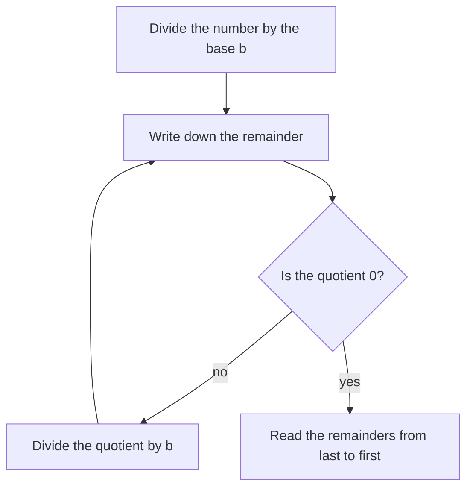

## Why ten?

In the place value lesson you learned that each place is worth ten times the place to its right: ones, tens, hundreds, thousands. Nothing in mathematics forces the number ten. We almost certainly count in tens because we have ten fingers. Any whole number bigger than 1 can play the same role, and several do: computers work in twos, programmers write numbers in sixteens, and we still tell time partly in sixties.

The number a system groups by is its **number base**. Our everyday system is the **base-ten system**. This lesson shows how place value works in other bases, how to convert between bases, and why it matters. Seeing place value in an unfamiliar base is also the best way to understand what it really means in base ten.

## Grouping by fives

Suppose you have 38 sticks and are only allowed to count in fives. Bundle the sticks into groups of 5. Whenever you have five bundles, tie them into a bigger group of $5 \times 5 = 25$. Here is what happens:

One group of 25, two fives and three ones: we write this as $123_5$, read "one two three, base five." The small 5 below the line is a subscript telling you the base. Without it, 123 means the base-ten number one hundred twenty-three, which is a different amount.

In base five the places, from the right, are worth

$$1, \quad 5, \quad 5 \times 5 = 25, \quad 5 \times 5 \times 5 = 125, \quad 5^4 = 625, \ldots$$

Each place is five times the place to its right. And because five of anything get bundled into the next place, the only digits you ever need are 0, 1, 2, 3 and 4. The pattern holds in every base: **in base $b$ the places are 1, $b$, $b^2$, $b^3$, … and the digits run from 0 to $b - 1$.** Base ten fits: places 1, 10, 100, 1,000, and digits 0 through 9.

## Converting to base ten

To find the base-ten value of a number written in another base, write it in expanded form using that base's place values, then add. This is exactly the expanded form you already know, with different place values.

### Example 1

Convert $2304_5$ to base ten.

Label the places from the right: 4 is in the ones place, 0 in the fives place, 3 in the twenty-fives place and 2 in the one-hundred-twenty-fives place.

$$2304_5 = 2 \times 125 + 3 \times 25 + 0 \times 5 + 4 \times 1 = 250 + 75 + 0 + 4 = 329$$

So $2304_5 = 329$. The 0 is a placeholder, just as in base ten: it says "no fives" and keeps the 2 and 3 in the right places.

## Converting from base ten

Going the other way takes one of two methods.

*Method 1: biggest place first.* List the place values of the new base, find the largest one that fits, and see how many times it fits. Take that much away and repeat with the next place. For 38 in base five: 125 is too big; 25 fits once (38 − 25 = 13); 5 fits twice (13 − 10 = 3); 3 ones are left. Digits 1, 2, 3, so $38 = 123_5$.

*Method 2: repeated division.* Divide by the base again and again, writing down each remainder, until the quotient is 0. The remainders, read from the *last one to the first*, are the digits.

Why does repeated division work? Dividing 38 by 5 asks how many bundles of 5 you can make (7) and how many sticks are left over (3). The leftovers can't be bundled, so they are the ones digit. Dividing the 7 bundles by 5 again makes 1 big group with 2 bundles left over: that 2 is the fives digit. The first remainder is the ones digit, so the remainders come out right to left, and you read them from the bottom up.

| Division | Quotient | Remainder |
|---|---|---|
| $38 \div 5$ | 7 | 3 (ones) |
| $7 \div 5$ | 1 | 2 (fives) |
| $1 \div 5$ | 0 | 1 (twenty-fives) |

Reading the remainders from the bottom: $123_5$. Check with Example 1's method: $1 \times 25 + 2 \times 5 + 3 = 38$. ✓

## Binary: base two

In **binary** the base is 2, so there are only two digits, 0 and 1, and the places are

$$1, \quad 2, \quad 4, \quad 8, \quad 16, \quad 32, \quad 64, \quad 128, \ldots$$

each double the one before. Computers use binary because a circuit can reliably be in one of two states (on or off, high voltage or low), and two states are exactly what one binary digit records. A single binary digit is called a **bit** (short for *binary digit*), and a group of 8 bits is a **byte**.

To read a binary number, add the place values where the digit is 1. For example, $1101_2 = 8 + 4 + 0 + 1 = 13$. The largest number one byte can hold is $11111111_2 = 128 + 64 + 32 + 16 + 8 + 4 + 2 + 1 = 255$, which is why so many computer settings run from 0 to 255.

### Example 2

Write 45 in binary.

Repeated division by 2:

| Division | Quotient | Remainder |
|---|---|---|
| $45 \div 2$ | 22 | 1 |
| $22 \div 2$ | 11 | 0 |
| $11 \div 2$ | 5 | 1 |
| $5 \div 2$ | 2 | 1 |
| $2 \div 2$ | 1 | 0 |
| $1 \div 2$ | 0 | 1 |

Reading the remainders from the bottom up: $45 = 101101_2$. Check by adding place values: $32 + 8 + 4 + 1 = 45$. ✓ (Method 1 gives the same answer: 32 fits, leaving 13; 16 doesn't; 8 fits, leaving 5; 4 fits, leaving 1; 2 doesn't; 1 fits.)

### Arithmetic in binary

The addition method you know works in any base; only the carrying changes. In base ten you carry when a column reaches ten. In binary you carry when a column reaches two, because $1 + 1 = 2 = 10_2$: write 0 and carry 1. And $1 + 1 + 1 = 3 = 11_2$: write 1 and carry 1.

### Example 3

Add $1011_2 + 110_2$.

Line up the columns on the right and add from the right:

| | eights | fours | twos | ones |
|---|---|---|---|---|
| | 1 | 0 | 1 | 1 |
| + | | 1 | 1 | 0 |

- Ones: $1 + 0 = 1$. Write 1.
- Twos: $1 + 1 = 10_2$. Write 0, carry 1.
- Fours: $0 + 1 + 1$ (carried) $= 10_2$. Write 0, carry 1.
- Eights: $1 + 1$ (carried) $= 10_2$. Write 0, carry 1 into a new sixteens place.

The sum is $10001_2$. Check in base ten: $1011_2 = 11$, $110_2 = 6$, and $11 + 6 = 17 = 16 + 1 = 10001_2$. ✓

## Hexadecimal: base sixteen

Binary numbers get long fast: 255 needs eight digits. Programmers often use **hexadecimal**, base sixteen, instead. It needs sixteen digits, so after 0–9 it borrows letters: A = 10, B = 11, C = 12, D = 13, E = 14 and F = 15. The places are 1, 16, 256, 4,096, and so on.

Hexadecimal is handy because $16 = 2 \times 2 \times 2 \times 2$: each hexadecimal digit stands for exactly four bits, so one byte is always two hexadecimal digits, from 00 to FF. Web colors are written this way: in the color code #FF8000, the pairs FF, 80 and 00 give the amounts of red, green and blue, each from 0 to 255.

### Example 4

Convert $2\text{F}_{16}$ to base ten, and 200 to hexadecimal.

$2\text{F}_{16} = 2 \times 16 + 15 \times 1 = 32 + 15 = 47$.

For 200: $200 \div 16 = 12$ R 8, and $12 \div 16 = 0$ R 12. Reading the remainders from the bottom up gives the digits 12 and 8. The digit for 12 is C, so $200 = \text{C}8_{16}$. Check: $12 \times 16 + 8 = 192 + 8 = 200$. ✓

## Other bases in history

Base ten was not the only choice people made. Babylonian mathematicians, nearly 4,000 years ago, wrote numbers in base sixty, and we still divide an hour into 60 minutes and a minute into 60 seconds. The Maya of Central America counted mostly in twenties (in their calendar, one place was $18 \times 20 = 360$ rather than $20 \times 20$), and both the Babylonians and the Maya developed a placeholder sign for an empty place. Traces of counting by twenties survive in some languages: the French word for 80, *quatre-vingts*, means "four twenties."

## Common mistakes

- *Using a digit that is too big for the base.* $14_5$ is fine, but $15_5$ is not a base-five numeral; in base five the digits stop at 4. Likewise binary uses only 0 and 1.
- *Reading the remainders in the wrong order.* The first remainder is the ones digit, so it goes on the right. Reading 45's remainders top to bottom gives $101101_2$ by luck here (it reads the same both ways), but for 38 in base five it would give $321_5 = 86$, not 38.
- *Reading a binary numeral as a base-ten number.* $101_2$ is five, not one hundred one. Say the digits: "one zero one, base two."
- *Dropping placeholder zeros.* $2304_5$ and $234_5$ are different numbers (329 and 69).
- *Carrying at ten in another base.* In binary, $1 + 1$ is written $10_2$; in base five, $3 + 4 = 7 = 12_5$.

## Key points

- In base $b$ the place values are 1, $b$, $b^2$, $b^3$, … and the digits are 0 to $b - 1$.
- To convert to base ten, write the number in expanded form with the base's place values and add.
- To convert from base ten, take out the biggest place value first, or divide by the base repeatedly and read the remainders from the last to the first.
- Binary (base 2) uses bits 0 and 1; 8 bits make a byte, which holds 0 to 255.
- Hexadecimal (base 16) uses 0–9 and A–F; each hexadecimal digit is exactly 4 bits.
