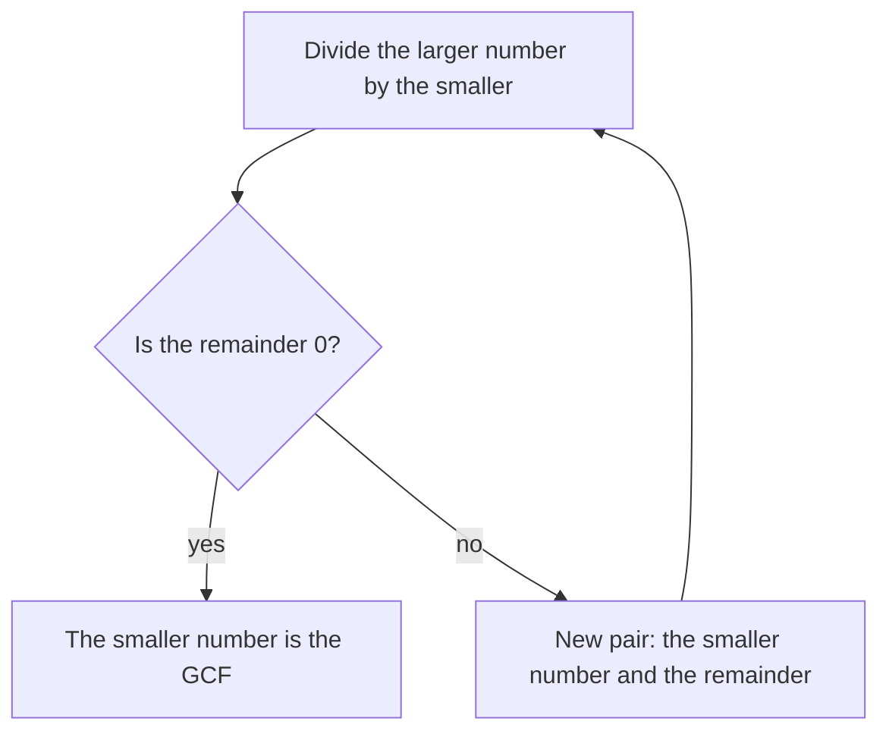

## When factoring gets hard

In the GCF and LCM lesson you found greatest common factors by writing both numbers as products of primes. That works well for numbers like 84 and 90. Now try 2,024 and 1,309. To factor 1,309 you would have to test 2, 3, 5, 7 (it works: $1{,}309 = 7 \times 187$), then discover that $187 = 11 \times 17$. For larger numbers, finding the prime factors can take a very long time, even for a computer.

More than 2,000 years ago the Greek mathematician Euclid described a way to find the GCF *without factoring at all*, in his book the *Elements* (about 300 BC). It is called the **Euclidean algorithm** (an *algorithm* is a step-by-step procedure that always finishes with the answer), and versions of it are still how computers find GCFs today. This lesson explains why it works, then turns to two more questions about divisors: how many divisors a number has, and whether the primes ever run out.

## The key fact: common factors survive subtraction

Suppose $d$ divides both 48 and 18. Then $48 = d \times (\text{something})$ and $18 = d \times (\text{something else})$, so

$$48 - 18 = d \times (\text{something}) - d \times (\text{something else}) = d \times (\text{something} - \text{something else}),$$

and $d$ divides $48 - 18 = 30$ as well. Subtracting 18 again, $d$ divides 12. In general, *a common divisor of two numbers also divides their difference*, and so it divides whatever is left after you take away any number of copies of the smaller one. That leftover is exactly the remainder of a division: $48 = 2 \times 18 + 12$.

The argument also runs backward. If $d$ divides 18 and 12, it divides $2 \times 18 + 12 = 48$. So the pair (48, 18) and the pair (18, 12) have exactly the same common divisors, and therefore the same greatest one:

$$\text{GCF}(48, 18) = \text{GCF}(18, 12).$$

The new pair is smaller, so we can repeat: $18 = 1 \times 12 + 6$, so $\text{GCF}(18, 12) = \text{GCF}(12, 6)$. And $12 = 2 \times 6 + 0$: 6 divides 12 exactly, so $\text{GCF}(12, 6) = 6$. Therefore $\text{GCF}(48, 18) = 6$.

There is a picture of this. Cut the biggest possible squares off a 48-by-18 rectangle: two 18-by-18 squares leave an 18-by-12 strip; a 12-by-12 square leaves a 12-by-6 strip; two 6-by-6 squares finish it with nothing left over. The last square size, 6, is the GCF, and 6-by-6 squares tile the whole rectangle.

## The Euclidean algorithm

To find the GCF of two whole numbers:

1. Divide the larger number by the smaller one and note the remainder.
2. If the remainder is 0, the smaller number is the GCF. Stop.
3. Otherwise, replace the pair with (the smaller number, the remainder) and go back to step 1.

The answer is the last nonzero remainder (or the smaller starting number, if the first division comes out even).

The algorithm always stops, because each remainder is smaller than the number you divided by, and whole numbers can't keep shrinking forever. In fact it stops quickly: every two steps, the remainder drops to less than half of what it was.

### Example 1

Find GCF(1,071, 462), and use it to simplify $\dfrac{462}{1{,}071}$.

- $1{,}071 \div 462 = 2$ R 147, since $2 \times 462 = 924$ and $1{,}071 - 924 = 147$.
- $462 \div 147 = 3$ R 21, since $3 \times 147 = 441$ and $462 - 441 = 21$.
- $147 \div 21 = 7$ R 0.

The last nonzero remainder is 21, so GCF(1,071, 462) = 21. Dividing top and bottom by 21: $\dfrac{462}{1{,}071} = \dfrac{22}{51}$. Since 21 was the *greatest* common factor, $\tfrac{22}{51}$ is in lowest terms (22 and 51 are relatively prime).

### Example 2

Find the GCF and the LCM of 2,024 and 1,309.

| Division | Remainder |
|---|---|
| $2{,}024 = 1 \times 1{,}309 + 715$ | 715 |
| $1{,}309 = 1 \times 715 + 594$ | 594 |
| $715 = 1 \times 594 + 121$ | 121 |
| $594 = 4 \times 121 + 110$ | 110 |
| $121 = 1 \times 110 + 11$ | 11 |
| $110 = 10 \times 11 + 0$ | 0 |

GCF = 11. For the LCM, use the fact from the GCF and LCM lesson that GCF × LCM = the product of the two numbers. It is easiest to divide first:

$$\text{LCM} = \frac{2{,}024 \times 1{,}309}{11} = 184 \times 1{,}309 = 240{,}856.$$

(Check with factoring, now that we know what to look for: $2{,}024 = 2^3 \times 11 \times 23$ and $1{,}309 = 7 \times 11 \times 17$. They share only the 11.)

## How many divisors?

The prime factorization tells you much more than the GCF. Take $72 = 2^3 \times 3^2$. Any divisor of 72 is a product of some of these primes and nothing else, using at most three 2s and at most two 3s. So a divisor is fixed by two choices:

- how many 2s it uses: none, one, two or three (4 choices);
- how many 3s it uses: none, one or two (3 choices).

Every pair of choices gives a different divisor (by the Fundamental Theorem of Arithmetic), so 72 has $4 \times 3 = 12$ divisors:

| | no 3s | one 3 | two 3s |
|---|---|---|---|
| no 2s | 1 | 3 | 9 |
| one 2 | 2 | 6 | 18 |
| two 2s | 4 | 12 | 36 |
| three 2s | 8 | 24 | 72 |

The same reasoning gives a general rule: **if $n = p^a \times q^b \times r^c \times \cdots$ for different primes $p, q, r, \ldots$, the number of divisors of $n$ is $(a + 1)(b + 1)(c + 1)\cdots$.** The "+ 1" counts the choice of using none of that prime.

### Example 3

How many divisors does 360 have?

From the GCF and LCM lesson, $360 = 2^3 \times 3^2 \times 5$ (the 5 has exponent 1). The number of divisors is $(3 + 1)(2 + 1)(1 + 1) = 4 \times 3 \times 2 = 24$. Listing factor pairs would take much longer, and it is easy to miss one.

### Which numbers have an odd number of divisors?

Divisors usually come in pairs: for 72 the pairs are $1 \times 72$, $2 \times 36$, $3 \times 24$, $4 \times 18$, $6 \times 12$ and $8 \times 9$. The only way to get an odd count is a pair whose two members are the same number, like $6 \times 6$ for 36. That happens exactly when the number is a perfect square. In the formula, a perfect square has every exponent even, so every factor $(a + 1)$ is odd, and so is the product: $36 = 2^2 \times 3^2$ has $3 \times 3 = 9$ divisors.

### Example 4

What is the smallest whole number with exactly 12 divisors?

Write 12 as a product of factors, each factor being (exponent + 1), and give the biggest exponents to the smallest primes:

| 12 as a product | Exponents | Smallest number |
|---|---|---|
| 12 | 11 | $2^{11} = 2{,}048$ |
| $6 \times 2$ | 5, 1 | $2^5 \times 3 = 96$ |
| $4 \times 3$ | 3, 2 | $2^3 \times 3^2 = 72$ |
| $3 \times 2 \times 2$ | 2, 1, 1 | $2^2 \times 3 \times 5 = 60$ |

The smallest is 60. Check: its divisors are 1, 2, 3, 4, 5, 6, 10, 12, 15, 20, 30 and 60, which is twelve.

## The primes never run out

The factors lesson said there are infinitely many primes. Euclid's *Elements* also contains the argument, and it uses only ideas from this module.

Suppose someone hands you a list of primes and claims it is complete, say 2, 3, 5 and 7. Multiply them all and add 1:

$$N = 2 \times 3 \times 5 \times 7 + 1 = 211.$$

Dividing $N$ by any prime on the list leaves remainder 1, so no prime on the list divides $N$. But $N$ is bigger than 1, so it has a prime factorization, and the primes in it are not on the list. (Here 211 happens to be prime itself.) The same thing happens with *any* finite list, so no finite list of primes can be complete.

Be careful about what this shows. It does *not* say that $N$ is always prime. With the list 2, 3, 5, 7, 11, 13 you get $N = 30{,}031 = 59 \times 509$, which is composite; its prime factors 59 and 509 are simply primes missing from the list.

## Common mistakes

- *Stopping one step early or late.* The GCF is the last *nonzero* remainder, not the 0 and not the quotient. In Example 1 the quotients were 2, 3, 7; the GCF is the remainder 21.
- *A slip in one remainder.* A wrong remainder throws off every later step. Check that each remainder is smaller than the number you divided by, and check at the end that the GCF divides both starting numbers.
- *Forgetting the "+ 1" when counting divisors.* $72 = 2^3 \times 3^2$ has $4 \times 3 = 12$ divisors, not $3 \times 2 = 6$; the "+ 1" counts using none of that prime.
- *Using the divisor formula without a full prime factorization.* $72 = 8 \times 9$ is not a prime factorization; $8 = 2^3$ must be written with its exponent.
- *Thinking Euclid's $N$ must be prime.* Its prime factors are new, but $N$ itself can be composite.

## Key points

- A common divisor of two numbers divides their difference and the remainder of their division, so $\text{GCF}(a, b) = \text{GCF}(b, r)$ when $a = qb + r$.
- Euclidean algorithm: divide, replace the pair with (divisor, remainder), repeat; the last nonzero remainder is the GCF. No factoring is needed.
- LCM $= \dfrac{a \times b}{\text{GCF}}$; divide one number by the GCF first to keep the numbers small.
- If $n = p^a q^b r^c \cdots$, then $n$ has $(a + 1)(b + 1)(c + 1)\cdots$ divisors; only perfect squares have an odd number of divisors.
- Multiplying a finite list of primes and adding 1 gives a number with a prime factor not on the list, so there are infinitely many primes.
