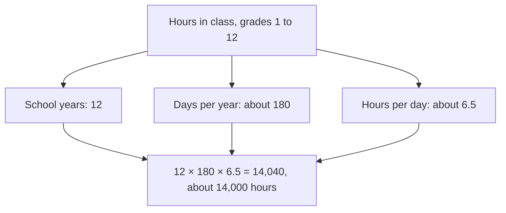

## How good is an estimate?

In the place value lesson you estimated $38 \times 589$ as $40 \times 600 = 24{,}000$, and noticed the estimate was high because both numbers were rounded up. This lesson takes estimation further in three directions. First, instead of one estimate, find two numbers that the exact answer is guaranteed to lie between. Second, work backward from a rounded number to the range the true number could be in. Third, estimate quantities nobody has told you anything about, such as how many times your heart beats in a year, by breaking them into pieces you can guess. Scientists and engineers use all three every day to check their work and to decide whether an idea is even worth calculating carefully.

## Upper and lower bounds

A **lower bound** is a number the exact answer can't be below; an **upper bound** is a number it can't be above. Together they trap the answer in a range.

For sums and products of whole numbers, the trick is to round *every* number down to get a lower bound and *every* number up to get an upper bound. Rounding a number down makes a sum or product smaller (or leaves it the same), and rounding up makes it larger.

### Example 1

Find a lower and an upper bound for $38 \times 589$ by rounding each number to the tens.

- Round both down: $30 \times 580 = 17{,}400$.
- Round both up: $40 \times 590 = 23{,}600$.

So $17{,}400 < 38 \times 589 < 23{,}600$. The exact product, 22,382, is in that range. Notice that the front-end estimate 24,000 is *above* the upper bound: it is a guess, not a guarantee. An estimate that is too big is an **overestimate**, and one that is too small is an **underestimate**.

### Differences need the opposite rounding

Subtraction is different. Taking away *less* leaves *more*, so to make a difference as large as possible you round the first number up and the number being subtracted down.

### Example 2

Find bounds for $8{,}372 - 2{,}815$ by rounding to the hundreds.

- Lower bound: smallest first number, largest amount taken away: $8{,}300 - 2{,}900 = 5{,}400$.
- Upper bound: largest first number, smallest amount taken away: $8{,}400 - 2{,}800 = 5{,}600$.

The exact difference, 5,557, is between 5,400 and 5,600. Rounding both numbers *up* ($8{,}400 - 2{,}900 = 5{,}500$) gives an ordinary estimate, but not a bound: 5,557 is above it.

The same idea applies to division: a quotient is largest when the number being divided is large and the divisor is small.

## Working backward from a rounded number

A news report says a town has 3,800 people, "to the nearest hundred." What could the real number be? Any whole number that rounds to 3,800: the smallest is 3,750 (exactly halfway rounds up) and the largest is 3,849 (3,850 would round to 3,900). The real population is somewhere from 3,750 to 3,849.

```numberline
{"x": [3700, 3900], "points": [{"at": [3750, 0]}, {"at": [3849, 0]}, {"at": [3800, 0], "label": "3,800"}], "segments": [{"from": [3750, 0], "to": [3849, 0]}], "caption": "Whole numbers that round to 3,800 to the nearest hundred: 3,750 through 3,849"}
```

In general, a whole number rounded to the nearest 10, 100 or 1,000 can be off by up to half of that place: up to 5, 50 or 500 below the rounded value, and up to one less than that above it. This is the hidden uncertainty in every rounded number, and it grows when rounded numbers are combined.

### Example 3

A stadium section has 40 rows, rounded to the nearest ten, and each row has exactly 30 seats. Between what numbers is the number of seats?

The number of rows is from 35 to 44. So the seats number from $35 \times 30 = 1{,}050$ to $44 \times 30 = 1{,}320$. The simple estimate $40 \times 30 = 1{,}200$ could be off by 150 in one direction or 120 in the other, even though the "40" was off by at most 5. Multiplying makes the uncertainty bigger.

## Fermi problems

The physicist Enrico Fermi (1901–1954) was famous for quick, rough estimates of quantities that seemed impossible to know. At the first atomic bomb test in 1945 he dropped scraps of paper as the blast wave passed and, from how far they moved, estimated the explosion's strength; his figure was of the same order of magnitude as the later measurements. He is said to have liked asking students questions such as "how many piano tuners are there in Chicago?" Questions of this kind are now called **Fermi problems**.

The method:

1. Break the unknown quantity into a chain of smaller quantities that multiply (or add) to give it.
2. Estimate each piece from things you know, rounding to friendly numbers. Write down every assumption.
3. Combine the pieces.
4. Ask whether the answer is reasonable, and which assumption matters most.

The goal is the right **order of magnitude**: the size of the answer to the nearest power of ten (tens, hundreds, thousands, millions…). An answer of 30,000 when the truth is 40,000 is a success; an answer of 300 is not.

Fermi estimates work better than you might expect because errors often partly cancel. If one guess is twice too big and another is half what it should be, their product is exactly right.

### Example 4

About how many times does a resting human heart beat in a year?

Assume about 70 beats per minute (a typical resting rate; the real rate changes during the day).

- Per hour: $70 \times 60 = 4{,}200$, about 4,000.
- Per day: $4{,}000 \times 24$ is about $4{,}000 \times 25 = 100{,}000$.
- Per year: $100{,}000 \times 365 = 36{,}500{,}000$, about 40 million.

Unrounded, $70 \times 60 \times 24 \times 365 = 36{,}792{,}000$. The estimate "tens of millions of beats a year" is solid even though we rounded at every step, because 4,000 was a little low and 25 a little high.

### Example 5

About how many hours does a student spend in class from grade 1 through grade 12? (This uses typical United States numbers; school years differ from place to place.)



Combine: $12 \times 180 = 2{,}160$ days, and $2{,}160 \times 6.5 = 14{,}040$ hours, about 14,000.

Now use bounds to see how much the assumptions matter. If a school year is somewhere from 170 to 185 days and a school day from 6 to 7 hours, then the total is between $12 \times 170 \times 6 = 12{,}240$ and $12 \times 185 \times 7 = 15{,}540$ hours. Either way, the answer is "between 12,000 and 16,000 hours," which settles the order of magnitude: roughly ten thousand hours, not a thousand and not a hundred thousand.

## Common mistakes

- *Treating an estimate as a bound.* Front-end rounding can land on either side of the exact answer; only rounding all one way (and the right way for differences) gives a guaranteed bound.
- *Rounding a difference the same way for both numbers.* For an upper bound on $a - b$, round $a$ up and $b$ down.
- *Getting the range of a rounded number wrong.* 3,800 to the nearest hundred means 3,750 to 3,849, not 3,700 to 3,899 and not 3,750 to 3,850.
- *Hiding assumptions.* A Fermi answer is only as good as its pieces; write them down so you, or someone else, can check them.
- *Reporting too many digits.* "36,792,000 beats" sounds precise, but the heart rate was a guess; "about 40 million" is honest.

## Key points

- Round every number down for a lower bound and up for an upper bound on a sum or product; for a difference, round the first number and the subtracted number in opposite directions.
- A whole number rounded to a place can be up to half of that place below the rounded value, and up to one less than half above it.
- Uncertainty grows when rounded numbers are multiplied.
- Fermi problems: break the quantity into pieces, estimate each, combine, and judge the result; aim for the right order of magnitude.
- State your assumptions, and use bounds to see which ones matter.
