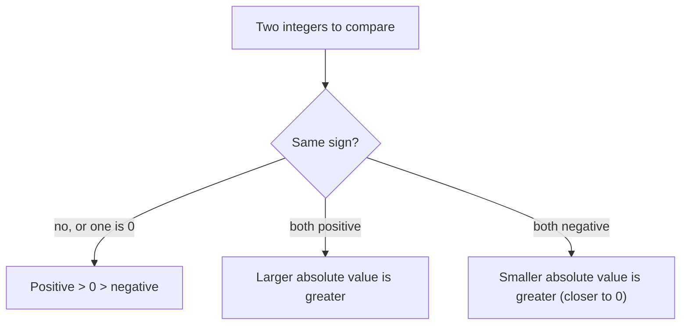

## Numbers below zero

Whole numbers start at 0, but the world doesn't. Temperatures drop below zero, bank balances go overdrawn, a submarine sits below sea level, and a football team can lose yards. To describe these we extend the number line to the left of 0. This module builds the arithmetic of these new numbers; this lesson sets up the picture you'll use for all of it.

## Integers and opposites

A **negative number** is a number less than zero, written with a minus sign: $-5$ is read "negative five." A **positive number** is greater than zero; the plus sign is usually left off, so $+5$ is written 5. Zero is neither positive nor negative.

The **integers** are the whole numbers together with their negatives:

$$\ldots, -3, -2, -1, 0, 1, 2, 3, \ldots$$

On the number line, positive numbers are to the right of 0 and negative numbers to the left, at the same spacing.

```numberline
{"x": [-6, 6], "points": [{"at": [-4, 0], "label": "-4"}, {"at": [4, 0], "label": "4"}, {"at": [0, 0], "label": "0"}], "caption": "4 and -4 are opposites: the same distance from 0 on opposite sides"}
```

Two numbers that are the same distance from 0 but on opposite sides are **opposites**. The opposite of 4 is $-4$, and the opposite of $-4$ is 4. The opposite of 0 is 0. The minus sign can be read as "the opposite of," which explains a fact that surprises people at first:

$$-(-4) = 4$$

"The opposite of negative four" is four. Flipping to the other side of zero twice brings you back.

## Comparing integers

The number line rule from whole numbers still holds: *a number to the right is greater*. So $3 > -10$, because 3 is to the right of $-10$. Among negatives this can feel backwards: $-2 > -7$, because $-2$ is to the right of $-7$, closer to zero. Think of temperature: $-2^\circ$ is warmer than $-7^\circ$; or money: owing \$2 is better than owing \$7.

### Example 1

Order from least to greatest: $4, -6, 0, -1, -9, 2$.

Least means farthest left. The negatives go first, and the one farthest from zero is the smallest: $-9, -6, -1$. Then 0, then the positives: $2, 4$.

Result: $-9, -6, -1, 0, 2, 4$.

The chart below sums up how to compare any two integers without drawing the number line.



## Absolute value

The **absolute value** of a number is its distance from 0 on the number line. It's written with vertical bars: $|{-6}|$ is read "the absolute value of negative six." Since distance is never negative,

$$|6| = 6, \qquad |{-6}| = 6, \qquad |0| = 0.$$

For any nonzero number, the absolute value is the positive version of it. Absolute value measures size and ignores direction; you'll use exactly this idea to add integers in the next lesson.

Be careful with the minus sign outside the bars: $-|{-6}|$ means "the opposite of the absolute value of $-6$," which is $-6$. The bars act as grouping symbols, so evaluate inside them first.

### Example 2

Evaluate $|{-8}| - |3| + |{-2 - 5}|$.

- $|{-8}| = 8$ and $|3| = 3$.
- Inside the last bars, $-2 - 5$ is $-7$ (start at $-2$ and move 5 more to the left; the next lesson explains this in detail), and $|{-7}| = 7$.
- So we have $8 - 3 + 7 = 12$.

## Distance between two numbers

How far apart are $-3$ and 5 on the number line? Counting: from $-3$ to 0 is 3 units, and from 0 to 5 is 5 more, for a total of 8.

```numberline
{"x": [-5, 7], "points": [{"at": [-3, 0], "label": "-3"}, {"at": [5, 0], "label": "5"}], "segments": [{"from": [-3, 0], "to": [5, 0], "label": "8 units"}], "caption": "The distance from -3 to 5 is 8"}
```

In general, the distance between two numbers $a$ and $b$ is $|a - b|$: subtract them in either order, then take the absolute value. You'll be able to compute $5 - (-3) = 8$ directly after the next lesson. For now, a reliable shortcut: if the numbers are on *opposite sides* of zero, add their absolute values; if they are on the *same side*, subtract the smaller absolute value from the larger.

### Example 3

At 6 a.m. the temperature was $-11^\circ$F. By noon it was $-4^\circ$F. By how many degrees did it rise?

Both are negative (same side of zero), so subtract absolute values: $11 - 4 = 7$. The temperature rose 7 degrees. Check on a number line: from $-11$, move 7 to the right and you land on $-4$. ✓

A thermometer is a number line stood on end: warmer is higher, just as greater is farther right. Each small mark below is 1 degree.


### Example 4

The highest point in a region is 1,250 feet above sea level and the lowest is 80 feet below sea level. What is the difference in elevation?

Write the elevations as integers: 1,250 and $-80$. They are on opposite sides of zero, so add the absolute values: $1{,}250 + 80 = 1{,}330$ feet.

## Signs as directions

It helps to translate words into signs consistently:

| Positive | Negative |
|---|---|
| above, up, rise, gain, deposit, profit, ahead | below, down, drop, loss, withdrawal, debt, behind |

Choosing a direction as positive is a decision you make at the start of a problem; the arithmetic then takes care of itself.

## Common mistakes

- *Thinking $-7 > -2$ because 7 > 2.* For negatives, the one with the bigger absolute value is *smaller*.
- *Writing $|{-5}| = -5$.* Absolute value is a distance, never negative.
- *Ignoring a sign outside the bars.* $-|4| = -4$, and $-|{-4}| = -4$ too.
- *Counting tick marks instead of spaces* when finding a distance on a number line.
- *Calling 0 positive.* Zero is neither positive nor negative.

## Key points

- Integers: $\ldots, -2, -1, 0, 1, 2, \ldots$; negatives sit left of zero.
- Opposites are the same distance from 0 on opposite sides; $-(-a) = a$.
- Farther right means greater, so $-2 > -7$.
- $|a|$ is the distance from 0, never negative.
- Distance between $a$ and $b$ is $|a - b|$: add absolute values across zero, subtract them on the same side.
