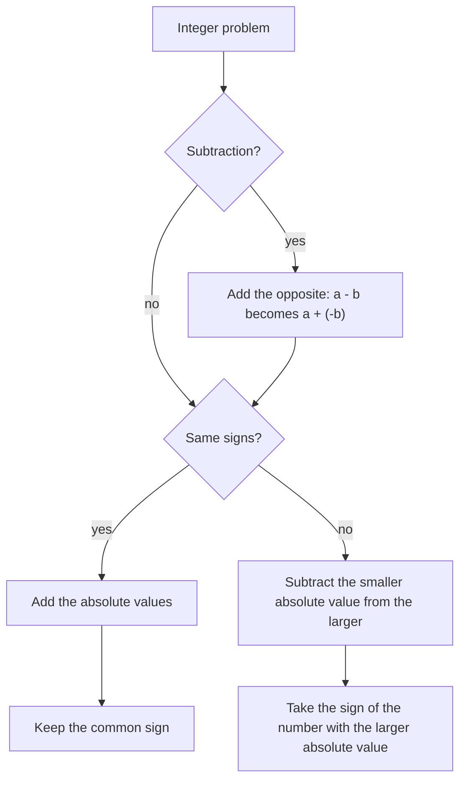

## Moving along the number line

In the last lesson you placed integers on the number line and measured distance with absolute value. Now we make them move. Adding and subtracting integers is the single most error-prone skill in pre-algebra, and almost every later topic (solving equations, slopes, simplifying expressions) depends on it. The goal is to understand *why* the rules work, so that you can rebuild them if you forget.

## Adding on the number line

Think of addition as a trip: start at the first number, and the second number tells you how far to move and in which direction. A positive number means move right; a negative number means move left.

- $3 + 4$: start at 3, move 4 right, land on 7.
- $3 + (-4)$: start at 3, move 4 left, land on $-1$.
- $-3 + (-4)$: start at $-3$, move 4 left, land on $-7$.
- $-3 + 4$: start at $-3$, move 4 right, land on 1.

```numberline
{"x": [-6, 6], "points": [{"at": [3, 0], "label": "start 3"}, {"at": [-1, 0], "label": "end -1"}], "segments": [{"from": [3, 0], "to": [-1, 0], "arrow": true, "label": "move 4 left"}], "caption": "3 + (-4) = -1"}
```

## The rules for adding integers

Looking at many such trips, two patterns appear.

*Same signs:* add the absolute values and keep the common sign. Moving left from a negative number takes you further left, so two negatives make a bigger negative: $-8 + (-5) = -13$.

*Different signs:* subtract the smaller absolute value from the larger, and take the sign of the number with the larger absolute value. The two moves partly cancel, and whichever is "stronger" wins: $-8 + 5 = -3$ (8 is stronger and negative), while $8 + (-5) = 3$.

A money picture makes these rules concrete. Positive numbers are dollars you have; negative numbers are debts. If you owe \$8 and earn \$5, you still owe \$3: $-8 + 5 = -3$. If you owe \$8 and then borrow \$5 more, you owe \$13: $-8 + (-5) = -13$.

A third model uses counters: each + counter is worth $+1$ and each − counter is worth $-1$. One of each together is a **zero pair**, worth $1 + (-1) = 0$, so zero pairs can be removed without changing the total. To find $-5 + 3$, lay out five − counters and three + counters, remove the three zero pairs, and read what is left: two − counters, so $-5 + 3 = -2$. That is the different-signs rule in action: the 3 cancels part of the 5, and the leftover has the sign of the larger group.


Two consequences:

- A number plus its opposite is zero: $7 + (-7) = 0$. Opposites are also called **additive inverses** for this reason.
- Addition of integers is still commutative and associative, so with a long sum you can add all the positives, add all the negatives, and combine the two results at the end.

### Example 1

Find $-12 + 7 + (-9) + 15 + (-4)$.

Group by sign. Positives: $7 + 15 = 22$. Negatives: $-12 + (-9) + (-4) = -25$. Combine: $22 + (-25)$. Different signs; $25 - 22 = 3$, and the negative is stronger, so the sum is $-3$.

## Subtracting: add the opposite

Subtraction asks "what must be added to the second number to get the first?" From that comes the rule that makes subtraction easy:

$$a - b = a + (-b)$$

*To subtract, add the opposite.* Change the subtraction to addition and change the sign of the number being subtracted; then use the addition rules. Only the second number changes.

Why is this true? Check with the definition: $(a + (-b)) + b = a + ((-b) + b) = a + 0 = a$. So $a + (-b)$ is exactly the number that, added to $b$, gives $a$, which is what $a - b$ means.

Some cases:

- $5 - 9 = 5 + (-9) = -4$
- $-5 - 9 = -5 + (-9) = -14$
- $5 - (-9) = 5 + 9 = 14$
- $-5 - (-9) = -5 + 9 = 4$

The third line is the famous one: *subtracting a negative is the same as adding a positive.* In money terms, if a \$9 debt is taken away from you (someone cancels it), you are \$9 better off.

On the number line, $a - b$ is the signed distance from $b$ to $a$. For example, $5 - (-9) = 14$ says that going from $-9$ to 5 is a trip of 14 units to the right. That's why the distance between two numbers in the last lesson was $|a - b|$.

```numberline
{"x": [-11, 7], "points": [{"at": [-9, 0], "label": "-9"}, {"at": [5, 0], "label": "5"}], "segments": [{"from": [-9, 0], "to": [5, 0], "arrow": true, "label": "14 units right"}], "caption": "5 - (-9) = 14: the trip from -9 to 5 is 14 units to the right"}
```

The whole procedure for adding and subtracting fits in one chart:



### Example 2

Simplify $-6 - (-14) - 11$.

Rewrite each subtraction as adding the opposite: $-6 + 14 + (-11)$. Left to right: $-6 + 14 = 8$, then $8 + (-11) = -3$.

### Example 3

Simplify $4 - 10 - (-3) + (-8)$.

Rewrite: $4 + (-10) + 3 + (-8)$. Positives: $4 + 3 = 7$. Negatives: $-10 + (-8) = -18$. Combine: $7 + (-18) = -11$.

## Reading the minus sign

The symbol "−" does three jobs, and reading it correctly prevents most errors:

1. *Subtract*, between two numbers: $8 - 3$.
2. *Negative*, attached to a number: $-3$.
3. *Opposite of*, in front of an expression: $-(-3)$, $-(x + 2)$.

In $8 - -3$ (better written $8 - (-3)$), the first sign means subtract and the second means negative. Parentheses around negative numbers make this clear, and you should use them whenever two signs would otherwise touch.

## Word problems

### Example 4

A submarine is at 240 feet below sea level. It rises 85 feet, then dives 130 feet. What is its final depth?

Use below sea level as negative. Start: $-240$. Rising is positive, diving negative: $-240 + 85 + (-130)$. First, $-240 + 85 = -155$. Then $-155 + (-130) = -285$. The submarine is 285 feet below sea level.

### Example 5

The highest temperature recorded in a town was 104°F and the lowest was $-29$°F. What is the range (difference) between them?

Difference = highest minus lowest $= 104 - (-29) = 104 + 29 = 133$ degrees.

## Common mistakes

- *Changing the sign of the first number* when subtracting. In $-5 - 9$, only the 9 changes: $-5 + (-9) = -14$, not $5 + (-9)$.
- *Using the multiplication sign rule for addition.* "Two negatives make a positive" is about multiplying. $-4 + (-6)$ is $-10$, not 10.
- *Taking the wrong sign with different signs.* In $-12 + 5$, the larger absolute value is 12, which is negative, so the answer is $-7$.
- *Subtracting in the wrong order* in word problems. "The change from $-3$ to 8" is $8 - (-3) = 11$ (final minus initial).

## Key points

- Same signs: add absolute values, keep the sign. Different signs: subtract absolute values, take the sign of the larger.
- A number plus its opposite is 0.
- To subtract, add the opposite: $a - b = a + (-b)$. So $a - (-b) = a + b$.
- With many terms, add positives and negatives separately, then combine.
- Change = final value − initial value.
