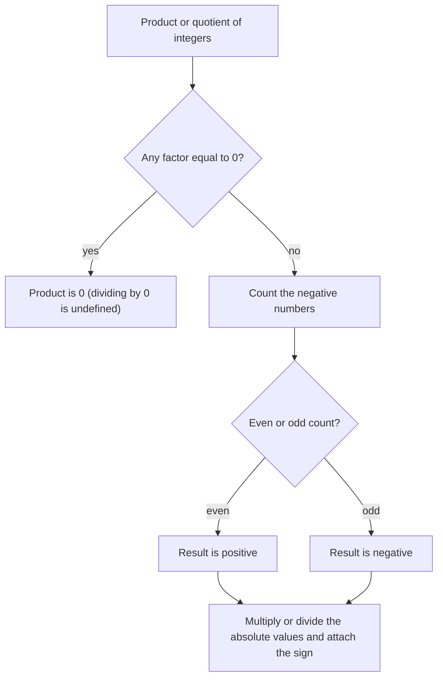

## Completing integer arithmetic

You can now add and subtract integers. This lesson finishes the job with multiplication and division, then puts all four operations together with exponents in the order of operations. The sign rules here are short, but it's worth seeing why they are true, because "a negative times a negative is a positive" sounds like an arbitrary rule until you see that nothing else would be consistent.

## Multiplying a positive and a negative

Multiplication is repeated addition, so

$$3 \times (-4) = (-4) + (-4) + (-4) = -12.$$

Three debts of \$4 are a debt of \$12. On the number line, $3 \times (-4)$ is three jumps of 4 to the left, starting from 0:

```numberline
{"x": [-14, 2], "points": [{"at": [0, 0], "label": "0"}, {"at": [-4, 0], "label": "-4"}, {"at": [-8, 0], "label": "-8"}, {"at": [-12, 0], "label": "-12"}], "segments": [{"from": [0, 0], "to": [-4, 0], "arrow": true}, {"from": [-4, 0], "to": [-8, 0], "arrow": true}, {"from": [-8, 0], "to": [-12, 0], "arrow": true}], "caption": "3 × (-4): three jumps of -4 from 0 land on -12"}
```

Because multiplication is commutative, $(-4) \times 3 = -12$ as well. *A positive times a negative is negative.*

## Multiplying two negatives

What should $(-3) \times (-4)$ be? Look at a pattern, decreasing the first factor by 1 each time:

| Product | Result |
|---|---|
| $3 \times (-4)$ | $-12$ |
| $2 \times (-4)$ | $-8$ |
| $1 \times (-4)$ | $-4$ |
| $0 \times (-4)$ | $0$ |
| $(-1) \times (-4)$ | ? |
| $(-2) \times (-4)$ | ? |
| $(-3) \times (-4)$ | ? |

Each time the first factor goes down by 1, the product goes *up* by 4. Continuing the pattern, the next results are 4, 8 and 12. So $(-3) \times (-4) = 12$. *A negative times a negative is positive.*

Another way to see it: $-(-12) = 12$ says that the opposite of a negative is positive. Multiplying by $-1$ takes the opposite, so $(-3) \times (-4) = -(3 \times (-4)) = -(-12) = 12$.

## The sign rules

| Signs of the two numbers | Sign of the product or quotient |
|---|---|
| same (both + or both −) | positive |
| different (one +, one −) | negative |

Division follows the same rules, because division undoes multiplication: $-20 \div 4 = -5$ because $-5 \times 4 = -20$, and $-20 \div (-4) = 5$ because $5 \times (-4) = -20$.

Zero still behaves as before: $0 \times (-7) = 0$, $0 \div (-7) = 0$, and $-7 \div 0$ is undefined.

### Many factors

With several factors, each negative factor flips the sign. So count the negatives:

- an *even* number of negative factors gives a positive product;
- an *odd* number of negative factors gives a negative product.

If any factor is 0, the product is 0 no matter how many negatives there are. The chart puts the whole sign check in order:



### Example 1

Find $(-2)(5)(-3)(-1)(4)$.

There are three negative factors, an odd number, so the product is negative. Multiply the absolute values: $2 \times 5 \times 3 \times 1 \times 4 = 120$. The product is $-120$.

## Powers of negative numbers

A negative base raised to a power follows the same counting rule: $(-2)^4 = (-2)(-2)(-2)(-2) = 16$ (four negatives) and $(-2)^3 = -8$ (three negatives). So *a negative base to an even power is positive, and to an odd power is negative.*

Now a subtle but important point of notation. Compare

$$(-3)^2 = (-3)(-3) = 9 \qquad \text{and} \qquad -3^2 = -(3 \times 3) = -9.$$

In $-3^2$ the exponent applies only to the 3, because exponents come before taking the opposite (which is a kind of multiplication by $-1$). If you want the negative number squared, you must write the parentheses. Calculators follow this rule too.

## Order of operations with integers

The order of operations is unchanged: grouping, exponents, multiplication and division left to right, addition and subtraction left to right. The only new work is keeping track of signs.

### Example 2

Evaluate $-4 + 6(-3) - (-10) \div 2$.

- Multiplication and division, left to right: $6(-3) = -18$ and $(-10) \div 2 = -5$.
- The expression becomes $-4 + (-18) - (-5)$.
- Add the opposite: $-4 + (-18) + 5$.
- Left to right: $-22 + 5 = -17$.

### Example 3

Evaluate $\dfrac{(-2)^3 - 4}{-3^2 + 6}$.

- Top: $(-2)^3 = -8$, and $-8 - 4 = -12$.
- Bottom: $-3^2 = -9$ (the exponent applies only to 3), and $-9 + 6 = -3$.
- Divide: $-12 \div (-3) = 4$ (same signs, positive).

### Example 4

Evaluate $5 - 2(1 - 4)^2$.

- Parentheses: $1 - 4 = -3$.
- Exponent: $(-3)^2 = 9$.
- Multiply: $2 \times 9 = 18$.
- Subtract: $5 - 18 = -13$.

A common slip is to compute $5 - 2 = 3$ first and get $3 \times 9 = 27$; subtraction waits until the multiplication is done.

## Word problems

### Example 5

A stock lost \$3 in value each day for 6 straight days. What was the total change in value?

Each day's change is $-3$, and there are 6 days: $6 \times (-3) = -18$. The stock changed by $-\$18$, a drop of \$18.

### Example 6

Over 5 days, a lake's water level changed by a total of $-15$ inches, the same amount each day. What was the daily change?

Divide: $-15 \div 5 = -3$. The level fell 3 inches per day.

## Common mistakes

- *Mixing up the addition and multiplication rules.* $-5 + (-3) = -8$, but $(-5)(-3) = 15$.
- *Reading $-3^2$ as 9.* Without parentheses, the exponent applies only to 3, giving $-9$.
- *Losing a sign in a long product.* Count the negative factors first and decide the sign before multiplying.
- *Subtracting before multiplying* in expressions like $5 - 2(-3)$. That's $5 - (-6) = 11$, not $3(-3) = -9$.

## Key points

- Same signs → positive; different signs → negative. This holds for both multiplication and division.
- With many factors, an even number of negatives gives a positive result, an odd number gives a negative result.
- $(-a)^2$ is positive, but $-a^2$ is negative: the exponent binds before the minus sign.
- The order of operations is the same with integers; rewrite subtraction as adding the opposite to keep signs straight.
