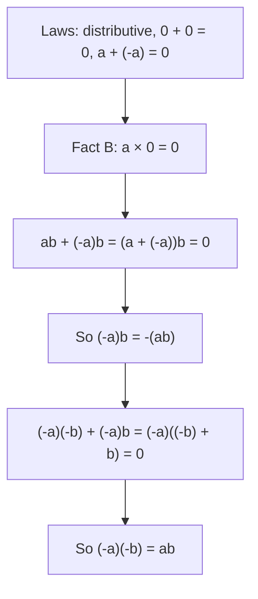

## From patterns to reasons

Lesson 8 gave two reasons why a negative times a negative is positive: a table whose products went up by 4 each step, and a story about debts. Both are good intuition, but neither is a reason in the mathematician's sense. A pattern can be continued in more than one way, and a story only shows that the rule fits one situation. This honors lesson shows something stronger: if negative numbers are to obey the same basic laws that whole numbers obey, the sign rules are *forced*. No other choice is possible. Along the way you will see how mathematicians argue from a few agreed facts to new ones, which is the heart of algebra, and you will get some practical tools for mental arithmetic with negatives.

## A short history of negative numbers

Negative numbers were not accepted all at once. What follows is a simplified outline; the full story is longer and still studied by historians.

- **China.** The *Nine Chapters on the Mathematical Art*, a collection of problems that reached its final form around the first century CE, used positive and negative quantities while solving systems of equations and stated rules for adding and subtracting them. In Liu Hui's commentary on the book (263 CE), numbers were laid out with counting rods: red rods for positive amounts and black rods for negative ones.
- **India.** In 628 CE the astronomer Brahmagupta wrote down rules for "fortunes" (positive numbers), "debts" (negative numbers) and zero, including the rule that the product of two debts is a fortune.
- **Europe.** European mathematicians were slow to accept negatives. Well into the 1500s and later, some writers called negative solutions of equations "false" or "fictitious" and threw them away. Negatives became standard over the next few centuries, and in the 1800s mathematicians began justifying them the way this lesson does: from the laws of arithmetic.

## The rules of the game

Here are the laws we want to keep. They are true for whole numbers, and we insist that they stay true after the negatives are added. Letters stand for any integers.

| Law | Addition | Multiplication |
|---|---|---|
| Commutative | $a + b = b + a$ | $ab = ba$ |
| Associative | $(a + b) + c = a + (b + c)$ | $(ab)c = a(bc)$ |
| Identity | $a + 0 = a$ | $a \times 1 = a$ |
| Opposites | $a + (-a) = 0$ | |
| Distributive | $a(b + c) = ab + ac$ | |

The last row is the one that links addition and multiplication, and it does almost all the work below.

## Two small facts first

**Fact A: a number has only one opposite.** Suppose $a + x = 0$. Add $-a$ to both sides: $(-a) + a + x = -a$. The left side is $0 + x = x$, so $x = -a$. In words: *if two numbers add to 0, each is the opposite of the other.* This gives a test for "is this the opposite?": add and see whether you get 0.

**Fact B: anything times 0 is 0.** Since $0 + 0 = 0$,
$$a \times 0 = a \times (0 + 0) = a \times 0 + a \times 0$$
by the distributive property. Call $a \times 0$ by the name $z$; the line says $z = z + z$. Add $-z$ to both sides and you get $0 = z$. So $a \times 0 = 0$ for every integer, negative or not.

## The sign rules, proved

**Step 1: positive times negative.** Take any integers $a$ and $b$ and add $ab$ to $(-a)b$:
$$ab + (-a)b = \big(a + (-a)\big)b = 0 \times b = 0.$$
The first equals sign is the distributive property (used from right to left), and the last is Fact B. The two products add to 0, so by Fact A, $(-a)b$ is the opposite of $ab$:
$$(-a)b = -(ab).$$
With $a = 4$ and $b = 3$: $(-4)(3) = -12$. A negative times a positive is negative, as Lesson 8 said.

**Step 2: negative times negative.** Now add $(-a)(-b)$ to $(-a)b$:
$$(-a)(-b) + (-a)b = (-a)\big((-b) + b\big) = (-a) \times 0 = 0.$$
So $(-a)(-b)$ is the opposite of $(-a)b$. By Step 1, $(-a)b = -(ab)$, and the opposite of $-(ab)$ is $ab$. Therefore
$$(-a)(-b) = ab.$$

Read that conclusion carefully. Nobody *chose* $(-3)(-4) = 12$. If it were anything else, the distributive property would fail for negative numbers, and every rule you use to simplify expressions would break. The chart shows the chain of reasoning.



### Example 1

Show directly that $(-1)(-1) = 1$, using only the laws in the table and Facts A and B.

- Start from something known to be 0: $(-1) \times 0 = 0$ (Fact B).
- Write the 0 inside as $1 + (-1)$: $(-1)\big(1 + (-1)\big) = 0$.
- Distribute: $(-1)(1) + (-1)(-1) = 0$.
- Since $(-1)(1) = -1$ (identity law), this says $-1 + (-1)(-1) = 0$.
- Two numbers that add to 0 are opposites (Fact A), so $(-1)(-1)$ is the opposite of $-1$, which is 1.

### Example 2

Prove that the opposite of a sum is the sum of the opposites: $-(a + b) = (-a) + (-b)$.

Use the test from Fact A: add the two and check for 0. Rearranging with the commutative and associative laws,
$$(a + b) + \big((-a) + (-b)\big) = \big(a + (-a)\big) + \big(b + (-b)\big) = 0 + 0 = 0.$$
So $(-a) + (-b)$ is the opposite of $a + b$. For example, $-(5 + 8) = -13$ and $(-5) + (-8) = -13$. This is the reason you can "distribute a minus sign" later in algebra: $-(x + 7) = -x - 7$.

## Multiplying by −1 flips the number line

Step 1 with $a = 1$ says $(-1)b = -b$: *multiplying by $-1$ takes the opposite.* On the number line, taking the opposite is a flip (a mirror reflection) across 0. Every point jumps to the same distance on the other side.

```numberline
{"x": [-7, 7], "points": [{"at": [5, 0], "label": "5"}, {"at": [-5, 0], "label": "-5"}, {"at": [0, 0], "label": "0"}], "segments": [{"from": [5, 0], "to": [-5, 0], "arrow": true}], "caption": "Multiplying by -1 flips 5 across 0 to -5"}
```

Multiplying by any negative number is a flip followed by a stretch. Since $-2 = (-1) \times 2$, multiplying $-3$ by $-2$ means: flip $-3$ to 3, then double to 6.

```numberline
{"x": [-5, 8], "points": [{"at": [-3, 0], "label": "-3"}, {"at": [3, 0], "label": "3", "open": true}, {"at": [6, 0], "label": "6"}], "segments": [{"from": [-3, 0], "to": [6, 0], "arrow": true}], "caption": "(-3) × (-2): flip -3 to 3 (open dot), then stretch by 2 to reach 6"}
```

This picture explains the counting rule from Lesson 8. Each negative factor is one flip. Two flips bring you back to the side you started on, so an even number of negative factors gives a positive result, and an odd number leaves you on the negative side.

## Using the distributive property for mental math

Because the distributive property holds for all integers, you can use it to make products with negatives easy.

### Example 3

Find $(-8)(97)$ in your head.

Write 97 as $100 - 3$, that is, $100 + (-3)$:
$$(-8)(97) = (-8)(100) + (-8)(-3) = -800 + 24 = -776.$$
The sign rules are used twice: $(-8)(100)$ is negative, and $(-8)(-3)$ is positive.

### Example 4

Find $(-7)(13) + (-7)(-3)$.

Both products share the factor $-7$, so use the distributive property in reverse:
$$(-7)(13) + (-7)(-3) = (-7)\big(13 + (-3)\big) = (-7)(10) = -70.$$
Check the long way: $-91 + 21 = -70$. ✓

## What changes when negatives arrive

Adding negative numbers to the whole numbers fixes one problem and leaves others alone.

A set of numbers is **closed** under an operation if doing that operation to any two numbers in the set always gives a number in the set. The whole numbers are not closed under subtraction: $3 - 5$ is not a whole number. The integers *are* closed under subtraction, and that is one way to say why they were needed. The integers are closed under addition, subtraction and multiplication, but not under division: $-7 \div 2$ is not an integer. (Fractions fix that in the next module.)

Some laws never held for subtraction and division, and negatives don't change that. To show a general statement is false, one example where it fails is enough. Such an example is called a **counterexample**.

### Example 5

Is subtraction associative? That is, does $(a - b) - c = a - (b - c)$ for all integers?

Try $a = 10$, $b = 4$, $c = 3$:
$$(10 - 4) - 3 = 6 - 3 = 3, \qquad 10 - (4 - 3) = 10 - 1 = 9.$$
The results differ, so this is a counterexample: subtraction is not associative. You can see why by adding the opposite: $(a - b) - c = a + (-b) + (-c)$, while $a - (b - c) = a + (-b) + c$. The two differ only in the sign of $c$, so they agree only when $c = 0$. Subtraction is not commutative either: $2 - 9 = -7$ but $9 - 2 = 7$. In fact $b - a$ is always the opposite of $a - b$.

### Example 6

Why is $-6 \div 0$ undefined, and what goes wrong with $0 \div 0$?

Division undoes multiplication: $-6 \div 0 = q$ would mean $q \times 0 = -6$. But by Fact B, $q \times 0 = 0$ for every $q$, so no number works. For $0 \div 0 = q$ we would need $q \times 0 = 0$, which is true for *every* $q$, so there is no single answer. Both are left undefined.

## Common mistakes

- *Treating a pattern as a proof.* A table that "keeps going" suggests a rule; the distributive property is what proves it.
- *Thinking the sign rules were chosen by convention.* Any other choice would break the distributive property.
- *Writing $-(a + b) = -a + b$.* The opposite of a sum changes the sign of *every* term: $-a + (-b)$.
- *Assuming subtraction can be regrouped or reordered.* $(10 - 4) - 3 \ne 10 - (4 - 3)$, and $a - b$ is the opposite of $b - a$.
- *Thinking one example proves a general rule.* One example can disprove a rule (a counterexample), but checking a few cases never proves one.

## Key points

- The integers keep the commutative, associative, identity and distributive laws, and every integer has an opposite.
- From these laws: $a \times 0 = 0$, $(-a)b = -(ab)$ and $(-a)(-b) = ab$. The sign rules are forced, not chosen.
- Two numbers that add to 0 are opposites; this is the test used in every proof above.
- Multiplying by $-1$ flips the number line across 0; each negative factor is one flip.
- The integers are closed under $+$, $-$ and $\times$, not $\div$. Subtraction is neither commutative nor associative, and one counterexample shows it.
