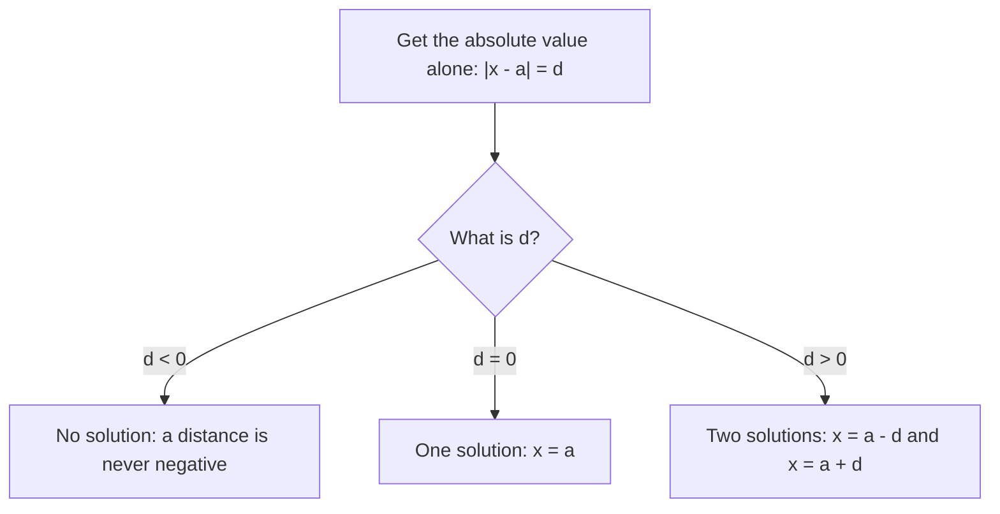

## Absolute value as distance

Lesson 6 defined $|a|$ as the distance from $a$ to 0, and found the distance between two numbers as $|a - b|$. Lesson 7 explained why: $a - b$ is the signed trip from $b$ to $a$, and the absolute value throws away the direction and keeps the length. This honors lesson runs that idea backward. Instead of asking "how far apart are these two numbers?", it asks "which numbers are this far from a given number?" That question leads to your first equations with two answers, to midpoints, to counting the integers in a range, and to the difference between how far you went and where you ended up.

Two facts about distance are worth stating plainly:

- $|a - b| = |b - a|$. The trip from $a$ to $b$ and the trip back are the same length; $a - b$ and $b - a$ are opposites, and opposites have the same absolute value.
- $|x|$ is $|x - 0|$, the distance from $x$ to 0.

## Reading |x − a| out loud

The most useful habit in this lesson is to read $|x - a|$ as *"the distance from $x$ to $a$."* For a sum inside the bars, rewrite it as a difference first: $x + 6 = x - (-6)$, so $|x + 6|$ is the distance from $x$ to $-6$, not to 6. The sign inside the bars is the opposite of the sign of the point it measures from.

| Expression | Read it as |
|---|---|
| $\lvert x - 4 \rvert$ | distance from $x$ to 4 |
| $\lvert x + 6 \rvert$ | distance from $x$ to $-6$ |
| $\lvert x \rvert$ | distance from $x$ to 0 |
| $\lvert 3 - x \rvert$ | distance from $x$ to 3 (same as $\lvert x - 3 \rvert$) |

## Absolute value equations

An **absolute value equation** is an equation with the unknown inside absolute value bars, such as $|x - 4| = 9$. Read as distance, it asks: *which numbers are 9 units from 4?* Walk 9 units left of 4 or 9 units right of 4:

```numberline
{"x": [-7, 15], "points": [{"at": [-5, 0], "label": "-5"}, {"at": [4, 0], "label": "4"}, {"at": [13, 0], "label": "13"}], "segments": [{"from": [4, 0], "to": [-5, 0], "arrow": true, "label": "9"}, {"from": [4, 0], "to": [13, 0], "arrow": true, "label": "9"}], "caption": "|x - 4| = 9: the two numbers 9 units from 4 are -5 and 13"}
```

In general, $|x - a| = d$ has:

- **two solutions**, $a - d$ and $a + d$, when $d$ is positive;
- **one solution**, $x = a$, when $d = 0$ (only $a$ itself is 0 units from $a$);
- **no solution** when $d$ is negative, because a distance can never be negative.

Before deciding, get the absolute value alone on one side, exactly as you would isolate a variable.



### Example 1

Solve $|x - 4| = 9$.

The distance from $x$ to 4 is 9, so $x = 4 - 9 = -5$ or $x = 4 + 9 = 13$.

Check both: $|-5 - 4| = |-9| = 9$ ✓ and $|13 - 4| = |9| = 9$ ✓.

### Example 2

Solve $|x + 6| = 2$.

Rewrite: $|x - (-6)| = 2$, so $x$ is 2 units from $-6$. Then $x = -6 - 2 = -8$ or $x = -6 + 2 = -4$.

Check: $|-8 + 6| = |-2| = 2$ ✓ and $|-4 + 6| = |2| = 2$ ✓. A common wrong answer is $4$ and $8$, from measuring from $+6$ instead of $-6$.

### Example 3

Solve (a) $3|x - 1| + 4 = 19$ and (b) $|x - 3| + 8 = 2$.

(a) Isolate the absolute value. Subtract 4: $3|x - 1| = 15$. Divide by 3: $|x - 1| = 5$. So $x = 1 - 5 = -4$ or $x = 1 + 5 = 6$. Check $x = -4$: $3|-5| + 4 = 15 + 4 = 19$ ✓. Check $x = 6$: $3|5| + 4 = 19$ ✓.

(b) Subtract 8: $|x - 3| = -6$. A distance can't be $-6$, so there is **no solution**. Notice that the $-6$ appeared only after isolating; the original equation had only positive numbers in it.

## Midpoints

The **midpoint** of two numbers is the number exactly halfway between them, the same distance from each. To find it, start at the smaller number and move half the distance:

$$\text{midpoint} = a + \frac{b - a}{2} = \frac{a + b}{2}.$$

The second form says the midpoint is the average of the two numbers. When the distance $b - a$ is even, the midpoint is an integer. When it is odd, the midpoint falls halfway between two integers; you will be able to name such numbers after the fractions and decimals modules, so this lesson's problems use even distances.

### Example 4

Find the midpoint of $-11$ and 5.

The distance is $5 - (-11) = 16$; half of it is 8. Start at $-11$ and move 8 right: $-11 + 8 = -3$. With the other form: $\dfrac{-11 + 5}{2} = \dfrac{-6}{2} = -3$.

Check: $-3$ is $|-3 - (-11)| = 8$ from $-11$ and $|5 - (-3)| = 8$ from 5. ✓

## Everything within a distance, and counting integers

Often we want all numbers *within* a distance, not exactly at it. The statement $|x - a| \le d$ says "$x$ is at most $d$ units from $a$," which is every number from $a - d$ to $a + d$, endpoints included. A machine part that should be 50 mm long, give or take 2 mm, must satisfy $|L - 50| \le 2$, so any length from 48 mm to 52 mm passes.

How many *integers* lie in such a range? Counting needs care. From 1 to 10 there are 10 integers, which is $10 - 1 + 1$. In general,

$$\text{number of integers from } m \text{ to } n \text{, including both} = n - m + 1.$$

The difference $n - m$ counts the *gaps* between neighboring integers, and there is always one more integer than gaps, just as a fence with 9 gaps needs 10 posts. Forgetting the $+1$ is called a fencepost error. If neither endpoint counts, take away both ends: $n - m - 1$.

### Example 5

How many integers $x$ satisfy $|x - 2| \le 5$? How many satisfy $|x - 2| < 5$?

$|x - 2| \le 5$ means $x$ is from $2 - 5 = -3$ to $2 + 5 = 7$, endpoints included. Count: $7 - (-3) + 1 = 11$ integers: $-3, -2, \ldots, 6, 7$.

$|x - 2| < 5$ leaves out the two endpoints (they are exactly 5 away), so $11 - 2 = 9$ integers: $-2$ through 6. Check with the "neither end" formula: $7 - (-3) - 1 = 9$. ✓

## Net change and distance traveled

Absolute value also separates two ideas that everyday language mixes up. The **net change** of a trip is final position minus starting position: a signed number that tells where you ended up. The *total distance traveled* adds the lengths of all the moves, ignoring direction. Picture a walker who starts at 0, goes 7 units right, then 10 units left.


The net change is $7 + (-10) = -3$; the distance traveled is $|7| + |-10| = 17$. The size of the net change is never more than the distance traveled, because moves in opposite directions partly cancel. For any two integers this is the **triangle inequality**:

$$|a + b| \le |a| + |b|.$$

The two sides are equal exactly when $a$ and $b$ have the same sign (or one of them is 0), because then nothing cancels. The name comes from geometry, where it says one side of a triangle is never longer than the other two sides together; on the number line the "triangle" is flattened into a line.

Multiplication is simpler. The sign rules decide only the sign, never the size, so sizes just multiply: $|ab| = |a| \cdot |b|$, and likewise $|a \div b| = |a| \div |b|$ when $b \ne 0$. For example, $|(-6)(4)| = |-24| = 24 = 6 \times 4$.

### Example 6

A diver goes down 12 m, comes up 5 m, then goes down 9 m. Find her net change in depth and the total distance she swam vertically.

With down as negative, the moves are $-12$, $+5$ and $-9$.

- Net change: $-12 + 5 + (-9) = -16$. She ends 16 m below where she started.
- Distance traveled: $12 + 5 + 9 = 26$ m.

The triangle inequality holds: $|-16| = 16 \le 26$. The two are not equal because one move went the opposite way; the 5 m up was traveled but then had to be "re-traveled" going down.

## Common mistakes

- *Measuring from the wrong point.* $|x + 6|$ is the distance from $-6$, so the solutions of $|x + 6| = 2$ are $-8$ and $-4$, not 4 and 8.
- *Giving only one solution.* $|x - 4| = 9$ has two: $-5$ and 13.
- *Solving $|x - 3| = -6$ anyway.* A negative distance means no solution.
- *Not isolating first.* In $3|x - 1| + 4 = 19$, undo the $+4$ and the $\times 3$ before reading off the distance.
- *Fencepost errors.* The integers from $-3$ to 7 number $7 - (-3) + 1 = 11$, not 10.
- *Writing $|a + b| = |a| + |b|$.* That holds only when $a$ and $b$ have the same sign (or one is 0): $|7 + (-10)| = 3$, but $|7| + |-10| = 17$.

## Key points

- Read $|x - a|$ as the distance from $x$ to $a$; $|x + a|$ is the distance from $x$ to $-a$.
- $|x - a| = d$: two solutions $a \pm d$ if $d > 0$, one if $d = 0$, none if $d < 0$. Isolate the absolute value first.
- The midpoint of $a$ and $b$ is $\dfrac{a + b}{2}$, the same as $a$ plus half the distance.
- Integers from $m$ to $n$ inclusive: $n - m + 1$. Strictly between: $n - m - 1$.
- Net change is signed (final − start); distance traveled adds the absolute values of the moves. $|a + b| \le |a| + |b|$, and $|ab| = |a||b|$.
