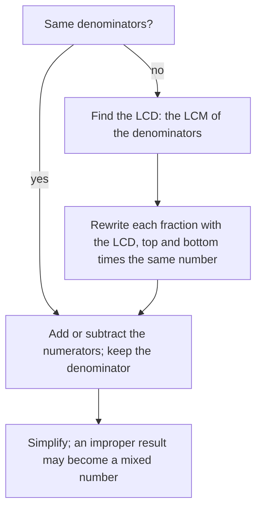

## Adding needs same-size pieces

You can't add 3 apples and 2 oranges and call it 5 of anything in particular. Fractions are similar: $\tfrac13 + \tfrac14$ can't be found by adding pieces until the pieces are the same size. This lesson shows how to make them the same size with a common denominator, using the LCM from Module 1, and then how to add and subtract.

## Like denominators

Fractions with the same denominator are called **like fractions**. Adding them is just counting pieces of the same size:

$$\frac{a}{c} + \frac{b}{c} = \frac{a + b}{c}, \qquad \frac{a}{c} - \frac{b}{c} = \frac{a - b}{c}$$

Two eighths plus three eighths is five eighths: $\tfrac28 + \tfrac38 = \tfrac58$. The denominator names the size of the pieces, so it stays the same; you never add denominators. Simplify at the end if possible: $\tfrac{5}{12} + \tfrac{1}{12} = \tfrac{6}{12} = \tfrac12$.

## Unlike denominators

When denominators differ, rewrite each fraction as an equivalent fraction with a **common denominator**, then add the numerators. Any common multiple of the denominators works, but the smallest one, the **least common denominator** (**LCD**), keeps the numbers small. The LCD is simply the LCM of the denominators.

```shape
{"polygons": [{"points": [[0, 2], [4, 2], [4, 3], [0, 3]], "fill": true}, {"points": [[0, 2], [12, 2], [12, 3], [0, 3]]}, {"points": [[0, 0], [3, 0], [3, 1], [0, 1]], "fill": true}, {"points": [[0, 0], [12, 0], [12, 1], [0, 1]]}], "segments": [{"from": [4, 2], "to": [4, 3]}, {"from": [8, 2], "to": [8, 3]}, {"from": [3, 0], "to": [3, 1]}, {"from": [6, 0], "to": [6, 1]}, {"from": [9, 0], "to": [9, 1]}], "labels": [{"at": [-1, 2.5], "text": "1/3"}, {"at": [-1, 0.5], "text": "1/4"}], "caption": "1/3 = 4/12 and 1/4 = 3/12, so together they make 7/12"}
```

*Steps for adding or subtracting fractions:*

1. Find the LCD (the LCM of the denominators).
2. Rewrite each fraction with the LCD by multiplying its top and bottom by the needed factor.
3. Add or subtract the numerators; keep the denominator.
4. Simplify.



### Example 1

Add $\dfrac{5}{6} + \dfrac{3}{8}$.

1. LCD: $6 = 2 \times 3$ and $8 = 2^3$, so LCM $= 2^3 \times 3 = 24$.
2. $\dfrac{5}{6} = \dfrac{5 \times 4}{6 \times 4} = \dfrac{20}{24}$ and $\dfrac{3}{8} = \dfrac{3 \times 3}{8 \times 3} = \dfrac{9}{24}$.
3. $\dfrac{20}{24} + \dfrac{9}{24} = \dfrac{29}{24}$.
4. 29 is prime and doesn't divide 24, so $\dfrac{29}{24}$ is simplified. (As a mixed number, $1\tfrac{5}{24}$.)

Using $6 \times 8 = 48$ as the common denominator also works: $\tfrac{40}{48} + \tfrac{18}{48} = \tfrac{58}{48} = \tfrac{29}{24}$. You just have more simplifying to do at the end.

### Example 2

Subtract $\dfrac{7}{10} - \dfrac{4}{15}$.

LCD of 10 and 15 is 30. $\dfrac{7}{10} = \dfrac{21}{30}$ and $\dfrac{4}{15} = \dfrac{8}{30}$. So $\dfrac{21}{30} - \dfrac{8}{30} = \dfrac{13}{30}$.

## Negative results and negative fractions

Subtraction can give a negative answer, and fractions follow the integer rules from Module 2.

### Example 3

Compute $\dfrac{1}{4} - \dfrac{5}{6}$.

LCD 12: $\dfrac{3}{12} - \dfrac{10}{12} = \dfrac{3 - 10}{12} = \dfrac{-7}{12} = -\dfrac{7}{12}$.

### Example 4

Compute $-\dfrac{2}{3} + \dfrac{1}{2} - \left(-\dfrac{5}{6}\right)$.

Subtracting a negative is adding: $-\dfrac23 + \dfrac12 + \dfrac56$. LCD 6: $-\dfrac46 + \dfrac36 + \dfrac56 = \dfrac{-4 + 3 + 5}{6} = \dfrac{4}{6} = \dfrac23$.

## Why you can't add tops and bottoms

A tempting shortcut is $\tfrac12 + \tfrac13 = \tfrac{1+1}{2+3} = \tfrac25$. Check the size: $\tfrac12$ alone is already bigger than $\tfrac25$, so adding $\tfrac13$ to it can't give $\tfrac25$. The correct answer is $\tfrac36 + \tfrac26 = \tfrac56$. Adding denominators would mean the pieces get *smaller* when you add more of them, which makes no sense.

## Word problems

### Example 5

Lena spent $\tfrac13$ of her paycheck on rent and $\tfrac{1}{5}$ on food. What fraction is left?

Spent: $\tfrac13 + \tfrac15 = \tfrac5{15} + \tfrac3{15} = \tfrac8{15}$. The whole paycheck is 1, which is $\tfrac{15}{15}$. Left: $\tfrac{15}{15} - \tfrac8{15} = \tfrac7{15}$.

### Example 6

A carpenter cuts $\tfrac{3}{8}$ inch off a board and then another $\tfrac{5}{16}$ inch. How much has been removed in total, and is it more or less than $\tfrac34$ inch?

$\tfrac38 + \tfrac5{16} = \tfrac6{16} + \tfrac5{16} = \tfrac{11}{16}$ inch. Compare with $\tfrac34 = \tfrac{12}{16}$: $\tfrac{11}{16}$ is $\tfrac1{16}$ inch less than $\tfrac34$.

## Order of operations with fractions

All the earlier rules still hold. Multiplication and division come before addition and subtraction, so in $\tfrac12 + \tfrac13 \times \tfrac34$ you multiply first: $\tfrac13 \times \tfrac34 = \tfrac14$, then $\tfrac12 + \tfrac14 = \tfrac34$.

## Estimating with benchmark fractions

Before adding exactly, it helps to estimate with **benchmark fractions**: 0, $\tfrac12$ and 1. Round each fraction to the nearest benchmark by comparing its numerator with half its denominator. For $\tfrac{7}{8} + \tfrac{5}{12}$: $\tfrac78$ is close to 1 (7 is nearly 8), and $\tfrac{5}{12}$ is close to $\tfrac12$ (5 is close to 6). So the sum should be about $1\tfrac12$. The exact answer is $\tfrac{21}{24} + \tfrac{10}{24} = \tfrac{31}{24} = 1\tfrac{7}{24}$, a little less than $1\tfrac12$, which fits. If your exact answer had come out as $\tfrac{12}{20}$, the estimate would immediately tell you something went wrong.

```numberline
{"x": [0, 1], "points": [{"at": [0, 0], "label": "0"}, {"at": [0.5, 0], "label": "1/2"}, {"at": [1, 0], "label": "1"}, {"at": [0.41667, 0], "label": "5/12", "open": true}, {"at": [0.875, 0], "label": "7/8", "open": true}], "caption": "5/12 sits just left of the benchmark 1/2, and 7/8 sits just left of 1"}
```

Benchmarks also settle comparisons quickly. Is $\tfrac{4}{9} + \tfrac{3}{7}$ more or less than 1? Each fraction is a bit less than $\tfrac12$ (4 is less than half of 9, and 3 is less than half of 7), so the sum is less than 1 with no common denominator needed.

## Common mistakes

- *Adding denominators:* $\tfrac25 + \tfrac15 = \tfrac35$, not $\tfrac3{10}$.
- *Changing the denominator without the numerator.* To turn $\tfrac{3}{4}$ into twelfths, multiply both parts by 3: $\tfrac{9}{12}$.
- *Using a common denominator that isn't a multiple of both.* For 6 and 8, 12 doesn't work (8 doesn't divide 12); 24 does.
- *Forgetting to simplify* at the end: $\tfrac{6}{12}$ should be $\tfrac12$.
- *Sign slips* when the result is negative; subtract the numerators carefully, then attach the sign.

## Key points

- Like fractions: add or subtract numerators, keep the denominator.
- Unlike fractions: rewrite with the LCD (the LCM of the denominators), then add or subtract.
- Never add or subtract denominators.
- Simplify the result; negative results follow the integer sign rules.
- "What fraction is left?" means subtract from 1, written with the same denominator.
