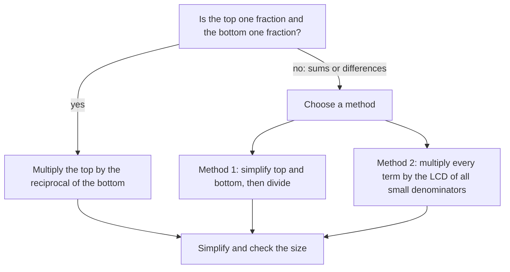

## Fractions inside fractions

In Lesson 10 you saw why dividing by a fraction means multiplying by its reciprocal. One argument there wrote the division $\tfrac ab \div \tfrac cd$ as a "big fraction" with a fraction on top and a fraction on the bottom, then multiplied the top and the bottom by the same thing. This honors lesson takes that idea seriously. Fractions stacked inside fractions turn up in formulas for average speed, in electronics and optics, and in algebra, where they are a routine step. You will learn two reliable ways to simplify them, see why both work, and then meet a beautiful special case, the continued fraction, which gives some of the best fraction approximations of numbers like $\pi$.

Everything here uses only the skills from this module: equivalent fractions, the four operations, the LCD and mixed numbers.

## What a complex fraction is

A **complex fraction** is a fraction whose numerator, denominator or both contain a fraction. Some examples:

$$\frac{\tfrac34}{\tfrac58}, \qquad \frac{\tfrac12 + \tfrac13}{\tfrac34 - \tfrac16}, \qquad \frac{3 - \tfrac14}{2 + \tfrac56}.$$

("Complex" here just means "made of several parts"; it has nothing to do with the complex numbers you may meet in a later course.)

Every complex fraction has a **main fraction bar**: the longest bar, which separates the whole top from the whole bottom. Lesson 3 said a fraction bar is a grouping symbol, so the main bar tells you the order of work: finish everything above it, finish everything below it, and divide last.

### Why the length of the bar matters

On paper, the bar lengths show which division is the main one. Typed on one line, they vanish, and that changes the answer:

$$\frac{\tfrac34}{5} = \frac34 \div 5 = \frac{3}{20}, \qquad\text{but}\qquad \frac{3}{\tfrac45} = 3 \div \frac45 = \frac{15}{4}.$$

Both are "3 over 4 over 5", yet the second is 25 times the first. When you write a complex fraction on one line, use parentheses: `(3/4)/5` or `3/(4/5)`. (Most calculators read `3/4/5` left to right, as `(3/4)/5`.)

## Method 1: simplify the top and bottom, then divide

This method follows the order of operations exactly.

1. Simplify the numerator to a single fraction.
2. Simplify the denominator to a single fraction.
3. Divide: multiply the top by the reciprocal of the bottom, and simplify.

When the top and bottom are already single fractions, only step 3 is needed: $\dfrac{\tfrac58}{\tfrac{15}{16}} = \dfrac58 \times \dfrac{16}{15} = \dfrac{1}{1} \times \dfrac{2}{3} = \dfrac23$ (cancel 5 with 15 and 8 with 16).

### Example 1

Simplify $\dfrac{\tfrac12 + \tfrac13}{\tfrac34 - \tfrac16}$.

*Top:* the LCD of 2 and 3 is 6, so $\tfrac12 + \tfrac13 = \tfrac36 + \tfrac26 = \tfrac56$.

*Bottom:* the LCD of 4 and 6 is 12, so $\tfrac34 - \tfrac16 = \tfrac9{12} - \tfrac2{12} = \tfrac7{12}$.

*Divide:* $\dfrac56 \div \dfrac7{12} = \dfrac56 \times \dfrac{12}{7}$. Cancel 6 with 12 (leaving 1 and 2): $\dfrac{5 \times 2}{1 \times 7} = \dfrac{10}{7}$.

Size check: the top is a little less than 1 and the bottom is a little more than $\tfrac12$, so the answer should be a bit less than 2. $\tfrac{10}{7} = 1\tfrac37$ fits.

## Method 2: multiply the top and bottom by the LCD

The second method clears all the small fractions at once. Find the LCD of *every* small denominator in the complex fraction, then multiply the whole top and the whole bottom by it.

*Why it's allowed:* multiplying the top and bottom of any fraction by the same nonzero number $k$ multiplies the fraction by $\tfrac kk = 1$, which doesn't change its value. That's the equivalent-fractions rule from Lesson 9, now applied to a fraction whose parts are themselves fractions.

*Why it helps:* the LCD is a multiple of each small denominator, so every small fraction turns into a whole number. To multiply a sum like $\tfrac12 + \tfrac13$ by 12, multiply *each* term by 12 (the distributive property): $12 \times \tfrac12 + 12 \times \tfrac13 = 6 + 4$.

### Example 2

Simplify the complex fraction from Example 1 by Method 2.

The small denominators are 2, 3, 4 and 6; their LCD is 12. Multiply every term on top and bottom by 12:

$$\frac{12 \times \tfrac12 + 12 \times \tfrac13}{12 \times \tfrac34 - 12 \times \tfrac16} = \frac{6 + 4}{9 - 2} = \frac{10}{7}.$$

Same answer, in one line, with no fraction division at all.

### Example 3

Simplify $\dfrac{3 - \tfrac14}{2 + \tfrac56}$.

*Method 2:* the small denominators are 4 and 6, so multiply by 12. The whole numbers get multiplied too:

$$\frac{36 - 3}{24 + 10} = \frac{33}{34}.$$

*Method 1, as a check:* top $= \tfrac{12}{4} - \tfrac14 = \tfrac{11}{4}$; bottom $= \tfrac{12}{6} + \tfrac56 = \tfrac{17}{6}$. Then $\tfrac{11}{4} \times \tfrac{6}{17} = \tfrac{66}{68} = \tfrac{33}{34}$. ✓

The most common slip in Method 2 is multiplying only the fractions by 12 and forgetting the whole numbers, which would give $\tfrac{3 - 3}{2 + 10} = 0$, clearly wrong since the top $3 - \tfrac14$ is not zero.

### Which method when?

Both methods always give the same answer, so choose the one with less work.

## Signs and mixed numbers

Signs follow the integer rules, and mixed numbers should become improper fractions first (Lesson 12).

### Example 4

Simplify $\dfrac{-2\tfrac13}{1\tfrac34}$.

Convert: $-2\tfrac13 = -\tfrac73$ and $1\tfrac34 = \tfrac74$. Then

$$-\frac73 \div \frac74 = -\frac73 \times \frac47 = -\frac{4}{3}.$$

The 7s cancel. A negative divided by a positive is negative, so the answer is $-\tfrac43$, or $-1\tfrac13$.

## Continued fractions

Here is a complex fraction with another complex fraction inside it:

$$1 + \cfrac{1}{2 + \cfrac{1}{3}}.$$

A fraction built like this, a whole number plus 1 over (a whole number plus 1 over …), is a **continued fraction**. (Mathematicians call this kind, with every numerator 1, a *simple* continued fraction; it is the only kind in this lesson.)

*Evaluating:* work from the bottom up, because the deepest part is the innermost grouping. Here $2 + \tfrac13 = \tfrac73$; then $1 \div \tfrac73 = \tfrac37$; then $1 + \tfrac37 = \tfrac{10}{7}$. (It's a coincidence that this matches Example 1.)

### Example 5

Write $\dfrac{43}{30}$ as a continued fraction.

Undo the evaluation steps: split off the whole number, then flip what's left.

- $\dfrac{43}{30} = 1 + \dfrac{13}{30}$ (since $43 \div 30 = 1$ R 13).
- $\dfrac{13}{30} = \dfrac{1}{\tfrac{30}{13}}$, and $\dfrac{30}{13} = 2 + \dfrac{4}{13}$ (since $30 \div 13 = 2$ R 4).
- $\dfrac{4}{13} = \dfrac{1}{\tfrac{13}{4}}$, and $\dfrac{13}{4} = 3 + \dfrac14$ (since $13 \div 4 = 3$ R 1).
- $\dfrac14$ already has numerator 1, so stop.

$$\frac{43}{30} = 1 + \cfrac{1}{2 + \cfrac{1}{3 + \cfrac{1}{4}}}$$

Check by evaluating from the bottom: $3 + \tfrac14 = \tfrac{13}{4}$; $2 + \tfrac{4}{13} = \tfrac{30}{13}$; $1 + \tfrac{13}{30} = \tfrac{43}{30}$. ✓

### Why the process always stops

Each step is a whole-number division with a remainder, and each new division uses the previous remainder as its divisor. In Example 5 the remainders were 13, 4, 1, then 0. Remainders are always smaller than the divisor, so they keep shrinking, and a list of shrinking whole numbers can't go on forever. So every fraction of whole numbers has a continued fraction that ends. (Numbers that are *not* fractions, such as $\pi$ or $\sqrt2$, turn out to have continued fractions that never end.)

## Application: approximating π

The continued fraction of $\pi$ begins

$$\pi = 3 + \cfrac{1}{7 + \cfrac{1}{15 + \cfrac{1}{1 + \cfrac{1}{292 + \dotsb}}}}$$

Cutting it off early gives fractions close to $\pi$:

| Stop after | Fraction | How close |
|---|---|---|
| 3 | $3$ | too small by about 0.14 |
| 7 | $3 + \tfrac17 = \tfrac{22}{7}$ | too big by about 0.0013 |
| 15 | $\tfrac{333}{106}$ | too small by about 0.00008 |
| 1 | $\tfrac{355}{113}$ | too big by less than 0.0000003 |

The cut-off fractions land alternately below and above $\pi$, closing in from both sides. $\tfrac{22}{7}$ is the familiar school approximation. $\tfrac{355}{113}$ was found by the Chinese mathematician Zu Chongzhi (429–500 CE), whose estimates of $\pi$ were not improved on anywhere for roughly 900 years. The next number, 292, is unusually large, which is *why* $\tfrac{355}{113}$ is so good: the term it leaves off, $\tfrac{1}{292 + \dotsb}$, is tiny.

## Common mistakes

- *Picking the wrong main bar.* $\tfrac{3/4}{5}$ and $\tfrac{3}{4/5}$ differ by a factor of 25. Write parentheses on one line.
- *In Method 2, multiplying only the fractions.* Every term on top and bottom, whole numbers included, gets multiplied by the LCD.
- *Using an LCD that misses a denominator.* It must be a multiple of every small denominator, top and bottom.
- *Flipping the top instead of the bottom* when dividing. Only the divisor (the bottom) is flipped.
- *Evaluating a continued fraction from the top down.* Start at the deepest level and work up.
- *Forgetting to flip the leftover* when building a continued fraction: $\tfrac{13}{30}$ becomes $1 \div \tfrac{30}{13}$, not $\tfrac{30}{13}$.

## Key points

- A complex fraction has fractions in its numerator, denominator or both; the main fraction bar is done last.
- Method 1: simplify the top and bottom to single fractions, then multiply by the reciprocal of the bottom.
- Method 2: multiply every term on top and bottom by the LCD of all the small denominators; this is multiplying by 1.
- A continued fraction is evaluated from the bottom up; to build one, repeatedly split off the whole number and flip the remaining fraction.
- Every fraction has a continued fraction that ends; cutting off a longer continued fraction gives very good approximations, such as $\tfrac{22}{7}$ and $\tfrac{355}{113}$ for $\pi$.
