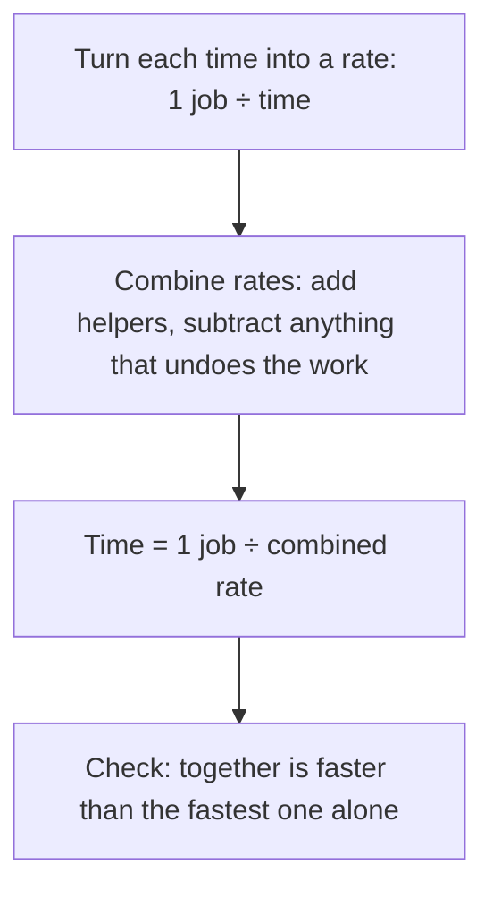

## Three classic traps

Lesson 10 said "of" means multiply, and Lesson 11 found "what fraction is left" by subtracting from 1. Those two ideas solve most fraction word problems. But three kinds of problem catch out even strong students, because the obvious move (subtract the fractions, add the times, average the speeds) gives a confident wrong answer. This honors lesson works through all three: taking a fraction of *what's left*, two people or machines *working together*, and the *average speed* of a round trip. Each one comes down to asking carefully "a fraction of what?" and "per what?", and each has a quick check that catches the trap.

## Fractions of what's left

"Jo spent $\tfrac13$ of her money on a jacket and then $\tfrac14$ of the rest on lunch." The second fraction is a fraction of *the rest*, not of the original amount. So $1 - \tfrac13 - \tfrac14$ is wrong.

Follow what's left instead. After the jacket, $\tfrac23$ of the money is left. Lunch takes $\tfrac14$ of that, so $\tfrac34$ of it remains, and $\tfrac34$ *of* $\tfrac23$ is

$$\frac34 \times \frac23 = \frac12.$$

Half the money is left. The wrong method gives $1 - \tfrac13 - \tfrac14 = \tfrac5{12}$, which treats lunch as $\tfrac14$ of the whole amount instead of $\tfrac14$ of what was left.

In the bar picture, the lunch piece is $\tfrac14$ of the two-thirds that remained, which is $\tfrac16$ of the whole. Spent: $\tfrac13 + \tfrac16 = \tfrac12$, so $\tfrac12$ is left, matching the multiplication.

*The rule:* when each fraction is taken from what remains, **multiply the fractions that are left**, one for each step.

### Example 1

A $360 paycheck: $\tfrac13$ goes to rent, then $\tfrac14$ of what remains to food, then $\tfrac25$ of what remains after that to bills. How much is left?

Fractions left at each step: $\tfrac23$, then $\tfrac34$, then $\tfrac35$. Fraction of the paycheck left:

$$\frac23 \times \frac34 \times \frac35 = \frac{2 \times 3 \times 3}{3 \times 4 \times 5} = \frac{18}{60} = \frac{3}{10}.$$

Left: $\tfrac{3}{10} \times 360 = 108$ dollars.

Check step by step: rent $120, leaving $240; food $60, leaving $180; bills $72, leaving $108. ✓

### Example 2: working backward

A tank had some water. First $\tfrac25$ of it was used, then $\tfrac13$ of the remaining water was used. Now 12 gallons are left. How much was in the tank at the start?

Fraction left: $\tfrac35 \times \tfrac23 = \tfrac25$. So $\tfrac25$ of the starting amount is 12 gallons. To find the whole from a part, divide by the fraction:

$$12 \div \frac25 = 12 \times \frac52 = 30 \text{ gallons}.$$

Check: 30 gallons, use $\tfrac25$ (12), leaving 18; use $\tfrac13$ of 18 (6), leaving 12. ✓

## Working together

"Ana can paint a fence in 3 hours. Ben can paint the same fence in 6 hours. How long if they work together?" Adding the times (9 hours) can't be right: two painters should finish *faster* than either alone. Averaging the times (4.5 hours) is also wrong, since that's slower than Ana alone.

The key is to switch from *time per job* to *job per hour*. A **work rate** is how much of a job gets done per unit of time. If Ana finishes the fence in 3 hours, she paints $\tfrac13$ of the fence each hour; Ben paints $\tfrac16$ each hour. Rates of people working on the same job at the same time add:

$$\frac13 + \frac16 = \frac26 + \frac16 = \frac36 = \frac12 \text{ fence per hour}.$$

At half a fence per hour, the whole fence takes $1 \div \tfrac12 = 2$ hours.

These problems assume each worker keeps a steady pace and nobody gets in anyone's way. Real crews aren't that tidy, so this is a simplified model, but it is the standard one and it is often close.

### Example 3

Pipe A fills a tank in 4 hours; pipe B fills it in 6 hours. How long with both open?

Rates: $\tfrac14$ and $\tfrac16$ tank per hour. Combined: $\tfrac3{12} + \tfrac2{12} = \tfrac5{12}$ tank per hour. Time: $1 \div \tfrac5{12} = \tfrac{12}{5} = 2\tfrac25$ hours. Since $\tfrac25$ of 60 minutes is 24 minutes, that's 2 hours 24 minutes.

Check: less than 4 hours (the faster pipe alone), as it must be.

### A shortcut for two workers, and why it works

For times $a$ and $b$, the combined rate is $\tfrac1a + \tfrac1b = \tfrac{b}{ab} + \tfrac{a}{ab} = \tfrac{a+b}{ab}$, so the time together is its reciprocal, $\dfrac{ab}{a+b}$: *product over sum*. For Example 3: $\tfrac{4 \times 6}{4 + 6} = \tfrac{24}{10} = \tfrac{12}{5}$. ✓ The shortcut is only for two workers; with three or more, add all the rates.

### Example 4: a rate that works against you

A pipe fills a tub in 3 hours, but a leak would empty a full tub in 5 hours. With the pipe running and the leak open, how long until the tub is full?

The leak *undoes* work, so subtract its rate: $\tfrac13 - \tfrac15 = \tfrac5{15} - \tfrac3{15} = \tfrac2{15}$ tub per hour. Time: $1 \div \tfrac2{15} = \tfrac{15}{2} = 7\tfrac12$ hours. Slower than the pipe alone, as it should be.

## Average speed

Speed is distance divided by time, in units like miles per hour (mph). The **average speed** for a whole trip is

$$\text{average speed} = \frac{\text{total distance}}{\text{total time}}.$$

It is *not* usually the average of the speeds.

### Example 5

Sam drives 60 miles to a lake at 30 mph and drives the same 60 miles home at 60 mph. What is his average speed?

Times: going, $60 \div 30 = 2$ hours; returning, $60 \div 60 = 1$ hour. Total: 120 miles in 3 hours, so the average speed is $120 \div 3 = 40$ mph, not 45.

Why less than 45? Sam spends 2 hours at the slow speed and only 1 hour at the fast speed, so the slow speed counts for more.

### The harmonic mean

For a round trip of equal distances $d$ at speeds $a$ and $b$, the total time is $\tfrac da + \tfrac db$, so

$$\text{average speed} = \frac{2d}{\tfrac da + \tfrac db} = \frac{2}{\tfrac1a + \tfrac1b} = \frac{2ab}{a + b}.$$

(The middle step divides the top and bottom by $d$. The last step multiplies the top and bottom by $ab$.) The distance cancels out, so it doesn't matter how far the trip is. The number $\dfrac{2ab}{a+b}$ is called the **harmonic mean** of $a$ and $b$: the reciprocal of the average of the reciprocals. For Sam, $\tfrac{2 \times 30 \times 60}{90} = \tfrac{3600}{90} = 40$. ✓

Notice the link to working together: both turn to reciprocals. A work problem adds the rates $\tfrac1a + \tfrac1b$; a round trip adds the times $\tfrac da + \tfrac db$. In fact the time for two workers, $\tfrac{ab}{a+b}$, is exactly half the harmonic mean of their times.

### Example 6

Lia rides her bike up a hill road at 8 mph and back down the same road at 12 mph. Find her average speed for the round trip.

$$\frac{2 \times 8 \times 12}{8 + 12} = \frac{192}{20} = \frac{48}{5} = 9\tfrac35 \text{ mph},$$

a little less than the plain average, 10 mph.

*When is the plain average right?* When the *times* are equal instead of the distances. One hour at 30 mph and one hour at 60 mph covers 90 miles in 2 hours: $90 \div 2 = 45$ mph, the plain average.

## Common mistakes

- *Subtracting a fraction of the rest as if it were a fraction of the whole.* "$\tfrac14$ of the rest" is $\tfrac14 \times$ (what's left).
- *Multiplying the spent fractions* ($\tfrac13 \times \tfrac14$) instead of the fractions left ($\tfrac23 \times \tfrac34$).
- *Working backward by multiplying.* If $\tfrac25$ of the whole is 12, the whole is $12 \div \tfrac25 = 30$, not $12 \times \tfrac25$.
- *Adding or averaging times* in a work problem. Add the *rates*, then flip.
- *Forgetting the last flip.* The combined rate $\tfrac5{12}$ tank per hour is not the time; the time is $\tfrac{12}{5}$ hours.
- *Averaging two speeds* for equal distances. Use total distance ÷ total time (the harmonic mean).

## Key points

- For "a fraction of what's left", multiply the fractions remaining after each step.
- To find a whole from a known part, divide the part by its fraction of the whole.
- Work rate = 1 job ÷ time. Rates of workers on the same job add; a drain or leak subtracts. Time = 1 ÷ combined rate.
- Two workers with times $a$ and $b$ take $\tfrac{ab}{a+b}$ together, less than either alone.
- Average speed = total distance ÷ total time. For equal distances at speeds $a$ and $b$, it is the harmonic mean $\tfrac{2ab}{a+b}$; for equal times, it is the plain average.
