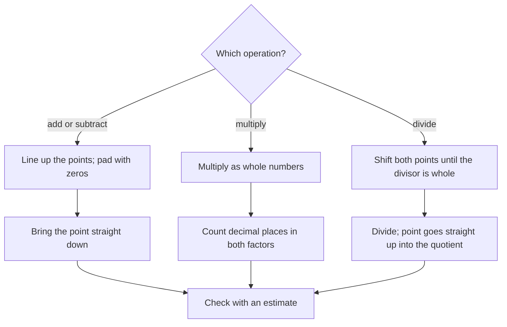

## Arithmetic with decimals

With place value extended past the decimal point, decimal arithmetic is whole-number arithmetic plus one extra job: putting the decimal point in the right place. This lesson gives the rule for each operation and, more importantly, why it puts the point where it does, so you can always check the placement with an estimate.

## Adding and subtracting

*Line up the decimal points*, so that tenths are added to tenths, hundredths to hundredths, and so on. Fill empty places with zeros if it helps, add or subtract as with whole numbers, and bring the decimal point straight down.

### Example 1

Find $27.4 + 3.085 - 9.67$.

Add first, lining up the points:

$$27.400 + 3.085 = 30.485$$

Then subtract: $30.485 - 9.670 = 20.815$.

Estimate check: $27 + 3 - 10 = 20$. ✓

Lining up points is just lining up place values. Writing $27.4 + 3.085$ with the last digits aligned would add 4 tenths to 5 thousandths, which is like adding dollars to cents.

## Multiplying

*Multiply as if there were no decimal points. Then count the total number of decimal places in the factors; the product gets that many decimal places.*

### Example 2

Find $3.6 \times 0.25$.

Ignore the points: $36 \times 25 = 900$. The factors have 1 + 2 = 3 decimal places, so the product has 3: $0.900 = 0.9$.

Why does counting work? Because $3.6 = \tfrac{36}{10}$ and $0.25 = \tfrac{25}{100}$, so

$$3.6 \times 0.25 = \frac{36}{10} \times \frac{25}{100} = \frac{900}{1000} = 0.900.$$

The denominators multiply to $10 \times 100 = 1000$, which has 3 zeros: one from each decimal place.

A picture shows the same thing for a smaller product. In a square worth 1, split into 100 small squares, 0.3 is 3 columns and 0.2 is 2 rows. Taking 0.3 *of* 0.2 means the overlap, which is 6 small squares out of 100:

So $0.3 \times 0.2 = 0.06$: one decimal place from each factor gives hundredths.

Estimate check: $3.6 \times 0.25$ is about a quarter of 4, which is 1. ✓

### Multiplying by powers of 10

Multiplying by 10, 100 or 1,000 moves the decimal point 1, 2 or 3 places to the *right* (the number gets bigger). Dividing by them moves it to the *left*.

- $4.27 \times 100 = 427$
- $4.27 \div 100 = 0.0427$
- $0.035 \times 1000 = 35$

This is the place value chart at work: multiplying by 10 shifts every digit up one place.

## Dividing

*To divide by a decimal, make the divisor a whole number first.* Move the decimal point in the divisor to the right until it's a whole number, and move the point in the dividend the same number of places. Then divide as usual, placing the decimal point in the quotient directly above the one in the dividend.

Why is that allowed? Moving both points the same number of places multiplies the dividend and divisor by the same power of 10, and

$$\frac{a}{b} = \frac{a \times 10}{b \times 10},$$

the same fact that makes equivalent fractions.

### Example 3

Find $7.38 \div 0.6$.

Move both points one place: $73.8 \div 6$. Divide: 6 into 7 is 1 (remainder 1); 6 into 13 is 2 (remainder 1); bring down 8 after the point: 6 into 18 is 3. So the quotient is 12.3.

Check: $12.3 \times 0.6 = 7.38$. ✓

### Example 4

Find $5 \div 0.08$.

Move both points two places: $500 \div 8 = 62.5$. (Add a zero after the point to continue: 8 into 500 is 62 R 4, and 8 into 40 is 5.)

Dividing by a number less than 1 gives a larger result, just as with fractions.

### Rounding quotients

When a quotient doesn't come out evenly, divide to one place past the one you need, then round. To find $10 \div 3$ to the nearest hundredth, compute $3.333\ldots$, look at the thousandths digit (3), and round to 3.33.

## Money problems

Money amounts are decimals with two places, and most everyday decimal arithmetic is about money. Round final money answers to the nearest cent.

### Example 5

Gas costs \$3.89 per gallon. How much do 12.5 gallons cost?

$3.89 \times 12.5$: $389 \times 125 = 48{,}625$; the factors have 2 + 1 = 3 decimal places, so 48.625. Rounded to the nearest cent: \$48.63.

Estimate check: about $4 \times 12 = 48$. ✓

### Example 6

Four friends split a restaurant bill of \$87.40 equally. How much does each pay?

$87.40 \div 4 = 21.85$. Each pays \$21.85.

### Example 7

Ground beef costs \$5.48 per pound. Ty buys a package for \$9.32. How many pounds is it, to the nearest tenth?

$9.32 \div 5.48$: move both points two places, $932 \div 548 \approx 1.700\ldots$ Rounded: 1.7 pounds.

## Where the point goes: a summary

## Common mistakes

- *Not lining up decimal points* when adding or subtracting, especially with whole numbers: $12 + 0.5 = 12.5$, not 1.7.
- *Lining up points when multiplying.* For multiplication, line up the right-hand digits and count decimal places afterward.
- *Miscounting decimal places* in a product: $0.3 \times 0.2 = 0.06$, not 0.6.
- *Moving the point only in the divisor:* in $7.38 \div 0.6$, both numbers change.
- *Skipping the estimate.* A quick estimate catches nearly every misplaced point.

## Key points

- Add and subtract: line up the decimal points.
- Multiply: multiply as whole numbers, then give the product as many decimal places as the factors have in total.
- Multiplying by $10^n$ moves the point $n$ places right; dividing moves it left.
- Divide: shift both points until the divisor is whole, then divide.
- Always estimate to check where the point belongs; round money to the nearest cent.
