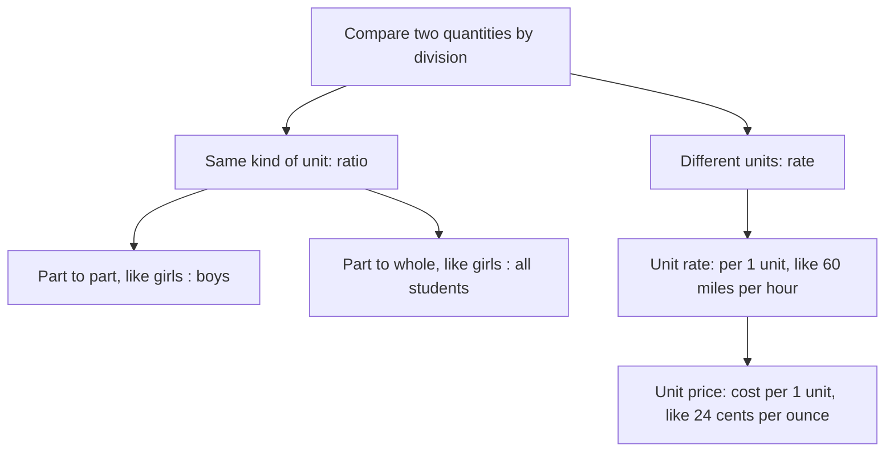

## Comparing two quantities

A fraction compares a part to a whole. Often, though, you want to compare two separate quantities: 3 cups of flour to 2 cups of sugar, 300 miles to 5 hours, \$4.50 to 18 ounces. Ratios and rates are the tools for this, and they lead directly to proportions in the next lesson and to percents in Module 5.

## Ratios

A **ratio** compares two quantities by division. The ratio of $a$ to $b$ can be written three ways:

$$a \text{ to } b, \qquad a : b, \qquad \frac{a}{b}$$

Order matters: if a class has 12 girls and 15 boys, the ratio of girls to boys is 12 : 15, while boys to girls is 15 : 12.

Ratios are simplified like fractions, by dividing both numbers by their GCF: $12 : 15 = 4 : 5$. That says "for every 4 girls there are 5 boys." Unlike fractions, a ratio in fraction form is usually left as an improper fraction rather than changed to a mixed number, because $\tfrac{5}{4}$ compares two things and "$1\tfrac14$" loses that meaning.

A ratio can also be part-to-whole. With 12 girls and 15 boys there are 27 students, so the ratio of girls to all students is 12 : 27 = 4 : 9.

### Ratios with units and decimals

When both quantities have the same kind of unit, convert them to the same unit first; then the units cancel. The ratio of 45 minutes to 2 hours is not 45 : 2. Convert: 2 hours = 120 minutes, so the ratio is 45 : 120 = 3 : 8.

When a ratio involves decimals or fractions, multiply both parts by the same number to clear them: $1.5 : 2.25$ becomes $150 : 225$ (times 100), which simplifies to $2 : 3$.

### Example 1

A paint mix uses 2.4 liters of blue and 4 liters of white. Write the ratio of blue to white in simplest form.

$2.4 : 4$. Multiply by 10: $24 : 40$. GCF 8: $3 : 5$.

### Ratios with three parts

Ratios can compare more than two quantities. A trail mix with 3 cups of nuts, 2 of raisins and 1 of chocolate has ratio $3 : 2 : 1$. If you want 12 cups total, the 6 parts are each worth $12 \div 6 = 2$ cups, giving 6 cups nuts, 4 raisins, 2 chocolate.

### Example 2

Profit of \$4,500 is split between two partners in the ratio 2 : 7. How much does each get?

There are $2 + 7 = 9$ parts in all, each worth $4{,}500 \div 9 = 500$ dollars. The partners get $2 \times 500 = \$1{,}000$ and $7 \times 500 = \$3{,}500$. Check: they add to \$4,500. ✓

A **tape diagram** makes the parts visible: one bar for the whole, cut into 9 equal parts.

## Rates

A **rate** is a ratio of two quantities with *different* units, like miles per hour or dollars per pound. The units are part of the answer: "300 miles in 5 hours" is the rate $\dfrac{300 \text{ miles}}{5 \text{ hours}}$.

A **unit rate** is a rate whose second quantity is 1: how much per one unit. Find it by dividing:

$$\frac{300 \text{ miles}}{5 \text{ hours}} = \frac{60 \text{ miles}}{1 \text{ hour}} = 60 \text{ miles per hour}.$$

The word "per" means "for each one" and signals a unit rate. Common unit rates: speed (miles per hour), wages (dollars per hour), fuel economy (miles per gallon), heart rate (beats per minute), and price per item.

### Example 3

A car travels 252 miles on 9 gallons of gas. What is its fuel economy?

Miles per gallon means miles divided by gallons: $252 \div 9 = 28$ miles per gallon.

Divide in the order the units are named. "Gallons per mile" would be $9 \div 252 \approx 0.036$, a different (and less useful) rate.

## Unit price

A **unit price** is the cost per one unit of something: per ounce, per pound, per item. Unit prices let you compare packages of different sizes.

### Example 4

Which is the better buy: 18 ounces of cereal for \$4.50, or 24 ounces for \$5.76?

- Small box: $4.50 \div 18 = 0.25$, so \$0.25 per ounce.
- Large box: $5.76 \div 24 = 0.24$, so \$0.24 per ounce.

The large box is the better buy by 1 cent per ounce. (Better buy here means lower cost per ounce; whether you'll use 24 ounces is a separate question.)

## Using a unit rate

Once you know a unit rate, multiply to scale up and divide to find how many units.

### Example 5

Sara earns \$18.50 per hour. How much does she earn in a 7.5-hour shift? How many hours must she work to earn \$740?

Earnings: $18.50 \times 7.5 = 138.75$, so \$138.75.

Hours: $740 \div 18.50 = 40$ hours.

## Ratio or rate?

The words in this lesson fit together like this:

## Common mistakes

- *Reversing the order.* "The ratio of cats to dogs" puts cats first.
- *Comparing quantities in different units* without converting: 30 seconds to 2 minutes is 30 : 120 = 1 : 4, not 15 : 1.
- *Dividing upside down for a unit rate.* Dollars per ounce means dollars ÷ ounces.
- *Turning a ratio into a mixed number.* Write 7 : 4 or $\tfrac74$, not $1\tfrac34$.
- *Splitting by the wrong total* in a part-to-part ratio: with ratio 2 : 7, there are 9 parts, not 7.

## Key points

- A ratio compares two quantities: $a : b$ or $\tfrac ab$; order matters; simplify by the GCF.
- Convert to the same unit before writing a ratio of like quantities.
- A rate compares quantities with different units; a unit rate is per 1 unit.
- Unit price = total cost ÷ number of units; the lower unit price is the better buy.
- To share an amount in the ratio $a : b$, divide it into $a + b$ equal parts.
