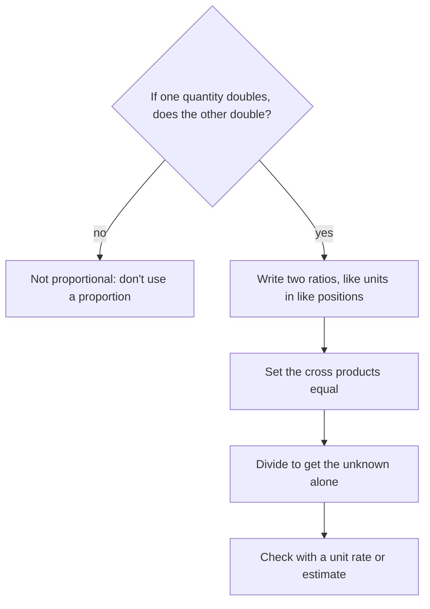

## When two ratios are equal

If 3 notebooks cost \$7.50, what do 8 cost? If a map's scale is 1 inch to 25 miles, how far apart are two towns that are 3.4 inches apart on the map? Problems like these say that two ratios are the same, and they are solved with proportions. A proportion is also your first equation with an unknown, a preview of Module 7.

## What a proportion is

A **proportion** is an equation stating that two ratios are equal:

$$\frac{a}{b} = \frac{c}{d}$$

For example, $\tfrac{2}{3} = \tfrac{8}{12}$ is a true proportion: both ratios equal the same number. Quantities that stay in a fixed ratio, like cost and number of items at a fixed price, are called *proportional*.

## Cross products

In a proportion, the **cross products** are equal:

$$\frac{a}{b} = \frac{c}{d} \quad\text{exactly when}\quad a \times d = b \times c$$

Check with $\tfrac23 = \tfrac8{12}$: $2 \times 12 = 24$ and $3 \times 8 = 24$. ✓

Why? Start from $\tfrac ab = \tfrac cd$ and multiply both sides by $b \times d$. On the left the $b$ cancels, leaving $a \times d$; on the right the $d$ cancels, leaving $c \times b$. Equal things multiplied by the same number stay equal.

Cross products give a fast test: $\tfrac{5}{8}$ and $\tfrac{15}{24}$ form a proportion because $5 \times 24 = 120 = 8 \times 15$, but $\tfrac{4}{7}$ and $\tfrac{6}{10}$ do not because $40 \ne 42$.

## Solving a proportion

When one of the four numbers is unknown, use a letter for it, set the cross products equal, and divide.

### Example 1

Solve $\dfrac{x}{12} = \dfrac{15}{20}$.

Cross products: $20 \times x = 12 \times 15$, so $20x = 180$. Divide both sides by 20: $x = 9$.

Check: $\tfrac{9}{12} = \tfrac34$ and $\tfrac{15}{20} = \tfrac34$. ✓

(Here $20x$ means $20 \times x$. Writing a number next to a letter means multiply.)

### Example 2

Solve $\dfrac{3.5}{n} = \dfrac{14}{9}$.

Cross products: $14n = 3.5 \times 9 = 31.5$. Divide: $n = 31.5 \div 14 = 2.25$.

Sometimes there's a quicker route by *scaling*. In $\tfrac{4}{5} = \tfrac{x}{35}$, the denominator went from 5 to 35 (times 7), so $x = 4 \times 7 = 28$. Cross products always work; scaling is a shortcut when the numbers are friendly.

## Setting up word problems

The main skill is writing the proportion correctly. *Keep the same units in the same positions*: if the first ratio is items over dollars, the second must be items over dollars too.

### Example 3

Three notebooks cost \$7.50. How much do 8 notebooks cost?

$$\frac{3 \text{ notebooks}}{7.50 \text{ dollars}} = \frac{8 \text{ notebooks}}{x \text{ dollars}}$$

Cross products: $3x = 8 \times 7.50 = 60$, so $x = 20$. Eight notebooks cost \$20.

Check with a unit rate: each costs $7.50 \div 3 = 2.50$, and $8 \times 2.50 = 20$. ✓ Unit rates and proportions are two routes to the same answer.

### Example 4

A map's scale is 1 inch : 25 miles. Two towns are 3.4 inches apart on the map. How far apart are they really?

$$\frac{1 \text{ in}}{25 \text{ mi}} = \frac{3.4 \text{ in}}{x \text{ mi}} \quad\Rightarrow\quad x = 25 \times 3.4 = 85 \text{ miles}.$$

### Example 5

A recipe that serves 6 uses $1\tfrac12$ cups of rice. How much rice is needed to serve 10?

$$\frac{6 \text{ servings}}{1.5 \text{ cups}} = \frac{10 \text{ servings}}{x \text{ cups}} \quad\Rightarrow\quad 6x = 15 \quad\Rightarrow\quad x = 2.5 \text{ cups}.$$

## Similar figures and scale

Two figures are **similar** if they have the same shape but possibly different sizes; their corresponding sides are proportional. Proportions find missing lengths.

### Example 6

A 6-foot person casts a 4-foot shadow. At the same time a tree casts a 22-foot shadow. How tall is the tree?

The sun's rays make similar triangles, so height and shadow are proportional:

```shape
{"polygons": [{"points": [[0, 0], [4, 0], [0, 6]]}, {"points": [[8, 0], [30, 0], [8, 33]]}], "rightAngles": [[[0, 0], [4, 0], [0, 6]], [[8, 0], [30, 0], [8, 33]]], "segments": [{"from": [0, 0], "to": [0, 6], "label": "6 ft"}, {"from": [0, 0], "to": [4, 0], "label": "4 ft"}, {"from": [8, 0], "to": [8, 33], "label": "h"}, {"from": [8, 0], "to": [30, 0], "label": "22 ft"}], "caption": "Person and tree with their shadows form similar triangles"}
```

$$\frac{6}{4} = \frac{h}{22} \quad\Rightarrow\quad 4h = 132 \quad\Rightarrow\quad h = 33 \text{ feet}.$$

## Not everything is proportional

A proportion only fits when the two quantities grow together at a fixed ratio. If a taxi charges a \$3 flat fee plus \$2 per mile, a 10-mile ride (\$23) doesn't cost twice a 5-mile ride (\$13), because of the fixed fee. Before setting up a proportion, ask: if one quantity doubles, does the other double too?

A graph shows the difference. A proportional relationship is a straight line through the origin (0 miles, \$0). The taxi's line starts at \$3, so doubling the miles does not double the fare.

```plot
{"x": [0, 11], "y": [0, 26], "xLabel": "miles", "yLabel": "dollars", "functions": [{"f": "2x"}, {"f": "3 + 2x", "dashed": true}], "points": [[5, 10], [10, 20], [5, 13], [10, 23]], "labels": [{"at": [8, 5], "text": "2 per mile (proportional)"}, {"at": [4, 21], "text": "3 + 2 per mile (not proportional)"}, {"at": [6.3, 8.2], "text": "(5, 10)"}, {"at": [10.2, 16.5], "text": "(10, 20)"}, {"at": [3.7, 14.5], "text": "(5, 13)"}, {"at": [8.7, 24], "text": "(10, 23)"}], "caption": "Doubling 5 miles to 10 doubles 10 dollars to 20, but turns 13 dollars into 23, not 26"}
```

The whole method for word problems, including that first question:



## Scale factors

When two figures or quantities are proportional, the number you multiply by to go from one to the other is called the **scale factor**. In Example 4 the scale factor from map inches to real miles is 25. In Example 6, every length on the tree's triangle is $\tfrac{22}{4} = 5.5$ times the matching length on the person's triangle, so the height is $6 \times 5.5 = 33$ feet, the same answer as the proportion gave.

Scale factors show up in models and drawings. A model car built at a scale of 1 : 24 has every length $\tfrac{1}{24}$ of the real length, so a 180-inch car becomes a $180 \div 24 = 7.5$-inch model. A scale factor greater than 1 enlarges; one between 0 and 1 shrinks. Either way, finding it once lets you convert every length with a single multiplication.

## Common mistakes

- *Mismatched setup:* $\tfrac{3}{7.50} = \tfrac{x}{8}$ mixes notebooks-over-dollars with dollars-over-notebooks.
- *Multiplying across the top* instead of cross-multiplying.
- *Forgetting to divide* at the end: $20x = 180$ means $x = 9$, not 180.
- *Using a proportion when there's a fixed fee* or other non-proportional part.
- *Mixing units*, such as inches in one ratio and feet in the other.

## Key points

- A proportion says two ratios are equal: $\tfrac ab = \tfrac cd$.
- In a proportion, cross products are equal: $ad = bc$.
- Solve by cross-multiplying and dividing, or by scaling when the numbers are friendly.
- Keep like units in like positions when setting up word problems.
- Similar figures have proportional sides.
