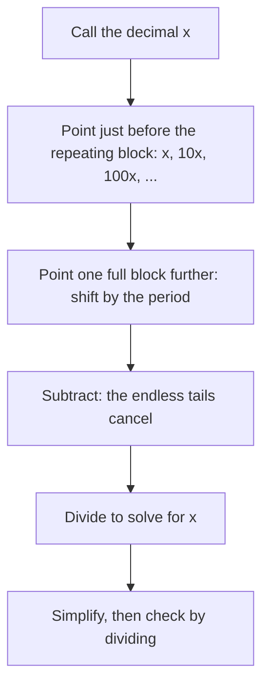

Lesson 13 showed that dividing a numerator by a denominator always gives a decimal that either stops or repeats. That lesson went one way, from fraction to decimal. This lesson goes the other way: given a repeating decimal such as $0.\overline{36}$ or $2.3\overline{18}$, find the fraction it equals. The method is a small piece of algebra with a big payoff. It proves that *every* repeating decimal is a fraction, it lets you do exact arithmetic with repeating decimals, and it settles a famous puzzle: is $0.999\ldots$ really equal to 1?

## Why the decimal must repeat

First, a closer look at why fractions give repeating decimals. Dividing 1 by 7 by long division, each step brings down a 0, divides by 7, and leaves a remainder. The remainder decides the next step completely, so as soon as a remainder comes back, every digit after it repeats too.

Starting from remainder 1: $10 \div 7 = 1$ remainder 3, $30 \div 7 = 4$ remainder 2, $20 \div 7 = 2$ remainder 6, $60 \div 7 = 8$ remainder 4, $40 \div 7 = 5$ remainder 5, $50 \div 7 = 7$ remainder 1. Remainder 1 is back, so

$$\frac17 = 0.\overline{142857}.$$

The block of digits that repeats is called the **repetend**, and the number of digits in it is the **period**. For $\tfrac17$ the repetend is 142857 and the period is 6. Dividing by 7, only the remainders 1 to 6 can occur (a remainder of 0 would make the decimal stop), so the period of a fraction with denominator 7 can't be more than 6. In general, a fraction with denominator $d$ has a period of at most $d - 1$.

## Shift and subtract

Now the reverse direction. The trick is to make two copies of the decimal whose endless tails are *identical*, then subtract so the tails cancel.

Take $x = 0.\overline{36} = 0.363636\ldots$ The repetend has 2 digits, so multiply by $10^2 = 100$, which shifts the point exactly one block to the right:

$$\begin{aligned} 100x &= 36.363636\ldots \\ x &= \phantom{3}0.363636\ldots \end{aligned}$$

Below the point the two lines match digit for digit forever, so subtracting removes the tail completely:

$$99x = 36, \qquad x = \frac{36}{99} = \frac{4}{11}.$$

Check by dividing: $4 \div 11 = 0.3636\ldots$ ✓

The key is shifting by exactly one period. Multiplying by 10 instead would give $10x = 3.636363\ldots$, whose tail ($.636363\ldots$) does not line up with $x$'s tail ($.363636\ldots$), and nothing cancels.

### Example 1

Write $0.\overline{7}$ and $0.\overline{135}$ as fractions in simplest form.

For $x = 0.777\ldots$ the period is 1, so use $10x = 7.777\ldots$ Subtract: $9x = 7$, so $x = \tfrac79$.

For $y = 0.135135\ldots$ the period is 3, so use $1000y = 135.135135\ldots$ Subtract: $999y = 135$, so $y = \tfrac{135}{999}$. Both are divisible by 27 ($135 = 27 \times 5$, $999 = 27 \times 37$), so $y = \tfrac{5}{37}$.

Check: $5 \div 37 = 0.135135\ldots$ ✓

## The nines pattern

Example 1 shows a pattern. Shifting by a period of $n$ digits and subtracting always leaves $(10^n - 1)x$ on the left, and $10^n - 1$ is written with $n$ nines: 9, 99, 999, … So for a decimal that repeats right from the point,

$$0.\overline{\text{repetend}} = \frac{\text{repetend}}{\text{as many 9s as digits in the repetend}}.$$

| Decimal | Fraction | Simplified |
|---|---|---|
| $0.\overline{4}$ | $\tfrac{4}{9}$ | $\tfrac49$ |
| $0.\overline{27}$ | $\tfrac{27}{99}$ | $\tfrac{3}{11}$ |
| $0.\overline{06}$ | $\tfrac{6}{99}$ | $\tfrac{2}{33}$ |
| $0.\overline{142857}$ | $\tfrac{142857}{999999}$ | $\tfrac17$ |

Watch the zero in $0.\overline{06}$: the repetend is "06", two digits, so the denominator is 99, not 9.

A decimal like this, which repeats starting right after the point, is a **pure repeating decimal**.

## When the repeat starts later

Some decimals have a few digits before the repeating part, such as $\tfrac16 = 0.1666\ldots = 0.1\overline{6}$. This is a **mixed repeating decimal**. (Some books say "delayed" or "eventually repeating"; the names vary, the idea doesn't.) Now you need *two* shifts: one that puts the point just before the repeating part and one that puts it one period further.

For $x = 0.1\overline{6}$:

$$\begin{aligned} 100x &= 16.666\ldots \\ 10x &= \phantom{1}1.666\ldots \end{aligned}$$

Both tails are all 6s, so subtracting gives $90x = 15$ and $x = \tfrac{15}{90} = \tfrac16$. ✓

### Example 2

Write $2.3\overline{18}$ as a fraction in simplest form.

Let $x = 2.3181818\ldots$ One digit (the 3) comes before the repeat, so $10x = 23.181818\ldots$ puts the point just before the repeating part. The period is 2, so shift two more places: $1000x = 2318.181818\ldots$

Subtract: $1000x - 10x = 2318.1818\ldots - 23.1818\ldots$, so $990x = 2295$ and

$$x = \frac{2295}{990}.$$

The GCF of 2295 and 990 is 45: $2295 = 45 \times 51$ and $990 = 45 \times 22$. So $x = \tfrac{51}{22}$, or $2\tfrac{7}{22}$.

Check: $51 \div 22 = 2.31818\ldots$ ✓

### A shortcut for mixed repeating decimals

The subtraction in Example 2 always has the same shape. For a number between 0 and 1:

- *numerator:* the digits through the end of the first repetend, minus the digits before the repetend;
- *denominator:* one 9 for each repetend digit, followed by one 0 for each digit between the point and the repetend.

For $0.2\overline{45}$: numerator $245 - 2 = 243$; denominator 990 (two 9s, one 0). So $0.2\overline{45} = \tfrac{243}{990} = \tfrac{27}{110}$. Use the shortcut to check your work, but learn the shift-and-subtract method first, because it explains the shortcut and works when you forget it.

## Is $0.999\ldots$ equal to 1?

Apply the method to $x = 0.\overline{9}$:

$$10x = 9.999\ldots, \qquad 10x - x = 9, \qquad 9x = 9, \qquad x = 1.$$

So $0.\overline{9} = 1$ exactly. Many people find this hard to accept, so here are two more ways to see it.

- *From a fraction you trust:* $\tfrac13 = 0.333\ldots$ Multiply both sides by 3: $1 = 0.999\ldots$
- *No room between them:* if two numbers are different, some number lies between them (their average, for example). But $1 - 0.9 = 0.1$, $1 - 0.99 = 0.01$, $1 - 0.999 = 0.001$, and the gap keeps shrinking with every 9. The never-ending decimal $0.999\ldots$ is closer to 1 than any of these, closer than $0.1$, $0.01$, $0.001$ and every other positive number, so the gap is 0.

The confusion comes from picturing $0.999\ldots$ as a process that "never quite gets there." It isn't a process; it's a number, and the notation $0.\overline{9}$ means the value that the decimals 0.9, 0.99, 0.999, … close in on. A *finite* string of 9s, like 0.999, really is less than 1. A consequence: every terminating decimal has a second form ending in repeating 9s, such as $0.5 = 0.4\overline{9}$ and $2.38 = 2.37\overline{9}$.

## Exact arithmetic with repeating decimals

Rounding $0.\overline{3}$ to 0.33 before you compute introduces an error. Converting to fractions keeps everything exact.

### Example 3

Find $0.\overline{4} \times 0.\overline{3}$ exactly, and write the answer as a repeating decimal.

Convert: $0.\overline{4} = \tfrac49$ and $0.\overline{3} = \tfrac39 = \tfrac13$. Multiply: $\tfrac49 \times \tfrac13 = \tfrac{4}{27}$.

Now divide $4 \div 27$: 27 into 40 is 1 (remainder 13), into 130 is 4 (remainder 22), into 220 is 8 (remainder 4). Remainder 4 is where we started, so $\tfrac{4}{27} = 0.\overline{148}$.

With rounded inputs, $0.44 \times 0.33 = 0.1452$, which is already wrong in the third decimal place.

### Example 4

Find $0.\overline{12} + 0.\overline{87}$.

$\tfrac{12}{99} + \tfrac{87}{99} = \tfrac{99}{99} = 1$. Lining the decimals up shows the same thing: $0.121212\ldots + 0.878787\ldots = 0.999999\ldots = 1$.

## Every repeating decimal is a fraction

The shift-and-subtract method works on *any* repeating decimal: the subtraction always leaves a whole number times $x$ equal to a whole number (or a terminating decimal, which you can clear by multiplying by a power of 10). So every repeating decimal is a fraction of two integers, and Lesson 13 showed that every fraction is a terminating or repeating decimal. Fractions and terminating-or-repeating decimals are the same numbers written two ways. Lesson 20 names them the *rational numbers*; decimals that never stop and never repeat, like $\pi = 3.14159\ldots$, are not fractions at all.

## Common mistakes

- *Shifting by the wrong amount.* For $0.\overline{36}$, use $100x$, not $10x$: shift by the full period so the tails line up.
- *Writing the repetend over a power of 10.* $0.\overline{36}$ is $\tfrac{36}{99}$, not $\tfrac{36}{100}$; $\tfrac{36}{100} = 0.36$ exactly, which stops.
- *Forgetting the delay.* For $0.1\overline{6}$, subtracting $x$ from $10x$ leaves $9x = 1.5$; that's not wrong, but it isn't finished. Subtract $10x$ from $100x$ to get whole numbers right away ($90x = 15$).
- *Dropping a leading zero in the repetend.* $0.\overline{06} = \tfrac{6}{99}$, not $\tfrac69$.
- *Not simplifying.* $\tfrac{135}{999}$ is correct but simplifies to $\tfrac{5}{37}$.
- *Believing $0.\overline{9} < 1$.* They are equal; only a finite string of 9s is less than 1.

## Key points

- A fraction's decimal repeats because long division can only produce finitely many remainders; the repeating block is the repetend and its length is the period.
- Shift and subtract: multiply by $10^n$ where $n$ is the period, subtract so the tails cancel, divide, simplify.
- Pure repeating: $0.\overline{ab} = \tfrac{ab}{99}$, $0.\overline{abc} = \tfrac{abc}{999}$.
- Mixed repeating: use two shifts (or the shortcut: 9s for repeating digits, then 0s for the delayed digits).
- $0.\overline{9} = 1$ exactly.
- Every repeating decimal is a fraction, so convert to fractions to calculate exactly.
