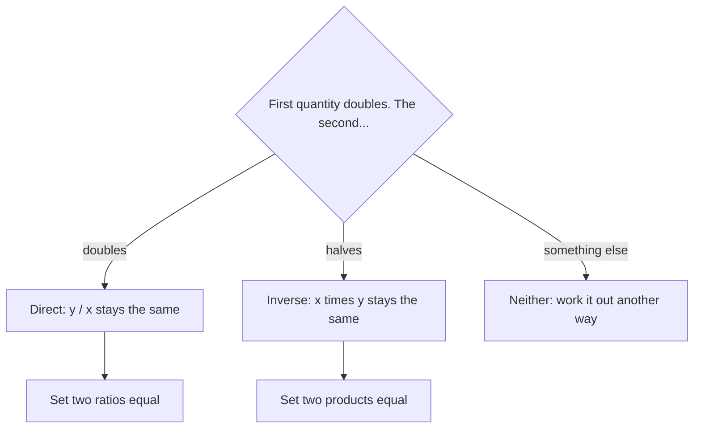

Lesson 16 asked one question before every proportion: if one quantity doubles, does the other double too? When the answer is yes, a proportion works. This lesson is about a second common answer: *the other one halves*. Double your speed and a trip takes half the time; double the number of painters and (ideally) the job takes half as many days. Quantities like these are inversely proportional, and they have their own simple rule. This lesson shows how to recognize the two kinds of relationship from words, tables and graphs, how to solve inverse problems (painters, seesaws, gears and guitar strings), and how to handle problems where both kinds happen at once.

## Two ways quantities can be linked

Two quantities are **directly proportional** when their *ratio* stays the same. If $y$ is directly proportional to $x$, then $\tfrac{y}{x}$ is always the same number $k$, so $y = kx$. The fixed number $k$ is the **constant of proportionality**. Cost and number of items at a fixed price are directly proportional, with $k$ the unit price.

Two quantities are **inversely proportional** when their *product* stays the same: $x \times y = k$ for a fixed $k$, so $y = \tfrac{k}{x}$. Now doubling $x$ halves $y$, tripling $x$ divides $y$ by 3, and so on.

Speed and time for a 120-mile trip are inversely proportional, because speed × time = distance = 120:

| Speed (mph) | 20 | 30 | 40 | 60 |
|---|---|---|---|---|
| Time (hours) | 6 | 4 | 3 | 2 |
| Speed × time | 120 | 120 | 120 | 120 |

Graphed, a direct proportion is a straight line through the origin. An inverse proportion is a curve that drops steeply at first and then levels off, never reaching either axis:

```plot
{"x": [0, 70], "y": [0, 12], "xLabel": "speed (mph)", "yLabel": "time (hours)", "functions": [{"f": "120/x", "from": 12}], "labels": [{"at": [45, 6], "text": "time = 120 / speed"}], "points": [{"at": [20, 6], "label": "(20, 6)"}, {"at": [30, 4], "label": "(30, 4)"}, {"at": [40, 3], "label": "(40, 3)"}, {"at": [60, 2], "label": "(60, 2)"}], "caption": "Time for a 120-mile trip: each point has speed × time = 120"}
```

Before solving, decide which kind of relationship you have:



## Solving inverse proportion problems

If $x$ and $y$ are inversely proportional, any two pairs have the same product:

$$x_1 \times y_1 = x_2 \times y_2.$$

(The small numbers below the letters just mean "first pair" and "second pair.") Fill in the three numbers you know and divide to find the fourth.

### Example 1

Six painters can paint a building in 10 days. How long would 4 painters take, working at the same rate?

Fewer painters means *more* days, so this is inverse, not direct. The product painters × days measures the total work: $6 \times 10 = 60$ painter-days. With 4 painters, $4 \times d = 60$, so $d = 15$ days.

A direct proportion here would give $\tfrac{6}{10} = \tfrac{4}{d}$, so $d \approx 6.7$ days: fewer painters finishing *sooner*, which makes no sense. Always ask which way the answer should move.

This model is a simplification. It assumes every painter works at the same steady rate and that adding people never makes them get in each other's way. Real crews only roughly behave like this, which is why it's an estimate, not a guarantee.

### Example 2

A seesaw balances when weight × distance from the pivot is the same on both sides. This rule, the law of the lever, was proved by Archimedes in the 3rd century BC. The pivot point is called the **fulcrum**.


In the picture, $30 \times 2 = 60$ and $20 \times 3 = 60$, so it balances: the heavier load sits closer to the fulcrum.

A 45 kg student sits 1.6 m from the fulcrum. Where should a 36 kg student sit to balance?

Weight and distance are inversely proportional here (the lighter student must sit farther out). So $45 \times 1.6 = 36 \times d$, which gives $72 = 36d$ and $d = 2$ m. (This ignores the board's own weight, which is fine when the board balances on its center.)

Gears work the same way. When two gears mesh, their teeth pass the contact point one for one, so in a minute both gears move the same number of teeth past it: teeth × turns per minute is the same for both. A small gear driven by a large one must spin faster. A 36-tooth gear turning 20 times a minute drives a 12-tooth gear at $36 \times 20 \div 12 = 60$ turns a minute, three times as fast, because it has a third as many teeth.

## Recognizing the relationship from a table

Data often arrives as a table, not a sentence. To test it, compute the ratio $\tfrac yx$ and the product $xy$ for every pair of values:

| $x$ | 2 | 3 | 4 | 6 |
|---|---|---|---|---|
| Table A: $y$ | 18 | 12 | 9 | 6 |
| Table B: $y$ | 5 | 7.5 | 10 | 15 |
| Table C: $y$ | 20 | 17 | 14 | 8 |

- Table A: products $36, 36, 36, 36$. Inversely proportional, with $k = 36$.
- Table B: ratios $2.5, 2.5, 2.5, 2.5$. Directly proportional, with $k = 2.5$.
- Table C: products $40, 51, 56, 48$ and ratios $10, 5.\overline{6}, 3.5, 1.\overline{3}$. Neither. The values of $y$ go *down* as $x$ goes up, but going down is not enough for inverse proportion: the product has to stay fixed. (Table C drops by 3 for each step of 1 in $x$, which is a linear pattern of the kind you'll graph in Module 7.)

### Example 3

Strings of the same material under the same tension follow an inverse rule, at least approximately: the frequency of the note (in hertz, vibrations per second) times the string's length stays the same. The ancient Greeks already knew that halving a string raises its note by an octave. A 60 cm string sounds at 220 Hz. What frequency does a 45 cm string of the same kind give?

The product is $60 \times 220 = 13{,}200$. For 45 cm: $45 \times f = 13{,}200$, so $f = 13{,}200 \div 45 \approx 293.3$ Hz. A shorter string gives a higher note, as it should. (Real strings are a little stiff, so this is an idealized model.)

For one fixed job, time and work rate are inversely proportional too: rate × time = 1 job. That's why, when people work together, you add their *rates* and only then turn the total back into a time. The Module 3 honors lesson on fraction problems works through those problems in detail.

## When both kinds happen at once

Some problems mix a direct relationship and an inverse one. The trick is to find a quantity that stays fixed, such as "worker-days per job."

### Example 4

Six painters paint 2 houses in 10 days. Working at the same rate, how many painters are needed to paint 3 houses in 5 days?

Count the work in painter-days (one painter working for one day):

1. Total work so far: $6 \times 10 = 60$ painter-days for 2 houses.
2. Work per house: $60 \div 2 = 30$ painter-days.
3. Work for 3 houses: $3 \times 30 = 90$ painter-days.
4. Spread over 5 days: $90 \div 5 = 18$ painters.

Each step has a direction you can check. More houses means more painters (direct). Fewer days also means more painters (inverse). Both push the number up: from 6 to 9 for the extra house, then from 9 to 18 for halving the time.

### Example 5

Four machines fill 3,000 bottles in 6 hours. How long would 5 machines take to fill 4,500 bottles?

The fixed quantity is bottles per machine-hour: $3{,}000 \div (4 \times 6) = 125$. Five machines fill $5 \times 125 = 625$ bottles per hour, so 4,500 bottles take $4{,}500 \div 625 = 7.2$ hours.

Check the directions: 1.5 times as many bottles pushes the time up (to 9 hours with 4 machines); one more machine pulls it back down ($9 \times \tfrac45 = 7.2$). ✓

## Common mistakes

- *Using a direct proportion for an inverse relationship.* Ask which way the answer should move: fewer workers means more days.
- *Calling anything that decreases "inverse."* Inverse proportion needs a constant product; $y = 20 - 3x$ decreases but isn't inverse.
- *Setting up ratios for an inverse problem.* For inverse, set products equal: $x_1 y_1 = x_2 y_2$.
- *Ignoring one of the changes in a mixed problem.* When the job size and the time both change, find the fixed quantity (like worker-days per job) first.
- *Treating a model as exact.* Real workers, seesaws and strings only approximately follow these rules.

## Key points

- Directly proportional: the ratio $\tfrac yx$ is constant ($y = kx$); double one, double the other. The graph is a line through the origin.
- Inversely proportional: the product $xy$ is constant ($y = \tfrac kx$); double one, halve the other. The graph is a curve that never touches the axes. Solve with $x_1 y_1 = x_2 y_2$.
- Test a table by computing the ratio and the product for every row.
- Lever law: weight × distance is the same on both sides of the fulcrum. Gears: teeth × turning speed is the same for both gears.
- Mixed problems: find the fixed quantity (worker-days per job, items per machine-hour), then scale.
