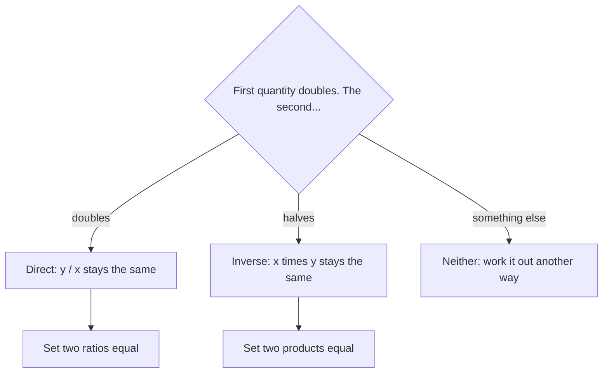

Lesson 16 asked one question before every proportion: if one quantity doubles, does the other double too? When the answer is yes, a proportion works. This lesson is about a second common answer: *the other one halves*. Double your speed and a trip takes half the time; double the number of painters and (ideally) the job takes half as many days. Quantities like these are inversely proportional, and they have their own simple rule. The same idea explains two classic puzzles: how long a job takes when two people work together, and why the average speed of a round trip is not the average of the two speeds.

## Two ways quantities can be linked

Two quantities are **directly proportional** when their *ratio* stays the same. If $y$ is directly proportional to $x$, then $\tfrac{y}{x}$ is always the same number $k$, so $y = kx$. The fixed number $k$ is the **constant of proportionality**. Cost and number of items at a fixed price are directly proportional, with $k$ the unit price.

Two quantities are **inversely proportional** when their *product* stays the same: $x \times y = k$ for a fixed $k$, so $y = \tfrac{k}{x}$. Now doubling $x$ halves $y$, tripling $x$ divides $y$ by 3, and so on.

Speed and time for a 120-mile trip are inversely proportional, because speed × time = distance = 120:

| Speed (mph) | 20 | 30 | 40 | 60 |
|---|---|---|---|---|
| Time (hours) | 6 | 4 | 3 | 2 |
| Speed × time | 120 | 120 | 120 | 120 |

Graphed, a direct proportion is a straight line through the origin. An inverse proportion is a curve that drops steeply at first and then levels off, never reaching either axis:

```plot
{"x": [0, 70], "y": [0, 10], "xLabel": "speed (mph)", "yLabel": "time (hours)", "functions": [{"f": "120/x", "label": "time = 120 / speed", "from": 12}], "points": [{"at": [20, 6], "label": "(20, 6)"}, {"at": [30, 4], "label": "(30, 4)"}, {"at": [40, 3], "label": "(40, 3)"}, {"at": [60, 2], "label": "(60, 2)"}], "caption": "Time for a 120-mile trip: each point has speed × time = 120"}
```

Before solving, decide which kind of relationship you have:



## Solving inverse proportion problems

If $x$ and $y$ are inversely proportional, any two pairs have the same product:

$$x_1 \times y_1 = x_2 \times y_2.$$

(The small numbers below the letters just mean "first pair" and "second pair.") Fill in the three numbers you know and divide to find the fourth.

### Example 1

Six painters can paint a building in 10 days. How long would 4 painters take, working at the same rate?

Fewer painters means *more* days, so this is inverse, not direct. The product painters × days measures the total work: $6 \times 10 = 60$ painter-days. With 4 painters, $4 \times d = 60$, so $d = 15$ days.

A direct proportion here would give $\tfrac{6}{10} = \tfrac{4}{d}$, so $d \approx 6.7$ days: fewer painters finishing *sooner*, which makes no sense. Always ask which way the answer should move.

This model is a simplification. It assumes every painter works at the same steady rate and that adding people never makes them get in each other's way. Real crews only roughly behave like this, which is why it's an estimate, not a guarantee.

### Example 2

A seesaw balances when weight × distance from the pivot is the same on both sides. This rule, the law of the lever, was proved by Archimedes in the 3rd century BC. The pivot point is called the **fulcrum**.


In the picture, $30 \times 2 = 60$ and $20 \times 3 = 60$, so it balances: the heavier load sits closer to the fulcrum.

A 45 kg student sits 1.6 m from the fulcrum. Where should a 36 kg student sit to balance?

Weight and distance are inversely proportional here (the lighter student must sit farther out). So $45 \times 1.6 = 36 \times d$, which gives $72 = 36d$ and $d = 2$ m. (This ignores the board's own weight, which is fine when the board balances on its center.)

## Working together: add rates, not times

How long do two people take to finish a job together? The tempting answers, adding the times or averaging them, are both wrong. Together should be *faster* than either person alone, so the answer must be less than the shorter time.

The key is to think in rates. A **work rate** is how much of a job gets done per unit of time. Someone who mows a lawn in 3 hours has a work rate of $\tfrac13$ of the lawn per hour. When two people work at the same time, their rates add.

### Example 3

Hose A can fill a tank in 6 hours; hose B can fill it in 3 hours. How long do they take running together?

Rates: A fills $\tfrac16$ of the tank per hour, B fills $\tfrac13 = \tfrac26$. Together: $\tfrac16 + \tfrac26 = \tfrac36 = \tfrac12$ of the tank per hour. Half a tank per hour means the whole tank takes **2 hours**.

Sanity check: 2 hours is less than B's 3 hours alone. ✓ (Averaging gives 4.5 hours and adding gives 9, both slower than B alone.)

### Example 4

Ana can mow the lawn in 40 minutes and Ben in 60 minutes. How long together?

Rates: $\tfrac{1}{40} + \tfrac{1}{60} = \tfrac{3}{120} + \tfrac{2}{120} = \tfrac{5}{120} = \tfrac{1}{24}$ of the lawn per minute. So together they take **24 minutes**.

For two workers there's a shortcut, "product over sum": $\tfrac{40 \times 60}{40 + 60} = \tfrac{2400}{100} = 24$. It comes from adding the two rates, so it only works for exactly two workers both helping.

Rates can also work against each other.

### Example 5

A pipe fills a pool in 4 hours, but a leak would empty the full pool in 6 hours. With both going, how long does the pool take to fill?

The leak's rate counts as negative: $\tfrac14 - \tfrac16 = \tfrac{3}{12} - \tfrac{2}{12} = \tfrac{1}{12}$ of the pool per hour. The pool fills in **12 hours**.

Where's the inverse proportion? For one fixed job, time = 1 ÷ rate: doubling the rate halves the time. That's why you add the rates, not the times.

## Average speed is not the average of the speeds

The same idea catches people with speeds.

### Example 6

Lee drives 120 miles to a city at 60 mph and returns the same 120 miles at 40 mph. What is the average speed for the round trip?

Average speed means total distance ÷ total time. Going takes $120 \div 60 = 2$ hours; returning takes $120 \div 40 = 3$ hours. Total: 240 miles in 5 hours, so the average speed is $240 \div 5 = 48$ mph.

Not 50. Lee spends more *time* at the slower speed (3 hours versus 2), so the average leans toward 40. Averaging the two speeds would be right only if the two legs took equal *times*, not equal distances.

## Common mistakes

- *Using a direct proportion for an inverse relationship.* Ask which way the answer should move: fewer workers means more days.
- *Adding or averaging times for people working together.* Add the rates, then turn the total rate back into a time.
- *Forgetting to flip at the end.* A combined rate of $\tfrac{1}{24}$ lawn per minute means 24 minutes, not $\tfrac{1}{24}$ minute.
- *Using "product over sum" for three workers.* For three, add all three rates.
- *Averaging speeds over equal distances.* Divide total distance by total time.
- *Treating a model as exact.* Real workers and real seesaws only approximately follow these rules.

## Key points

- Directly proportional: the ratio $\tfrac yx$ is constant ($y = kx$); double one, double the other.
- Inversely proportional: the product $xy$ is constant ($y = \tfrac kx$); double one, halve the other. Solve with $x_1 y_1 = x_2 y_2$.
- Lever law: weight × distance is the same on both sides of the fulcrum.
- Working together: add the work rates (subtract one that undoes the work), then time = 1 ÷ total rate.
- Average speed = total distance ÷ total time, which is not usually the average of the speeds.
