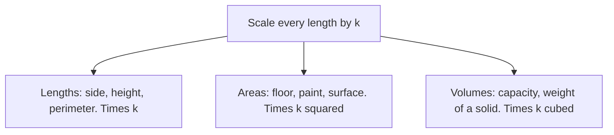

Lesson 16 ended with scale factors: in a 1 : 24 model car, every *length* is $\tfrac{1}{24}$ of the real length. It's tempting to think everything else scales the same way, so that the model needs $\tfrac{1}{24}$ of the paint and weighs $\tfrac{1}{24}$ as much. It doesn't. Areas and volumes change by much larger factors than lengths, and that one fact explains why a large pizza is often the better deal, why maps shrink areas so drastically, and why there are no ants the size of elephants. This lesson uses only two facts from earlier: a rectangle's area is length × width, and a cube with edge $s$ has volume $s^3$ (Lessons 2 and 3).

## Area scales by the square of the scale factor

Take a 3 by 2 rectangle, with area 6, and scale it by a factor of 3. Both the length and the width are multiplied by 3, so the new rectangle is 9 by 6 and its area is 54. That's $9$ times the old area, not 3 times.

The picture shows why: the big rectangle is 3 copies across and 3 copies down, $3 \times 3 = 9$ copies of the original. In general, if every length is multiplied by $k$, then length × width becomes $(k \times \text{length}) \times (k \times \text{width})$, so

$$\text{new area} = k^2 \times \text{old area}.$$

This works for any shape, not just rectangles: a triangle, a circle or the outline of a state can be filled (as closely as you like) with tiny squares, and every one of those squares grows by $k^2$. That argument is the idea behind a careful proof, not the proof itself, but the rule holds for every flat shape and also for **surface area**, the total area of the outside of a solid.

### Example 1

A pizza place sells a 12-inch pizza for \$10 and a 16-inch pizza for \$16. Which is the better buy per square inch?

The large pizza is a scaled-up copy of the small one, with scale factor $k = \tfrac{16}{12} = \tfrac43$. So its area is $k^2 = \left(\tfrac43\right)^2 = \tfrac{16}{9} \approx 1.78$ times as large. The price is only $\tfrac{16}{10} = 1.6$ times as large. You get about 78% more pizza for 60% more money, so the large is the better buy.

Notice that you never needed the formula for a circle's area: the ratio of areas is $k^2$ for any shape.

### Example 2

A map has scale 1 : 50,000, so 1 cm on the map is 50,000 cm, which is 500 m or 0.5 km, on the ground. A park covers 3 square centimeters on the map. What is its real area?

Lengths scale by 1 cm → 0.5 km, so a 1 cm by 1 cm square on the map is a 0.5 km by 0.5 km square on the ground, with area $0.25$ square kilometers. The park's real area is $3 \times 0.25 = 0.75$ square kilometers.

A common error is to multiply 3 by 0.5 and get 1.5 km². That scales the area as if it were a length.

## Volume scales by the cube of the scale factor

A solid has three dimensions to grow in. Scale a cube with edge 1 by a factor of 2: the new edge is 2, each face has area $2^2 = 4$, and the volume is $2^3 = 8$. Eight of the original cubes fit inside.

For a box, length, width and height each get multiplied by $k$, so the volume gets multiplied by $k \times k \times k$:

$$\text{new volume} = k^3 \times \text{old volume}.$$

Anything that depends on volume follows the same rule: how much a container holds (its **capacity**), and the weight of a solid object made of the same material.

### Example 3

A sculptor makes a solid bronze model of a statue at a scale of 1 : 10. The model weighs 2 kg and needed 0.05 square meters of gold leaf to cover. If the real statue is solid bronze in the same shape, how much does it weigh, and how much gold leaf would it need?

From model to statue, $k = 10$.

- Weight goes with volume: $10^3 = 1000$ times, so $2 \times 1000 = 2000$ kg.
- Gold leaf goes with surface area: $10^2 = 100$ times, so $0.05 \times 100 = 5$ square meters.

The statue is 10 times as tall but 1,000 times as heavy.

## Working backward

If you know how two areas or two volumes compare, you can find the scale factor for lengths by asking which number squared (or cubed) gives that comparison.

### Example 4

Two similar rectangles have areas 20 cm² and 45 cm². The smaller one is 4 cm wide. How wide is the larger?

The area ratio is $\tfrac{45}{20} = \tfrac94$. Which number times itself is $\tfrac94$? It's $\tfrac32$, since $\tfrac32 \times \tfrac32 = \tfrac94$. So $k = \tfrac32$, and the width is $4 \times \tfrac32 = 6$ cm.

The mistake to avoid: $\tfrac{45}{20} = 2.25$ is the *area* factor, so $4 \times 2.25 = 9$ cm is wrong. Check the right answer instead: $6 \div 4 = 1.5$ and $1.5^2 = 2.25$. ✓

Similarly, if two similar jars hold 8 cups and 27 cups, the volume ratio is $\tfrac{27}{8}$, and since $3^3 = 27$ and $2^3 = 8$, the length ratio is $\tfrac32$: the bigger jar is 1.5 times as tall.

## The square–cube law

Put the two rules together. When a solid is scaled up by $k$, its surface grows by $k^2$ but its volume grows by $k^3$, which is faster. This is the **square–cube law**, and Galileo used it in 1638 to argue that animals and buildings can't simply be scaled up without changing shape.

- *Strength.* How much weight a bone or a column can hold depends on the area of its cross section, which grows by $k^2$. The weight it must hold grows by $k^3$. Scale an ant up 100 times and its weight is multiplied by 1,000,000 while its leg strength is multiplied only by 10,000. Its legs would fail. Large animals have proportionally much thicker legs; compare an elephant to a deer.
- *Heat and melting.* A body gains or loses heat through its surface, but how much heat it holds depends on its volume. Small things have much more surface for their size, so a mouse loses heat far faster for its size than an elephant does, and crushed ice melts faster than one big block.

These are simplified models (real bones, animals and ice involve more than geometry), but the scaling idea is the main reason behind each one.

### Example 5

Compare the surface-to-volume ratio of a cube with edge 1 cm and a cube with edge 3 cm.

Small cube: surface area $6 \times 1^2 = 6$ cm², volume $1^3 = 1$ cm³, ratio $\tfrac{6}{1} = 6$.

Large cube: surface area $6 \times 3^2 = 54$ cm², volume $3^3 = 27$ cm³, ratio $\tfrac{54}{27} = 2$.

Scaling by 3 cut the surface area per unit of volume to $\tfrac13$ of what it was. (For any cube with edge $s$, the ratio is $\tfrac{6s^2}{s^3} = \tfrac{6}{s}$.)

## Units are scaled too

Unit conversions follow the same rule. Since 1 foot = 12 inches, a square foot is 12 inches by 12 inches, so $1 \text{ ft}^2 = 144 \text{ in}^2$, not 12. Since 1 yard = 3 feet, $1 \text{ yd}^2 = 9 \text{ ft}^2$ and $1 \text{ yd}^3 = 27 \text{ ft}^3$. Carpet sold by the square yard and concrete sold by the cubic yard both depend on getting this right.

## Common mistakes

- *Scaling area or volume by $k$.* Area goes by $k^2$, volume by $k^3$.
- *Using the area factor for lengths.* If the area is 4 times as big, lengths are 2 times as big, not 4.
- *Forgetting that weight follows volume.* A model at 1 : 10 weighs $\tfrac{1}{1000}$ as much (same material), not $\tfrac{1}{10}$.
- *Converting square or cubic units with the length factor.* $1 \text{ yd}^2 = 9 \text{ ft}^2$, not 3.
- *Applying the rules to shapes that aren't similar.* $k^2$ and $k^3$ only hold when every length is scaled by the same factor.

## Key points

- Scale every length by $k$: lengths × $k$, areas (including surface area) × $k^2$, volumes × $k^3$.
- The area rule holds for every shape, which is why bigger pizzas and bigger maps grow so fast.
- Weight of a solid object and capacity of a container go with volume.
- Working backward: find the number whose square (or cube) is the area (or volume) ratio.
- Square–cube law: volume outgrows surface area, so large objects have less surface for their size.
- Square and cubic units scale too: $1 \text{ ft}^2 = 144 \text{ in}^2$, $1 \text{ yd}^3 = 27 \text{ ft}^3$.
