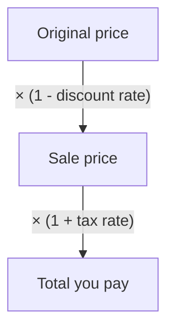

## Percents with money

The last lesson's equation, amount = percent × base, runs through almost every money calculation you'll meet: sales tax at the register, the tip on a restaurant bill, a sale price, a salesperson's commission, and the interest on a loan or savings account. This lesson works through each one. They differ only in what the base is and whether the amount is added or subtracted.

## Sales tax

**Sales tax** is a percent of the purchase price added on at the register. The percent is the **tax rate**.

$$\text{tax} = \text{rate} \times \text{price}, \qquad \text{total} = \text{price} + \text{tax}$$

### Example 1

A bicycle costs \$340 and the sales tax rate is 7.5%. What is the total cost?

Tax: $0.075 \times 340 = 25.50$. Total: $340 + 25.50 = 365.50$, so \$365.50.

Shortcut: the total is 107.5% of the price, so $1.075 \times 340 = 365.50$ in one step.

## Tips

A **tip** (gratuity) is a percent of a bill that you choose to add. A common mental method: find 10% by moving the decimal point, then scale.

### Example 2

Leave an 18% tip on a \$46.50 bill.

10% is \$4.65, so 20% is \$9.30. 2% is $\tfrac15$ of 10%: \$0.93. So 18% is $9.30 - 0.93 = 8.37$. Check: $0.18 \times 46.50 = 8.37$. ✓ The total is $46.50 + 8.37 = 54.87$.

## Discounts and sale prices

A **discount** is a percent taken *off* the original price. The **sale price** is what's left.

$$\text{discount} = \text{rate} \times \text{original price}, \qquad \text{sale price} = \text{original} - \text{discount}$$

Shortcut: after a 30% discount you pay 70%, so the sale price is $0.70 \times \text{original}$.

A purchase with a discount and tax is a chain of two multiplications. To work backward from a total to the original price, divide by the same numbers in reverse order.



### Example 3

An \$85 pair of shoes is 30% off, and there is 6% sales tax. What do you pay?

Sale price: $0.70 \times 85 = 59.50$. Tax is figured on the sale price: $0.06 \times 59.50 = 3.57$. Total: $59.50 + 3.57 = 63.07$, so \$63.07.

(Equivalently, $85 \times 0.70 \times 1.06 = 63.07$.)

The receipt shows each step:


### Finding the original price

### Example 4

After a 25% discount a lamp costs \$48. What was the original price?

The sale price is 75% of the original: $48 = 0.75 \times B$, so $B = 48 \div 0.75 = 64$. The original price was \$64. (A common mistake is to add 25% of \$48 back on, getting \$60. The 25% was of the *original*, not of the sale price.)

### Stacked discounts

An extra 20% off an already reduced item is not "50% off" in total. A \$100 item at 30% off costs \$70; an extra 20% off that gives $0.80 \times 70 = 56$, a total discount of 44%.

## Markup

Stores buy items at a *cost* and sell them at a higher price. The increase is the **markup**, often stated as a percent of the cost. A 40% markup on a \$25 item gives a selling price of $25 \times 1.40 = 35$ dollars. Markup is just a percent increase.

## Commission

A **commission** is pay figured as a percent of sales. Many salespeople earn a base salary plus commission.

### Example 5

A salesperson earns \$1,800 a month plus 4% commission on sales. In March she sold \$62,000 worth of goods. What were her total earnings?

Commission: $0.04 \times 62{,}000 = 2{,}480$. Total: $1{,}800 + 2{,}480 = 4{,}280$, so \$4,280.

## Simple interest

When you borrow money you pay **interest** for its use; when you save, the bank pays you interest. The amount borrowed or deposited is the **principal**. With **simple interest**, interest is paid only on the original principal, at a fixed annual rate:

$$I = Prt$$

where $I$ is the interest, $P$ the principal, $r$ the annual rate as a decimal, and $t$ the time *in years*. The total amount owed or saved at the end is $A = P + I$.

Why multiply all three? The interest for one year is $r \times P$ (a percent of the principal). Over $t$ years it's that amount $t$ times.

### Example 6

Find the simple interest on a \$2,500 loan at 6% per year for 3 years, and the total to repay.

$I = 2{,}500 \times 0.06 \times 3 = 450$. Total: $2{,}500 + 450 = 2{,}950$, so \$2,950.

### Example 7

\$1,200 is invested at 4.5% simple interest for 8 months. How much interest is earned?

The time must be in years: 8 months $= \tfrac{8}{12}$ year. $I = 1{,}200 \times 0.045 \times \tfrac{8}{12} = 36$. The interest is \$36.

### Example 8

A loan of \$3,000 for 2 years earned \$330 in simple interest. What was the annual rate?

$330 = 3{,}000 \times r \times 2 = 6{,}000r$, so $r = 330 \div 6{,}000 = 0.055 = 5.5\%$.

### A note on compound interest

Most real savings accounts and loans use **compound interest**, where interest is added to the principal and then itself earns interest. For the same rate and time, compound interest is a bit more than simple interest. For example, \$1,000 at 5% compounded yearly for 2 years grows to $1{,}000 \times 1.05 \times 1.05 = 1{,}102.50$, compared with \$1,100 under simple interest.

Over a short time the difference is small, but it keeps widening. The graph follows \$1,000 at 5% for 20 years: simple interest adds the same \$50 every year (a straight line), while compound interest adds 5% of a growing balance (a curve that bends upward).

```plot
{"x": [-3, 25], "y": [0, 3000], "xLabel": "years", "yLabel": "balance ($)", "functions": [{"f": "1000 + 50*x", "label": "simple: 1000 + 50t", "dashed": true, "from": 0, "to": 20}, {"f": "1000*1.05^x", "label": "compound yearly", "from": 0, "to": 20}], "points": [{"at": [20, 2000], "label": "2,000"}, {"at": [20, 2653.3], "label": "2,653.30"}], "caption": "$1,000 at 5% a year: simple vs compound interest"}
```

You'll study compounding in algebra; for now, be sure which kind a problem describes.

## Common mistakes

- *Taxing the original price* instead of the sale price after a discount.
- *Undoing a discount by adding the same percent back.* Divide by the remaining percent instead.
- *Using months as years* in $I = Prt$: 8 months is $\tfrac{8}{12}$ year.
- *Using the rate as a whole number:* 6% is 0.06 in the formula.
- *Adding stacked discounts:* 30% then 20% off is 44% off, not 50%.

## Key points

- Tax, tip, commission and interest are percents of a base, usually added on; discounts are subtracted.
- Price after an increase at rate $r$ (as a decimal): multiply by $1 + r$; after a discount at rate $r$: multiply by $1 - r$.
- To find an original price, divide by the percent that remains.
- Simple interest: $I = Prt$ with $t$ in years; total $A = P + I$.
- Compound interest earns interest on interest, so it grows faster than simple interest.
