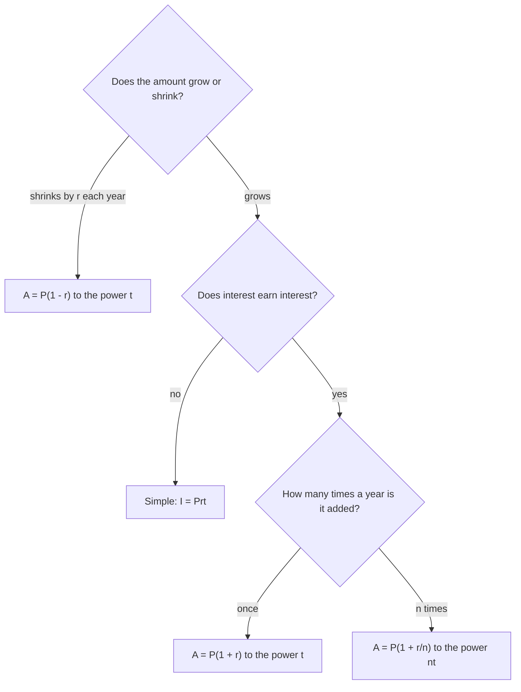

## Interest that earns interest

The last lesson ended with a short note: most real savings accounts and loans use **compound interest**, where interest is added to the balance and then earns interest itself. \$1,000 at 5% compounded yearly for 2 years grew to \$1,102.50 instead of the \$1,100 that simple interest gives. Fifty cents doesn't sound like much. This lesson shows why the gap keeps widening, gives the formula banks actually use, and explains three tools for comparing and estimating: the annual percentage yield, the rule of 72 and the same idea run backward for things that lose value. You'll need a calculator with an exponent key (often marked $x^y$, $y^x$ or ^).

## Year by year

Follow \$1,000 for five years both ways. To keep the arithmetic exact, use a rate of 10% a year. With simple interest, each year adds 10% of the *original* \$1,000, which is always \$100. With compound interest, each year adds 10% of *whatever is in the account*, and the account keeps getting bigger.

| Year | Simple interest balance | Compound interest balance | Interest added that year (compound) |
|---|---|---|---|
| 0 | \$1,000.00 | \$1,000.00 | |
| 1 | \$1,100.00 | \$1,100.00 | \$100.00 |
| 2 | \$1,200.00 | \$1,210.00 | \$110.00 |
| 3 | \$1,300.00 | \$1,331.00 | \$121.00 |
| 4 | \$1,400.00 | \$1,464.10 | \$133.10 |
| 5 | \$1,500.00 | \$1,610.51 | \$146.41 |

Look at the right-hand column: the yearly interest itself grows by 10% each year. That is the "interest on interest." After five years compounding is ahead by \$110.51, and the lead grows every year.

## The compound interest formula

Adding 10% to a balance is the same as multiplying it by 1.1 (from *Solving percent problems*: an increase at rate $r$ multiplies by $1 + r$). So each year *multiplies* the balance by 1.1:

$$1{,}000 \to 1{,}000(1.1) \to 1{,}000(1.1)(1.1) \to 1{,}000(1.1)(1.1)(1.1) \to \cdots$$

After $t$ years there are $t$ factors of 1.1, which is a power:

$$A = P(1 + r)^t$$

Here $P$ is the principal, $r$ the annual rate as a decimal, $t$ the number of years, and $A$ the balance at the end. The number $1 + r$ is the **growth factor**: what the balance is multiplied by each year. Check: $1{,}000 \times 1.1^5 = 1{,}000 \times 1.61051 = 1{,}610.51$, matching the table. Order of operations matters here: raise $1.1$ to the power first, then multiply by $P$. The same formula with $r = 0.05$ gives the example from the last lesson: $1{,}000 \times 1.05^2 = 1{,}102.50$.

Anything that is multiplied by the same factor every period shows **exponential growth**. Compare the shapes: simple interest adds the same amount each year, so its graph is a straight line; compound interest multiplies, so its graph curves upward more and more steeply.

```plot
{"x": [0, 30], "y": [0, 18000], "xLabel": "years", "yLabel": "balance ($)", "functions": [{"f": "1000 + 100*x", "label": "simple: adds 100 a year", "dashed": true}, {"f": "1000*1.1^x", "label": "compound: × 1.1 a year"}], "points": [{"at": [30, 4000], "label": "4,000"}, {"at": [30, 17449.4], "label": "about 17,449"}], "caption": "$1,000 at 10% a year for 30 years: the straight line is simple interest, the curve is compound interest"}
```

### Example 1

Lena puts \$2,500 in a certificate of deposit paying 4% compounded yearly for 10 years. How much will she have? How does that compare with 4% simple interest?

Compound: $A = 2{,}500(1.04)^{10}$. First $1.04^{10} \approx 1.480244$, then $2{,}500 \times 1.480244 \approx 3{,}700.61$. She will have \$3,700.61.

Simple: $I = Prt = 2{,}500 \times 0.04 \times 10 = 1{,}000$, so \$3,500.

Compounding earned her \$200.61 more. Over 10 years the difference is noticeable; over 30 years it would be huge.

## Compounding more than once a year

Many accounts add interest monthly or even daily. The stated yearly rate $r$ is then split evenly among the **compounding periods**: with $n$ periods a year, each period pays $\tfrac{r}{n}$, and in $t$ years there are $nt$ periods. The formula becomes

$$A = P\left(1 + \frac{r}{n}\right)^{nt}$$

With $n = 1$ this is the yearly formula again. Common values: $n = 2$ (semiannually), $n = 4$ (quarterly), $n = 12$ (monthly), $n = 365$ (daily).

### Example 2

Redo Example 1 with interest compounded monthly.

Rate per month: $\tfrac{0.04}{12} = 0.0033333\ldots$ Number of months: $12 \times 10 = 120$.

$A = 2{,}500\left(1 + \tfrac{0.04}{12}\right)^{120} \approx 2{,}500 \times 1.490833 \approx 3{,}727.08$.

Monthly compounding gives \$3,727.08, about \$26 more than yearly. Type $\tfrac{0.04}{12}$ into the calculator as a division (or store it) instead of rounding it to 0.0033; rounding the rate early changes the cents.

How much does compounding more often help? Here is \$1,000 at 6% for one year:

| Compounded | $n$ | Balance after 1 year |
|---|---|---|
| yearly | 1 | \$1,060.00 |
| semiannually | 2 | \$1,060.90 |
| quarterly | 4 | \$1,061.36 |
| monthly | 12 | \$1,061.68 |
| daily | 365 | \$1,061.83 |

More frequent compounding helps, but each step helps less, and the balances level off. Even compounding every instant (called *continuous compounding*, which you'll meet in algebra with the number $e \approx 2.718$) gives only about \$1,061.84.

## Comparing accounts: the annual percentage yield

Bank A offers 4.9% compounded monthly. Bank B offers 5% compounded yearly. Which pays more? The stated rates can't be compared directly, because they compound differently. The fair comparison is the **annual percentage yield** (APY): the percent the balance actually grows in one year, with compounding included.

$$\text{APY} = \left(1 + \frac{r}{n}\right)^{n} - 1$$

The reasoning: in one year the balance is multiplied by $\left(1 + \tfrac{r}{n}\right)^n$, and subtracting 1 leaves the growth as a decimal. Then convert it to a percent.

The stated rate before compounding is often called the *nominal* rate. In the United States, banks must show the APY on savings accounts and certificates of deposit, so you can compare them directly. (Loans are quoted with an **APR**, an annual percentage rate. That is a different measure: roughly the yearly cost of the loan, including some fees, but generally *without* the effect of compounding. This is a simplified description; the legal rules have many details.)

### Example 3

Compare Bank A (4.9% compounded monthly) with Bank B (5% compounded yearly).

Bank A: $\left(1 + \tfrac{0.049}{12}\right)^{12} - 1 \approx 1.050116 - 1 = 0.050116$, an APY of about 5.01%.

Bank B: compounded once a year, so its APY is just 5.00%.

Bank A pays slightly more, even though its stated rate is lower. On \$10,000 the difference after one year is only about \$1.16, but the APY settles the question without guessing.

## How long to double? The rule of 72

At a growth factor of $1 + r$ per year, how long until the money doubles? Notice that the principal doesn't matter: \$1,000 doubles exactly when \$50 does, since both are multiplied by the same factors. A handy estimate is the **rule of 72**:

$$\text{years to double} \approx \frac{72}{\text{rate as a percent}}$$

At 8% a year, money doubles in about $72 \div 8 = 9$ years. Check: $1.08^9 \approx 1.999$. Almost exactly double.

The time it takes a growing quantity to double is its **doubling time**. The rule of 72 is an approximation, not an exact formula. For yearly compounding at rates from about 3% to 15% it is within about 4% of the true doubling time, and it is most accurate near 8%:

| Rate | Rule of 72 | True doubling time (yearly compounding) |
|---|---|---|
| 2% | 36 years | about 35.0 years |
| 6% | 12 years | about 11.9 years |
| 8% | 9 years | about 9.0 years |
| 12% | 6 years | about 6.1 years |
| 24% | 3 years | about 3.2 years |

(The true times come from logarithms, which you'll learn in algebra; you can confirm any of them by multiplying. For example $1.06^{12} \approx 2.012$.) The rule also works in reverse: to double in 6 years you need about $72 \div 6 = 12\%$ a year.

### Example 4

A country's population grows about 3% a year. Roughly how long until it doubles? Until it is four times as large?

Doubling time: about $72 \div 3 = 24$ years. Quadrupling means doubling twice, so about 48 years. Check: $1.03^{48} \approx 4.13$. Close to 4. (Real populations don't grow at a perfectly steady rate, so this is a model, not a prediction.)

## Losing a percent each year: depreciation

The same reasoning works when something *loses* a fixed percent of its value each year. Losing value over time is **depreciation**. A decrease at rate $r$ multiplies by $1 - r$, so after $t$ years

$$A = P(1 - r)^t$$

```plot
{"x": [0, 10], "y": [0, 30000], "xLabel": "years", "yLabel": "value ($)", "functions": [{"f": "28000*0.85^x", "label": "value = 28,000 × 0.85^t"}], "points": [{"at": [0, 28000], "label": "28,000"}, {"at": [3, 17195.5], "label": "about 17,196"}, {"at": [10, 5511.8], "label": "about 5,512"}], "caption": "A car losing 15% of its value each year: the drop gets smaller every year, and the value never reaches zero"}
```

### Example 5

A new car costs \$28,000 and loses 15% of its value each year. Estimate its value after 3 years.

Each year it keeps 85%: $A = 28{,}000(0.85)^3 = 28{,}000 \times 0.614125 = 17{,}195.50$. The car is worth about \$17,196.

A common wrong answer subtracts $3 \times 15\% = 45\%$ of the original, giving \$15,400. That treats each year's loss as 15% of the *original* price, but the second and third years' losses are 15% of a smaller value. (Real cars don't lose value at a perfectly constant percent; this is a standard simplified model.)

## Which formula?



## Common mistakes

- *Using the yearly rate for each period.* With monthly compounding at 6%, each month pays $\tfrac{0.06}{12} = 0.005$, not 0.06.
- *Using years as the exponent when compounding monthly.* Ten years of monthly compounding is $nt = 120$ periods.
- *Multiplying before raising to the power.* In $2{,}500(1.04)^{10}$, compute $1.04^{10}$ first; $(2{,}500 \times 1.04)^{10}$ is a different, enormous number.
- *Rounding the growth factor early.* $1 + \tfrac{0.04}{12}$ is $1.003333\ldots$; using 1.003 over 120 months gives \$3,581.39, about \$146 too little.
- *Comparing stated rates instead of APYs* when the compounding differs.
- *Treating the rule of 72 as exact.* It's an estimate, best for moderate rates.
- *Subtracting the same amount each year for depreciation.* A constant *percent* loss shrinks by a smaller amount each year.

## Key points

- Compound interest multiplies the balance by the growth factor $1 + r$ every year: $A = P(1 + r)^t$.
- With $n$ compounding periods a year: $A = P\left(1 + \tfrac{r}{n}\right)^{nt}$. More frequent compounding helps, but less and less.
- Repeated multiplication by the same factor is exponential growth; its graph curves upward, while simple interest is a straight line.
- APY $= \left(1 + \tfrac{r}{n}\right)^n - 1$ is the true one-year growth and the fair way to compare savings accounts.
- Rule of 72: doubling time $\approx 72 \div$ (percent rate). An estimate, most accurate near 8%.
- Losing a fixed percent $r$ each year: $A = P(1 - r)^t$.
