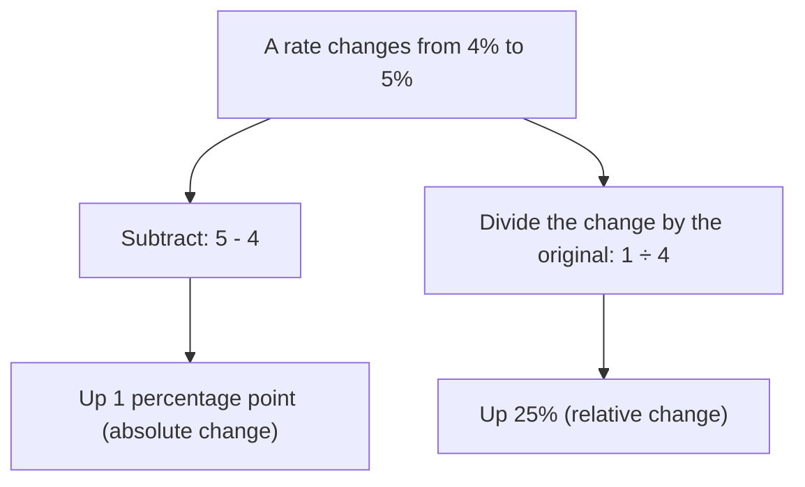

## Why percents fool people

Lesson 18 showed a surprise: a 20% rise followed by a 20% fall leaves you 4% *below* where you started. Lesson 19 showed another: 30% off and then 20% off is 44% off, not 50%. These aren't isolated tricks. They come from one fact: every percent is a percent *of something*, and when the "something" changes, so does the meaning of the percent. This lesson builds that fact into a toolkit for chains of changes, for undoing a change, for the difference between percent and percentage points, and for comparisons that look obvious but aren't. These are the skills that let you check a news headline or an advertisement yourself.

## Every change is a multiplication

Write a percent change as a decimal $r$, positive for an increase and negative for a decrease. The new value is the old value times the **multiplier** $1 + r$:

| Change | Multiplier |
|---|---|
| up 15% | 1.15 |
| up 100% (doubles) | 2 |
| down 15% | 0.85 |
| down 100% (to zero) | 0 |

Going the other way, a multiplier $m$ means a percent change of $(m - 1) \times 100\%$. A multiplier of 1.08 is an 8% increase; 0.92 is an 8% decrease; 1 means no change.

When changes happen one after another, each one multiplies the result of the one before, so **the multipliers multiply**. The overall change is the product of the multipliers, minus 1.

### Example 1

A store raises a price 10%, then puts it on sale at 25% off, then raises the sale price 20%. What is the overall percent change?

Multipliers: 1.10, 0.75 and 1.20. Product: $1.10 \times 0.75 \times 1.20 = 0.99$. Overall: $0.99 - 1 = -0.01$, a 1% decrease.

Simply adding the percents ($+10 - 25 + 20 = +5$) would say a 5% increase, which is wrong. Try it with a \$100 item: $100 \to 110 \to 82.50 \to 99$.

## The order of the changes doesn't matter

Multiplication can be done in any order ($ab = ba$), so a chain of percent changes ends at the same value whichever order the changes come in. A 30% discount followed by an extra 20% off gives $0.70 \times 0.80 = 0.56$; 20% off first and then 30% off gives $0.80 \times 0.70 = 0.56$. Either way you pay 56%.

### Example 2

At the register, a \$120 jacket gets a 25% coupon and 6% sales tax. Does it matter whether the tax is added before or after the coupon?

Coupon first: $120 \times 0.75 = 90$, then tax: $90 \times 1.06 = 95.40$.

Tax first: $120 \times 1.06 = 127.20$, then coupon: $127.20 \times 0.75 = 95.40$.

The total is \$95.40 either way, because both are percent changes and $0.75 \times 1.06 = 1.06 \times 0.75 = 0.795$. (Store rules decide which amount appears on the receipt as "tax," but the total is the same.) This only works because both steps are *percents*. A flat \$10-off coupon is not a multiplier, and with one of those the order does matter.

## Undoing a percent change

A price rises 25%. What percent decrease brings it back? Not 25%: the decrease is taken of the *larger* price. Multipliers make this exact. To undo multiplying by $m$, multiply by $\tfrac{1}{m}$:

$$\text{undo a rise of 25\%:} \quad \frac{1}{1.25} = 0.8, \text{ a decrease of } 20\%$$

Both steps change the price by the same \$20, but \$20 is 25% of \$80 and only 20% of \$100. In general, a rise of $r$ is undone by a decrease of $\tfrac{r}{1 + r}$, which is always *smaller* than $r$, and a fall of $r$ is undone by a rise of $\tfrac{r}{1 - r}$, which is always *larger*:

| Change | Undone by |
|---|---|
| up 25% | down 20% |
| up 50% | down $33\tfrac13\%$ |
| up 100% | down 50% |
| down 20% | up 25% |
| down 40% | up $66\tfrac23\%$ |
| down 50% | up 100% |

### Example 3

A stock falls 40%. What percent gain does it need to get back to its starting value?

After the fall it is worth 0.6 of the original. To return to 1 it must be multiplied by $\tfrac{1}{0.6} = 1.666\ldots$, a gain of $66\tfrac23\%$. With numbers: a \$50 share falls to \$30; getting back to \$50 takes a \$20 gain, and $\tfrac{20}{30} = 66\tfrac23\%$. This is why investors say losses hurt more than equal-sized gains help.

## Percent or percentage points?

Some quantities are percents themselves: interest rates, tax rates, unemployment rates, the share of voters who support something. When one of them changes, there are two different ways to describe the change, and both are correct:

- the **percentage point** change is the plain difference of the two percents;
- the **relative change** is the percent change you already know: the difference divided by the original.

If a savings rate rises from 4% to 5%, it went up 1 percentage point, and that is a 25% increase, because the 1-point rise is a quarter of the original 4.

Saying "the rate rose 1%" is ambiguous: it could mean 4% to 5% or 4% to 4.04%. Careful writers say "percentage points" for the difference.

### Example 4

A town's unemployment rate falls from 5.0% to 4.2%. Describe the change both ways.

Percentage points: $4.2 - 5.0 = -0.8$, a drop of 0.8 percentage point.

Relative: $\tfrac{-0.8}{5.0} = -0.16$, a 16% decrease in the unemployment rate.

A headline saying "unemployment down 16%" and one saying "unemployment down 0.8 point" describe the same change.

## Absolute and relative change in the news

Relative change can make a small effect sound big, and absolute change can make a big effect sound small. The **absolute change** is the plain difference (in people, dollars or percentage points); the relative change compares that difference to the starting value.

### Example 5

A study reports that a medicine "raises the risk of a side effect by 50%." Among people not taking it, 2 in 10,000 get the side effect; among people taking it, 3 in 10,000 do. Describe the change both ways.

Relative: $\tfrac{3 - 2}{2} = 0.5$, a 50% increase. True.

Absolute: 2 in 10,000 is 0.02%, and 3 in 10,000 is 0.03%. The risk went up 0.01 percentage point, or 1 extra case per 10,000 people.

Both statements are accurate. The relative one tells you how much the medicine changes the risk; the absolute one tells you how much that matters for one person. When you see one, ask for the other. (This example is invented for practice, not about a real medicine.)

## When combined percents mislead

### Example 6

Two basketball players kept track of their free throws for two months:

| | Month 1 | Month 2 | Both months |
|---|---|---|---|
| Ana | 9 of 10 (90%) | 30 of 50 (60%) | 39 of 60 (65%) |
| Bea | 34 of 40 (85%) | 11 of 20 (55%) | 45 of 60 (75%) |

Who is the better shooter?

Ana had the higher percent in Month 1 *and* in Month 2. Yet Bea has the higher percent overall. No arithmetic is wrong. The overall percent is a *weighted* average of the monthly percents, weighted by the number of attempts. Ana took most of her shots (50 of 60) in her weaker month, while Bea took most of hers (40 of 60) in her stronger month. (The numbers are invented to show the effect.)

A trend that holds in every group but reverses when the groups are combined is called **Simpson's paradox**. It is not rare in real data, for example in medical studies where sicker patients tend to get one treatment. It is a warning: before comparing two overall percents, check whether the groups behind them are of very different sizes or kinds. Which comparison is "right" depends on the question being asked, and that takes thought, not just arithmetic.

## Common mistakes

- *Adding percent changes in a chain.* Multiply the multipliers instead: +10%, −25%, +20% is a 1% decrease, not a 5% increase.
- *Undoing a change with the same percent.* A 25% rise is undone by a 20% fall; a 40% fall needs a $66\tfrac23\%$ rise.
- *Mixing up percentage points and percent.* From 4% to 5% is up 1 percentage point, which is up 25%.
- *Trusting a relative change alone.* "50% more risk" may mean 1 extra case in 10,000.
- *Comparing overall percents without looking at the groups.* Group sizes can reverse a comparison.
- *Treating a flat amount like a percent.* \$10 off is not a multiplier, so order matters with it.

## Key points

- A percent change $r$ (as a decimal) is a multiplier $1 + r$; a multiplier $m$ is a change of $(m - 1) \times 100\%$.
- In a chain of changes the multipliers multiply, in any order.
- To undo a change, multiply by the reciprocal of its multiplier: up $r$ is undone by down $\tfrac{r}{1 + r}$.
- The difference of two percents is in percentage points; dividing that difference by the original gives the relative change in percent.
- Absolute and relative change answer different questions; look for both.
- A comparison can hold in every group and reverse overall (Simpson's paradox).
