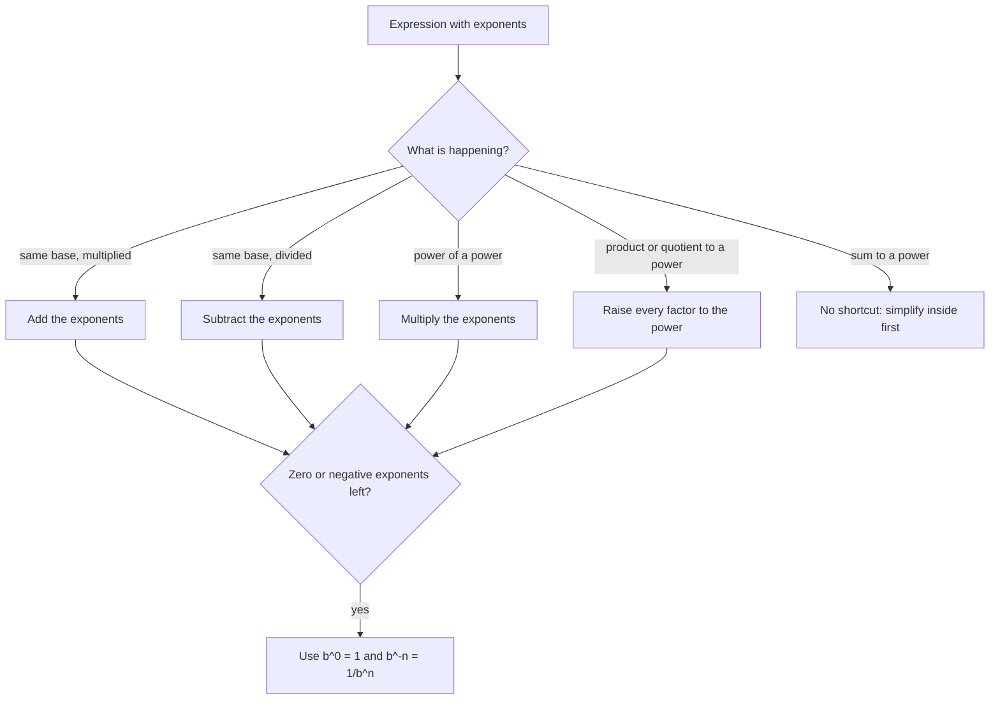

## Shortcuts that come from counting

When the same base appears several times, exponents combine in predictable ways. These **exponent rules** aren't new facts to memorize blindly; each one comes from counting factors. They also force a natural meaning for $b^0$ and for negative exponents, which you'll need for scientific notation in the next lesson. Throughout, the base can be a number or a letter standing for a number (as in $x^3$), which is a first taste of algebra.

## The product rule

$$b^m \cdot b^n = b^{m+n}$$

*Why:* $2^3 \cdot 2^4 = (2 \cdot 2 \cdot 2)(2 \cdot 2 \cdot 2 \cdot 2)$, which is seven 2s in a row, so $2^7$. Multiplying powers of the same base just pools the factors, so the exponents add.

Examples: $x^5 \cdot x^2 = x^7$; $10^3 \cdot 10^6 = 10^9$; $a \cdot a^4 = a^5$ (remember $a = a^1$).

The rule needs the *same base*. $2^3 \cdot 5^2$ can't be combined this way; it's just $8 \cdot 25 = 200$.

## The quotient rule

$$\frac{b^m}{b^n} = b^{m-n} \qquad (b \ne 0)$$

*Why:* $\dfrac{3^6}{3^2} = \dfrac{3 \cdot 3 \cdot 3 \cdot 3 \cdot 3 \cdot 3}{3 \cdot 3}$. Two 3s on the bottom cancel two on top, leaving four: $3^4$. Dividing cancels factors, so the exponents subtract.

Examples: $\dfrac{x^9}{x^4} = x^5$; $\dfrac{10^8}{10^5} = 10^3$.

## The power rules

$$\left(b^m\right)^n = b^{mn}, \qquad (ab)^n = a^n b^n, \qquad \left(\frac{a}{b}\right)^n = \frac{a^n}{b^n}$$

*Why:* $\left(x^3\right)^4 = x^3 \cdot x^3 \cdot x^3 \cdot x^3$, which by the product rule is $x^{3+3+3+3} = x^{12}$. Raising a power to a power multiplies the exponents. And $(2x)^3 = 2x \cdot 2x \cdot 2x = 2^3 \cdot x^3 = 8x^3$: the exponent applies to every factor inside the parentheses.

Careful: this works for products, not sums. $(a + b)^2$ is *not* $a^2 + b^2$; for example $(3 + 4)^2 = 49$ but $3^2 + 4^2 = 25$.

## The zero exponent

What should $5^0$ mean? "Zero factors of 5" doesn't make immediate sense, but the quotient rule settles it. On one hand, $\dfrac{5^3}{5^3} = 1$ (anything nonzero divided by itself). On the other hand, the quotient rule says $\dfrac{5^3}{5^3} = 5^{3-3} = 5^0$. For both to be right,

$$b^0 = 1 \qquad (b \ne 0).$$

Another view: in the list $2^3 = 8$, $2^2 = 4$, $2^1 = 2$, each step down divides by 2. One more step gives $2^0 = 2 \div 2 = 1$.

Watch the base: $-7^0 = -(7^0) = -1$, while $(-7)^0 = 1$. And $5x^0 = 5 \cdot 1 = 5$, since the exponent applies only to $x$.

## Negative exponents

Keep going down the list: $2^0 = 1$, then $2^{-1} = 1 \div 2 = \tfrac12$, then $2^{-2} = \tfrac14$, $2^{-3} = \tfrac18$. The quotient rule agrees: $\dfrac{2^3}{2^5} = 2^{-2}$, and canceling directly gives $\dfrac{1}{2 \cdot 2} = \dfrac14$. So:

$$b^{-n} = \frac{1}{b^n} \qquad (b \ne 0).$$

The bar chart shows the pattern: each step to the left halves the bar, and the halving doesn't stop at $2^0 = 1$; it carries on into the negative exponents.

```plot
{"x": [-3.6, 3.6], "y": [-0.9, 9], "grid": false, "bars": [{"x": -3, "height": 0.125, "width": 0.7, "label": "2⁻³"}, {"x": -2, "height": 0.25, "width": 0.7, "label": "2⁻²"}, {"x": -1, "height": 0.5, "width": 0.7, "label": "2⁻¹"}, {"x": 0, "height": 1, "width": 0.7, "label": "2⁰"}, {"x": 1, "height": 2, "width": 0.7, "label": "2¹"}, {"x": 2, "height": 4, "width": 0.7, "label": "2²"}, {"x": 3, "height": 8, "width": 0.7, "label": "2³"}], "segments": [{"from": [-3.6, 0], "to": [3.6, 0]}], "labels": [{"at": [-3, 0.575], "text": "1/8"}, {"at": [-2, 0.7], "text": "1/4"}, {"at": [-1, 0.95], "text": "1/2"}, {"at": [0, 1.45], "text": "1"}, {"at": [1, 2.45], "text": "2"}, {"at": [2, 4.45], "text": "4"}, {"at": [3, 8.45], "text": "8"}], "caption": "Powers of 2 from 2⁻³ = 1/8 to 2³ = 8: each step left divides by 2"}
```

*A negative exponent means reciprocal, not a negative number.* $2^{-3} = \tfrac18$, which is positive. Some more:

- $10^{-2} = \dfrac{1}{100} = 0.01$
- $5^{-1} = \dfrac15$
- $\left(\dfrac{2}{3}\right)^{-2} = \left(\dfrac32\right)^2 = \dfrac94$ (flip the fraction, then make the exponent positive)
- $\dfrac{1}{x^{-4}} = x^4$ (a negative exponent in the denominator moves up)

Powers of 10 now cover the whole place value chart: $10^2 = 100$, $10^1 = 10$, $10^0 = 1$, $10^{-1} = 0.1$, $10^{-2} = 0.01$, $10^{-3} = 0.001$.

### Example 1

Simplify $\dfrac{x^4 \cdot x^7}{x^3}$.

Product rule on top: $x^{4+7} = x^{11}$. Quotient rule: $x^{11-3} = x^8$.

### Example 2

Simplify $\left(3a^2\right)^3 \cdot a^{-4}$, writing the answer with positive exponents.

Power rules: $\left(3a^2\right)^3 = 3^3 \cdot \left(a^2\right)^3 = 27a^6$. Product rule: $27a^6 \cdot a^{-4} = 27a^{6 + (-4)} = 27a^2$.

### Example 3

Evaluate $4^{-2} + 3^0 - 2^{-1}$.

$4^{-2} = \tfrac{1}{16}$, $3^0 = 1$, $2^{-1} = \tfrac12$. So $\tfrac1{16} + 1 - \tfrac12 = \tfrac1{16} + \tfrac{16}{16} - \tfrac8{16} = \tfrac{9}{16}$.

### Example 4

Simplify $\dfrac{10^{-3} \cdot 10^5}{10^{-4}}$.

Top: $10^{-3+5} = 10^2$. Divide: $10^{2-(-4)} = 10^6$. Subtracting a negative exponent adds.

## Summary table

| Rule | Statement | Example |
|---|---|---|
| Product | $b^m b^n = b^{m+n}$ | $x^2 x^5 = x^7$ |
| Quotient | $b^m / b^n = b^{m-n}$ | $y^8 / y^3 = y^5$ |
| Power of a power | $(b^m)^n = b^{mn}$ | $(z^4)^3 = z^{12}$ |
| Power of a product | $(ab)^n = a^n b^n$ | $(2x)^4 = 16x^4$ |
| Power of a quotient | $(a/b)^n = a^n / b^n$ | $(x/3)^2 = x^2/9$ |
| Zero exponent | $b^0 = 1$ | $9^0 = 1$ |
| Negative exponent | $b^{-n} = 1/b^n$ | $x^{-2} = 1/x^2$ |

When you meet an expression, decide which situation you're in before reaching for a rule:



## Common mistakes

- *Multiplying exponents in a product:* $x^3 \cdot x^4 = x^7$, not $x^{12}$.
- *Multiplying the bases:* $2^3 \cdot 2^4 = 2^7$, not $4^7$.
- *Reading $b^{-n}$ as negative:* $3^{-2} = \tfrac19$, not $-9$.
- *Thinking $b^0 = 0$:* any nonzero number to the zero power is 1.
- *Distributing an exponent over a sum:* $(x + 2)^2 \ne x^2 + 4$.
- *Forgetting the coefficient:* $(2x)^3 = 8x^3$, not $2x^3$.

## Key points

- Same base: multiply → add exponents; divide → subtract exponents.
- Power of a power → multiply exponents; a power of a product or quotient applies to each factor.
- $b^0 = 1$ and $b^{-n} = \dfrac{1}{b^n}$ for $b \ne 0$; these definitions keep the rules consistent.
- Exponents distribute over multiplication and division, never over addition or subtraction.
