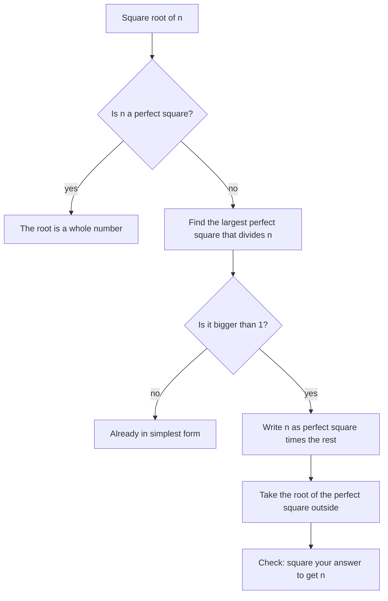

## Exact answers instead of decimals

In Lesson 20 you pinned $\sqrt{58}$ between 7.6 and 7.7. That is fine for measuring a garden, but a decimal like 7.6158 is only an approximation: the digits of an irrational number never end. Algebra and geometry usually keep such numbers *exact*, written with a radical sign, and then tidy them into a standard form so that answers can be compared. A geometry book will say a diagonal is $5\sqrt{2}$, not 7.07 and not $\sqrt{50}$.

This lesson shows how to do that tidying, how to multiply, add and divide square roots, and finally how the exponent rules from Lesson 21 give a meaning to exponents like $\tfrac12$ and $\tfrac23$. Throughout, the numbers under a square root are nonnegative and the bases of fractional exponents are positive. (Negative numbers inside odd roots, like $\sqrt[3]{-8}$, do work, but the rules have extra conditions that a later course handles; this lesson leaves them out.)

## Multiplying and dividing square roots

*Product rule for square roots.* For $a \ge 0$ and $b \ge 0$,

$$\sqrt{a} \cdot \sqrt{b} = \sqrt{ab}.$$

*Why:* square the left side using the power-of-a-product rule: $\left(\sqrt{a}\cdot\sqrt{b}\right)^2 = \left(\sqrt{a}\right)^2\left(\sqrt{b}\right)^2 = ab$. So $\sqrt{a}\cdot\sqrt{b}$ is a nonnegative number whose square is $ab$, and that is exactly what $\sqrt{ab}$ means. Check with perfect squares: $\sqrt{4}\cdot\sqrt{9} = 2 \cdot 3 = 6$ and $\sqrt{36} = 6$.

*Quotient rule for square roots.* For $a \ge 0$ and $b > 0$,

$$\frac{\sqrt{a}}{\sqrt{b}} = \sqrt{\frac{a}{b}}.$$

For example, $\dfrac{\sqrt{50}}{\sqrt{2}} = \sqrt{25} = 5$, and $\sqrt{\tfrac{7}{9}} = \dfrac{\sqrt7}{\sqrt9} = \dfrac{\sqrt7}{3}$.

There is no such rule for sums. As Lesson 20 warned, $\sqrt{9 + 16} = 5$ but $\sqrt9 + \sqrt{16} = 7$. Roots split over multiplication and division, never over addition or subtraction, just like exponents.

## Simplest radical form

Reading the product rule backward splits a root into two pieces, and if one piece is a perfect square, its root is a whole number:

$$\sqrt{72} = \sqrt{36 \cdot 2} = \sqrt{36}\cdot\sqrt{2} = 6\sqrt{2}.$$

$6\sqrt2$ is read "six root two" and means $6 \times \sqrt2$; the number in front is a coefficient, as in scientific notation. A square root is in **simplest radical form** when

1. the radicand has no perfect-square factor other than 1,
2. there is no fraction under the radical sign, and
3. there is no radical in a denominator.

To meet the first condition, find the *largest* perfect square that divides the radicand. Two ways to find it:

- *Test perfect squares.* Try 4, 9, 16, 25, 36, 49, 64, 81, 100, … and keep the largest one that divides evenly.
- *Use the prime factorization* (Lesson 5). Each *pair* of equal prime factors is a perfect square, so it leaves the radical as one copy of that prime.

### Example 1

Write $\sqrt{180}$ in simplest radical form.

*By prime factors:* $180 = 2 \cdot 2 \cdot 3 \cdot 3 \cdot 5$. The pair of 2s brings out a 2, the pair of 3s brings out a 3, and the 5 has no partner, so it stays inside:

$$\sqrt{180} = \sqrt{2^2 \cdot 3^2 \cdot 5} = 2 \cdot 3\sqrt{5} = 6\sqrt{5}.$$

*By perfect squares:* the largest perfect square dividing 180 is $36 = 2^2 \cdot 3^2$, and $180 = 36 \times 5$, giving the same $6\sqrt5$.

*Check:* $\left(6\sqrt5\right)^2 = 36 \times 5 = 180$. ✓

If you use a smaller perfect square, you aren't wrong, just not finished: $\sqrt{180} = \sqrt{4 \cdot 45} = 2\sqrt{45}$, and 45 still contains 9, so $2\sqrt{45} = 2 \cdot 3\sqrt5 = 6\sqrt5$.

### A picture of $\sqrt8 = 2\sqrt2$

Simplifying is not just symbol pushing; it can be seen on graph paper. The tilted square below has its corners at the midpoints of the sides of a 4-by-4 square. It is the big square with four corner triangles cut off, so its area is $16 - 4 \times 2 = 8$ and its side is $\sqrt8$. But each of its sides is also the diagonal of a 2-by-2 square, which is twice the diagonal of a 1-by-1 square. In the same way, a tilted square drawn inside a 2-by-2 square has area $4 - 4 \times \tfrac12 = 2$, so the diagonal of a 1-by-1 square is $\sqrt2$. Together: $\sqrt8 = 2\sqrt2$.

## Adding and subtracting: like radicals

**Like radicals** have the same index and the same radicand, such as $3\sqrt5$ and $-7\sqrt5$. They combine exactly like terms such as $3x + 4x$, by the distributive property:

$$3\sqrt5 + 4\sqrt5 = (3 + 4)\sqrt5 = 7\sqrt5.$$

Unlike radicals don't combine: $\sqrt2 + \sqrt3$ is about $1.414 + 1.732 = 3.146$, while $\sqrt5$ is about 2.236. Leave $\sqrt2 + \sqrt3$ as it is. Sometimes, though, radicals that look unlike become like after simplifying, so simplify first.

### Example 2

Simplify $\sqrt{12} + \sqrt{75} - \sqrt{27}$.

- $\sqrt{12} = \sqrt{4 \cdot 3} = 2\sqrt3$.
- $\sqrt{75} = \sqrt{25 \cdot 3} = 5\sqrt3$.
- $\sqrt{27} = \sqrt{9 \cdot 3} = 3\sqrt3$.
- Combine the coefficients: $(2 + 5 - 3)\sqrt3 = 4\sqrt3$.

*Check with decimals:* $3.4641 + 8.6603 - 5.1962 = 6.9282$, and $4\sqrt3 \approx 4 \times 1.7321 = 6.9282$. ✓

### Example 3

Multiply $\left(2\sqrt6\right)\left(5\sqrt{15}\right)$.

Multiply coefficients with coefficients and radicands with radicands (the commutative and associative properties allow the regrouping): $2 \cdot 5 = 10$ and $\sqrt6 \cdot \sqrt{15} = \sqrt{90}$. So the product is $10\sqrt{90}$. Now simplify: $90 = 9 \times 10$, so $\sqrt{90} = 3\sqrt{10}$ and the answer is $10 \cdot 3\sqrt{10} = 30\sqrt{10}$.

## Rationalizing a denominator

The third condition of simplest radical form says no radical in a denominator. Removing one is called **rationalizing the denominator**: multiply the top and bottom by the radical, which is the same as multiplying by 1, so the value doesn't change.

$$\frac{1}{\sqrt2} = \frac{1}{\sqrt2}\cdot\frac{\sqrt2}{\sqrt2} = \frac{\sqrt2}{2}.$$

The denominator became $\sqrt2 \cdot \sqrt2 = 2$, a rational number, hence the name. Why bother? Before calculators, dividing 1.41421 by 2 by hand was far easier than dividing 1 by 1.41421. Today the reason is mostly convention: a single standard form lets everyone recognize equal answers (a teacher can see at once that your $\tfrac{\sqrt2}{2}$ matches the key). Many tests still expect it, so it's worth knowing, but $\tfrac{1}{\sqrt2}$ is not *wrong*; it is the same number.

### Example 4

Rationalize: (a) $\dfrac{6}{\sqrt3}$, (b) $\sqrt{\dfrac{2}{3}}$.

(a) $\dfrac{6}{\sqrt3}\cdot\dfrac{\sqrt3}{\sqrt3} = \dfrac{6\sqrt3}{3} = 2\sqrt3$.

(b) First split the root: $\sqrt{\tfrac23} = \dfrac{\sqrt2}{\sqrt3}$. Then $\dfrac{\sqrt2}{\sqrt3}\cdot\dfrac{\sqrt3}{\sqrt3} = \dfrac{\sqrt6}{3}$.

## Fractional exponents

Lesson 21 gave meanings to $b^0$ and $b^{-n}$ by insisting that the exponent rules keep working. Do the same for $9^{1/2}$. If the power-of-a-power rule still holds,

$$\left(9^{1/2}\right)^2 = 9^{\frac12 \cdot 2} = 9^1 = 9.$$

So $9^{1/2}$ must be a number whose square is 9, and we take the positive one: $9^{1/2} = 3 = \sqrt9$. In the same way $\left(8^{1/3}\right)^3 = 8$, so $8^{1/3} = \sqrt[3]{8} = 2$. In general, for $b > 0$:

$$b^{1/n} = \sqrt[n]{b}, \qquad b^{m/n} = \left(\sqrt[n]{b}\right)^m = \sqrt[n]{b^m}.$$

The small number $n$ in $\sqrt[n]{b}$ is the **index** of the radical. A square root has index 2, which is not written; a cube root has index 3. An exponent like $\tfrac23$ or $-\tfrac12$ is called a **fractional exponent** (or rational exponent): the denominator is a root and the numerator is a power. A negative sign still means reciprocal.

Taking the root first usually keeps the numbers small: $8^{2/3} = \left(\sqrt[3]{8}\right)^2 = 2^2 = 4$, while the other order needs $\sqrt[3]{64}$.

### Example 5

Evaluate (a) $16^{3/4}$, (b) $25^{-1/2}$, (c) $27^{-2/3}$.

(a) The fourth root of 16 is 2, because $2^4 = 16$. Then $2^3 = 8$. So $16^{3/4} = 8$.

(b) $25^{1/2} = \sqrt{25} = 5$, and the negative sign means reciprocal: $25^{-1/2} = \tfrac15$.

(c) $\sqrt[3]{27} = 3$, $3^2 = 9$, and the reciprocal gives $27^{-2/3} = \tfrac19$.

### Example 6

Simplify $2^{1/2} \cdot 2^{3/2}$ and check it with the product rule for square roots.

Same base, so add the exponents: $\tfrac12 + \tfrac32 = \tfrac42 = 2$, and $2^2 = 4$. In radical form the same product is $\sqrt2 \cdot \sqrt{2^3} = \sqrt2 \cdot \sqrt8 = \sqrt{16} = 4$. ✓ The two systems agree, which is the whole point of defining fractional exponents this way.

## Common mistakes

- *Splitting a root over a sum:* $\sqrt{a + b} \ne \sqrt a + \sqrt b$.
- *Stopping too early:* $\sqrt{72} = 2\sqrt{18}$ is true but not simplest, because 18 still contains 9.
- *Adding unlike radicals:* $\sqrt2 + \sqrt3 \ne \sqrt5$.
- *Adding radicands when combining like radicals:* $3\sqrt5 + 4\sqrt5 = 7\sqrt5$, not $7\sqrt{10}$.
- *Rationalizing only the bottom:* multiplying the denominator by $\sqrt2$ without the numerator changes the value.
- *Treating a fractional exponent as multiplication:* $8^{2/3}$ is 4, not $8 \times \tfrac23$.
- *Reading a negative fractional exponent as a negative number:* $25^{-1/2} = \tfrac15$, not $-5$.

## Key points

- $\sqrt a \cdot \sqrt b = \sqrt{ab}$ and $\dfrac{\sqrt a}{\sqrt b} = \sqrt{\dfrac ab}$ (for nonnegative $a$, positive $b$); roots never split over sums.
- Simplest radical form: no perfect-square factor left under the root, no fraction under it, no radical in a denominator.
- Pull out the largest perfect square, or take one prime out for each pair of equal prime factors.
- Like radicals (same index, same radicand) combine by adding coefficients; simplify first to find them.
- $b^{1/n} = \sqrt[n]{b}$ and $b^{m/n} = \left(\sqrt[n]{b}\right)^m$ for $b > 0$: the denominator is the root, the numerator the power, and a negative sign means reciprocal.
