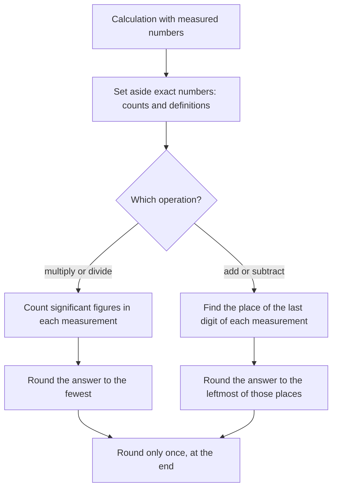

## How many digits mean something?

Lesson 22 ended with a hint: $5{,}000{,}002{,}000$ is "still about $5 \times 10^9$ to three significant digits." In Example 6 of that lesson, a budget known only as "about \$4.4 trillion" was divided by a population of "about 330 million", and a calculator would happily print 13,333.333… dollars per person. Most of those digits are noise: the inputs were only known to two digits, so the answer can't honestly be known to eight.

This lesson is about that honesty. Science and engineering mark how precisely a number is known by how many digits are written, and scientific notation is the clearest way to do it. You'll learn to count the digits that carry meaning, to round a calculated answer to match its inputs, and to use powers of ten and metric prefixes to compare sizes from atoms to planets.

A word of warning before starting: the rules below are a *rule of thumb* used in school science and on many tests. Careful laboratory work states uncertainty directly (for example $14.3 \pm 0.05$ cm) and has its own, more exact methods. The rules here are a good first approximation to those methods.

## Measured numbers and exact numbers

Suppose a pencil measured with a centimeter ruler marked in tenths is 14.3 cm long. That means it is closer to 14.3 than to 14.2 or 14.4, so its length is somewhere from about 14.25 to 14.35 cm. Writing 14.30 cm would claim more: that you could tell 14.30 from 14.31, which this ruler can't do. The digits of a measured number that carry real information are its **significant figures** (also called significant digits). 14.3 has three; 14.30 has four.

Some numbers aren't measured at all. **Exact numbers** come from counting (24 students, 3 eggs) or from definitions (1 foot = 12 inches; 1 inch = 2.54 cm exactly, by international agreement in 1959). Exact numbers have no uncertainty, so they never limit how many digits an answer keeps.

## Counting significant figures

1. Every nonzero digit is significant: 4.62 has 3.
2. A zero *between* nonzero digits is significant: 4,007 has 4; 30.08 has 4.
3. *Leading* zeros, before the first nonzero digit, are never significant. They only place the decimal point: 0.0062 has 2.
4. *Trailing* zeros after a decimal point are significant, because nobody would write them unless they were measured: 2.50 has 3; 0.004050 has 4.
5. Trailing zeros in a whole number with no decimal point are ambiguous. Does 1,500 mean "about 1,500, to the nearest hundred" (2 significant figures) or "exactly 1,500 to the nearest unit" (4)? You can't tell. Conventions differ (some books write "1500." with a final point to mean 4), so this course uses scientific notation to remove the doubt.

### Scientific notation shows them all

In scientific notation, *every digit of the coefficient is significant* and the power of ten carries the place value. So the leading zeros disappear and trailing zeros become visible:

| Standard form | Scientific notation | Significant figures |
|---|---|---|
| 0.004050 | $4.050 \times 10^{-3}$ | 4 |
| 1,500 (to the nearest hundred) | $1.5 \times 10^{3}$ | 2 |
| 1,500 (to the nearest ten) | $1.50 \times 10^{3}$ | 3 |
| 1,500 (to the nearest one) | $1.500 \times 10^{3}$ | 4 |

### Example 1

How many significant figures? (a) 0.000710 (b) 30.08 (c) $6.020 \times 10^{23}$ (d) 7,000,000

(a) Leading zeros don't count; 7, 1 and the trailing 0 after the point do: **3**.
(b) The zero between 3 and 8 counts: **4**.
(c) All four coefficient digits count: **4**.
(d) Ambiguous. Written this way it has at least 1 (the 7); the zeros may or may not have been measured. Writing $7.0 \times 10^6$ would say 2.

## Rounding to a number of significant figures

To round to $n$ significant figures, start at the first nonzero digit, count $n$ digits, and round at that place using the usual rule (look at the next digit; 5 or more rounds up).

### Example 2

(a) Round 0.0048372 to 2 significant figures. The first significant digit is the 4 (thousandths place), the second is the 8 (ten-thousandths). The next digit is 3, so round down: **0.0048**.

(b) Round 86,451 to 3 significant figures. The digits 8, 6, 4 are kept and the next digit is 5, so round up to 86,500. Keep the zeros as placeholders; dropping them (865) would change the size of the number. To make the 3 significant figures clear, write **$8.65 \times 10^4$**.

(c) Round 9.96 to 2 significant figures. Rounding the 9 in the tenths place up carries all the way: 10. Written as "10" it looks like 1 significant figure, so write **$1.0 \times 10^1$**.

## Calculating with measurements

A calculation can't create precision that the measurements didn't have. Two rules cover most cases:

- *Multiplying or dividing:* round the answer to the same number of significant figures as the measurement with the *fewest*.
- *Adding or subtracting:* round the answer to the *place* (tens, ones, tenths, …) of the least precise measurement, the one whose last digit is farthest to the left.

The rules differ because the operations spread error differently. When you add 120.4 g and 3.256 g, the first mass is unknown in the hundredths place, so the total is too, no matter how many digits the second mass has. When you multiply, what matters is the *relative* error, the error as a fraction of the size, and the number of significant figures is a rough measure of that.

Two habits keep the rules honest. Ignore exact numbers when counting, and round only once, at the end: rounding in the middle of a calculation lets small errors pile up.

### Example 3

A rectangular rug measures 4.52 m by 2.1 m. What is its area?

$4.52 \times 2.1 = 9.492$ on a calculator. The measurements have 3 and 2 significant figures, so the answer keeps 2: the area is **9.5 m²**. Writing 9.492 m² would claim the area is known to a thousandth of a square meter, when the 2.1 m side alone could be off by 0.05 m, which changes the area by more than 0.2 m².

### Example 4

Three samples have masses 120.4 g, 3.256 g and 15 g. What is the total mass?

The exact sum is $120.4 + 3.256 + 15 = 138.656$ g. The least precise measurement, 15 g, is known only to the ones place, so the total is rounded to the ones place: **139 g**. (Counting significant figures here would be the wrong rule: it's a sum.)

### Example 5

A student times a pendulum three times: 12.6 s, 12.9 s and 12.7 s. What is the average?

Sum: $12.6 + 12.9 + 12.7 = 38.2$ s, known to the tenths place. Divide by 3, which is an exact count, so it doesn't limit anything: $38.2 \div 3 = 12.7333\ldots$ The sum 38.2 has 3 significant figures, so the average is **12.7 s**.

## Sizes in powers of ten

Scientific notation also makes it easy to compare sizes that are wildly different. A number's power of ten tells its rough size, its *order of magnitude*, and two quantities whose ratio is about $10^n$ are said to differ by $n$ orders of magnitude. The picture places familiar things on a scale where each step is ten times the last.

The metric system names the powers of ten that come up most often. Module 8 uses kilo-, centi- and milli-; the larger and smaller prefixes continue in steps of 1,000:

| Prefix | Symbol | Factor | Example |
|---|---|---|---|
| giga- | G | $10^9$ (billion) | a 2.4 GHz processor: $2.4 \times 10^9$ cycles per second |
| mega- | M | $10^6$ (million) | 5 megawatts = $5 \times 10^6$ watts |
| kilo- | k | $10^3$ (thousand) | 42 km = $4.2 \times 10^4$ m |
| milli- | m | $10^{-3}$ (thousandth) | 250 mL = $2.5 \times 10^{-1}$ L |
| micro- | µ | $10^{-6}$ (millionth) | 8 µm = $8 \times 10^{-6}$ m |
| nano- | n | $10^{-9}$ (billionth) | 120 nm = $1.2 \times 10^{-7}$ m |

To convert, replace the prefix with its power of ten, then adjust the coefficient: $120 \text{ nm} = 120 \times 10^{-9} \text{ m} = 1.2 \times 10^2 \times 10^{-9} \text{ m} = 1.2 \times 10^{-7} \text{ m}$.

### Example 6

The Earth–Sun distance is about $1.5 \times 10^{11}$ m and Earth's width is about $1.27 \times 10^7$ m. How many Earths would fit in a line from Earth to the Sun?

$$\frac{1.5 \times 10^{11}}{1.27 \times 10^{7}} = \frac{1.5}{1.27} \times 10^{4} \approx 1.2 \times 10^{4}.$$

About 12,000 Earths: four orders of magnitude. The inputs have 2 and 3 significant figures, so the answer keeps 2.

### Example 7

A red blood cell is about 8 µm across and a typical virus about 100 nm. How do their sizes compare?

In meters: $8 \times 10^{-6}$ and $1 \times 10^{-7}$. The ratio is $\dfrac{8}{1} \times 10^{-6-(-7)} = 8 \times 10^1 = 80$. So the cell is about 80 times wider, nearly two orders of magnitude. Notice that comparing the exponents alone ($-6$ against $-7$) would suggest only one: when the coefficients are far apart, as 8 and 1 are, they matter too.

## Common mistakes

- *Counting leading zeros:* 0.0062 has 2 significant figures, not 5.
- *Dropping a measured trailing zero:* 2.50 m and 2.5 m are different statements; keep the zero you measured.
- *Using the wrong rule:* sums and differences round to a place; products and quotients round to a number of significant figures.
- *Letting exact numbers limit the answer:* dividing by a count of 3 doesn't cut the answer to 1 significant figure.
- *Rounding at every step* instead of once at the end.
- *Dropping placeholder zeros when rounding:* 86,451 to 3 significant figures is 86,500, not 865.
- *Treating one order of magnitude as "one more"* instead of "ten times as much."

## Key points

- Significant figures are the digits of a measurement that carry information; exact numbers (counts, definitions) have unlimited precision.
- Nonzero digits and zeros between them count; leading zeros never count; trailing zeros count after a decimal point and are ambiguous in whole numbers.
- In scientific notation every coefficient digit is significant, which removes the ambiguity.
- Multiply or divide: keep the fewest significant figures. Add or subtract: keep the least precise place. Round once, at the end.
- Metric prefixes are powers of ten: giga $10^9$, mega $10^6$, kilo $10^3$, milli $10^{-3}$, micro $10^{-6}$, nano $10^{-9}$.
- A ratio of about $10^n$ means a difference of $n$ orders of magnitude.
