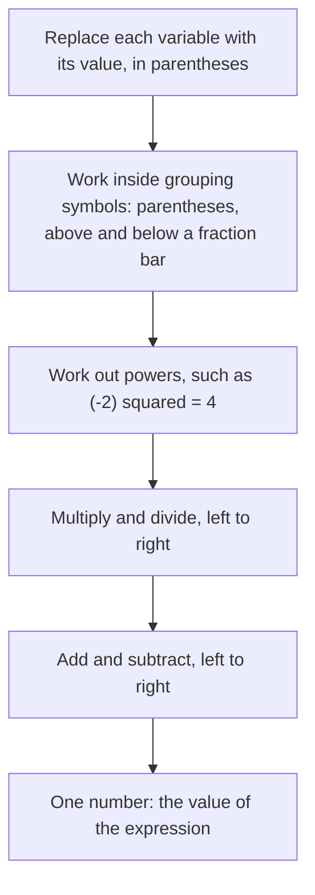

## From arithmetic to algebra

Everything so far has used specific numbers. Algebra starts when we let a letter stand for a number we don't know yet, or for any number at all. You have already seen this: the formulas $I = Prt$, $a \times 10^n$ and the exponent rules all used letters. This lesson makes the language precise: what variables and expressions are, how to evaluate an expression by substituting numbers, and how to translate English phrases into algebra.

## Variables and constants

A **variable** is a letter or symbol that represents a number. A **constant** is a quantity whose value doesn't change, like 7 or $\pi$. In the cost of $n$ movie tickets at \$12 each, $12n$, the 12 is a constant and $n$ is a variable: it varies with how many tickets are bought.

Conventions for writing multiplication with variables:

- $12n$ means $12 \times n$. A number written in front of a variable is multiplied by it.
- $ab$ means $a \times b$; $3xy$ means $3 \times x \times y$.
- $\dfrac{x}{4}$ means $x \div 4$.
- $1x$ is written $x$, and $-1x$ is written $-x$.
- Number first: write $5x$, not $x5$.

## Expressions and their parts

An **algebraic expression** is a combination of numbers, variables and operation symbols, like $3x^2 - 5x + 8$. It has no equals sign; an expression is a *name for a number*, not a statement. (An equation, coming in Lesson 25, says two expressions are equal.)

The parts of an expression separated by addition or subtraction are its **terms**. In $3x^2 - 5x + 8$:

| Term | Coefficient | Variable part |
|---|---|---|
| $3x^2$ | 3 | $x^2$ |
| $-5x$ | $-5$ | $x$ |
| $8$ | (constant term) | none |

The **coefficient** is the number multiplying the variable part. Notice the sign goes with the term: subtracting $5x$ is the same as adding $-5x$, so the coefficient is $-5$. A term with no variable is the constant term. (Lesson 22 also used "coefficient" for the number in front of a power of 10; it's the same idea.)

The picture labels each part of $3x^2 - 5x + 8$.

## Evaluating expressions

To **evaluate** an expression, **substitute** (replace) each variable with its given value and then follow the order of operations. Put each substituted value in parentheses, especially negatives; it prevents sign errors.

The steps always come in the same order:

### Example 1

Evaluate $3x^2 - 5x + 8$ when $x = -2$.

Substitute with parentheses: $3(-2)^2 - 5(-2) + 8$.

- Exponent first: $(-2)^2 = 4$, so $3(4) = 12$.
- Multiply: $-5(-2) = 10$.
- Add: $12 + 10 + 8 = 30$.

Without parentheses you might write $3 \cdot -2^2$, which reads as $-12$, and get the wrong answer.

### Example 2

Evaluate $\dfrac{a + 2b}{a - b}$ when $a = 7$ and $b = -1$.

Numerator: $7 + 2(-1) = 7 - 2 = 5$. Denominator: $7 - (-1) = 8$. Value: $\dfrac58$.

### Example 3

The formula $F = \tfrac95 C + 32$ converts a Celsius temperature $C$ to Fahrenheit. Convert $C = 25$.

$F = \tfrac95(25) + 32 = 45 + 32 = 77$. So 25 °C is 77 °F.

Formulas are expressions with a name attached; evaluating a formula is evaluating an expression.

## Translating words into algebra

Word problems become algebra by translating phrases into expressions. The vocabulary from Lesson 2 carries over.

| Words | Expression |
|---|---|
| 7 more than a number | $n + 7$ |
| a number increased by 4 | $n + 4$ |
| 9 less than a number | $n - 9$ |
| a number decreased by 2 | $n - 2$ |
| 5 subtracted from a number | $n - 5$ |
| the difference of a number and 3 | $n - 3$ |
| twice a number | $2n$ |
| the product of 6 and a number | $6n$ |
| a number divided by 8; the quotient of a number and 8 | $\dfrac{n}{8}$ |
| half a number | $\dfrac{n}{2}$ or $\tfrac12 n$ |
| the square of a number | $n^2$ |
| 3 times the sum of a number and 1 | $3(n + 1)$ |
| the sum of 3 times a number and 1 | $3n + 1$ |

Watch the order in subtraction phrases. "9 less than a number" starts with the number and takes 9 away: $n - 9$, *not* $9 - n$. "Less than" and "subtracted from" reverse the order in which the words appear.

Watch grouping too. "Three times the sum of a number and 1" multiplies the whole sum, so it needs parentheses: $3(n + 1)$. "The sum of three times a number and 1" multiplies only the number: $3n + 1$.

### Example 4

Write an expression: "the cost of renting a car for $d$ days at \$45 per day plus a \$30 fee."

Per-day cost: $45d$. Add the fee: $45d + 30$. For a 4-day rental, evaluate: $45(4) + 30 = 210$ dollars.

### Example 5

Let $w$ be the width of a rectangle. Its length is 3 less than twice the width. Write expressions for the length and the perimeter.

Length: "twice the width" is $2w$, and "3 less than" that is $2w - 3$. Perimeter: $2(\text{length}) + 2(\text{width}) = 2(2w - 3) + 2w$. (The next lesson shows how to simplify this to $6w - 6$.)

## Common mistakes

- *Substituting without parentheses:* with $x = -3$, $x^2$ is $(-3)^2 = 9$, not $-9$.
- *Reversing "less than":* "4 less than $y$" is $y - 4$.
- *Dropping grouping:* "twice the sum of $a$ and $b$" is $2(a + b)$, not $2a + b$.
- *Reading $3x$ as 3 plus x.* A number next to a variable means multiply: if $x = 5$, $3x = 15$, not 35.
- *Losing the sign of a coefficient:* in $4 - 7y$, the coefficient of $y$ is $-7$.

## Key points

- A variable stands for a number; an expression combines numbers, variables and operations, with no equals sign.
- Terms are separated by + and −; a term's coefficient is its numerical factor, sign included.
- Evaluate by substituting values in parentheses, then using the order of operations.
- Translate carefully: "less than" and "subtracted from" reverse order; "the sum of… times" needs parentheses.
