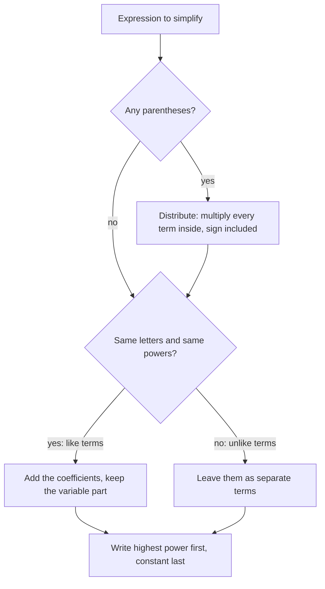

## Making expressions simpler

The last lesson ended with the perimeter $2(2w - 3) + 2w$. It's correct, but clumsy: every time you evaluate it you do five operations. The simpler equivalent expression $6w - 6$ needs only two. Two tools do almost all simplifying in algebra: the **distributive property**, which removes parentheses, and *combining like terms*, which merges terms that are really the same kind of thing. Both are essential for solving equations in the next lessons.

## The distributive property

$$a(b + c) = ab + ac \qquad\text{and}\qquad a(b - c) = ab - ac$$

Multiplying a sum by a number is the same as multiplying each part of the sum and then adding. You've used this already: in Lesson 2, $47 \times 36 = 47 \times 30 + 47 \times 6$.

*Why it's true:* $3(4 + 2)$ means three groups of $(4 + 2)$. Picture three rows, each with 4 red and 2 blue counters. Counting all the red ones gives $3 \times 4$ and all the blue ones $3 \times 2$, so the total is $3 \times 4 + 3 \times 2$. As areas: a rectangle of width 3 and length $4 + 2$ splits into a $3 \times 4$ rectangle and a $3 \times 2$ rectangle.

```shape
{"polygons": [{"points": [[0, 0], [4, 0], [4, 3], [0, 3]], "fill": true}, {"points": [[4, 0], [6, 0], [6, 3], [4, 3]]}], "labels": [{"at": [2, 1.5], "text": "3 × 4"}, {"at": [5, 1.5], "text": "3 × 2"}], "segments": [{"from": [0, 3.4], "to": [4, 3.4], "label": "4"}, {"from": [4, 3.4], "to": [6, 3.4], "label": "2"}, {"from": [-0.4, 0], "to": [-0.4, 3], "label": "3"}], "caption": "3(4 + 2) = 3 × 4 + 3 × 2"}
```

With variables it works the same way, and it's how you remove parentheses:

- $5(x + 3) = 5x + 15$
- $-2(4y - 7) = -8y + 14$ (the $-2$ multiplies *both* terms; $(-2)(-7) = +14$)
- $(3a + 1)4 = 12a + 4$
- $-(x - 6) = -x + 6$ (a minus sign in front means multiply by $-1$, which changes every sign inside)

The arrows show the $-2$ multiplying each term inside the parentheses:


## Like terms

**Like terms** have exactly the same variable part: the same variables raised to the same powers. Only the coefficients may differ.

| Like terms | Not like terms |
|---|---|
| $4x$ and $-9x$ | $4x$ and $4x^2$ (different powers) |
| $3ab$ and $ab$ | $3ab$ and $3a$ (different variables) |
| $7$ and $-2$ (constants) | $7$ and $7y$ |
| $x^2$ and $5x^2$ | $x^2$ and $2x$ |

To **combine like terms**, add or subtract their coefficients and keep the variable part:

$$4x + 9x = 13x, \qquad 6y^2 - y^2 = 5y^2, \qquad 3ab - 8ab = -5ab$$

*Why it's allowed:* it's the distributive property used backward. $4x + 9x = (4 + 9)x = 13x$. Four $x$'s plus nine $x$'s is thirteen $x$'s, just as 4 apples plus 9 apples is 13 apples. Unlike terms can't combine for the same reason that 4 apples plus 9 oranges isn't 13 of anything: $4x + 9x^2$ stays as it is.

## Simplifying step by step

1. Use the distributive property to remove parentheses.
2. Rearrange (mentally or on paper) so like terms are together, keeping each term's sign.
3. Combine like terms.
4. Write the result with the highest power first and the constant last (a convention, not a rule).

The same procedure as a flowchart:



### Example 1

Simplify $7x - 4 + 2x^2 - 3x + 10 - x^2$.

Group like terms with their signs: $(2x^2 - x^2) + (7x - 3x) + (-4 + 10)$.

Combine: $x^2 + 4x + 6$.

### Example 2

Simplify $2(2w - 3) + 2w$ (the perimeter from the last lesson).

Distribute: $4w - 6 + 2w$. Combine the $w$ terms: $6w - 6$.

Check by evaluating both at, say, $w = 5$: $2(2 \cdot 5 - 3) + 2 \cdot 5 = 14 + 10 = 24$, and $6(5) - 6 = 24$. ✓ Equivalent expressions give the same value for every value of the variable, so a spot check like this catches most mistakes.

### Example 3

Simplify $5(a - 2b) - 3(2a - b)$.

Distribute each part, watching signs: $5a - 10b - 6a + 3b$. (The $-3$ multiplies $-b$ to give $+3b$.)

Combine: $(5a - 6a) + (-10b + 3b) = -a - 7b$.

### Example 4

Simplify $8 - (3x - 5) + 4(x + 1)$.

Distribute: $8 - 3x + 5 + 4x + 4$. Combine: $x + 17$.

The most common error here is writing $8 - 3x - 5$, forgetting that the minus sign in front of the parentheses changes the sign of $-5$ too.

## Factoring out a common factor

The distributive property also runs in reverse: $6x + 15 = 3(2x + 5)$, pulling out the GCF of the terms. This is called **factoring**. It uses the GCF from Lesson 5, and in algebra courses it becomes a major skill. For now, practice spotting it: $12y - 8 = 4(3y - 2)$, since 4 is the GCF of 12 and 8.

## Common mistakes

- *Distributing to only the first term:* $3(x + 4) = 3x + 12$, not $3x + 4$.
- *Dropping a sign when distributing a negative:* $-2(x - 5) = -2x + 10$.
- *Combining unlike terms:* $3x + 2y$ and $x^2 + x$ can't be simplified further.
- *Adding exponents when combining:* $5x^2 + 3x^2 = 8x^2$, not $8x^4$. Combining adds coefficients only.
- *Forgetting a coefficient of 1:* $x + 6x = 7x$, since $x$ means $1x$.

## Key points

- Distributive property: $a(b + c) = ab + ac$; a negative multiplier changes every sign inside.
- Like terms have identical variable parts; combine them by adding coefficients.
- Simplify by distributing, then combining like terms.
- Check by evaluating the original and the simplified expression at the same value.
- Factoring pulls out a common factor: $ab + ac = a(b + c)$.
