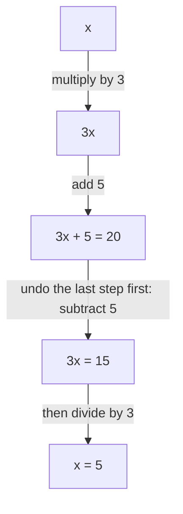

## What it means to solve

An expression names a number; an **equation** says that two expressions name the same number, like $3x + 5 = 20$. A **solution** of an equation is a value of the variable that makes it true. Here $x = 5$ is a solution, because $3(5) + 5 = 20$, and $x = 4$ isn't, because $3(4) + 5 = 17 \ne 20$. To **solve** an equation means to find all its solutions. You did a version of this with proportions in Lesson 16. This lesson builds a systematic method that will carry you through every equation in algebra.

## Checking a solution

Before learning to solve, learn to check: substitute the value into both sides and see whether they match. A check takes seconds and catches nearly every arithmetic slip.

Is $y = -3$ a solution of $4 - 2y = 10$? Left side: $4 - 2(-3) = 4 + 6 = 10$. Right side: 10. Yes.

## The balance idea

Think of an equation as a balanced scale. Whatever you do to one side, you must do to the other to keep it balanced. This gives the **properties of equality**:

- **Addition property of equality**: adding the same number to both sides gives an equivalent equation.
- **Subtraction property of equality**: subtracting the same number from both sides gives an equivalent equation.
- **Multiplication property of equality**: multiplying both sides by the same nonzero number gives an equivalent equation.
- **Division property of equality**: dividing both sides by the same nonzero number gives an equivalent equation.

The picture shows $3x + 5 = 20$ as a balance: three boxes of unknown weight $x$ and 5 unit cubes on the left, 20 unit cubes on the right. Taking 5 cubes off each pan keeps it level and leaves $3x = 15$; splitting each side into three equal groups leaves one box balancing 5 cubes, so $x = 5$.

**Equivalent equations** have the same solutions. The strategy is to keep transforming the equation into simpler equivalent ones until it says $x = \text{(a number)}$. To get the variable alone (to **isolate** it), undo whatever has been done to it using **inverse operations**: addition and subtraction undo each other, and multiplication and division undo each other.

## One-step equations

### Example 1

Solve $x - 8 = -3$.

8 is subtracted from $x$; undo it by adding 8 to both sides:

$$x - 8 + 8 = -3 + 8 \quad\Rightarrow\quad x = 5.$$

Check: $5 - 8 = -3$. ✓

### Example 2

Solve $-6n = 42$.

$n$ is multiplied by $-6$; divide both sides by $-6$:

$$\frac{-6n}{-6} = \frac{42}{-6} \quad\Rightarrow\quad n = -7.$$

Check: $-6(-7) = 42$. ✓

### Example 3

Solve $\dfrac{k}{4} = 2.5$.

$k$ is divided by 4; multiply both sides by 4: $k = 10$. Check: $\tfrac{10}{4} = 2.5$. ✓

### Example 4

Solve $\dfrac{2}{3}m = 14$.

$m$ is multiplied by $\tfrac23$. Multiply both sides by the reciprocal, $\tfrac32$ (that's the same as dividing by $\tfrac23$):

$$\frac32 \cdot \frac23 m = \frac32 \cdot 14 \quad\Rightarrow\quad m = 21.$$

Check: $\tfrac23 \times 21 = 14$. ✓

## Two-step equations

When two operations have been done to the variable, undo them in the *reverse order* of the order of operations: first undo addition or subtraction, then multiplication or division. Think of getting dressed: socks then shoes; to undress, shoes come off first.

The diagram builds $3x + 5$ from $x$, then undoes it step by step (Example 5 below):

### Example 5

Solve $3x + 5 = 20$.

Read what happens to $x$: multiply by 3, then add 5. Undo in reverse:

- Subtract 5 from both sides: $3x = 15$.
- Divide both sides by 3: $x = 5$.

Check: $3(5) + 5 = 20$. ✓

### Example 6

Solve $7 - 4y = 27$.

It helps to see this as $-4y + 7 = 27$: $y$ is multiplied by $-4$, then 7 is added.

- Subtract 7: $-4y = 20$.
- Divide by $-4$: $y = -5$.

Check: $7 - 4(-5) = 7 + 20 = 27$. ✓ The usual mistake is dividing by 4 instead of $-4$; the coefficient of $y$ is $-4$.

### Example 7

Solve $\dfrac{x}{5} - 3 = 1$.

- Add 3: $\dfrac{x}{5} = 4$.
- Multiply by 5: $x = 20$.

Check: $\tfrac{20}{5} - 3 = 1$. ✓

### Example 8

Solve $\dfrac{x - 3}{5} = 1$.

This is different from Example 7: here 3 is subtracted *first*, then the result is divided by 5. Reverse order:

- Multiply by 5: $x - 3 = 5$.
- Add 3: $x = 8$.

Check: $\tfrac{8 - 3}{5} = 1$. ✓

## Equations from word problems

### Example 9

A gym charges a \$25 sign-up fee plus \$30 per month. Lee has paid \$235 in total. How many months has he been a member?

Let $m$ be the number of months. Total paid: $30m + 25 = 235$.

- Subtract 25: $30m = 210$.
- Divide by 30: $m = 7$.

Lee has been a member for 7 months. Check: $30 \times 7 + 25 = 235$. ✓

Writing "let $m$ be…" is a good habit: it says exactly what the variable means, so the answer can be stated in words with units.

## Common mistakes

- *Doing something to only one side.* Every step applies to both sides.
- *Dividing only part of a side:* in $3x + 5 = 20$, dividing just the $3x$ by 3 to get $x + 5 = 20$ is wrong. Subtract 5 first; if you divide first, every term must be divided.
- *Losing the sign of the coefficient:* in $-4y = 20$, divide by $-4$, not 4.
- *Subtracting instead of adding* to undo subtraction: from $x - 8 = -3$, subtracting 8 gives $x - 16 = -11$, which goes the wrong way.
- *Skipping the check.*

## Key points

- A solution makes the equation true; check by substituting into both sides.
- Properties of equality: add, subtract, multiply or divide both sides by the same number (not dividing by zero).
- Isolate the variable with inverse operations.
- For two steps, undo addition/subtraction first, then multiplication/division.
- Divide by the coefficient including its sign; multiply by the reciprocal of a fractional coefficient.
