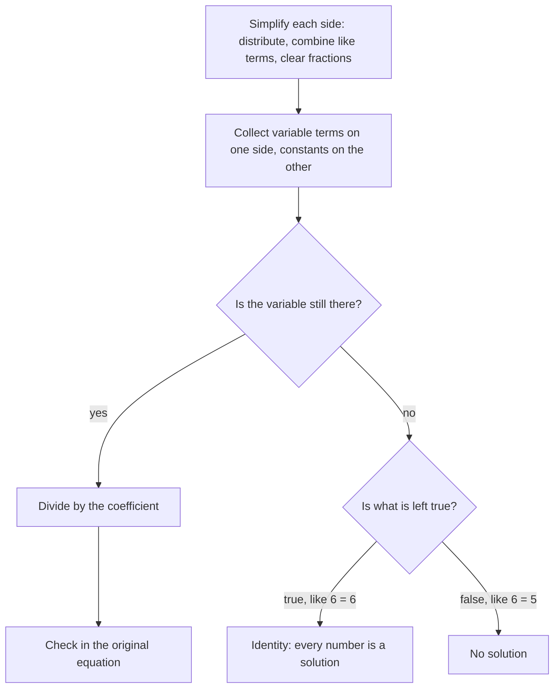

## Putting the tools together

Real equations rarely arrive in the tidy form $ax + b = c$. They have parentheses, variables on both sides, and fractions. This lesson combines the simplifying tools from Lesson 24 with the solving steps from Lesson 25 into one general method, then applies it to word problems, which is where equations earn their keep.

## A general strategy

1. *Simplify each side* separately: distribute to remove parentheses, then combine like terms.
2. *Collect the variable terms on one side* by adding or subtracting a variable term on both sides.
3. *Collect the constants on the other side.*
4. *Divide* by the coefficient of the variable.
5. *Check* in the *original* equation.

The flowchart shows the same strategy, including what to do if the variable disappears (see Special cases below):



## Parentheses

### Example 1

Solve $4(x - 3) + 2x = 18$.

- Distribute: $4x - 12 + 2x = 18$.
- Combine like terms: $6x - 12 = 18$.
- Add 12: $6x = 30$.
- Divide by 6: $x = 5$.

Check: $4(5 - 3) + 2(5) = 8 + 10 = 18$. ✓

## Variables on both sides

When the variable appears on both sides, move all the variable terms to one side. It's usually easiest to move them to the side with the larger coefficient, which keeps the coefficient positive, but any choice works.

### Example 2

Solve $7x - 5 = 3x + 11$.

- Subtract $3x$ from both sides: $4x - 5 = 11$.
- Add 5: $4x = 16$.
- Divide by 4: $x = 4$.

Check: left $7(4) - 5 = 23$; right $3(4) + 11 = 23$. ✓

### Example 3

Solve $2(3y + 1) = 5y - 2(y - 7)$.

- Distribute both sides: $6y + 2 = 5y - 2y + 14$.
- Combine on the right: $6y + 2 = 3y + 14$.
- Subtract $3y$: $3y + 2 = 14$.
- Subtract 2: $3y = 12$, so $y = 4$.

Check: left $2(13) = 26$; right $20 - 2(-3) = 26$. ✓

## Fractions in equations

If an equation has fractions, you can *clear them* by multiplying every term on both sides by the LCD of the denominators. This turns it into an equation with whole-number coefficients.

### Example 4

Solve $\dfrac{x}{3} + \dfrac{1}{2} = \dfrac{5}{6}$.

The LCD of 3, 2 and 6 is 6. Multiply every term by 6:

$$6 \cdot \frac{x}{3} + 6 \cdot \frac12 = 6 \cdot \frac56 \quad\Rightarrow\quad 2x + 3 = 5.$$

Then $2x = 2$ and $x = 1$. Check: $\tfrac13 + \tfrac12 = \tfrac26 + \tfrac36 = \tfrac56$. ✓

Decimals can be cleared the same way: multiply $0.4x + 1.2 = 3$ by 10 to get $4x + 12 = 30$, so $x = 4.5$.

## Special cases

Sometimes the variable disappears.

- $2(x + 3) = 2x + 6$ simplifies to $2x + 6 = 2x + 6$, and subtracting $2x$ leaves $6 = 6$, which is always true. Every number is a solution; the equation is an **identity**.
- $2(x + 3) = 2x + 5$ leaves $6 = 5$, which is never true. The equation has **no solution**.

## Solving a formula for a variable

The same steps work on a formula with several letters. To solve $d = rt$ for $t$, treat $r$ like a number multiplying $t$ and divide both sides by it: $t = \dfrac{d}{r}$ (for $r \ne 0$). To solve the perimeter formula $P = 2l + 2w$ for $w$, subtract $2l$ from both sides, giving $P - 2l = 2w$, then divide by 2: $w = \dfrac{P - 2l}{2}$. Rewriting a formula this way is useful when you need the same unknown many times, such as the width of several rectangles with known perimeters and lengths. In Lesson 29 you will solve equations like $2x + 3y = 12$ for $y$ in exactly this way.

## Word problems

A reliable process:

1. *Read* the problem and identify what you're asked to find.
2. *Define a variable* for the unknown ("let $n$ = …"). If there are other unknowns, write them in terms of the same variable.
3. *Write an equation* that says the same thing as the problem.
4. *Solve* it.
5. *Answer* the question in a sentence with units, and check that it makes sense in the story.

The next lesson applies this process to a family of money problems: coins, tickets and mixtures.

### Example 5 (number problem)

Three times a number, decreased by 7, equals the number increased by 9. Find the number.

Let $n$ be the number. "Three times a number, decreased by 7" is $3n - 7$; "the number increased by 9" is $n + 9$.

$3n - 7 = n + 9$, so $2n = 16$ and $n = 8$. Check: $3(8) - 7 = 17$ and $8 + 9 = 17$. ✓

### Example 6 (consecutive integers)

The sum of three consecutive integers is 72. Find them.

Consecutive integers each differ by 1. Let the smallest be $n$; the others are $n + 1$ and $n + 2$.

$n + (n + 1) + (n + 2) = 72 \Rightarrow 3n + 3 = 72 \Rightarrow 3n = 69 \Rightarrow n = 23$.

The integers are 23, 24 and 25. Check: $23 + 24 + 25 = 72$. ✓

### Example 7 (comparing plans)

Plan A charges \$40 per month plus \$0.10 per minute. Plan B charges \$25 per month plus \$0.25 per minute. For how many minutes do the plans cost the same?

Let $m$ be the minutes. Cost A: $40 + 0.10m$. Cost B: $25 + 0.25m$. Set them equal:

$40 + 0.10m = 25 + 0.25m$. Subtract $0.10m$: $40 = 25 + 0.15m$. Subtract 25: $15 = 0.15m$. Divide: $m = 100$.

At 100 minutes both cost \$50. (Fewer minutes favor Plan B; more favor Plan A.)

### Example 8 (perimeter)

A rectangle's length is 4 cm more than twice its width, and its perimeter is 56 cm. Find its dimensions.

Let $w$ be the width; the length is $2w + 4$. Perimeter: $2w + 2(2w + 4) = 56$.

Simplify: $2w + 4w + 8 = 56 \Rightarrow 6w = 48 \Rightarrow w = 8$. The length is $2(8) + 4 = 20$.

The rectangle is 8 cm by 20 cm. Check: $2(8) + 2(20) = 56$. ✓

```shape
{"polygons": [{"points": [[0, 0], [20, 0], [20, 8], [0, 8]], "fill": true}], "segments": [{"from": [0, -1.2], "to": [20, -1.2], "label": "length 2w + 4 = 20 cm"}, {"from": [-1.2, 0], "to": [-1.2, 8]}], "labels": [{"at": [-4.6, 4], "text": "w = 8 cm"}], "caption": "Example 8: width w = 8 cm, length 2w + 4 = 20 cm, perimeter 56 cm"}
```

## Common mistakes

- *Not distributing to every term* inside parentheses, especially with a negative in front.
- *Moving a term without changing its sign.* Subtracting $3x$ from both sides of $7x - 5 = 3x + 11$ removes $3x$ from the right and *subtracts* it on the left.
- *Multiplying only some terms* when clearing fractions. Every term on both sides gets multiplied.
- *Checking in a simplified equation* instead of the original, which can hide a distribution error.
- *Answering the wrong question:* in Example 8 the problem asks for both dimensions, not just $w$.

## Key points

- Simplify each side, collect variable terms on one side and constants on the other, then divide.
- Clear fractions by multiplying every term by the LCD.
- If the variable vanishes, a true statement means every number works; a false one means no solution.
- Solve a formula for one of its letters with the same inverse operations, treating the other letters as numbers.
- For word problems: define the variable, write the equation, solve, answer in words, check.
