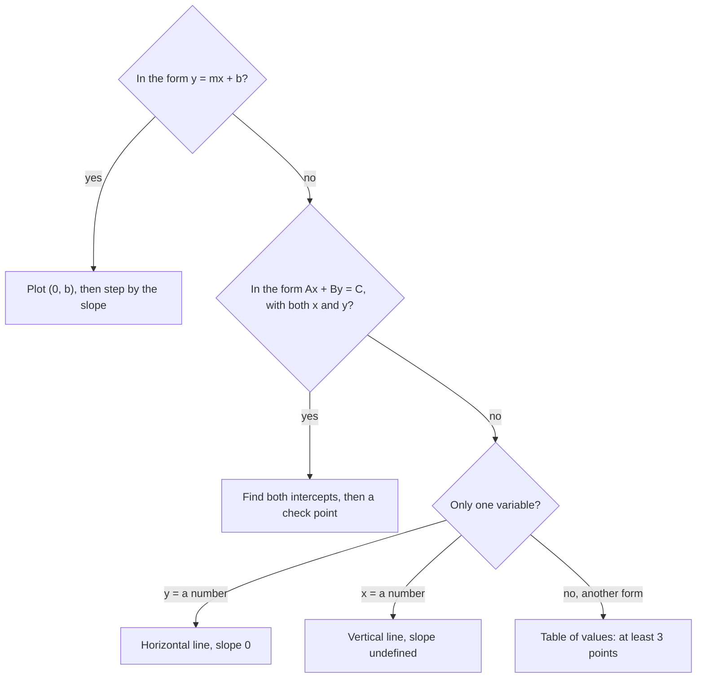

## From a number line to a plane

In Lesson 28 you graphed inequalities in one variable on a number line. An equation with *two* variables, such as $y = 2x - 1$, needs more room: each solution is a pair of numbers, one for $x$ and one for $y$, so it takes two directions to show it. This lesson builds the grid that does that, then shows how equations like $y = 2x - 1$ draw straight lines on it, and how to read a line's steepness and starting point straight from its equation.

## The coordinate plane

The **coordinate plane** is made from two number lines that cross at right angles at their zeros. The horizontal one is the **x-axis**, the vertical one is the **y-axis**, and the point where they cross is the **origin**.

Every point is named by an **ordered pair** $(x, y)$. To plot $(3, -2)$, start at the origin, move 3 units right (the $x$-coordinate), then 2 units down (the $y$-coordinate). Negative $x$ means left; negative $y$ means down. The order matters: $(3, -2)$ and $(-2, 3)$ are different points.

The axes cut the plane into four **quadrants**, numbered I to IV counterclockwise starting from the upper right:

| Quadrant | Signs of $(x, y)$ | Example |
|---|---|---|
| I | $(+, +)$ | $(2, 4)$ |
| II | $(-, +)$ | $(-3, 1)$ |
| III | $(-, -)$ | $(-1, -3)$ |
| IV | $(+, -)$ | $(3, -2)$ |

A point on an axis is in no quadrant. Points on the $x$-axis have $y = 0$, like $(5, 0)$; points on the $y$-axis have $x = 0$, like $(0, -4)$.

```plot
{"x": [-5, 5], "y": [-5, 5], "equal": true, "points": [{"at": [2, 4], "label": "(2, 4)"}, {"at": [-3, 1], "label": "(-3, 1)"}, {"at": [-1, -3], "label": "(-1, -3)"}, {"at": [3, -2], "label": "(3, -2)"}], "labels": [{"at": [4, 4.5], "text": "I"}, {"at": [-4, 4.5], "text": "II"}, {"at": [-4, -4.5], "text": "III"}, {"at": [4, -4.5], "text": "IV"}], "caption": "One point in each quadrant"}
```

## Solutions are points

A solution of an equation in two variables is an ordered pair that makes it true. For $y = 2x - 1$, the pair $(3, 5)$ is a solution because $2(3) - 1 = 5$; the pair $(5, 3)$ is not, because $2(5) - 1 = 9 \ne 3$. There are infinitely many solutions: pick any $x$, and the equation tells you the matching $y$. Plotting them all gives the equation's **graph**.

An equation whose graph is a straight line is a **linear equation**. In this course that means $x$ and $y$ appear only to the first power and are never multiplied together: $y = 2x - 1$ and $2x + 3y = 12$ are linear; $y = x^2$ is not.

### Example 1

Graph $y = 2x - 1$ by making a table of values.

Choose a few easy $x$-values, including a negative one and 0, and compute each $y$:

| $x$ | $y = 2x - 1$ | point |
|---|---|---|
| $-1$ | $2(-1) - 1 = -3$ | $(-1, -3)$ |
| 0 | $2(0) - 1 = -1$ | $(0, -1)$ |
| 1 | $2(1) - 1 = 1$ | $(1, 1)$ |
| 2 | $2(2) - 1 = 3$ | $(2, 3)$ |
| 3 | $2(3) - 1 = 5$ | $(3, 5)$ |

Plot the points; they line up. Draw the line through them with arrows on both ends, since the solutions continue forever.

```plot
{"x": [-3, 5], "y": [-5, 7], "equal": true, "functions": [{"f": "2x - 1", "label": "y = 2x - 1"}], "points": [{"at": [-1, -3]}, {"at": [0, -1]}, {"at": [1, 1]}, {"at": [2, 3]}, {"at": [3, 5], "label": "(3, 5)"}], "caption": "The points from the table lie on one straight line"}
```

Two points determine a line, but plot at least three: if one lands off the line, you've made an arithmetic slip.

## Intercepts

The places where a line crosses the axes are especially useful.

- The **x-intercept** is where the line crosses the $x$-axis. There $y = 0$, so set $y = 0$ and solve for $x$.
- The **y-intercept** is where the line crosses the $y$-axis. There $x = 0$, so set $x = 0$ and solve for $y$.

Intercepts give a fast way to graph an equation written like $2x + 3y = 12$, where making a table would mean solving for $y$ each time.

The picture puts the names from this lesson together on one graph, the line $3x + 4y = 12$, whose intercepts are $(4, 0)$ and $(0, 3)$.


### Example 2

Find the intercepts of $2x + 3y = 12$ and graph the line.

- $x$-intercept: set $y = 0$. Then $2x = 12$, so $x = 6$. The point is $(6, 0)$.
- $y$-intercept: set $x = 0$. Then $3y = 12$, so $y = 4$. The point is $(0, 4)$.

Check with a third point: $x = 3$ gives $6 + 3y = 12$, so $y = 2$, and $(3, 2)$ should be on the same line.

```plot
{"x": [-2, 8], "y": [-2, 6], "equal": true, "functions": [{"f": "4 - 2x/3", "label": "2x + 3y = 12"}], "points": [{"at": [6, 0], "label": "(6, 0)"}, {"at": [0, 4], "label": "(0, 4)"}, {"at": [3, 2], "label": "(3, 2)"}], "caption": "The intercepts (6, 0) and (0, 4), with the check point (3, 2)"}
```

## Slope: rise over run

Lines differ in steepness. The **slope** of a line measures it: how much $y$ changes for each step in $x$. Between two points on the line,

$$\text{slope} = m = \frac{\text{rise}}{\text{run}} = \frac{\text{change in } y}{\text{change in } x} = \frac{y_2 - y_1}{x_2 - x_1}.$$

The letter $m$ is the usual name for slope. Because a line is straight, it rises at the same rate everywhere, so *any* two points on it give the same slope. In Example 1, going from $(0, -1)$ to $(3, 5)$ rises 6 while running 3, so $m = \tfrac63 = 2$; from $(1, 1)$ to $(2, 3)$ it rises 2 and runs 1, again $m = 2$.

The sign of the slope tells the direction:

- *positive slope*: the line rises from left to right;
- *negative slope*: it falls from left to right;
- *zero slope*: it is horizontal (no rise), like $y = 3$;
- a vertical line, like $x = -2$, has no run, and dividing by 0 is undefined, so its slope is *undefined*.

### Example 3

Find the slope of the line through $(-2, 5)$ and $(4, 1)$.

Subtract in the same order on top and bottom (second point minus first):

$$m = \frac{1 - 5}{4 - (-2)} = \frac{-4}{6} = -\frac{2}{3}.$$

The slope is negative, so the line falls: for every 3 units to the right, it drops 2. Subtracting in the other order gives $\tfrac{5 - 1}{-2 - 4} = \tfrac{4}{-6}$, the same $-\tfrac23$, so either order works as long as top and bottom match.

```plot
{"x": [-4, 6], "y": [-2, 7], "equal": true, "functions": [{"f": "11/3 - 2x/3"}], "points": [{"at": [-2, 5], "label": "(-2, 5)"}, {"at": [4, 1], "label": "(4, 1)"}], "segments": [{"from": [-2, 5], "to": [4, 5], "dashed": true, "label": "run 6"}, {"from": [4, 5], "to": [4, 1], "dashed": true, "label": "rise -4"}], "caption": "Run 6, rise -4: slope -4/6 = -2/3"}
```

## Slope-intercept form: y = mx + b

Look again at $y = 2x - 1$. Its slope is 2 and its $y$-intercept is $-1$, and both numbers are sitting in the equation. That is no coincidence. In any equation

$$y = mx + b,$$

setting $x = 0$ gives $y = b$, so the line crosses the $y$-axis at $(0, b)$. And each time $x$ increases by 1, $mx$ increases by $m$, so $y$ rises by $m$: the slope is $m$. This is called **slope-intercept form**. It lets you graph a line without a table: plot $(0, b)$, then use the slope to step to a second point.

### Example 4

Graph $y = \tfrac34 x - 2$.

- The $y$-intercept is $b = -2$: plot $(0, -2)$.
- The slope is $m = \tfrac34$: from $(0, -2)$ run 4 to the right and rise 3, landing on $(4, 1)$.
- Do it again to reach $(8, 4)$, or go backward (left 4, down 3) to $(-4, -5)$. Draw the line through the points.

Check $(4, 1)$: $\tfrac34(4) - 2 = 3 - 2 = 1$. ✓

```plot
{"x": [-5, 9], "y": [-6, 5], "equal": true, "functions": [{"f": "3x/4 - 2", "label": "y = (3/4)x - 2"}], "points": [{"at": [0, -2], "label": "(0, -2)"}, {"at": [4, 1], "label": "(4, 1)"}], "segments": [{"from": [0, -2], "to": [4, -2], "dashed": true, "label": "run 4"}, {"from": [4, -2], "to": [4, 1], "dashed": true, "label": "rise 3"}], "caption": "Start at the y-intercept, then run 4 and rise 3"}
```

### Example 5

Find the slope and $y$-intercept of $2x + 3y = 12$.

The equation isn't in the form $y = mx + b$ yet, so solve it for $y$, as in Lesson 26:

- Subtract $2x$: $3y = -2x + 12$.
- Divide every term by 3: $y = -\tfrac23 x + 4$.

The slope is $-\tfrac23$ and the $y$-intercept is 4. This matches Example 2: from $(0, 4)$ to $(6, 0)$ the line drops 4 while running 6, a slope of $-\tfrac46 = -\tfrac23$.

### Slope in a story

In a real situation, the slope is a *rate* and the $y$-intercept is a *starting amount*. A taxi that charges \$4 to start plus \$2.50 per mile costs $y = 2.5x + 4$ dollars for $x$ miles. The slope 2.5 is dollars per mile, and the $y$-intercept 4 is the cost before the car moves.

## Horizontal and vertical lines

- $y = 3$ means $y$ is 3 no matter what $x$ is: a horizontal line through $(0, 3)$, slope 0. (It is $y = 0x + 3$.)
- $x = -2$ means $x$ is always $-2$: a vertical line through $(-2, 0)$, slope undefined. It can't be written as $y = mx + b$.

Which way to graph a line depends on the form of its equation:



## Common mistakes

- *Plotting $(x, y)$ backward*: the first number is always the move left or right.
- *Run over rise.* Slope is change in $y$ divided by change in $x$, not the reverse.
- *Mismatched subtraction*: $\tfrac{y_2 - y_1}{x_1 - x_2}$ flips the sign. Subtract in the same order on top and bottom.
- *Reading $m$ and $b$ from the wrong form.* In $2x + 3y = 12$ the slope is not 2 and the $y$-intercept is not 12; solve for $y$ first.
- *Mixing up the intercepts*: for the $x$-intercept, set $y = 0$ (not $x = 0$).
- *Calling a vertical line's slope 0.* Horizontal lines have slope 0; vertical lines have undefined slope.

## Key points

- A point is an ordered pair $(x, y)$: across first, then up or down. The quadrants I–IV go counterclockwise from the upper right.
- The graph of a linear equation is a straight line; make a table, plot at least three points, and connect them.
- $x$-intercept: set $y = 0$. $y$-intercept: set $x = 0$.
- Slope $m = \dfrac{\text{rise}}{\text{run}} = \dfrac{y_2 - y_1}{x_2 - x_1}$: positive rises, negative falls, 0 is horizontal, vertical is undefined.
- In $y = mx + b$, $m$ is the slope and $b$ is the $y$-intercept. Solve for $y$ to get this form.
