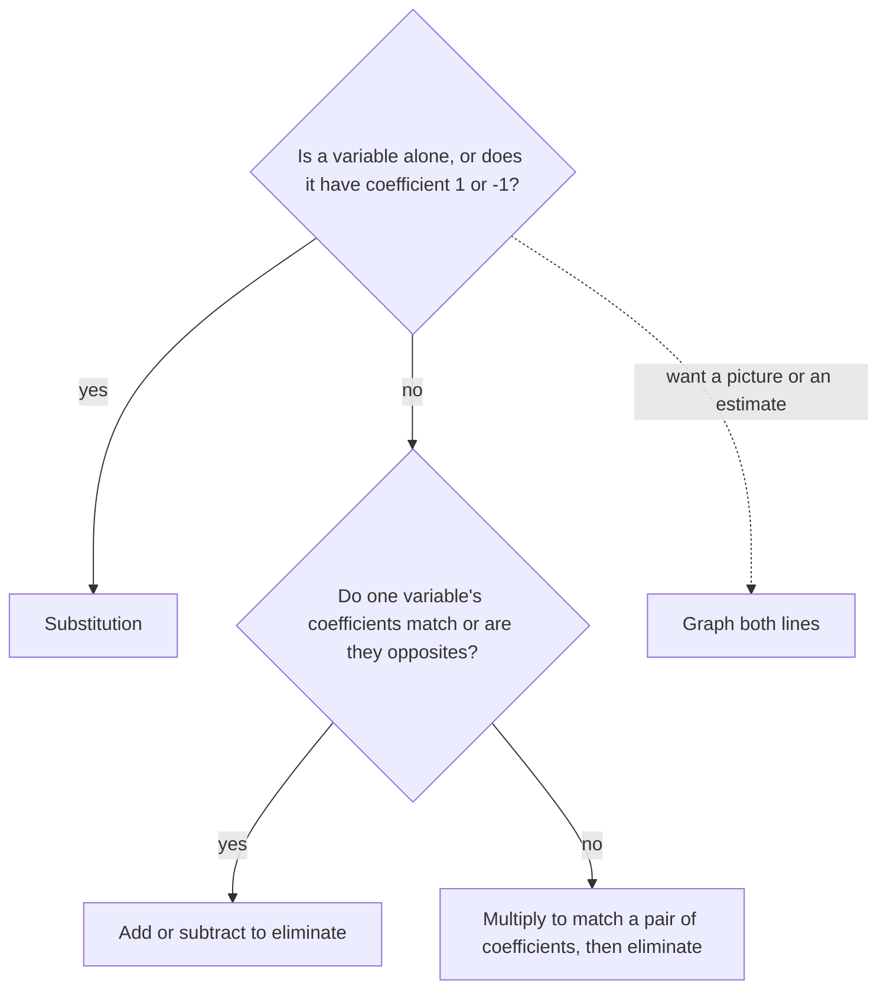

## Two unknowns, two facts

In Lesson 27 a jar held 30 dimes and quarters worth \$5.10. There were two unknowns, but we only knew how to solve equations with one, so we wrote the quarters as $30 - d$ and kept a single letter. In Lesson 29 you saw that an equation like $y = 2x - 1$ has infinitely many solutions, each one a point on a line. This honors lesson puts the two ideas together. With two unknowns you need two facts, and each fact is an equation whose graph is a line. The answer is the point the two lines share.

## Systems and their solutions

A **system of linear equations** is two (or more) linear equations about the same unknowns, considered together. A **solution of a system** is an ordered pair that makes *every* equation in it true at the same time. For example,

$$\begin{cases} x + y = 5 \\ 2x - y = 4 \end{cases}$$

has the solution $(3, 2)$: $3 + 2 = 5$ ✓ and $2(3) - 2 = 4$ ✓. The pair $(1, 4)$ fits the first equation but not the second ($2 - 4 = -2$), so it is not a solution of the system. Checking a pair always means checking it in *both* equations.

Each equation alone has a whole line of solutions. The system's solution must lie on both lines, so it is where they cross. That picture explains everything in this lesson.

## Solving by graphing

### Example 1

Solve by graphing: $y = 2x - 1$ and $y = -x + 5$.

Both equations are in slope-intercept form. The first line starts at $(0, -1)$ and rises 2 for each step right; the second starts at $(0, 5)$ and falls 1 for each step right. Drawn on one grid, they cross at $(2, 3)$.

```plot
{"x": [-2, 6], "y": [-3, 7], "equal": true, "functions": [{"f": "2x - 1", "label": "y = 2x - 1"}, {"f": "-x + 5", "label": "y = -x + 5", "dashed": true}], "points": [{"at": [2, 3], "label": "(2, 3)"}], "caption": "The lines cross at (2, 3), the solution of the system"}
```

Check: $2(2) - 1 = 3$ ✓ and $-2 + 5 = 3$ ✓.

Graphing shows the idea clearly, but it has a weakness: if the lines cross at $(\tfrac{7}{3}, -\tfrac{1}{2})$, no one can read that off a grid. The next two methods are algebra and give exact answers.

## The substitution method

In the **substitution method**, you solve one equation for one variable, then substitute that expression into the other equation. This leaves one equation with one unknown, which Lessons 25 and 26 taught you to solve.

### Example 2

Solve $y = 3x - 4$ and $2x + y = 11$.

The first equation already says what $y$ equals. Replace $y$ in the second equation by $(3x - 4)$:

$$2x + (3x - 4) = 11 \;\Rightarrow\; 5x - 4 = 11 \;\Rightarrow\; 5x = 15 \;\Rightarrow\; x = 3.$$

Now find $y$ from either equation; the one solved for $y$ is easiest: $y = 3(3) - 4 = 5$. The solution is $(3, 5)$.

Check in the equation you did *not* use for $y$: $2(3) + 5 = 11$ ✓.

### Example 3

Solve $x + 2y = 7$ and $3x - 4y = 1$.

Neither equation is solved for a variable, but $x$ in the first has coefficient 1, so solving for it creates no fractions: $x = 7 - 2y$. Substitute into the second:

$$3(7 - 2y) - 4y = 1 \;\Rightarrow\; 21 - 6y - 4y = 1 \;\Rightarrow\; -10y = -20 \;\Rightarrow\; y = 2.$$

Then $x = 7 - 2(2) = 3$. Solution: $(3, 2)$. Check: $3 + 4 = 7$ ✓ and $9 - 8 = 1$ ✓.

You have done this before without the name. The coin jar in Lesson 27 is the system $d + q = 30$ and $10d + 25q = 510$. Solving the first for $q$ gives $q = 30 - d$, and substituting gives $10d + 25(30 - d) = 510$, exactly the equation that lesson wrote.

## The elimination method

The **elimination method** adds or subtracts the equations so that one variable cancels. Why is that allowed? If $A = B$ and $C = D$, then $A + C = B + D$: adding equal amounts to equal amounts keeps them equal. It is the addition property of equality, with a whole equation as the "same amount" added to both sides.

### Example 4

Solve $3x + 2y = 16$ and $5x - 2y = 8$.

The $y$ terms are opposites, $+2y$ and $-2y$. Add the equations, left side to left side and right side to right side:

$$(3x + 2y) + (5x - 2y) = 16 + 8 \;\Rightarrow\; 8x = 24 \;\Rightarrow\; x = 3.$$

Substitute into the first equation: $9 + 2y = 16$, so $2y = 7$ and $y = 3.5$. Solution: $(3, 3.5)$. Check in the second: $15 - 7 = 8$ ✓. Notice that $y$ is not a whole number, which graphing could only have estimated.

### Example 5

Solve $2x + 3y = 12$ and $5x + 4y = 23$.

No variable cancels yet, so first *multiply* each equation by a number that makes one variable's coefficients match. To match the $x$ terms at 10, multiply the first equation by 5 and the second by 2 (every term, both sides):

$$10x + 15y = 60 \qquad 10x + 8y = 46.$$

Now subtract the second from the first: $7y = 14$, so $y = 2$. Back in the first original equation: $2x + 6 = 12$, so $x = 3$. Solution: $(3, 2)$. Check: $5(3) + 4(2) = 23$ ✓.

Subtracting an equation means subtracting *every* term: $15y - 8y = 7y$ and $60 - 46 = 14$. Many people prefer to multiply by a negative number instead (here, the second equation by $-2$) and then always add.

## One solution, none, or infinitely many

Two lines in a plane can meet in exactly three ways, so a system of two linear equations has exactly one of three outcomes.

| The lines | Slopes and intercepts | Solutions | What the algebra shows |
|---|---|---|---|
| cross | different slopes | exactly one | a single pair $(x, y)$ |
| are parallel | same slope, different intercepts | none | a false statement, like $0 = 7$ |
| are the same line | same slope, same intercept | infinitely many | a true statement, like $0 = 0$ |

These are the same "identity" and "no solution" outcomes as in Lesson 26, now with a picture behind them.

### Example 6

Solve $x + 2y = 4$ and $2x + 4y = 15$.

Multiply the first equation by 2: $2x + 4y = 8$. Subtract it from the second: $0 = 7$. Both variables vanished and what is left is false, so the system has *no solution*.

The graph explains why. Solving each equation for $y$ gives $y = -\tfrac12 x + 2$ and $y = -\tfrac12 x + 3.75$: the same slope, different $y$-intercepts. The lines are parallel and never meet.

```plot
{"x": [-4, 8], "y": [-2, 6], "equal": true, "functions": [{"f": "-x/2 + 2", "label": "x + 2y = 4"}, {"f": "-x/2 + 3.75", "label": "2x + 4y = 15", "dashed": true}], "caption": "Parallel lines: same slope -1/2, different intercepts, so no solution"}
```

If instead the second equation were $2x + 4y = 8$, the same steps would give $0 = 0$. That equation is just the first one doubled, so both describe the same line, and every point on it is a solution.

## Choosing a method

All three methods give the same answer when it exists; pick the one that makes the work shortest.



## A word problem with two variables

### Example 7

A café sold 50 baked goods in a morning: muffins at \$3 each and scones at \$4 each, for a total of \$172. How many of each did it sell?

Let $m$ be the muffins and $s$ the scones. Two facts give two equations:

$$m + s = 50 \qquad 3m + 4s = 172.$$

Elimination: multiply the first by 3 to get $3m + 3s = 150$, and subtract it from the second: $s = 22$. Then $m = 50 - 22 = 28$.

The café sold 28 muffins and 22 scones. Check: $28 + 22 = 50$ ✓ and $28(3) + 22(4) = 84 + 88 = 172$ ✓.

With two letters, each sentence of the story becomes its own equation, which many people find easier to set up than the one-variable version.

A historical note: methods very close to elimination appear in *The Nine Chapters on the Mathematical Art*, a Chinese text that reached its final form roughly 2,000 years ago. Its authors arranged the coefficients in columns of counting rods and combined columns to remove unknowns, the same idea used in this lesson. (The exact dating of the text is uncertain.)

## Common mistakes

- *Checking only one equation.* A pair can satisfy one equation and fail the other; check both.
- *Substituting into the equation you just solved.* Putting $x = 7 - 2y$ back into $x + 2y = 7$ gives $7 = 7$ and finds nothing. Substitute into the *other* equation.
- *Multiplying only one side, or only some terms*, before eliminating. Every term on both sides gets multiplied.
- *Sign slips when subtracting equations.* Subtracting $5x - 2y = 8$ from $3x + 2y = 16$ gives $-2x + 4y = 8$, not $-2x = 8$, because $2y - (-2y) = 4y$. Multiplying by a negative and adding avoids such slips.
- *Stopping after one variable.* The answer to a system is a pair; find the second value too.
- *Calling $0 = 0$ "no solution."* A true statement means infinitely many solutions; a false one means none.

## Key points

- A solution of a system makes every equation true; graphically it is where the lines cross.
- Substitution: solve one equation for a variable, substitute into the other, solve, then back-substitute.
- Elimination: multiply if needed so one variable's coefficients match or are opposites, then add or subtract the equations.
- Crossing lines give one solution; parallel lines give none ($0 = 7$); the same line gives infinitely many ($0 = 0$).
- In word problems, write one equation for each fact, then answer with both values and check them in the story.
