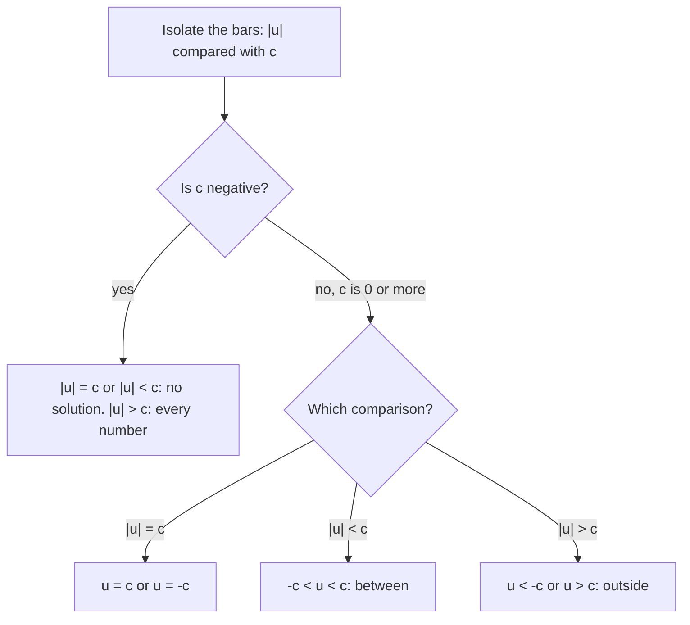

## Distance, again

Lesson 6 defined the absolute value $|a|$ as the distance from $a$ to 0 on the number line, so $|5| = 5$ and $|-5| = 5$. Lesson 28 solved inequalities and, at the end, graphed one statement with two parts, $-1 \le x < 3$. This honors lesson joins those threads. Equations and inequalities with absolute value in them turn out to be statements about *distance*, and their solutions are often two numbers or two pieces of the number line, which is exactly what compound inequalities describe. (If you did the honors lesson after Lesson 8, you have already solved $|x - a| = d$ by walking $d$ units each way from $a$. Here the expression inside the bars can be any linear expression, such as $2x - 1$, and the comparison can be $<$ or $>$ as well as $=$.)

## Absolute value as distance between two numbers

The distance between two numbers $a$ and $b$ on the number line is $|a - b|$. The distance between 9 and 4 is $|9 - 4| = 5$; between $-2$ and 3 it is $|-2 - 3| = |-5| = 5$. The order of subtraction doesn't matter, because $|a - b| = |b - a|$.

Read this way, $|x - 3| = 5$ says "$x$ is 5 units away from 3." Two numbers fit: $3 + 5 = 8$ and $3 - 5 = -2$.

```numberline
{"x": [-4, 10], "points": [{"at": [-2, 0], "open": false, "label": "-2"}, {"at": [3, 0], "open": true, "label": "center 3"}, {"at": [8, 0], "open": false, "label": "8"}], "caption": "|x - 3| = 5: the only two solutions are -2 and 8, each 5 units from 3 (the open circle marks 3, which is not a solution)"}
```

## Solving absolute value equations

An **absolute value equation** has the variable inside absolute value bars. The key fact: if $c > 0$, then

$$|u| = c \quad\text{means}\quad u = c \;\;\text{or}\;\; u = -c,$$

because exactly two numbers, $c$ and $-c$, are at distance $c$ from 0. So you split the problem into two ordinary equations and solve each. Two special cases: $|u| = 0$ means only $u = 0$, and $|u| = c$ with $c < 0$ has *no solution*, since a distance is never negative.

### Example 1

Solve $|2x - 1| = 7$.

The quantity inside is either 7 or $-7$:

- $2x - 1 = 7$: add 1, $2x = 8$, so $x = 4$.
- $2x - 1 = -7$: add 1, $2x = -6$, so $x = -3$.

Check both: $|2(4) - 1| = |7| = 7$ ✓ and $|2(-3) - 1| = |-7| = 7$ ✓. The solutions are $x = 4$ and $x = -3$.

### Example 2

Solve $3|x + 2| - 4 = 11$.

*Isolate the absolute value first*, treating $|x + 2|$ like a single unknown, just as you would treat $3y - 4 = 11$:

- Add 4: $3|x + 2| = 15$.
- Divide by 3: $|x + 2| = 5$.

Now split: $x + 2 = 5$ gives $x = 3$, and $x + 2 = -5$ gives $x = -7$. Check: $3|5| - 4 = 11$ ✓ and $3|-5| - 4 = 11$ ✓.

Splitting too early, as in $3(x + 2) - 4 = 11$ or $3(x + 2) - 4 = -11$, gives $x = 3$ and $x = -\tfrac{13}{3}$, and the second is wrong: the $-4$ was never inside the bars.

## Compound inequalities

A **compound inequality** joins two inequalities with "and" or "or."

- **And**: both parts must be true. The solution is where the two pieces overlap, usually a segment between two numbers. "$x \ge -1$ and $x < 3$" is written compactly as $-1 \le x < 3$.
- **Or**: at least one part must be true. The solution is everything in either piece, often two rays pointing away from each other, such as $x < -1$ or $x \ge 4$.

```numberline
{"x": [-4, 7], "points": [{"at": [-1, 0], "open": true}, {"at": [4, 0], "open": false}], "segments": [{"from": [-1, 0], "to": [-4, 0], "arrow": true}, {"from": [4, 0], "to": [7, 0], "arrow": true}], "caption": "x < -1 or x ≥ 4: two rays"}
```

To solve a compact "and" inequality such as $a < 2x + 1 \le b$, do the same step to *all three parts* at once, aiming to leave $x$ alone in the middle. The flip rule from Lesson 28 still applies: multiplying or dividing by a negative number reverses *both* symbols.

### Example 3

Solve $-3 < 2x + 1 \le 9$.

- Subtract 1 from all three parts: $-4 < 2x \le 8$.
- Divide all three parts by 2: $-2 < x \le 4$.

Check a number inside, $x = 0$: $-3 < 1 \le 9$ ✓. Check the closed end, $x = 4$: $2(4) + 1 = 9 \le 9$ ✓. Check the open end, $x = -2$: $2(-2) + 1 = -3$, and $-3 < -3$ is false, so $-2$ is correctly left out.

### Example 4

Solve $-5 \le 1 - 2x < 7$.

- Subtract 1: $-6 \le -2x < 6$.
- Divide by $-2$ and reverse *both* symbols: $3 \ge x > -3$.
- Rewrite with the smaller number on the left: $-3 < x \le 3$.

Check $x = 3$: $1 - 6 = -5$, and $-5 \le -5$ ✓. Check $x = -3$: $1 + 6 = 7$, and $7 < 7$ is false, so $-3$ is excluded, matching the open end.

An "and" can have no solution: "$x < 1$ and $x > 5$" asks for a number on both sides at once. An "or" can cover every number: "$x < 5$ or $x > 1$" includes every real number.

## Absolute value inequalities

An **absolute value inequality** compares a distance with a number. Think of distance from 0:

- $|x| < 3$ means $x$ is *less than* 3 units from 0: the numbers *between*, $-3 < x < 3$. That is an "and."
- $|x| > 3$ means $x$ is *more than* 3 units from 0: the numbers *outside*, $x < -3$ or $x > 3$. That is an "or."

In general, for $c > 0$:

$$|u| < c \;\Longleftrightarrow\; -c < u < c \qquad\qquad |u| > c \;\Longleftrightarrow\; u < -c \;\text{ or }\; u > c$$

with $\le$ and $\ge$ working the same way and including the endpoints. A memory aid many students use: "less than" gives an "and" (the solution is held *between*), "greater than" gives an "or" (the solution points *outward*). It is only a mnemonic; the distance picture is the reason.



### Example 5

Solve $|x - 4| \le 2.5$.

The distance from $x$ to 4 is at most 2.5, so $x$ lies between $4 - 2.5$ and $4 + 2.5$. Algebraically: $-2.5 \le x - 4 \le 2.5$, and adding 4 to all three parts gives $1.5 \le x \le 6.5$.

```numberline
{"x": [0, 8], "points": [{"at": [1.5, 0], "open": false, "label": "1.5"}, {"at": [6.5, 0], "open": false, "label": "6.5"}], "segments": [{"from": [1.5, 0], "to": [6.5, 0]}], "caption": "|x - 4| ≤ 2.5: every number within 2.5 of 4"}
```

### Example 6

Solve $|2x + 3| > 7$.

The quantity $2x + 3$ is more than 7 units from 0, so it is below $-7$ or above 7:

- $2x + 3 < -7$: subtract 3, $2x < -10$, so $x < -5$.
- $2x + 3 > 7$: subtract 3, $2x > 4$, so $x > 2$.

The solution is $x < -5$ or $x > 2$. Check a number in neither piece, $x = 0$: $|3| = 3 > 7$ is false ✓. Check $x = 3$: $|9| > 7$ ✓.

### Example 7 (a thermostat)

A thermostat is set to 68 °F. It switches on the heating or the air conditioning whenever the room temperature $T$ is more than 3 °F away from the setting. Write and solve an inequality for the temperatures that switch something on.

"More than 3 away from 68" is a distance statement: $|T - 68| > 3$. A "greater than" gives an "or": $T - 68 < -3$ or $T - 68 > 3$, so $T < 65$ or $T > 71$. Below 65 °F the heat comes on; above 71 °F the air conditioning does. Between 65 °F and 71 °F, endpoints included, nothing switches on, and that comfortable band is the solution of the opposite inequality, $|T - 68| \le 3$.

## Special cases

Isolate the absolute value, then look at the number on the other side before splitting:

- $|u| < -2$: a distance is never below a negative number, so *no solution*.
- $|u| > -2$: a distance is always at least 0, which is greater than $-2$, so *every number* is a solution.
- $|x - 1| \le 0$: a distance can't be negative, so it must equal 0, and the only solution is $x = 1$.

## Common mistakes

- *Forgetting the negative case*: $|x + 1| = 6$ has two solutions, 5 and $-7$, not just 5.
- *Splitting before isolating*: in $3|x + 2| - 4 = 11$, first get $|x + 2|$ alone.
- *Solving $|u| = -4$ anyway.* With a negative number on the other side, stop: no solution.
- *Using "and" for a greater-than inequality*: $|x| > 3$ is not $-3 > x > 3$, which no number satisfies; it is $x < -3$ or $x > 3$.
- *Reversing only one symbol* when dividing a compound inequality by a negative; both symbols reverse.
- *Moving a number or a sign into the bars*: $|x - 2| + 3$ is not $|x + 1|$, and $-|x|$ is not $|-x|$.

## Key points

- $|a - b|$ is the distance between $a$ and $b$; $|x - 3| = 5$ means $x$ is 5 units from 3.
- For $c > 0$: $|u| = c$ means $u = c$ or $u = -c$. Isolate the absolute value before splitting; an equation setting $|u|$ equal to a negative number has no solution.
- "And" means both (overlap, usually a segment); "or" means either (often two rays).
- For $c > 0$: $|u| < c$ means $-c < u < c$; $|u| > c$ means $u < -c$ or $u > c$.
- Do each step to all three parts of a compact inequality, reversing both symbols for a negative multiplier.
