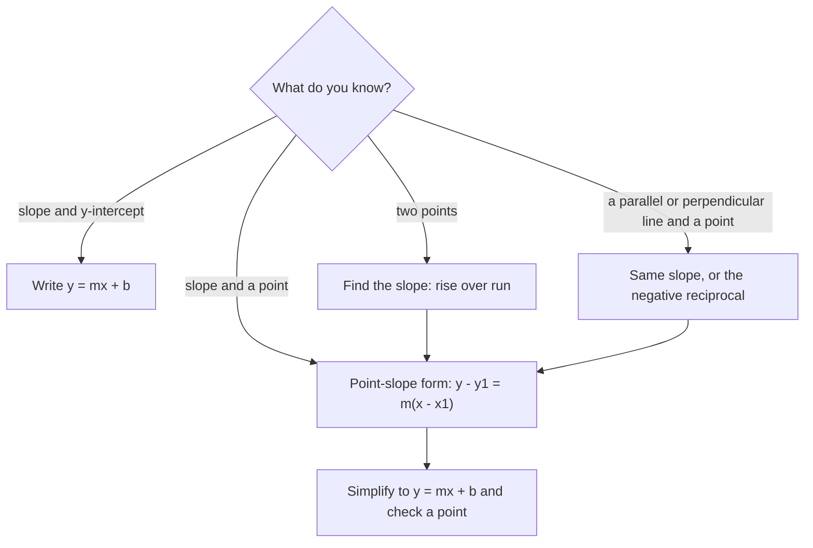

## From a line to its equation

Lesson 29 went one direction: start with an equation such as $y = \tfrac34 x - 2$ and draw its line. This honors lesson goes the other way. Given facts about a line (a point and a slope, two points, or a line it must be parallel or perpendicular to), you will write its equation. This is how a straight-line formula is built from measurements, and the lesson ends by doing exactly that.

## Point-slope form

Suppose a line has slope $m$ and passes through a known point $(x_1, y_1)$. Take any *other* point $(x, y)$ on the line. The slope between the two points is $m$, so

$$\frac{y - y_1}{x - x_1} = m.$$

Multiply both sides by $x - x_1$:

$$y - y_1 = m(x - x_1).$$

This is **point-slope form**. It is also true at $(x_1, y_1)$ itself, where both sides are 0, so it describes every point of the line. Its strength is that it uses the information you were given directly: the slope goes in front, and the point's coordinates are *subtracted* from $x$ and $y$.

### Example 1

Write an equation of the line with slope 3 through $(2, -1)$.

Point-slope form with $m = 3$, $x_1 = 2$, $y_1 = -1$:

$$y - (-1) = 3(x - 2), \quad\text{that is,}\quad y + 1 = 3(x - 2).$$

To get slope-intercept form, distribute and subtract 1: $y = 3x - 6 - 1 = 3x - 7$.

Check that the point is on it: $3(2) - 7 = -1$ ✓. Both forms describe the same line; slope-intercept form is usually the final answer because it shows the $y$-intercept.

## A line through two points

Two points determine a line. First find the slope from the two points, as in Lesson 29, then use either point in point-slope form.

### Example 2

Write an equation of the line through $(-1, 4)$ and $(3, -4)$.

Slope: $m = \dfrac{-4 - 4}{3 - (-1)} = \dfrac{-8}{4} = -2$.

Use the point $(-1, 4)$: $y - 4 = -2(x - (-1)) = -2(x + 1)$. Distribute: $y - 4 = -2x - 2$, so $y = -2x + 2$.

Check the *other* point, which the equation was not built from: $-2(3) + 2 = -4$ ✓. Using $(3, -4)$ instead gives $y + 4 = -2(x - 3)$, which simplifies to the same $y = -2x + 2$.

## Parallel lines

Parallel lines rise at the same rate, so non-vertical **parallel** lines have *equal slopes* (and different $y$-intercepts, or they would be the same line). That is why the parallel lines in the systems lesson never meet. Two vertical lines, such as $x = 1$ and $x = 4$, are also parallel, even though their slopes are undefined.

### Example 3

Write an equation of the line through $(4, 1)$ parallel to $y = \tfrac12 x + 3$.

The given line has slope $\tfrac12$, so the new line does too. Point-slope form: $y - 1 = \tfrac12(x - 4)$. Distribute: $y - 1 = \tfrac12 x - 2$, so $y = \tfrac12 x - 1$.

Same slope, different intercept ($-1$ instead of 3): parallel, as required.

## Perpendicular lines

Two lines are **perpendicular** when they meet at a right angle. For lines that are neither horizontal nor vertical, the slopes of perpendicular lines are **negative reciprocals**: flip the fraction and change its sign. If one slope is $\tfrac23$, a perpendicular slope is $-\tfrac32$. Equivalently, the product of the two slopes is $-1$: $\tfrac23 \cdot \left(-\tfrac32\right) = -1$.

*Why it's true.* Draw a slope triangle for a line: run 3, rise 2, so the slope is $\tfrac23$. Now turn the whole picture a quarter turn counterclockwise about the starting point. The line turns through a right angle, and the triangle turns with it: the run of 3 to the right becomes a rise of 3 upward, and the rise of 2 upward becomes a run of 2 to the *left*. The turned line therefore has rise 3 and run $-2$, a slope of $\tfrac{3}{-2} = -\tfrac32$.

```shape
{"polygons": [{"points": [[0, 0], [3, 0], [3, 2]], "fill": true}, {"points": [[0, 0], [0, 3], [-2, 3]], "fill": true}], "segments": [{"from": [0, 0], "to": [4.5, 3]}, {"from": [0, 0], "to": [-3, 4.5]}], "labels": [{"at": [4.9, 3.4], "text": "slope 2/3"}, {"at": [-3.3, 4.9], "text": "slope -3/2"}, {"at": [1.5, -0.4], "text": "run 3"}, {"at": [3.6, 1], "text": "rise 2"}, {"at": [0.55, 1.5], "text": "rise 3"}, {"at": [-1, 3.4], "text": "run -2"}], "rightAngles": [[[0, 0], [3, 2], [-2, 3]]], "caption": "A quarter turn swaps run and rise and changes a sign, so slope 2/3 becomes -3/2"}
```

The same argument works for any slope $\tfrac{b}{a}$: after the quarter turn, the run $a$ becomes a rise $a$ and the rise $b$ becomes a run $-b$, so the new slope is $-\tfrac{a}{b}$, and $\tfrac{b}{a} \cdot \left(-\tfrac{a}{b}\right) = -1$. (A full proof needs a little more geometry, such as showing the turned triangle really is congruent to the first; this picture shows the key idea.)

The rule leaves out one pair: a horizontal line (slope 0) and a vertical line (undefined slope) are perpendicular too, but 0 has no reciprocal.

### Example 4

Write an equation of the line through $(2, 5)$ perpendicular to $2x + 3y = 6$.

First find the given line's slope by solving for $y$: $3y = -2x + 6$, so $y = -\tfrac23 x + 2$, with slope $-\tfrac23$.

The negative reciprocal of $-\tfrac23$ is $\tfrac32$. Point-slope form: $y - 5 = \tfrac32(x - 2)$. Distribute: $y - 5 = \tfrac32 x - 3$, so $y = \tfrac32 x + 2$.

Check: $\left(-\tfrac23\right)\left(\tfrac32\right) = -1$ ✓, and $\tfrac32(2) + 2 = 5$, so $(2, 5)$ is on the line ✓.

## Which form to start from



## Linear models

When a quantity changes at a steady rate, its graph against time (or another input) is a straight line, and the equation of that line is a **linear model**. The slope is the **rate of change**, measured in output units per input unit, and the $y$-intercept is the starting value. Two measurements are enough to build the model.

### Example 5 (deriving a formula)

Water freezes at 0 °C, which is 32 °F, and boils (at sea level) at 100 °C, which is 212 °F. The Fahrenheit and Celsius scales are related linearly. Find the formula for $F$ in terms of $C$.

Treat the facts as two points $(C, F)$: $(0, 32)$ and $(100, 212)$. The slope is

$$m = \frac{212 - 32}{100 - 0} = \frac{180}{100} = \frac95,$$

so each degree Celsius is $\tfrac95$ of a degree Fahrenheit. The point $(0, 32)$ is the intercept, so $F = \tfrac95 C + 32$. That is the formula you evaluated in Lesson 23, now built from two facts.

A nice consequence: where do the scales agree? Set $F = C$: $C = \tfrac95 C + 32$, so $-\tfrac45 C = 32$ and $C = -40$. So $-40$ °C is the same temperature as $-40$ °F.

### Example 6 (a candle)

A candle burns at a steady rate. Two hours after it is lit it is 19 cm tall; six hours after, it is 9 cm tall. Write a model for its height $h$ after $t$ hours, and say when it burns out.

Slope (rate of change): $m = \dfrac{9 - 19}{6 - 2} = \dfrac{-10}{4} = -2.5$ cm per hour; the negative sign means the height goes down.

Point-slope form with $(2, 19)$: $h - 19 = -2.5(t - 2)$, so $h = -2.5t + 5 + 19 = -2.5t + 24$.

The intercept 24 means the candle was 24 cm tall when lit. It burns out when $h = 0$: $-2.5t + 24 = 0$, so $t = 9.6$ hours.

```plot
{"x": [0, 13], "y": [0, 26], "xLabel": "t (hours)", "yLabel": "h (cm)", "functions": [{"f": "-2.5x + 24", "from": 0, "to": 9.6}], "points": [{"at": [2, 19], "label": "(2, 19)"}, {"at": [6, 9], "label": "(6, 9)"}, {"at": [9.6, 0], "label": "(9.6, 0)"}], "caption": "The candle model: slope -2.5 cm per hour, starting height 24 cm"}
```

A model is a simplification. "A steady rate" is an assumption: a real candle may burn a little unevenly, and the model means nothing for $t > 9.6$, where it would predict a negative height. Use a linear model only within the range where its assumptions are reasonable.

## Common mistakes

- *Sign errors in point-slope form*: through $(-1, 4)$ the equation is $y - 4 = m(x + 1)$, because $x - (-1) = x + 1$.
- *Using a reciprocal without the sign change*, or the sign change without the reciprocal: perpendicular to slope 4 is $-\tfrac14$, not $\tfrac14$ or $-4$.
- *Reading the slope from the wrong form*: the slope of $2x + 3y = 6$ is $-\tfrac23$, not 2. Solve for $y$ first.
- *Forgetting to distribute to both terms* when converting $y - 5 = \tfrac32(x - 2)$.
- *Checking only the point you used.* Check the other given point or the required slope too.
- *Trusting a model outside its range*, such as a negative candle height.

## Key points

- Point-slope form: $y - y_1 = m(x - x_1)$ for slope $m$ through $(x_1, y_1)$; simplify to $y = mx + b$.
- Through two points: find the slope first, then use either point.
- Parallel non-vertical lines have equal slopes; perpendicular lines (neither horizontal nor vertical) have slopes that are negative reciprocals, with product $-1$.
- A linear model's slope is a rate of change and its $y$-intercept is the starting value; two data points determine it.
- A model holds only where its assumptions hold.
